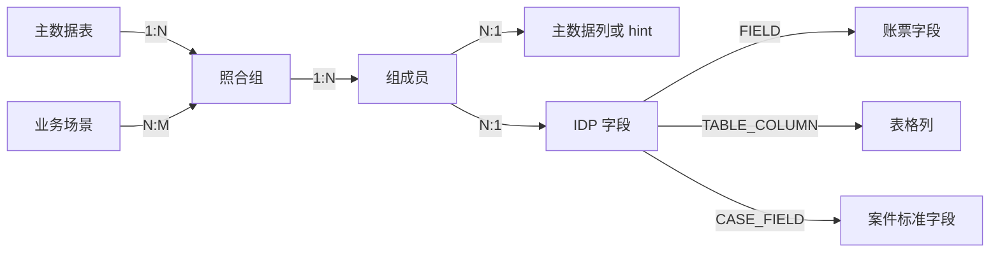
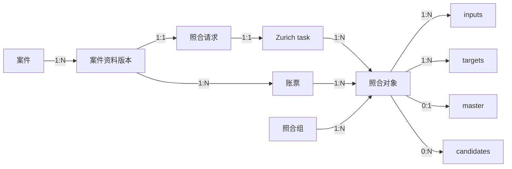
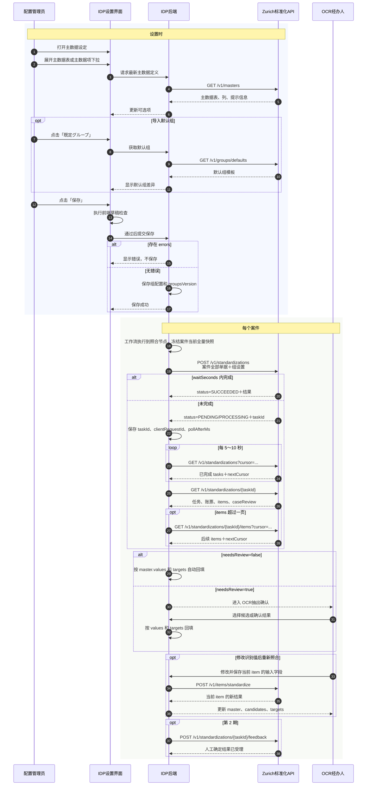
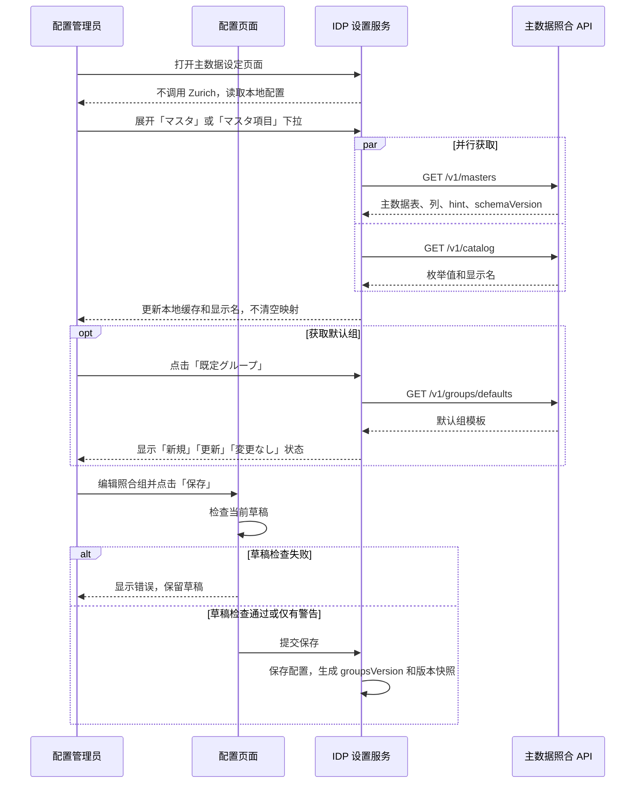
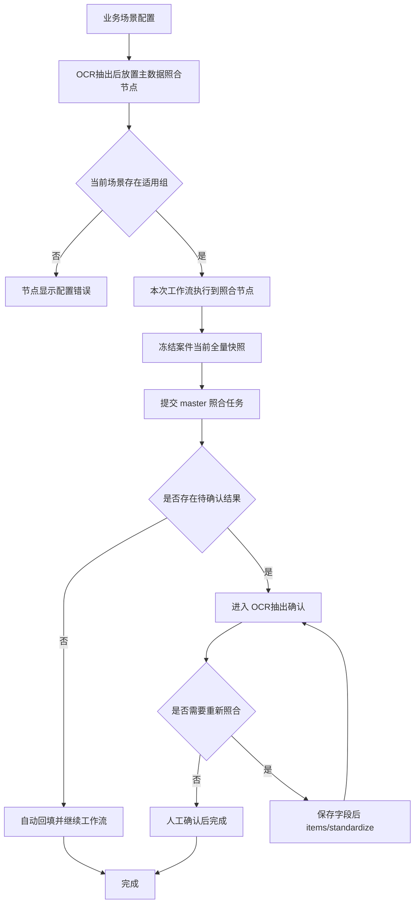
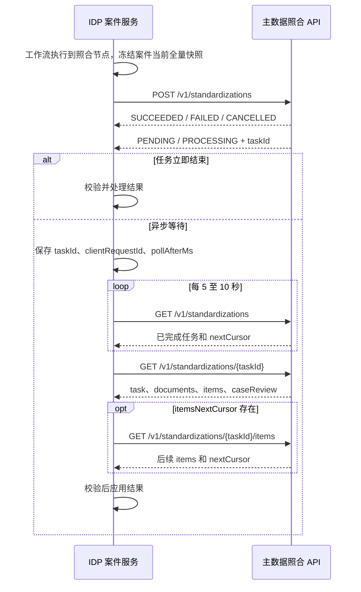
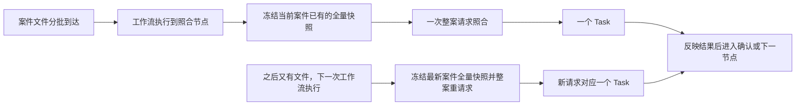
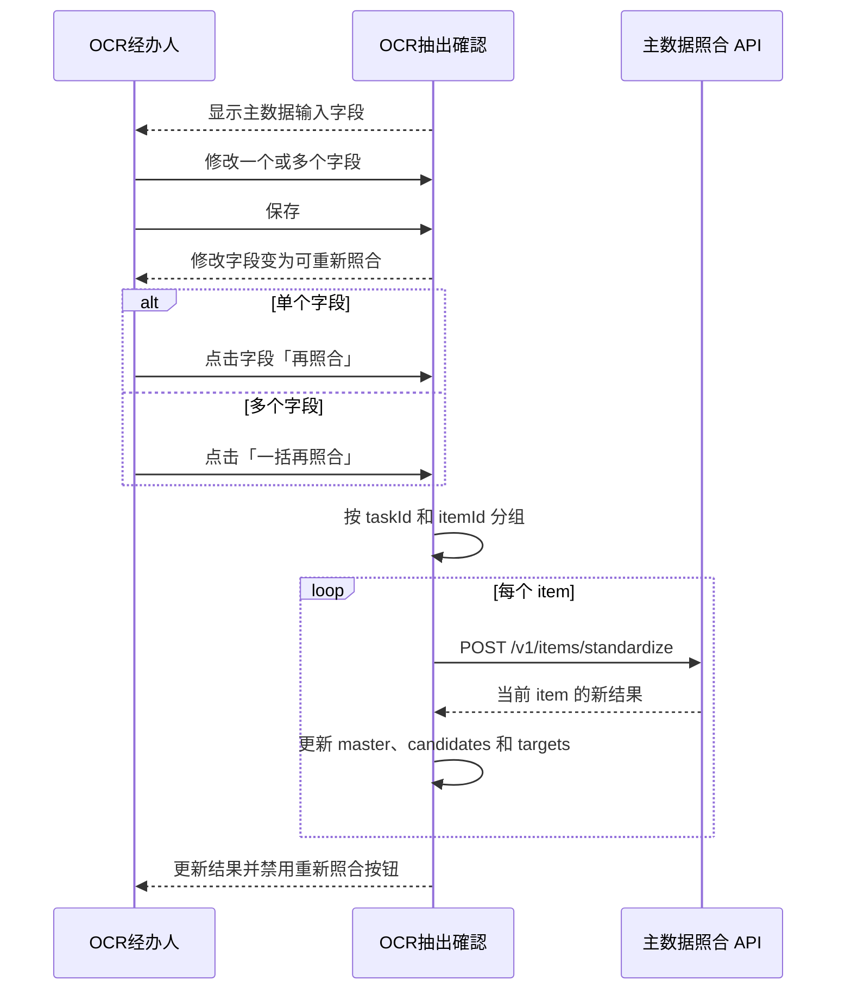

## 第 1 章｜本期范围与优先级

### 1.1 背景与目标

四期接入 Zurich 综合主数据名称标准化 API。上游已有案件集约、文件补件、OCR抽出和 OCR抽出确认任务。主数据照合按案件当前完整资料发起请求，并使用异步任务和现有 OCR抽出确认待办。

本 PRD 的正文、字段说明和流程说明使用简体中文。界面文案、API 字段值、接口返回内容和示例中的日语保留原文。

本期要完成以下结果。

- 配置管理员可以通过 Zurich 返回的主数据 schema 配置可复用的照合组。
- 业务场景管理员可以在 OCR抽出后放置「マスタ照合」节点。节点按当前业务场景自动读取适用的照合组。
- 每次工作流执行到主数据照合节点时，发送该时点案件下已有的全部账票；一次工作流执行对应一次 API 请求和一个 Task。工作流等待该 Task 结束后继续。后续工作流再次执行时仍发送当时案件的全部账票，不只发送新增文件。
- IDP 按结果中的 targets 回填无须确认的项目，将需要确认的结果送入本次案件工作流对应的 OCR抽出确认。
- 组外字段保持 OCR抽出值。
- 照合组、默认组来源、整体版本和变更履历可追溯。

### 1.2 本期范围

| 功能 | 本期说明 |
| --- | --- |
| API 接入 | 配置并测试 Zurich API 连接，读取主数据与照合组配置所需的数据 |
| 照合组配置 | 维护组、适用场景和字段映射；保存前校验，并保留版本与修改记录 |
| 工作流照合 | 在业务场景中配置「マスタ照合」节点；每次工作流执行到节点时，以当时案件的全部账票发起一次请求，一个请求对应一个 Task |
| 结果处理 | 按 `shouldWriteBack` 决定是否回写，按 `needsReview` 决定是否进入现有 OCR抽出确认 |
| 确认与重照合 | 在现有确认页面展示 API 返回的候选和说明；支持选择候选及对主数据输入字段重新照合 |
| 运行保障 | 保存请求快照和任务状态，处理异步查询、重试和失败情况 |

### 1.3 本期不做

- 不等待或判断案件“最后一批”；后续工作流再次执行时，使用最新的案件全量资料重新请求。
- 超过 50 张账票时本期拦截，不拆分多个请求或合并多个 Task。
- fallback、主数据检索、组设置建议、结果反馈和完成通知不纳入本期。

具体 API 字段和错误码以随附的 Zurich v1.2 式样书为准；本 PRD 后续章节只描述 IDP 的页面、工作流和结果处理规则，不重复列出式样书的功能清单。

### 1.4 里程碑与优先级

| 优先级 | 功能范围 |
| --- | --- |
| 本期 P0 | API 连接、照合组配置、工作流整案照合、结果回写与人工确认、字段级重新照合、任务与配置追溯 |
| 后续版本 | fallback、主数据检索、组设置建议、结果反馈、完成通知 |

### 1.5 上下游关系与依赖

| 系统或模块 | 关系 |
| --- | --- |
| API設定 → 外部API | 提供 Zurich Base URL、API Key 和连接状态 |
| 业务场景设定（「業務シーン設定」） | 提供 sceneId、账票类型和字段，供照合组匹配与节点读取 |
| OCR抽出 | 提供需要照合的案件 OCR 快照 |
| OCR抽出确认 | 承接普通 OCR 待确认项和主数据照合待确认项 |
| Zurich 标准化 API | 提供主数据 schema、默认组、组校验、案件标准化和字段重新照合 |

接口基准为 Zurich 综合主数据名称标准化 API v1.2。配置期使用 GET /v1/masters、GET /v1/catalog和 GET /v1/groups/defaults。执行期使用 POST /v1/standardizations、GET /v1/standardizations、GET /v1/standardizations/{taskId}、GET /v1/standardizations/{taskId}/items 和 POST /v1/items/standardize。

接口的阶段、调用时机、同步性和字段定义统一放在分模块 API 与字段中。

## 第 2 章｜用户故事与旅程

### 2.1 故事地图

| 使用场景 | 用户要完成的事 | 对应需求 | 版本 | 功能模块 |
| --- | --- | --- | --- | --- |
| 接入 Zurich | 配置地址、认证和 API Key，并确认连接可用 | P-01、N-01 | 本期 | API连接 |
| 准备主数据 | 同步主数据定义和显示名，导入默认组 | P-03、S-07 | 本期 | マスタ与照合组配置 |
| 配置照合组 | 选择业务场景、主数据和照合字段并保存 | S-01～S-06、S-10 | 本期 | マスタ与照合组配置 |
| 配置业务场景 | 在 OCR抽出后加入「マスタ照合」节点 | P-13～P-15 | 本期 | 业务场景与案件照合 |
| 执行案件照合 | 提交案件全量资料、等待 Task 结果并送入确认入口 | Q-01～Q-07、B-01～B-05 | 本期 | 业务场景与案件照合 |
| 核对识别结果 | 查看 master、候选项和 OCR 原值，并完成确认 | C-01、C-02、C-05 | 本期 | OCR抽出确认与结果应用 |
| 修改后重新照合 | 修改并保存一个或多个主数据输入字段，再重新照合当前 item | C-03、P-21 | 本期 | OCR抽出确认与结果应用 |

### 2.2 原子用户故事

#### US-01 配置 Zurich 连接

- 作为：**API管理员**
- 我想要：维护 Zurich 标准化 API 的地址、认证方式和 API Key
- 从而：让主数据配置和业务批次可以复用同一个受保护的连接
- 对应需求：P-01、N-01
- 前置条件：当前用户拥有 API 设定权限
- 验收标准：
  - Given 尚未配置 Zurich 连接，When 填写连接类型、认证方式、Base URL、API Key 并保存，Then 连接信息保存成功，页面只显示脱敏后的 API Key
  - Given 连接已经保存但尚未测试，When 点击连接测试，Then 页面显示有効或無効，并保留已经填写的配置
  - Given 已保存 API Key，When 再次编辑连接且不输入新的 Key，Then 原 API Key 保持有效

#### US-02 同步主数据定义

- 作为：**マスタ管理员**
- 我想要：同步 Zurich 的主数据定义、列、hint 和显示名
- 从而：配置照合组时可以使用最新的主数据项目和名称
- 对应需求：P-03
- 前置条件：Zurich 连接已经保存
- 验收标准：
  - Given 已存在可用的 Zurich 连接，When 展开主数据表或主数据项下拉，Then 页面分别获取 masters 和 catalog，并刷新后续下拉选项
  - Given 已有照合组，When 下拉刷新成功，Then 已有组配置和字段映射保持不变
  - Given masters 或 catalog 中一个接口失败，When 同步结束，Then 失败部分保留上一次成功的数据，另一部分正常刷新

#### US-03 导入默认组

- 作为：**マスタ管理员**
- 我想要：获取 Zurich 的默认照合组并查看差异
- 从而：快速建立初始组配置，同时保留本地确认过的适用场景
- 对应需求：S-07
- 前置条件：Zurich 连接已经保存
- 验收标准：
  - Given 尚未导入默认组，When 点击既定组，Then 显示新規、更新、変更なし和差异数量
  - Given 默认组存在新規或更新，When 点击更新，Then 新規和更新组进入页面草稿，更新组保留本地 groupId 和适用场景，补齐后保存才入库
  - Given 默认组没有差异，When 获取完成，Then 不修改现有组，只提示没有变更

#### US-04 配置并保存照合组

- 作为：**配置管理员**
- 我想要：维护组名、适用场景、主数据和照合字段
- 从而：让指定业务场景下的账票可以按同一主数据表完成照合和回填
- 对应需求：S-01～S-06、S-10
- 前置条件：主数据定义已经同步，业务场景和账票字段可用
- 验收标准：
  - Given 主数据列允许作为输入，When 配置一个或多个主输入，Then 所有主输入属于同一账票类型，表格主输入属于同一张表
  - Given 主数据列只能回填或当前行选择反映のみ，When 保存组，Then 该行不参与判断，只在采用主数据行后回填
  - Given 组配置存在阻断错误，When 点击保存，Then 显示对应组和字段错误，不保存新版本
  - Given 组配置只有允许保存的警告，When 校验完成，Then 可以保存并生成新的 groupsVersion 和版本快照

#### US-05 管理照合组和变更履历

- 作为：**配置管理员**
- 我想要：重命名、删除照合组并查看变更履历
- 从而：维护照合组并查看必要的变更时间和操作者
- 对应需求：S-06、P-05、P-12
- 前置条件：当前组已经存在
- 验收标准：
  - Given 修改组名、主数据、适用场景或照合字段，When 保存成功，Then 履历展示创建者和登记时间，并在更新记录中展示更新者和更新时间
  - Given 删除一个组，When 操作完成，Then 该组从列表移除，其他组的配置和版本不受影响

#### US-06 配置主数据照合节点并执行案件照合

- 作为：**业务场景管理员**
- 我想要：在 OCR抽出后放置主数据照合节点，并在工作流每次执行到该节点时按案件已有全部文件执行整案照合
- 从而：业务场景可以自动读取适用组，并把需要确认的结果送入现有 OCR抽出确认
- 对应需求：P-13～P-17、Q-01～Q-07、B-01～B-05
- 前置条件：业务场景已经关联账票，照合组已经保存并通过校验
- 验收标准：
  - Given 当前业务场景已经选择，When 在主数据照合节点打开配置，Then 节点读取该场景适用的组，不展示手动组选择
  - Given 工作流执行到主数据照合节点且 OCR、数据映射完成，When 节点开始执行，Then IDP 一次提交当时案件下已有的全部单据并获取一个 Task 的结果
  - Given 后续工作流再次执行到照合节点，When 案件文件或照合输入已变化，Then IDP 取消未结束的旧 Task 并以最新全量案件资料重新请求
  - Given 案件账票超过 50 张，When 执行主数据照合节点，Then IDP 不拆分请求并以超限失败结束

#### US-07 核对主数据照合结果

- 作为：**OCR经办人**
- 我想要：查看主数据推荐行、候选、OCR 原值和确认理由
- 从而：确认自动采用结果，或为需要判断的字段选择正确的 master
- 对应需求：C-01、C-02、C-05
- 前置条件：本次工作流执行已经取得主数据照合结果
- 验收标准：
  - Given 一个 item 返回 needsReview=false，When 打开 OCR抽出确认，Then 页面显示自动采用结果、主数据和候选
  - Given 一个 item 返回 needsReview=true，When 打开字段详情，Then 页面显示确认理由、候选、照合依据以及有值时的名称提案或追加要素
  - Given 操作员选择其他候选，When 选择完成，Then 同一 item 的全部 OUTPUT 和 INPUT_OUTPUT 字段按所选行的 values 和 targets 更新
  - Given 仍有待确认字段，When 尝试完成 OCR抽出确认，Then 系统阻止办结并显示剩余待确认数量

#### US-08 修改识别值并重新照合

- 作为：**OCR经办人**
- 我想要：修改一个或多个主数据输入字段，并在保存后重新照合
- 从而：只修正当前 item 的主数据照合结果，不影响同一请求的其他 item
- 对应需求：C-03、P-21
- 前置条件：当前 item 已经取得主数据照合结果
- 验收标准：
  - Given 字段属于主数据输入（INPUT 或 INPUT_OUTPUT），When 打开 OCR抽出确认，Then 该字段显示重新照合按钮；OUTPUT 字段不显示重新照合按钮
  - Given 操作员修改识别值但尚未保存，When 查看重新照合按钮，Then 按钮禁用，系统不调用接口
  - Given 操作员修改并保存一个或多个主数据输入字段，When 保存成功，Then 对应字段的重新照合按钮变为可用，并可按单个或批量执行
  - Given 操作员选中多个字段并点击批量重新照合，When 选中的字段属于同一 item，Then 系统用一个 POST /v1/items/standardize 请求提交这些 inputs
  - Given 选中的字段属于不同 item，When 点击批量重新照合，Then 系统按 item 分别提交，其他 item 保持不变
  - Given 字段已经执行重新照合后再次修改，When 尚未重新保存，Then 该字段重新照合按钮再次禁用

### 2.3 现状旅程

| 阶段 | 现在的做法 | 主要问题 | 本期变化 |
| --- | --- | --- | --- |
| 连接 API | 手工填写地址和密钥 | Key 暴露风险，连接是否可用不直观 | 保存后脱敏显示，并提供独立连接测试 |
| 配置主数据 | 依赖旧主数据规则维护组 | 配置项多，字段容易选错 | 字段来自 Zurich schema，保存前统一校验 |
| 执行案件照合 | 案件分批到达、照合任务状态难判断 | Task 只代表本次请求，不能代表案件资料已经齐全 | 工作流每执行一次就发起一次整案请求，Task 只表示该次工作流调用的结果；后续工作流再次执行时使用最新全案文件重请求 |
| 核对结果 | OCR 原值和多个候选混在一起 | 不清楚哪个是推荐行、候选或 OCR 原值 | 在候选下拉中区分推荐与候补，字段保留 OCR 原值供核对 |
| 修改结果 | 修改后重新执行整组照合 | 影响范围大，等待时间长 | 字段保存后可单个或批量重新照合当前 item |

### 2.4 目标旅程

| 阶段 | 角色 | 动作 | 结果 |
| --- | --- | --- | --- |
| 1 | API管理员 | 配置并测试 Zurich 连接 | 连接可用于主数据配置和照合执行 |
| 2 | マスタ管理员 | 展开下拉获取最新主数据，按需导入默认组草稿 | 主数据定义、显示名和默认组可用 |
| 3 | 配置管理员 | 创建照合组，选择适用场景、主数据和字段 | 组校验通过并保存 |
| 4 | 业务场景管理员 | 在 OCR抽出后放置「マスタ照合」节点 | 节点按 sceneId 自动读取适用组 |
| 5 | IDP | 工作流执行到照合节点且 OCR、数据映射完成后，按该时点案件已有全部文件整案提交并轮询结果 | 一个案件快照对应一个 Task；超 50 张拦截 |
| 6 | IDP | 根据 `needsReview` 分流 | 自动采用结果回填，其他结果进入确认 |
| 7 | OCR经办人 | 核对结果、改选候选或修改主数据输入字段并重新照合 | 当前 item 得到最终采用结果 |
| 8 | IDP | 保存采用记录并更新本次案件结果 | OCR抽出确认完成，工作流继续 |

## 第 3 章｜术语、数据结构与权限

### 3.1 术语与词汇表

| 中文 | 日语或界面 | 定义 |
| --- | --- | --- |
| 主数据 | マスタデータ | Zurich 管理的数据表和业务记录。IDP 只读取定义和执行照合，不维护业务记录 |
| 照合组 | 照合グループ | 一组主数据与 IDP 字段的映射设置，包含一个主数据表、适用场景和照合字段 |
| 主数据表 | マスタ | 一个照合组使用的一个 Zurich 主数据 schema，例如 DISEASE、DRUG |
| 主数据列 | マスタ列 | Zurich `columns[]` 中的列，包含 `inputRole` 和 `writable` |
| 提示信息 | ヒント | Zurich `hints[]` 中的补充判断信息，只能用于 INPUT |
| 照合方式 | 照合方式 | 组成员使用 INPUT、OUTPUT 或 INPUT_OUTPUT |
| 主输入 | 主入力 | `inputRole=PRIMARY` 的组输入 |
| 辅助输入 | 補助入力 | 除主输入外参与判断的主数据列或 hint |
| 回填 | 反映 | IDP 按 item 的 `targets` 写入主数据值 |
| 适用场景 | 適用シーン | 照合组生效的业务场景。节点按当前 `sceneId` 匹配 |
| 案件资料版本 | 案件快照 | IDP 提交给 Zurich 的案件全量资料及其版本 |
| Zurich 任务 | taskId | 一次受理的 Zurich 标准化请求对应的任务；案件资料变化后可产生新 Task |
| 照合对象 | item | Zurich 返回的一个标准化对象 |
| 候选 | candidates | 包含采用行在内的主数据候选，默认最多 5 条 |
| 组整体版本 | groupsVersion | 全部照合组的一次保存快照版本 |
| 默认组 | 既定グループ | Zurich 返回的推荐组模板 |
| 兜底照合 | FALLBACK | Zurich 对未配置组账票生成的临时照合结果 |

### 3.2 模块与对象关系

| 模块 | 负责内容 | 主要入口 |
| --- | --- | --- |
| API连接 | Zurich 连接、认证和连接状态 | API設定 → 外部API |
| 外部照合组配置 | 主数据下拉、组配置、默认组、校验和版本 | 外部マスタデータ |
| 业务场景与案件照合 | 节点配置、整案请求、轮询和结果应用 | 業務シーン設定 |
| OCR抽出确认与结果应用 | 候选确认、字段回填和采用记录 | OCR抽出確認 |

| 关系 | 基数 | 规则 |
| --- | --- | --- |
| 主数据表与组 | 1:N | 一个组只能选择一个主数据表，同一主数据表可以创建多个组 |
| 组与适用场景 | N:M | 一个组可以适用多个场景，一个场景可以命中多个组 |
| 组与成员 | 1:N | 一个组包含一个或多个组成员 |
| 成员与主数据项目 | N:1 | 每个成员选择一个主数据列或一个 hint |
| 普通字段／表格列与照合组 | N:1 | 同一账票字段或表格列只能配置在一个照合组中 |
| 案件标准字段与回填目标 | 1:N | 多个组回填同一案件标准字段时允许保存并显示警告，运行时冲突转人工 |

### 3.3 主数据、组与字段结构

| 对象 | 关系 | 规则 |
| --- | --- | --- |
| 主数据表与列 | 1:N | 列来自 Zurich `columns[]` |
| 主数据表与 hint | 1:N | hint 来自 Zurich `hints[]`，只用于补充判断 |
| 主数据行与列值 | 1:N | `values` 包含该主数据行的全部列值 |
| 组成员与 IDP 字段 | N:1 | 每个成员选择一个 IDP 字段和一个主数据项目 |
| 组成员与照合方式 | N:1 | 每个成员选择一个 `INPUT`、`OUTPUT` 或 `INPUT_OUTPUT` |

IDP 字段有三种类型。

| IDP 字段类型 | 含义 | 结果位置 |
| --- | --- | --- |
| FIELD | 单据普通字段 | `FIELD` |
| TABLE_COLUMN | 表格整列配置 | 每个表格行生成 `TABLE_CELL` 位置 |
| CASE_FIELD | 案件级标准字段 | `CASE_FIELD` |

主数据侧有两种可选项目。

| 类型 | 用途 | 可用照合方式 |
| --- | --- | --- |
| 主数据列 | 可作为输入或回填目标 | 受 `inputRole`、`writable` 和组配置限制 |
| hint | 只作为补充判断信息 | 只能使用 `INPUT` |

hint 会进入 item 的 `inputs[]`，不会进入 `targets`，因此不能回填。

组结构约束：

- 同一组内，同一主数据列或 hint 只能出现一次。
- 同一个单据普通字段或表格列只能放入一个组，用于输入、回填或读写均适用。
- 一个组只能配置一种 IDP 字段类型：普通字段、表格字段、案件标准字段三选一，不能混配。
- 同一个案件标准字段可以作为多个组的输入，但只能由一个组作为回填目标。
- `INPUT` 只参与判断，`OUTPUT` 只回填，`INPUT_OUTPUT` 同时参与判断和回填。

### 3.4 案件、请求、任务与结果结构

| 关系 | 基数 | 规则 |
| --- | --- | --- |
| 案件与案件资料版本 | 1:N | 案件照合输入变化后创建新版本 |
| 案件资料版本与账票 | 1:N | 每个版本包含本次照合时的全量案件账票 |
| 案件版本与请求 | 1:1 | 每次全量案件快照通过一次请求提交 |
| 请求与 task | 1:1 | 一次受理的请求返回一个 taskId |
| task 与组 | N:M | task 保存本次提交使用的组设置快照 |
| task 与 item | 1:N | 一个 task 返回多个照合对象 |
| 组与 item | 1:N | 一个组可以生成 0 个、1 个或多个 item |
| item 与 inputs | 1:N | 本次参与判断的输入可以有多个 |
| item 与 targets | 1:N | 本次回填目标可以有多个 |
| item 与 master | 1:0..1 | 无法确定主数据行时为 null |
| item 与 candidates | 1:N | 包含采用行，默认最多 5 条 |

`itemId` 在 task 内唯一，列表顺序没有业务意义。`FALLBACK` 和 `ADHOC` 是特殊 groupId，不对应 IDP 保存的普通组。

### 3.5 数据结构常见问题

| 问题 | 结论 |
| --- | --- |
| 一个主数据表能否配置多个组？ | 可以 |
| 一个组能否配置多个主数据表？ | 不可以 |
| 同一个场景能否命中多个组？ | 可以 |
| 不同组能否复用同一主数据列或 hint？ | 可以 |
| 同一组内能否重复使用同一主数据列或 hint？ | 不可以 |
| 一个 item 能否回填多个 IDP 字段？ | 可以 |
| 一个组是否有独立版本？ | 没有，使用整体 groupsVersion |
| hint 是否产生回填目标？ | 不会 |
| 已运行任务是否受组配置修改影响？ | 不会，任务使用提交时快照 |

### 3.6 权限

| 角色 | 配置端 | 工作流节点 | OCR抽出确认 |
| --- | --- | --- | --- |
| 配置管理员 | 查看、编辑、保存、同步、查看履历 | 查看 | 查看 |
| 业务场景管理员 | 查看 | 添加、删除和连接节点 | 查看 |
| OCR经办人 | 无 | 无 | 确认、修正和重新照合 |

## 第 4 章｜API 契约

字段名称、类型和必填性以 [综合主数据名称标准化 API 规格书 v1.2 中文版](/主数据API/综合主数据名称标准化API规格书_v1.2_zh-CN.md) 为准。本章只列 IDP 实际发送或使用的字段，不新增 API 字段。

标记说明：`必填` 和 `条件必填` 取自式样书；`可选` 不表示 IDP 不发送；`IDP发送` 只说明实现策略。

### 4.1 API 调用总览

| 模块 | 接口 | IDP阶段 | 调用时机 | 同步性 |
| --- | --- | --- | --- | --- |
| 配置 | `GET /v1/masters` | 本期 | 展开「マスタ」或「マスタ項目」下拉 | 同步 |
| 配置 | `GET /v1/catalog` | 本期 | 展开「マスタ」或「マスタ項目」下拉 | 同步 |
| 配置 | `GET /v1/groups/defaults` | 本期 | 点击「既定グループ」 | 同步 |
| 照合执行 | `POST /v1/standardizations` | 本期 | 每次工作流执行到节点时一次提交案件当前全部文件 | 异步，可由 `waitSeconds` 同步返回 |
| 照合执行 | `GET /v1/standardizations` | 本期 | 轮询已完成任务 | 同步 |
| 照合执行 | `GET /v1/standardizations/{taskId}` | 本期 | 任务进入终态或查询状态 | 同步 |
| 照合执行 | `GET /v1/standardizations/{taskId}/items` | 本期 | `itemsNextCursor` 存在 | 同步 |
| 照合执行 | `POST /v1/standardizations/{taskId}/cancel` | 本期 | 业务明确中止任务 | 同步 |
| 人工确认 | `POST /v1/items/standardize` | 本期 | 修改识别值并保存成功后 | 同步 |
| 运维 | `GET /v1/health` | 按需 | 连接排障或运行状态确认 | 同步 |
| 后续 | `POST /v1/standardizations/{taskId}/feedback` | 第 5 期 | 本期不调用 | 同步 |
| 后续 | `POST /v1/masters/search` | 第 5 期 | 本期不调用 | 同步 |
| 后续 | `POST /v1/groups/suggest` | 第 5 期 | 本期不调用 | 同步 |

完成通知 `callbackUrl` 在第 5 期接入，本期使用轮询。`GET /v1/health` 不进入本期页面流程。

#### 总览时序图

### 4.2 公共响应与对象

#### 公共响应 `code / msg / requestId / warnings / data`

| 字段 | 类型 | 含义 |
| --- | --- | --- |
| `code` | Integer | 成功为 0，失败时与 HTTP 状态码一致 |
| `msg` | String | 错误或提示说明 |
| `requestId` | String | 排障编号 |
| `warnings` | Object[] | 响应警告。公共响应和单据警告含 `code`、`message`；任务级 `data.warnings[]` 在组相关警告时还含 `groupId` |
| `data` | Object | 当前接口业务数据 |

#### 公共对象

- `Group`：`groupId`必填、`label`可选、`masterTable`必填、`members`必填。
- `Member`：`column` 或 `hint`条件必填、`mode`必填、`field`必填。
- `Member.field`：`type`必填，`documentTypeId`、`fieldName`、`tableName`、`columnName`按字段类型条件必填。
- `Document`：`documentId`、`documentTypeId`、`format`必填；`result` 或 `fields`按格式条件必填。
- `Item`：`itemId`、`groupId`、`masterTable`、`source`、`inputs`、`targets`、`status`、`needsReview` 为核心字段；`master`、`proposedName`、`confidence`、`candidates`、`reviewReasons`、`notices`、`reason`、`notesForAssessor`、`alternatives`、`splitItems`、`webEvidence` 按结果使用。
- `caseReview` 是任务级字段，位于任务结果的 `data.caseReview`，不属于单个 `Item`。

#### 字段归属

| 名称 | 来源 | 含义 |
| --- | --- | --- |
| `sceneId` | Zurich 请求字段，值来自 IDP 业务场景 | 当前业务场景 ID |
| `groupsVersion` | IDP 生成，作为 Zurich 请求字段发送 | 组配置整体版本。Zurich 在 `data.versions.groups` 中回显 |
| `sourceDefaultGroupId` | IDP 内部字段 | IDP 保存的 Zurich 默认组来源 ID，不发送给 Zurich |
| `masterStatus`、`masterResult` | IDP 工作流节点输出变量 | 节点处理状态和业务结果，不是 Zurich 返回字段 |
| 组快照、组变更履历 | IDP 内部数据 | 用于版本留痕和审计，不是 Zurich 返回字段 |

### 4.3 配置接口

#### `GET /v1/masters`

调用条件：展开「マスタ」或「マスタ項目」下拉。请求无业务参数。

| IDP读取并使用的返回字段（式样书字段子集） | 类型 | 必填性 | 用途 |
| --- | --- | --- | --- |
| `data.schemaVersion` | String | 返回 | 判断 schema 是否更新 |
| `data.masterTables[]` | Object[] | 返回 | 主数据表列表 |
| `data.masterTables[].masterTable` | String | 返回 | 组引用的主数据表键 |
| `data.masterTables[].label` | String | 返回 | 主数据表显示名 |
| `data.masterTables[].enabled` | Boolean | 返回 | 是否可用于新配置 |
| `data.masterTables[].deprecated` | Boolean | 返回 | 废弃标记，本期不使用 |
| `data.masterTables[].columns[]` | Object[] | 返回 | 该主数据表的列定义 |
| `data.masterTables[].columns[].column` | String | 返回 | 列键 |
| `data.masterTables[].columns[].label` | String | 返回 | 列显示名 |
| `data.masterTables[].columns[].inputRole` | String | 返回 | `PRIMARY`、`SUPPORTING`、`NONE` |
| `data.masterTables[].columns[].writable` | Boolean | 返回 | 是否可回填 |
| `data.masterTables[].columns[].deprecated` | Boolean | 返回 | 废弃标记，本期不使用 |
| `data.masterTables[].hints[]` | Object[] | 返回 | 该主数据表的 hint 定义 |
| `data.masterTables[].hints[].hint` | String | 返回 | hint 键 |
| `data.masterTables[].hints[].label` | String | 返回 | hint 显示名 |
| `data.masterTables[].hints[].deprecated` | Boolean | 返回 | 废弃标记，本期不使用 |

#### `GET /v1/catalog`

调用条件：展开「マスタ」或「マスタ項目」下拉。请求无业务参数。

| IDP读取并使用的返回字段（式样书字段子集） | 类型 | 必填性 | 用途 |
| --- | --- | --- | --- |
| `data.catalogVersion` | String | 返回 | 枚举版本 |
| `data.enums` | Object | 返回 | 枚举值和显示名 |

#### `GET /v1/groups/defaults`

调用条件：点击「既定グループ」。请求无业务参数。

| IDP读取并使用的返回字段（式样书字段子集） | 类型 | 必填性 | 用途 |
| --- | --- | --- | --- |
| `data.version` | String | 返回 | 默认组版本 |
| `data.groups[]` | Object[] | 返回 | 默认组模板 |
| `data.groups[].groupId` | String | 返回 | Zurich 默认组 ID |
| `data.groups[].label` | String | 返回 | 组名 |
| `data.groups[].masterTable` | String | 返回 | 主数据表键 |
| `data.groups[].members[]` | Object[] | 返回 | 组成员 |

#### 组配置校验

保存时由 IDP 前端检查照合组草稿，通过后提交保存。配置服务负责保存和版本记录，不重复执行前端控件的业务校验。四期配置流程不调用 Zurich 的 `POST /v1/groups/validate`。

### 4.4 照合执行接口

#### `POST /v1/standardizations`

调用条件：工作流执行到主数据照合节点，且本次需提交的案件文件已完成 OCR 抽出和数据映射。

| 请求字段 | 类型 | 必填性 | IDP发送策略 |
| --- | --- | --- | --- |
| `clientRequestId` | String | 可选 | 每次请求发送，用于幂等 |
| `caseNo` | String | 必填 | IDP 案件编号 |
| `sceneId` | String | 可选 | 当前业务场景 ID |
| `groups` | Object[] | 可选 | IDP 有有效组时发送 |
| `groupsVersion` | String | 可选 | 发送当前保存版本 |
| `waitSeconds` | Integer | 可选 | IDP 设置同步等待秒数 |
| `options.fallback` | Boolean | 可选 | v1.2 默认 `false`，fallback 为第 2 期功能；本期不发送 `true`，业务场景节点不提供此开关 |
| `options.maxCandidates` | Integer | 可选 | 默认值 5，可设置范围 1 至 10，候选数包含 `isMaster=true` 的主数据行 |
| `caseResult` | Object | 可选 | 案件标准字段容器，组使用 `CASE_FIELD` 时发送 |
| `caseResult.fields[]` | Object[] | 条件必填 | 标准字段数组，`CASE_FIELD.fieldName` 与其中 `name` 对应 |
| `caseResult.fields[].name` | String | 条件必填 | 案件标准字段名 |
| `caseResult.fields[].value` | JSON value | 条件必填 | 案件标准字段值，按 IDP 输出原样发送 |
| `documents` | Object[] | 必填 | 当前案件快照中的全部账票 |
| `documents[].documentId` | String | 必填 | 逻辑文件 ID |
| `documents[].documentTypeId` | String | 必填 | 账票类别 ID |
| `documents[].format` | String | 必填 | IDP 使用 `IDP_RESULT_JSON` |
| `documents[].result` | Object | 条件必填 | `format=IDP_RESULT_JSON` 时必填 |

`FIELDS` 和 `documents[].fields` 属于式样书能力，本期 IDP 不发送。

本接口不传输原始文件的二进制内容。`documents[].result` 发送每张账票完整的 OCR RESULT JSON，包含 `fields`、`table_list` 和 OCR 状态信息。每次工作流执行到照合节点时，请求发送该时点案件下已有的全部账票；组只决定哪些账票项目参与照合，不用于裁剪 `documents[].result`。

IDP读取并使用的返回字段（式样书字段子集）：`data.taskId`、`data.clientRequestId`、`data.caseNo`、`data.status`、`data.queue`、`data.progress`、`data.pollAfterMs`、`data.versions`、`data.summary`、`data.warnings`、`data.failure`、`data.documents`、`data.items`、`data.itemsNextCursor`、`data.caseReview`。

#### `GET /v1/standardizations`

| 查询参数 | 类型 | 必填性 | IDP发送策略 |
| --- | --- | --- | --- |
| `finishedAfter` | Long | 条件必填 | 首次查询发送 |
| `cursor` | String | 条件必填 | 第二次起发送上次 `nextCursor` |
| `limit` | Integer | 可选 | IDP 使用 100 |

IDP读取并使用的返回字段（式样书字段子集）：`data.tasks[].taskId`、`data.tasks[].clientRequestId`、`data.tasks[].caseNo`、`data.tasks[].status`、`data.tasks[].completedAt`、`data.nextCursor`。

#### `GET /v1/standardizations/{taskId}`

| Path/查询参数 | 类型 | 必填性 | IDP使用方式 |
| --- | --- | --- | --- |
| `taskId` | String | 必填 | Path 参数 |
| `includeItems` | Boolean | 可选 | IDP 发送 `true` |

IDP读取并使用的返回字段（式样书字段子集）：完整 `data` 任务对象，使用 `data.status`、`data.documents`、`data.items`、`data.itemsNextCursor`、`data.caseReview`、`data.warnings` 驱动流程和展示。

#### `GET /v1/standardizations/{taskId}/items`

| Path/查询参数 | 类型 | 必填性 | IDP使用方式 |
| --- | --- | --- | --- |
| `taskId` | String | 必填 | Path 参数 |
| `cursor` | String | 可选 | 存在后续页时发送 |
| `limit` | Integer | 可选 | IDP 使用 100 |

IDP读取并使用的返回字段（式样书字段子集）：`data.items[]`、`data.nextCursor`。

#### `POST /v1/standardizations/{taskId}/cancel`

请求只有 Path 参数 `taskId`，无请求体。IDP读取并使用的返回字段（式样书字段子集）：`data.status`。

### 4.5 人工确认与重新照合接口

#### `POST /v1/items/standardize`

| 请求字段 | 类型 | 必填性 | IDP发送策略 |
| --- | --- | --- | --- |
| `clientRequestId` | String | 可选 | IDP 发送 |
| `caseNo` | String | 可选 | IDP 发送用于审计 |
| `ref` | Object | 可选 | 原任务与 item 的引用容器 |
| `ref.taskId` | String | 条件必填 | 指定 `ref` 时发送 |
| `ref.itemId` | String | 条件必填 | 指定 `ref` 时发送 |
| `masterTable` | String | 必填 | 当前 item 的主数据表 |
| `inputs[]` | Object[] | 必填 | 修改后的输入 |
| `inputs[].column` | String | 条件必填 | 与 `hint` 二选一 |
| `inputs[].hint` | String | 条件必填 | 与 `column` 二选一 |
| `inputs[].value` | String | 必填 | 修改后的值 |
| `targets` | Object | 可选 | IDP 有明确 targets 时发送 |
| `options.timeoutSeconds` | Integer | 可选 | Zurich 重新照合处理时限，5～30 秒，默认 30 秒 |

IDP读取并使用的返回字段（式样书字段子集）：`data.itemId`、`data.groupId`、`data.masterTable`、`data.source`、`data.inputs`、`data.targets`、`data.status`、`data.needsReview`、`data.master`、`data.proposedName`、`data.candidates`、`data.reviewReasons`、`data.notices`、`data.reason`、`data.notesForAssessor`、`data.alternatives`、`data.splitItems`、`data.ref`。

该接口不发送文件、`documents` 或完整 OCR 结果。它只发送原任务引用、主数据表和修改过的输入字段。接口以 item 为执行单位，同一 item 的多个修改字段可以放入同一个 `inputs[]`；不同 item 需要分别调用。`mode` 不随请求发送，由原任务组快照决定字段用途。重新照合不创建任务，不重跑组，也不改变原案件照合 Task 的状态。

## 第 5 章｜功能详情

### 5.1 标准化 API 连接

#### 页面与入口

| 项目 | 内容 |
| --- | --- |
| 入口 | API設定 → 外部API |
| 使用者 | 配置管理员 |
| 连接使用方 | 主数据设定和主数据照合节点通过 IDP 后端使用该连接 |

外部 API 列表允许登记多条连接，始终提供「接続を追加」，并显示每条连接的「利用モジュール」。新增和编辑表单的「用途割当」使用单选下拉，四期仅提供「マスタデータ照合」，打开表单默认选中。

每个模块最多绑定一条连接。模块已被其他连接占用时，表单提示占用连接名称并禁止保存。四期更换连接信息可直接编辑现有连接。后端按模块标识保证绑定唯一，并拒绝并发重复绑定。

主数据设定和照合服务按模块标识读取绑定连接。没有绑定或连接测试未通过时，提示前往 API 設定。修改 URL、认证方式或密钥时重置测试状态，保留模块绑定。API Key 由服务端保存和使用。

#### 字段与参数规格

| 字段 | 必填 | 规则 |
| --- | --- | --- |
| 连接类型 | 是 | 下拉选择。默认不选中任何值，当前选项包含 Zurich |
| 连接名 | 是 | 用于外部API列表显示 |
| 用途割当 | 是 | 单选下拉，四期仅有「マスタデータ照合」且默认选中。同一模块只能绑定一条连接 |
| Base URL | 是 | 填写 Zurich 为生产或验证环境提供的 HTTPS Base URL，用于拼接接口路径。URL 为 HTTP 时，保存按钮不可用 |
| 认证方式 | 是 | 按连接类型选择。Zurich 使用 Bearer API Key |
| API Key | 是 | 填写环境对应的 Bearer API Key。后端保存受保护引用，编辑时显示「登録済み」和脱敏预览 |
| 接続テスト | 否 | 保存连接后手动执行，不阻断连接配置保存 |

连接名称、提供商、认证方式、Base URL 和首次输入的 API Key 显示「必須」标签。页面底部显示已保存凭证的脱敏预览。浏览器不得持有或直接使用 Zurich Token。「登録済み」只表示 API Key 已保存，不表示连接已验证。

#### 状态与按钮

| 按钮或状态 | 条件 | 结果 |
| --- | --- | --- |
| 保存 | 必填项完整 | 保存 Base URL、连接类型和 API Key 的受保护引用。连接状态保持「未確認」，或在 endpoint 与 API Key 未变化时沿用上一次测试结果 |
| 接続テスト | 连接已保存 | 调用 Zurich 接口确认连接 |
| 削除 | 连接已保存，包含已分配用途的连接 | 打开「削除確認」，显示连接名称及「用途割当」中已分配的用途。点「OK」删除连接并解除用途绑定，点「キャンセル」保留连接和绑定 |
| 登録済み | API Key 已保存 | 只表示凭证已登记，显示脱敏预览，不代表连接有效 |
| 未確認 | 尚未测试，或 Base URL、连接类型、API Key 已修改 | 可以保存，主数据加载前需要确认连接 |
| 有効 | 接続テスト成功 | 可以作为主数据设定的数据源 |
| 無効 | 接続テスト失败 | 显示连接错误，主数据加载失败 |

#### 异常与边界

- 未配置标准化 API 时，「外部マスタデータ」显示「標準化APIが設定されていません」和「API設定へ」入口。
- API 连接失败时，显示「標準化APIに接続できません」。
- Base URL、连接类型或 API Key 变化后，原连接测试状态失效。
- Zurich API Key 有效期为 1 年。到期前签发新 Key，切换期间新旧两个 Key 均可使用。依据式样书 §2.2。
- 连接使用 HTTPS，TLS 版本不低于 1.2。IDP 服务器配置 Zurich 内部 CA 证书。依据式样书 N-01 和 §2.1。

### 5.2 マスタ与照合组配置

#### 页面与入口

| 项目 | 内容 |
| --- | --- |
| 外部照合组入口 | 業務ルール設定 → マスタデータ設定 → 外部マスタデータ Tab |
| 内部主数据入口 | 業務ルール設定 → マスタデータ設定 → 内部マスタデータ Tab，菜单默认打开此页 |
| 内部账票规则 | 帳票タイプ設定 → ルール設定 → マスタ照合，恢复内部主数据及字段选择 |
| 使用者 | 配置管理员 |

#### 页面结构

| 区域 | 内容 |
| --- | --- |
| 左侧 | 照合组搜索、追加、既定グループ、组列表和组菜单 |
| 右侧 | グループ名、適用シーン、マスタ、照合フィールド |
| 底部 | 「閉じる」「保存」靠右排列 |

左侧只显示照合组列表，不显示主数据表列表。组内部 groupId 不在界面显示。

#### 接口调用时机

| 用户动作 | Zurich 接口调用 | 调用后处理 |
| --- | --- | --- |
| 打开或刷新页面 | 不调用 | 只读取 API 连接状态和 IDP 已保存的数据 |
| 展开「マスタ」或「マスタ項目」下拉 | 调用 `GET /v1/masters` 和 `GET /v1/catalog` | masters 成功后刷新主数据缓存。catalog 成功后刷新显示名。任一个失败都保留该部分原数据 |
| 点击「既定グループ」 | 调用 `GET /v1/groups/defaults` | 打开默认组差异弹窗。点击「更新」载入页面草稿 |
| 点击「保存」 | 仅执行前端草稿检查 | 校验通过或仅有警告时保存，生成 `groupsVersion` 和版本快照；有错误时停止保存 |
| 新增、改名、删除组或编辑字段 | 不调用 | 只修改页面草稿，点击「保存」时由 IDP 统一校验 |
| 工作流执行到照合节点 | 调用 `POST /v1/standardizations` | 发送该时点案件当前全部账票的 OCR 结果、有效组和 `groupsVersion`；一次执行对应一个 Task |

#### 主数据下拉刷新

展开「マスタ」或「マスタ項目」时，通过已通过连接测试的外部 API 获取最新主数据定义。主数据项按当前主数据表显示「列」和「ヒント」。masters 和 catalog 独立请求。取数失败时提示重新展开重试，保留已选配置。刷新下拉不触发默认组获取，也不保存照合组。

首次进入且没有已保存的照合组时，展示空态和「既定グループ」入口。已有保存配置时，重新进入显示已保存的照合组。默认组获取失败时保留现有配置。

#### 照合组列表

左侧列表按组名显示，支持搜索。组菜单包含以下操作。

| 操作 | 规则 |
| --- | --- |
| 名称変更 | 输入新组名后更新列表并记录履历 |
| 削除 | 二次确认后删除组。确认按钮为「OK」 |
| 変更履歴 | 查看组级变更记录 |

#### 组基本配置

| 字段 | 必填 | 规则 |
| --- | --- | --- |
| グループ名 | 是 | 界面显示名称 |
| 適用シーン | 是 | 多选。「全シーン」与其他具体场景互斥，最多直接显示 5 个标签，超出后通过折叠标签查看 |
| マスタ | 是 | 从 GET /v1/masters 获取。一个组只能选择一个主数据表 |

「適用シーン」是 IDP 配置字段，不发送给 Zurich。提交任务前从组对象中移除 sceneIds。all 表示「全シーン」，运行时匹配任意当前场景。

选择「全シーン」时清空其他具体场景。选择任一具体场景时取消「全シーン」。多场景配置的字段范围取所有已选场景账票类型的交集。

场景后续删除账票或字段时，已有组字段保留。保存时发现字段不在已选场景交集中，系统提示不兼容错误并阻止保存。

#### 默认组

点击「既定グループを取得」调用 `GET /v1/groups/defaults`，显示「新規」「更新」「変更なし」及项目数。点击差异弹窗中的「更新」后，将新增和变更的组载入页面草稿。

按外部 `Group ID` 跟踪默认组。新增组生成本地 groupId，已有组保留本地 groupId 和适用场景。自建组和本次未返回的默认组保留。

导入 §4.8 默认组时，`documentTypeId` 使用 Zurich 内部 ID，不直接写入 IDP 配置。根据响应中的 `fieldName`、`tableName`、`columnName`，按名称与 IDP 自身的字段、表和列进行模糊匹配；匹配成功时填入对应的 IDP 字段，匹配不到时字段留空，由管理员自行配置。

#### 照合字段

一个组由若干字段行组成。每一行把 1 个主数据列或 hint 对应到 1 个 IDP 字段，并设置 1 种照合方式。

| 页面字段 | API 字段 |
| --- | --- |
| 帳票タイプ | `field.documentTypeId` |
| フィールド | `field.type`、`field.fieldName`、`field.tableName`、`field.columnName` |
| マスタ項目 | `column` 或 `hint` |
| 照合方式 | `mode` |

##### 照合方式

字段编辑下拉和映射列表根据 `GET /v1/catalog` 的 `memberMode` 显示日文名称。

| API 值 | 日文显示名称 | 是否参与判断 | 是否回填 |
| --- | --- | --- | --- |
| `INPUT` | 読み取り（照合に使う） | 是 | 否 |
| `OUTPUT` | 書き戻し | 否 | 是 |
| `INPUT_OUTPUT` | 読み取り・書き戻し | 是 | 是 |

##### 主数据列、hint 与前端控件

主数据列和 hint 的定义及名称从 `GET /v1/masters` 获取。这里使用的 GET /v1/catalog 只返回枚举显示名，不提供主数据列名。

本小节定义前端编辑控件如何限制可选项目。用户选择主数据列或 hint 后，前端使用 API 返回的 `configuration.allowedModes` 控制照合方式，并显示 `configuration.roleLabel`。`inputRole` 和 `writable` 用于理解接口语义，不在页面分别展示或重复推导配置。

| `configuration.roleLabel` 示例 | `configuration.allowedModes` | `configuration.canBePrimary` | 页面处理 |
| --- | --- | --- | --- |
| 主输入、可回写 | `INPUT`、`OUTPUT`、`INPUT_OUTPUT` | `true` | 显示角色说明，并提供三种照合方式 |
| 主输入、只读 | `INPUT` | `true` | 显示角色说明，只提供 `INPUT` |
| 辅助输入、可回写 | `INPUT`、`OUTPUT`、`INPUT_OUTPUT` | `false` | 显示角色说明，并提供三种照合方式 |
| 仅回写 | `OUTPUT` | `false` | 显示角色说明，只提供 `OUTPUT` |
| 不可选择 | 空数组 | `false` | 禁用该主数据列 |
| 提示信息，仅用于匹配 | `INPUT` | `false` | 只提供 `INPUT`，不回写 |

hint 只能使用 `INPUT`，用于补充判断。hint 会出现在结果的 `inputs[]` 中，不进入 `targets`，不能回填。

`OUTPUT` 和 `INPUT_OUTPUT` 可以使用任意可写的主数据列，包括 `inputRole=NONE` 的列。前端不可选择的组合不会出现在照合方式下拉中。

`inputRole=NONE` 且 `writable=true` 的主数据列，本身就是只能回填的项目。当前原型 mock 中包括以下内容。

| 主数据表 | 只能回填的列 |
| --- | --- |
| 傷病名マスタ | 傷病名カナ |
| 手術マスタ | 手術番号 |
| 医療機関マスタ | 无 |
| 薬剤マスタ | 一般名（英語）、ATC分類、薬効分類、薬価収載日、収載終了日 |

##### 字段选择与编辑

一个组可以使用其他账票类型的字段。可用账票范围仍受已选适用场景的交集限制。

「フィールド」保留「通常／標準」二选一开关。

- 通常字段对应 `FIELD` 或 `TABLE_COLUMN`，从当前适用场景的账票和字段中选择。
- 标准字段对应 `CASE_FIELD`，从数据映射的标准字段中选择。
- 组内使用 `CASE_FIELD` 时，请求发送 `caseResult`。

字段编辑统一使用弹窗。弹窗顺序为「マスタ項目」→「照合方式」→「フィールド」，底部按钮为「キャンセル」和「OK」。

组内每一行表示以下关系。

| 配置 | 含义 |
| --- | --- |
| 主数据列或 hint | 当前行使用的判断来源或回填来源 |
| IDP 字段 | 从哪个账票字段、表格列或标准字段取值，或把值回填到哪里 |
| 照合方式 | 当前主数据项参与判断、参与回填，或两者都参与 |

`targets` 表示「哪一个主数据列的值要写到哪个 IDP 字段」。该映射来自组内配置为 `OUTPUT` 或 `INPUT_OUTPUT` 的行。组内所有输入共同确定一行主数据，随后每个回填目标都从这一行取值写入。

例如药品组：

- 商品名配置为 `INPUT_OUTPUT`，使用商品名帮助判断，并把规范商品名回填到商品名。
- 一般名配置为 `INPUT`，只帮助判断，不回填。
- ATC分類配置为 `OUTPUT`，不参与判断，但从确定的药品行取出 ATC 分類并回填。

#### 字段属性显示

「マスタ項目」下拉按「列」和「ヒント」分组。每项显示接口返回的字段名称及 `configuration.roleLabel`。选中后的输入框只显示字段名称。

照合字段列表显示字段、「照合方式」、「ロール」及操作。「ロール」显示 API 返回的日文 `configuration.roleLabel`；照合方式名称从目录 `memberMode` 获取并显示日文标签，不展示说明注释。页面根据 `configuration.allowedModes` 限定照合方式，并根据 `configuration.canBePrimary` 校验主输入，不分别展示 `inputRole` 与 `writable`。

#### 按钮与启用条件

| 按钮 | 条件 | 结果 |
| --- | --- | --- |
| フィールドを追加 | 已选择适用场景，且场景交集存在可用账票 | 打开新增字段弹窗。蓝底白字 |
| 編集 | 当前字段存在 | 打开编辑字段弹窗 |
| 削除 | 当前字段存在 | 删除字段 |
| 保存 | 当前组存在 | 执行前端草稿检查，通过或仅有警告时入库并生成新 groupsVersion 和版本快照 |
| 閉じる | 页面可关闭 | 关闭配置页 |

点击保存时执行前端草稿检查，有错误时保留草稿并提示。保存成功后显示「保存済み」。

#### 本地校验与保存条件

编辑时，前端下拉限制同组重复选择的主数据列或「ヒント」，按主数据项属性限制照合方式，并只展示选定场景范围内的账票及字段。点击「保存」时，前端检查默认组导入、场景变更等可能绕过编辑控件的情况，并检查跨成员组合规则。后端接收已检查的配置并保存版本。

`PRIMARY` 由主数据定义提供，允许同组选择多个。按 Zurich 式样书，至少一条 `PRIMARY` 映射必须使用 `INPUT` 或 `INPUT_OUTPUT`，多个主输入须满足账票类型和表格对齐规则。每个组内的 IDP 字段类型必须一致，不允许混合普通字段、表格字段和案件标准字段。

| 编号 | 检查项 | 不通过时 |
| --- | --- | --- |
| F-01 | 组名不能为空 | 阻止保存 |
| F-02 | 必须选择一个主数据表 | 阻止保存 |
| F-03 | 必须选择适用场景 | 阻止保存 |
| F-04 | 至少配置一个照合字段 | 阻止保存 |
| F-05 | 同一组不能重复使用同一主数据列或「ヒント」 | 阻止保存 |
| F-06 | 每个成员必须使用当前主数据项允许的照合方式 | 阻止保存 |
| F-07 | 至少有一个主输入 | 阻止保存 |
| F-08 | 多个主输入必须属于同一账票类型 | 阻止保存 |
| F-09 | 多个表格主输入必须位于同一张表 | 阻止保存 |
| F-10 | 同账票类型的表格列必须与主输入使用同一张表 | 阻止保存 |
| F-11 | 字段必须属于所选适用场景的交集 | 阻止保存 |
| F-12 | 账票类型、字段、表、列必须存在；标准字段必须来自数据映射 | 阻止保存 |
| F-13 | 多个组将同一案件标准字段设为回填目标 | 显示警告，允许继续保存 |
| F-14 | 同一组混配普通字段、表格字段和案件标准字段 | 阻止保存 |

保存条件如下。

| 检查结果 | 是否允许保存 | 页面处理 |
| --- | --- | --- |
| F-01 至 F-12 或 F-14 任一失败 | 否 | 显示对应组和字段错误 |
| F-13 出现重复回填警告 | 是 | 显示警告涉及的组名 |
| 前端检查无错误 | 是 | 生成新的 `groupsVersion` 和版本快照 |

点击「保存」时执行 F-01 至 F-14。F-01 至 F-12、F-14 有错误时显示对应提示并保留当前草稿。F-13 提示涉及的组，允许保存。保存成功后生成新的 `groupsVersion` 和版本快照。

同一账票普通字段或表格列只能配置到一个照合组；案件标准字段可作为多个组的输入，但同一案件标准字段只能由一个组回填。

#### 版本与变更履历

groupsVersion 是全部组配置的整体版本。保存成功后生成形如 2026-11-19-01 的新版本，并保存完整组快照。节点默认使用最近保存版本。任务提交时保存实际使用的 groupsVersion 和组快照。已运行任务不因后续配置修改而变化。

API 请求中的 `groupsVersion` 在结果 `data.versions.groups` 中回显，IDP 原样保存。

| 履历字段 | 内容 |
| --- | --- |
| 作成者 | 组的创建者 |
| 登録日時 | 组的登记时间 |
| 更新者 | 每条更新记录的操作者 |
| 更新時間 | 每条更新记录的时间 |

组变更履历按以下两类记录。

| 操作分类 | 记录时机 | 内容示例 |
| --- | --- | --- |
| 作成 | 新增组后 | 记录创建者和登记时间 |
| 更新 | 组名、マスタ、适用场景或字段保存后，或导入、覆盖默认组后 | グループ名を「A」から「B」に変更、照合フィールドを追加：診断書 › 傷病名1、既定グループ「傷病名（全シーン）」を取り込み／更新 |

删除组后不再保留该组的可查看履历。照合字段的新增、编辑和删除不逐条写入履历。点击「保存」后，系统比较上一版本和当前组配置，按组生成一条「更新」记录。内容写明组名、マスタ、适用场景以及字段的具体变化。下拉刷新和页面浏览不写入组履历。

履历内部同时保存 groupId、操作时的组名和 groupsVersion，用于定位组和审计。履历界面只展示「作成者」「登録日時」和表格中的「更新者」「更新時間」，不展示变更详情、操作类型或版本。

第 5 期显示 `deprecated=true` 的列和 hint 标记，并在新建配置中禁止选择。已有组继续运行。

#### 5.2.1 配置与接口调用流程

### 5.3 业务场景与案件照合

原始文件通过 IDP 现有上传入口或 IDP Open API 的 `POST /files/upload` 进入 IDP，随后由 IDP 完成 OCR抽出。Zurich 标准化接口不接收原始文件，只在 OCR 完成后接收账票的 RESULT JSON。

#### 5.3.1 业务场景与主数据照合节点

##### 节点定义

| 项目 | 内容 |
| --- | --- |
| 节点名称 | マスタ照合 |
| 节点位置 | OCR抽出之后、OCR抽出确认之前 |
| 节点分类 | 業務 Agent |
| 执行单位 | 案件的最新完整资料快照 |
| 节点颜色 | 独立颜色，不与其他节点重复 |

##### 主数据来源

以当前业务场景生效的工作流是否包含「マスタ照合」节点决定主数据来源。工作流放置该节点时，由节点调用外部 API，按当前场景执行适用照合组。同一场景跳过账票类别里的内部主数据照合规则。工作流未放置该节点时，沿用账票类别已配置的内部主数据及字段，无配置的字段沿用原有行为。

账票类别配置可跨场景复用，切换工作流节点时保留其中的内部配置。外部 API 连接不可用、没有适用组或调用失败时，按外部节点错误处理。

##### 节点配置

节点显示「対象照合グループ（N件）」和「設定ページへ」。配置管理员通过链接进入「外部マスタデータ」维护照合组。

##### Fallback

Zurich v1.2 将 fallback 列为第 2 期。本期不发送 `options.fallback=true`，仅对请求中已配置照合组引用的项目进行照合。业务场景节点不提供 fallback 开关。

节点根据当前 sceneId 查询 sceneIds 包含该场景或 all 且校验通过的照合组。实际执行使用当前已保存的最新组版本。

原型中，业务场景页面读取「外部マスタデータ」保存到浏览器存储的组配置。真实实现必须让业务场景和照合组引用同一套稳定 sceneId，不能依赖名称映射。

##### 异步执行规则

节点输出两个变量：`masterStatus` 表示当前案件照合请求状态，`masterResult` 表示业务结果。单次请求对应一个 Task。判定顺序如下。

| 条件 | masterStatus | masterResult | 后续 |
| --- | --- | --- | --- |
| 提交后 Task 为 `PENDING` / `PROCESSING`，或正在重试、轮询 | processing | 不计算 | 等待 |
| 输入 OCR 尚未确认，暂时不能采用结果 | processing | 不计算 | 等待输入确认 |
| Task 为 `SUCCEEDED`，全部 item 可自动采用，账票均成功且无阻断 warning | success | passed | 进入下一节点 |
| Task 为 `SUCCEEDED`，任一 item 需要人工确认、账票失败或存在阻断 warning | success | reviewRequired | 进入 OCR抽出确认 |
| Task 为 `FAILED` | failed | 不计算 | 进入失败处理 |
| 提交失败、重试结束仍失败、轮询无法恢复或无可执行组 | failed | 不计算 | 进入失败处理 |

`CANCELLED` 是工作流级处理，不是照合节点状态。输入更新或重新识别时，取消旧 Task、结束旧执行，并从开始节点以最新资料重新执行完整工作流。点击「案件中止」时取消未完成的 Task、将案件标记为中止并结束整条工作流。两种情况下都不应用被取消 Task 的结果。

人工确认节点的「完了」「补件」「案件中止」出口可以连接到任意有效工作流节点，包括前处理、OCR 和 AI 检证；不强制出口穿过特定节点，也不强制补件出口回流到指定上游。发布时按整条工作流结构和结束节点可达性校验。

节点提交后保存案件版本、`taskId`、`clientRequestId`、轮询状态和下次查询时间。单次请求不拆分多个 Task。页面刷新或服务重启后恢复轮询。

已完成任务列表首次查询使用 `finishedAfter`，后续查询使用上一次返回的 `nextCursor`。只有案件最后发送的请求进入终态并反映结果后，才推进工作流。

#### 5.3.2 案件请求与 Task

案件照合以案件为单位。IDP 的业务批次或文件到达批次不是 Zurich API 的 Task；Zurich 不接收批次状态，也不负责判断最后一批。

| 对象 | 所有者 | 定义 |
| --- | --- | --- |
| 案件 | IDP | 业务案件，可包含多张账票 |
| 案件资料快照 | IDP | 本次照合时案件的全部账票、案件标准字段和有效照合组 |
| 请求 | IDP 发往 Zurich | 一次 `POST /v1/standardizations`，包含案件资料快照 |
| Task | Zurich | API 受理一次请求后返回的处理任务；同步完成也返回终态结果 |
| 照合对象 item | Zurich | Task 内的一条标准化结果 |

1. 工作流每次执行到主数据照合节点，且本次案件账票均已完成 OCR 抽出和数据映射后，IDP 冻结此时案件已有的全量资料并一次提交。IDP 不等待或判断“最后一批”。
2. 后续追加、替换、删除或重新处理账票，或修改案件标准字段而改变照合输入时，使用最新的全量案件快照创建新版本请求，并取消尚未结束的旧 Task。
3. 新请求结果替换该案件此前的标准化结果。旧请求结果不覆盖新版本。
4. 本期每个案件快照最多提交 50 张账票。超过 50 张时，IDP 不拆分为多个 API 请求或 Task，节点以失败结束并提示超出本期上限。
5. `caseResult` 按 IDP 输出格式原样传递。业务上应为唯一值的案件标准字段若来源值不一致，通过 `caseFieldConflicts` 发送；Zurich 返回受影响的标准化对象为匹配失败、需人工确认，操作员修正后整案重请求。

第 4 项是 IDP 本期范围限制。Zurich v1.2 §2.6 对超过 50 张的处理写为拆分请求；本期不实现拆分和跨 Task 结果汇总。若本期遇到超限案件，不能按 API 规格自动拆分处理。

##### 超时、重试与发送的并行数

按 Zurich v1.2 §2.5、§2.7、§8.5 执行。连接超时统一为 5 秒。

| 接口 | 读取超时 | 重发条件 |
| --- | --- | --- |
| 提交照合 `POST /v1/standardizations` | `waitSeconds + 15` 秒 | 超时或 HTTP 500 时使用相同的 `clientRequestId` 和请求内容 |
| 查询照合任务、任务详情或结果明细 | 30 秒 | 可以重试 |
| 取消任务 | 15 秒 | 可以重试 |
| 重新照合 `POST /v1/items/standardize` | `timeoutSeconds + 15` 秒 | 附带 `clientRequestId` 时可以重试 |
| 主数据、默认组、目录和健康检查 | 15 秒 | 可以重试 |

- HTTP 429 或 503 按 `Retry-After` 指定的秒数等待后重试。HTTP 500 使用递增间隔，并加入随机波动。10、30、60 秒是式样书示例，式样书未指定固定最大重试次数。
- IDP 按 Zurich 通知的环境配额限制同时发出的请求数。式样书以同时最多 10 件为例，实际并行数按 §9 确认。Zurich 控制服务端处理并发。
- 案件重新启动并重新照合时，系统根据案件最新完整资料创建新版本请求；旧 Task 按 v1.2 取消规则处理。

##### 同一账票类型的多个逻辑文件

1. 组的主输入位于该账票类型的普通字段时，每个逻辑文件生成一个 item。
2. 组的主输入是该账票类型中的表格列时，按每个逻辑文件的每个表格行直接生成一个 item，不再创建额外的账票父级 item。
3. 该账票类型只作为其他账票的辅助输入时，如果同类型的多个逻辑文件值相同，Zurich 用该共同值参与匹配，但不会把辅助账票作为回填目标；值不同时返回 `AMBIGUOUS_SOURCE`，进入人工确认。
4. 每个 item 由独立 `itemId` 标识。`source` 指向具体字段或表格单元格，`groupId` 指向生成该 item 的组。普通字段和表格单元格的 `source` 带 `documentId`，案件标准字段的 `source.type=CASE_FIELD`，不带 `documentId`。

例如一次请求包含 1 份請求書、5 份診断書和 3 份診療明細書。以下三项表示三种不同的组配置，不是同时相加：

- 组的主输入是「診断書.傷病名」时，生成 5 个 item。
- 组的主输入是「診療明細書.薬剤情報.商品名」时，3 份診療明細書的每个表格行分别生成一个 item。
- 組把診断書只作为請求書的辅助输入时，5 份診断書值相同则共同参与匹配，值不同则转人工确认。

账票数量不等于 item 数量。一个账票可能生成多个 item，也可能只作为其他 item 的辅助输入而不单独生成 item。同一案件版本的全部账票放在同一个请求中，生成的 items 都属于该请求对应的一个 `taskId`。本期超过 50 张时拦截，不产生拆分请求和多 Task 合并流程。

##### 请求与结果上限

以下数值全部来自 Zurich API v1.2 式样书 §2.6。

| 项目 | 上限 |
| --- | --- |
| 单次请求体 | 10 MB |
| 单次请求账票数 | 50 件 |
| 单次请求组数 | 200 件 |
| 单个任务处理照合对象数 | 500 件，超出部分不处理并转人工 |
| 照合对象结果每页 | 100 件 |
| 单个照合对象结果大小 | 100 KB |

其中只有请求体、账票数和组数是请求上限。500 件是单个任务的处理上限，100 件是结果分页上限，100 KB 是单个结果大小上限。本期超过 50 张时按上文拦截，不执行式样书建议的拆分请求。

##### 任务接口顺序

1. POST /v1/standardizations 提交案件全量请求。
2. 立即返回 SUCCEEDED、FAILED 或 CANCELLED 时直接处理结果。
3. 返回 PENDING 或 PROCESSING 时保存任务编号并轮询。
4. GET /v1/standardizations 获取已完成任务和 nextCursor。IDP 保存最近一次 `nextCursor`。
5. GET /v1/standardizations/{taskId} 获取任务、账票、items 和 caseReview。
6. items 超过一页时，使用 GET /v1/standardizations/{taskId}/items?cursor=... 继续读取。
7. 等待该案件最新请求对应的 Task 终止，读取并应用该 Task 的结果。案件输入改变后，仅采用新版本请求的结果。

IDP 重启后从最近保存的 `nextCursor` 继续查询。完成通知 callback 在第 5 期接入，本期以轮询为准。

#### 5.3.3 工作流执行与整案照合流程图

每次工作流执行到照合节点时，按该时点案件下已有的全部文件提交整案请求，不等待或判断“最后一批”。后续工作流再次执行时，使用最新的全案文件重新请求；新版本结果取代旧版本结果。

### 5.4 OCR抽出确认与结果应用

#### 5.4.1 范围与入口

| 项目 | 内容 |
| --- | --- |
| 入口 | マイタスク → OCR抽出確認 |
| 使用者 | OCR经办人 |
| 待办单位 | IDP 现有案件工作流待办 |
| 待办类型 | 沿用现有 OCR抽出确认，不新增主数据照合待办 |

案件最新一次照合请求对应一个 Zurich Task。普通 OCR 待确认字段和主数据照合待确认字段进入 IDP 现有 OCR抽出确认流程。后续案件资料变化时，整案重请求并以新版本结果替换旧结果。

##### 账票类别规则

- 未放置「マスタ照合」节点的场景，沿用账票类别规则选择的内部主数据及原有确认规则。放置节点的场景，按外部 API 返回的照合结果处理。
- 保留 5 个确认规则。前 4 个 OCR 人工确认规则继续可配置并生效。
- 「マスタ照合結果の確認」保留显示但取消勾选并禁用，自动采用阈值不参与主数据照合判定。
- 主数据照合是否需要人工确认，只使用 Zurich 返回的 `needsReview`。

##### 字段更新范围

| 字段类型 | 参与照合 | 回填 | 行为 |
| --- | --- | --- | --- |
| 组内 INPUT | 是 | 否 | 保持 OCR 值 |
| 组内 OUTPUT | 否 | 是 | 跟随同一 item 采用行更新 |
| 组内 INPUT_OUTPUT | 是 | 是 | 参与判断，并跟随同一 item 采用行更新 |
| 组外字段 | 否 | 否 | 保持 OCR 值 |

改选候选后，同一 item 的全部 `OUTPUT` 和 `INPUT_OUTPUT` 字段一起更新，`INPUT` 字段保持 OCR 值。其他 item 和其他组不受影响。

#### 5.4.2 处理顺序

`needsReview` 是正常照合项的人工确认标记。对于失败或无照合项等情况，能否由 API 统一返回受影响字段及 `needsReview=true`，待 Zurich 确认。下列异常处理为现有响应结构下的处理方案。

每条 item 按以下顺序判断。命中人工确认条件后，不再进入自动采用。

| 顺序 | 判断 | 条件 | 处理结果 |
| --- | --- | --- | --- |
| 1 | 上游结果是否可用 | task 未成功、账票失败、无效组、主数据表不可用或 item 未正常返回 | 进入异常处理，不按正常 item 自动回填 |
| 2 | 是否明确要求确认 | `needsReview=true` | 进入 OCR抽出确认 |
| 3 | 确认标记是否缺失 | `needsReview=null` 或省略 | 强制进入 OCR抽出确认 |
| 4 | 返回是否违反接口约定 | `needsReview=false`，但 `status` 明确表示结果无法自动采用（例如 `UNRESOLVED`） | 按契约异常保护，转入 OCR抽出确认 |
| 5 | 是否需要回写 | `needsReview=false` 且结果可正常处理 | `shouldWriteBack=true` 时按采用行的 `master.values` 和 `targets` 回写；为 `false` 时保留当前值，不因此转人工确认 |

`needsReview` 决定是否进入人工确认；`shouldWriteBack` 决定最终采用值是否写入目标位置。确认页不按 `item.status` 分场景选择展示字段，而是统一读取 API 返回的确认结构：有候选就显示候选列表，有确认原因就显示确认原因，有其他信息就显示对应信息。`item.status` 保留用于结果解释和契约异常校验，不作为确认页内容的分支条件。`confidence` 只用于显示和排序，不作为人工确认阈值。

#### 5.4.3 进入人工确认的场景

##### 确认内容

`needsReview=true` 时，字段进入 OCR 抽出确认。页面默认显示 OCR 原值；按固定结构展示 API 返回的内容：`masterDataMatches` 非空时显示候选下拉，`reviewReason` 有值时显示确认原因，`remarks` 有内容时按返回顺序显示。没有返回的内容不显示。操作员可以选择候选；是否回写按 `shouldWriteBack` 判断，并使用所选项自己的 `master` 和 `targets`。

v1.2 将 fallback 列为第 2 期，本期无 `groupId=FALLBACK` 结果。

##### 阻断 warning 强制确认

| 场景 | 触发条件 | 页面必须展示的信息 | 操作与结果 |
| --- | --- | --- | --- |
| 回填冲突 | `reviewReasons` 包含 `WRITE_CONFLICT` | 冲突原因、当前推定行和候补 | 不覆盖已有回填，由操作员确认 |
| 辅助输入来源冲突 | `reviewReasons` 包含 `AMBIGUOUS_SOURCE` | 多来源不一致的原因、candidates | 同一账票类型的多个逻辑文件值不同，不能自动判断 |
| 未知位置 | `targets` 或输入位置不在当前组快照中 | 原始位置、`reviewReasons`、`reason` | 不自动回填，进入人工处理 |

##### 返回契约异常时强制确认

| 场景 | 触发条件 | 页面必须展示的信息 | 操作与结果 |
| --- | --- | --- | --- |
| 确认标记缺失 | `needsReview=null` 或省略 | 原始 `needsReview`、`reviewReasons`、`reason` | 按需要确认处理 |
| 状态要求确认但返回不确认 | `NEW_CANDIDATE` 或 `UNRESOLVED` 返回 `needsReview=false` | 原始 `status`、`needsReview`、`reviewReasons` | 不自动采用，强制人工确认 |
| 自动采用缺少主数据行 | `MATCHED` 或 `SPLIT` 返回 `needsReview=false`，但 `master===null` | 原始 `status`、`master`、`reviewReasons` | 不自动采用，强制人工确认 |
| 拆分缺少主要素 | `SPLIT` 返回 `needsReview=false`，但没有 `primary=true` 的要素 | 原始 `status`、`master`、`reviewReasons` | 不自动采用，按接口契约异常处理 |
| 未知状态 | `item.status` 不在已知枚举中 | 原始 `status`、`master`、`reviewReasons` | 不自动采用，避免新增枚举被误处理 |

#### 5.4.4 不进入人工确认的场景

| 场景 | 触发条件 | 系统处理 |
| --- | --- | --- |
| 普通照合自动采用 | `status=MATCHED` 且 `needsReview=false` 且 `master!==null` | 按 `master.values` 和 `targets` 自动回填 |
| 唯一正确拆分 | `status=SPLIT` 且 `needsReview=false` 且 `master!==null`，同时存在 `primary=true` 的要素 | 只自动采用主要素，按主要素对应的 item `targets` 回填 |
| 不适用 | `status=NOT_APPLICABLE` 且 `needsReview=false` 且 `master===null` | 不采用主数据值，保持 OCR 值 |

不进入人工确认的 item 仍要保存返回结果和采用记录。自动采用结果在确认页可见，操作员仍可展开候选并改选。

即使 Zurich 返回 `needsReview=false`，如果该 item 的 `inputs[]` 中存在 `idpNeedReview=1`，也只是延后采用，不新增 Zurich 的需确认分支。需求定义见 API 式样书 A-02 与 §8.4。操作员完成对应 OCR 输入确认后，IDP 再自动采用该结果。输入值没有变化时，采用原标准化结果。输入值被修改时，保存后通过 `POST /v1/items/standardize` 重新照合当前 item，并以新结果决定是否采用。

#### 5.4.5 自动采用与回填

自动采用需要同时满足以下条件。

- 任务和账票处理成功。
- `needsReview=false`。
- 输入 OCR 字段已经确认。
- 不存在失败、无效组、主数据表不可用、回填冲突或未知位置。

处理步骤如下。

1. IDP 从所采用行的 `master.values` 取值。
2. 按照 item 的 `targets` 写入目标字段。
3. `selection` 非空时保存，供审计和后续系统登记。
4. 同一个 item 的目标字段一起更新。

Zurich 不直接修改 IDP 的 OCR 字段。任务和账票 `status` 用于结果处理，不在字段行显示「自動採用」「確定」等状态标签。

#### 5.4.6 确认页面

##### 确认页数据结构

以下结构依据 Zurich v1.2 §5.10。OCR 原值由 IDP 字段数据提供；其余内容按 API 返回展示。

| 字段 | 类型 | 确认页行为 |
| --- | --- | --- |
| `needsReview` | Boolean | `true` 进入人工确认，`false` 跳过主数据照合人工确认 |
| `shouldWriteBack` | Boolean | `true` 时按采用行的值和目标位置回写，需确认时等操作员确认。为 `false` 时保留当前值 |
| `masterDataMatches` | Object[] | 下拉选项。每项使用 API 返回的 `type`、`label`、`confidence`、`primary`、`master` 和 `targets`。按返回顺序显示；空列表隐藏下拉。拆分时主要素和追加要素的选项都在此列表中，按 `primary` 显示要素标签 |
| `reviewReason` | String | 有值时显示在「確認理由」 |
| `remarks` | Object[] | 按返回顺序显示每条 `label` 和 `value`。可包含名称提案、追加要素、照合根拠和確認メモ。空值隐藏 |

OCR 原值保留在字段信息中。候选下拉使用 `masterDataMatches`，有候选时允许改选。名称提案、追加要素、照合依据或确认备注等信息由 API 放在 `remarks`；有内容就显示，没有就隐藏。页面不按 `status` 推断或补造展示内容。

##### 确认理由与展示顺序

- 字段标题使用原字段名。确认理由与照合结果在字段详情中展示。
- 所有需要确认的字段显示红色边框。
- 主数据照合需确认时显示 `reviewReason`；其他 OCR 确认理由仍按现有 OCR 确认流程展示。
- `reviewReason` 为空时不展示主数据照合确认理由，不从 `status` 推断理由。
- 删除通用理由「マスタ照合結果の確認」。
- 字段信息先显示「確認理由」，再按 `remarks` 返回顺序显示其他信息。
- 名称提案、追加要素、照合根拠和確認メモ使用固定宽度标签与内容对齐，标签使用深色加粗。

##### SPLIT

1. `SPLIT` 的主要素和追加要素都按选项放入同一个 `masterDataMatches` 列表；通过每项的 `primary` 区分。各选项包含自己的主数据行和回写目标。
2. 操作员可以选择主要素或追加要素。若 `shouldWriteBack=true`，使用最终选中项自己的 `master.values` 和 `targets` 回写。
3. 页面不另设按 `SPLIT` 状态定制的候选组件；仍按统一确认结构展示。

##### 操作

- 主输入字段作为整条 item 的人工确认入口。同一 item 只计一次。
- 是否显示候选下拉由 `masterDataMatches` 是否有选项及字段配置模式决定。选中候选后，按所选项的 `targets` 回写；不得按 `item.status` 另行决定展示内容。
- 人工选择候选后，按当前 item 的 `values` 和 `targets` 回填。
- 保存保留当前进度，全部待确认项处理完成后才可办结 OCR抽出确认。

#### 5.4.7 采用记录

每个 item 保存以下数据。

- `itemId`、`groupId`
- 所采用记录的 `object`、`masterId`、`selection`
- `values`、`needsReview`
- 采用原因

采用记录用于人工确认展示、审计、输出和后续结果反馈。回填目标字段不再重复设置 IDP 原有的「主数据匹配」。

#### 5.4.8 异常与边界

| 条件 | 系统处理 | 页面表现 |
| --- | --- | --- |
| INPUT 组件的 targets 为空 | 视为正常无回填 | 保持 OCR 值 |
| DRUG 的 selection 为 null | 只回填 values，不生成登记记录 | 正常显示 |
| NOT_APPLICABLE | 不回填主数据值 | 保持 OCR 值 |
| 任务 FAILED | 不应用结果，相关目标转人工 | 显示失败原因 |
| 任务 CANCELLED | 不应用任何结果 | 不进入正常结果页 |
| 账票部分失败 | 其他成功账票继续处理 | 显示失败账票及对应组 |
| 输入 OCR 尚未确认 | 暂停采用该 item | 保持待确认 |
| 未知 status 或位置类型 | 停止自动采用 | 转人工确认 |

#### 5.4.9 字段重新照合

字段重新照合用于 OCR经办人修改主数据输入字段后的局部重算。单个字段和多个字段共用同一套接口与结果更新规则。

##### 可操作字段

只有当前 item 的主数据输入字段可以执行重新照合。

| 字段条件 | 是否可重新照合 |
| --- | --- |
| `INPUT` | 是 |
| `INPUT_OUTPUT` | 是 |
| `OUTPUT` | 否 |
| 跟随主输入更新的回填字段 | 否 |
| 非主数据照合字段 | 否 |

##### item 与照合方式

item 本身不保存照合方式。照合方式保存在任务提交时使用的组快照中，item 通过 `groupId` 关联到该组。

1. 从 `item.groupId` 找到当前 task 使用的 group 快照。
2. 根据 `item.inputs[].column` 或 `item.inputs[].hint` 找到对应的 group member。
3. 读取该 member 的 IDP 字段和 `mode`。
4. 确认页据此决定哪些字段可以执行重新照合，以及哪些字段只跟随回填。

重新照合请求不发送 `mode`：

- `ref` 指定原 `taskId` 和 `itemId`。
- `inputs[]` 只发送修改后的输入字段。
- 其他输入从原结果继承。
- `targets` 从原结果继承，响应也会返回当前 item 的 `targets`。
- 响应返回新的 `itemId`，`groupId` 保持原结果的值。

IDP 不根据 item 猜测照合方式。确认页通过原任务组快照识别 `INPUT`、`INPUT_OUTPUT` 和 `OUTPUT`，请求完成后按响应的 `targets` 和 `master.values` 应用结果。

`OUTPUT` 字段不能用重新照合触发。它跟随同一 item 的 `INPUT` 或 `INPUT_OUTPUT` 字段更新。`FALLBACK` 和 `ADHOC` 没有普通组快照，直接使用 item 返回的 `inputs`、`targets` 和 `master.values` 处理。

##### 页面操作

- 主数据输入字段右侧显示「再照合」按钮。该按钮替代原来的「OCR 提取值恢复」按钮位置。
- 字段所在列表包含参与主数据照合的输入字段时，顶部才显示「一括再照合」按钮。普通字段不显示单项重新照合按钮。
- 「一括確認」与字段重新照合无关。
- 「一括再照合」处理当前所有已经保存且可以重新照合的主数据输入字段。
- 未保存修改时，单个「再照合」按钮和「一括再照合」按钮均不可点击。
- 修改并点击页面「保存」后，本次修改的字段变为可重新照合。
- 已保存字段再次被修改后，重新照合权限立即失效，必须再次保存。
- 重新照合成功后，相关字段重新变为不可点击，直到下一次修改并保存。

##### 触发与请求

1. OCR经办人修改一个或多个主数据输入字段。
2. 点击页面「保存」，IDP 保存当前字段值并标记本次修改字段。
3. 点击字段右侧「再照合」，只提交当前字段。
4. 点击「一括再照合」，提交当前所有已保存且可重新照合的字段。
5. IDP 按 `taskId` 和 `itemId` 对所选字段分组。
6. 同一 item 的多个修改字段合并为一个 `POST /v1/items/standardize` 请求，多个字段放入同一个 `inputs[]`。未修改的输入由 `ref` 继承。
7. 不同 item 的字段分别发送请求，其他 item 不受影响。
8. `ref` 提交对应原 `taskId` 和 `itemId`。
9. API 同步返回当前 item 的新结果，不创建 task。
10. 新结果只更新对应 item 的 `master`、`candidates`、`targets` 和采用记录。

##### 并发与结果

- 同一 item 在前一次重新照合完成前不能再次提交。
- 不同 item 的批量字段按 item 分别提交，当前原型按顺序执行。
- 旧响应不得覆盖较新的结果。
- 重新照合不重跑组，不修改其他 item、其他组或原案件照合 Task 状态。

##### 流程

### 5.5 端到端流程与模块交接

#### 5.5.1 端到端流程

#### 5.5.2 模块间数据交接

| 来源模块 | 交接数据 | 接收模块 |
| --- | --- | --- |
| 配置模块 | 有效组、groupsVersion、组快照 | 业务场景与案件照合 |
| 业务场景 | sceneId、适用组、fallback 设置 | 工作流节点 |
| 案件照合执行 | taskId、tasks、documents、items、caseReview | 结果应用 |
| 结果应用 | needsReview=true 的 item、reviewReasons | OCR抽出确认 |

### 5.6 跨模块通用性与非功能要求

#### 通用处理

- 配置界面、请求、回填和确认界面都不编写针对特定主数据表或列的分支。
- 新增主数据表或列时，通过 API schema 和配置即可使用。
- 响应中的未知字段忽略，不因新增字段导致处理失败。
- 可能增加的枚举值按字符串接收，不将当前枚举集合固定为唯一值。
- 所有 ID 按字符串处理。
- 主数据表、列、hint 和枚举显示名从 GET /v1/masters 与 GET /v1/catalog 获取。

#### 前后端职责边界

| 范围 | 前端负责 | 后端负责 |
| --- | --- | --- |
| API连接 | 表单输入、必填提示、Key 脱敏预览、显示连接状态 | 保存 Key 受保护引用、执行连接测试、代理 Zurich 请求 |
| マスタ与默认组 | 触发同步、展示选项和差异、处理 loading 和错误提示 | 调用 masters、catalog、defaults；保存定义和组配置 |
| 照合组配置 | 限制字段和照合方式选项、执行前端控制与本地校验、显示错误和警告 | 保存配置、生成版本及快照 |
| 版本与履历 | 显示版本和变更履历 | 生成 groupsVersion、快照和履历记录 |
| 业务场景与案件照合 | 配置节点、显示节点状态 | 每次工作流执行时提交案件全量快照、轮询本次 Task、保存案件版本与游标 |
| OCR抽出确认 | 展示候选项和原因、接收用户选择、提交修改后的输入 | 调用 items/standardize、保存采用记录、应用 targets |

前端已经能够可靠限制的选项和组合，后端不再重复实现同一套界面规则。后端仍负责请求字段完整性、接口调用、状态持久化和 Zurich 返回结果处理。

#### 连接与数据处理

- 通信使用 HTTPS，并信任 Zurich 内部证书颁发机构的证书。
- API Key 作为机密信息保管，不在界面和日志中显示。
- 连接超时、响应等待时间和接收缓冲区大小按 Zurich API v1.2 §8.5 执行。
- 通知脱敏随完成通知在第 5 期实现，本期不设置 callbackUrl，不发送完成通知。

## 第 6 章｜异常、注意点与附件

### 6.1 跨模块异常情况

| 模块 | 触发条件 | 系统结果 | 用户可见结果 |
| --- | --- | --- | --- |
| API 连接 | 未配置或连接无效 | 不调用 Zurich | 显示未配置或连接错误 |
| masters | 同步失败 | 保留最近一次主数据缓存 | 显示取数失败，可重新展开下拉重试 |
| catalog | 同步失败 | 保留最近一次显示名，不影响 masters 缓存 | 显示显示名更新失败 |
| 默认组 | 请求失败 | 不修改本地组配置 | 显示默认组获取失败 |
| 组校验 | 本地校验失败 | 保留草稿 | 显示字段级错误 |
| 重复回填目标 | 多个组写同一 IDP 字段 | 不阻止保存，产生配置警告 | 后续冲突结果转人工 |
| 案件请求 | 超时或 500 | 使用相同 clientRequestId 重试 | 节点保持 processing |
| 限流 | 429 或 503 | 按 Retry-After 重试 | 节点保持 processing |
| 案件请求 | 自动重试结束仍失败 | 停止自动重试，保留请求记录，节点转为 failed | 显示提交失败，不推进下游 |
| 标准字段 | 同一 `CASE_FIELD` 有多个来源值 | `caseResult` 的传值方式和采用规则待 Zurich 确认 | 确认画面待接口示例明确 |
| 任务 | FAILED | 相应目标项目转人工 | 显示失败原因并进入 OCR抽出确认 |
| 任务 | CANCELLED | 不应用任何结果 | 本次工作流执行按取消处理 |
| 任务 | 部分账票 FAILED | 任务仍可为 SUCCEEDED，相关组转人工 | 显示对应账票失败 |
| 结果分流 | needsReview 缺失或 null | 按需确认处理 | 进入 OCR抽出确认 |
| 结果分流 | ITEM 为 UNRESOLVED 或 NEW_CANDIDATE | 不自动回填 | 显示候选、原因和备注 |
| 兜底照合 | `groupId=FALLBACK`、`needsReview=true` | 进入人工确认 | 是否单独标注 fallback 待客户确认 |
| 候选冲突 | WRITE_CONFLICT | 不自动覆盖 | 后续组结果转人工 |
| 重新照合 | 同一 item 前一次请求未结束 | 不再提交下一次 | 不允许旧响应覆盖新结果 |
| 重新照合 | 接口超时 | 保留原结果并显示超时 | 可再次提交 |
| 分页 | itemsNextCursor 存在 | 继续获取 pages | 页面等待完整结果 |
| IDP 重启 | 存在未完成轮询 | 从保存的 nextCursor 继续 | 节点保持 processing |

### 6.2 注意点

1. Zurich 原始 status 和 needsReview 必须原样保存，IDP 状态只用于页面和流程分支。
2. 组配置保存后生成新的 groupsVersion，已运行任务使用冻结版本。
3. 本期一个案件快照只提交一个 Task；超过 50 张账票时拦截，不拆分并合并多个 taskId。
4. 组外字段和未选择照合的字段保持 OCR抽出原值。

---

### 6.3 接口规格书附件

- [综合主数据名称标准化 API 规格书 v1.2 中文版](/主数据API/综合主数据名称标准化API规格书_v1.2_zh-CN.md)

完整接口、公共对象、枚举、错误码和通知格式以该附件为准。本 PRD 只列 IDP 实际发送或使用的字段。
