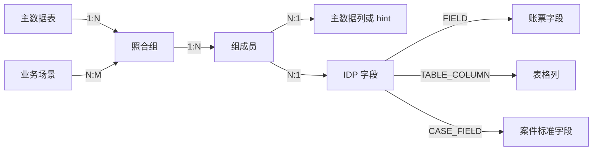
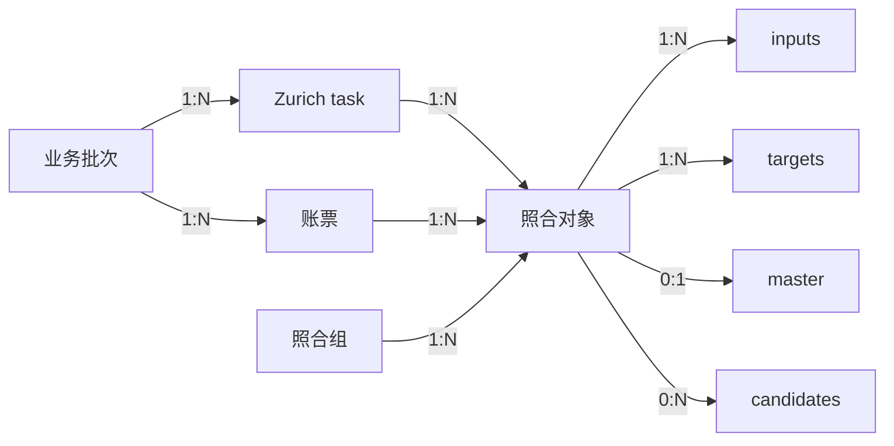
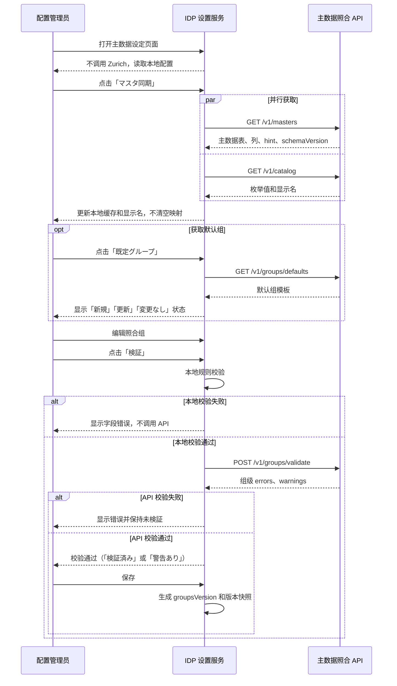
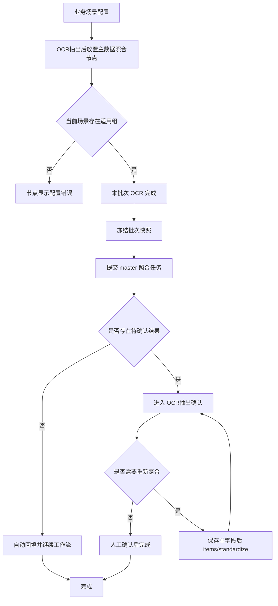
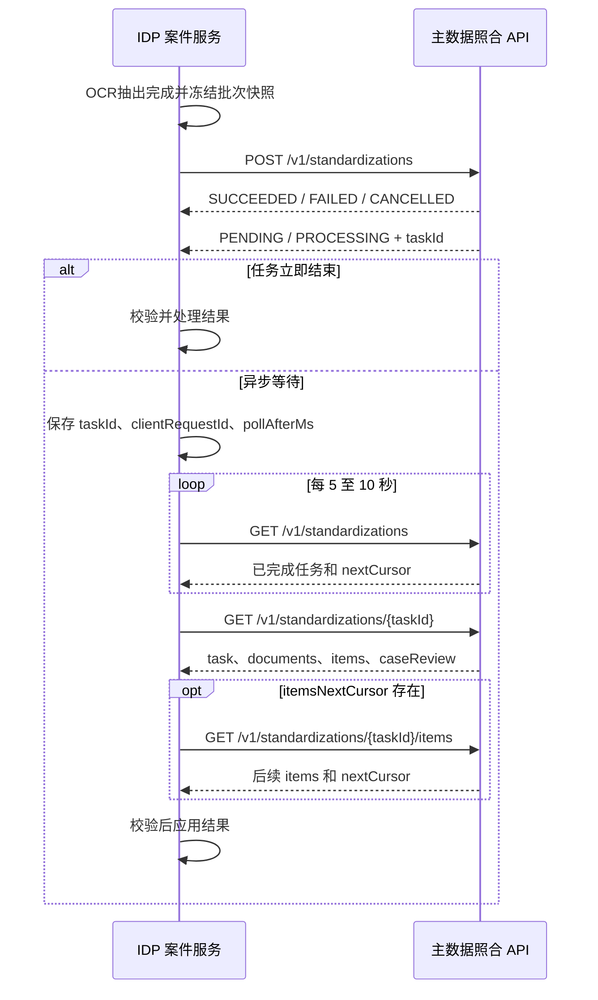
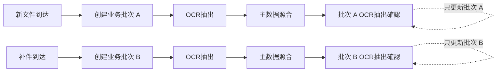
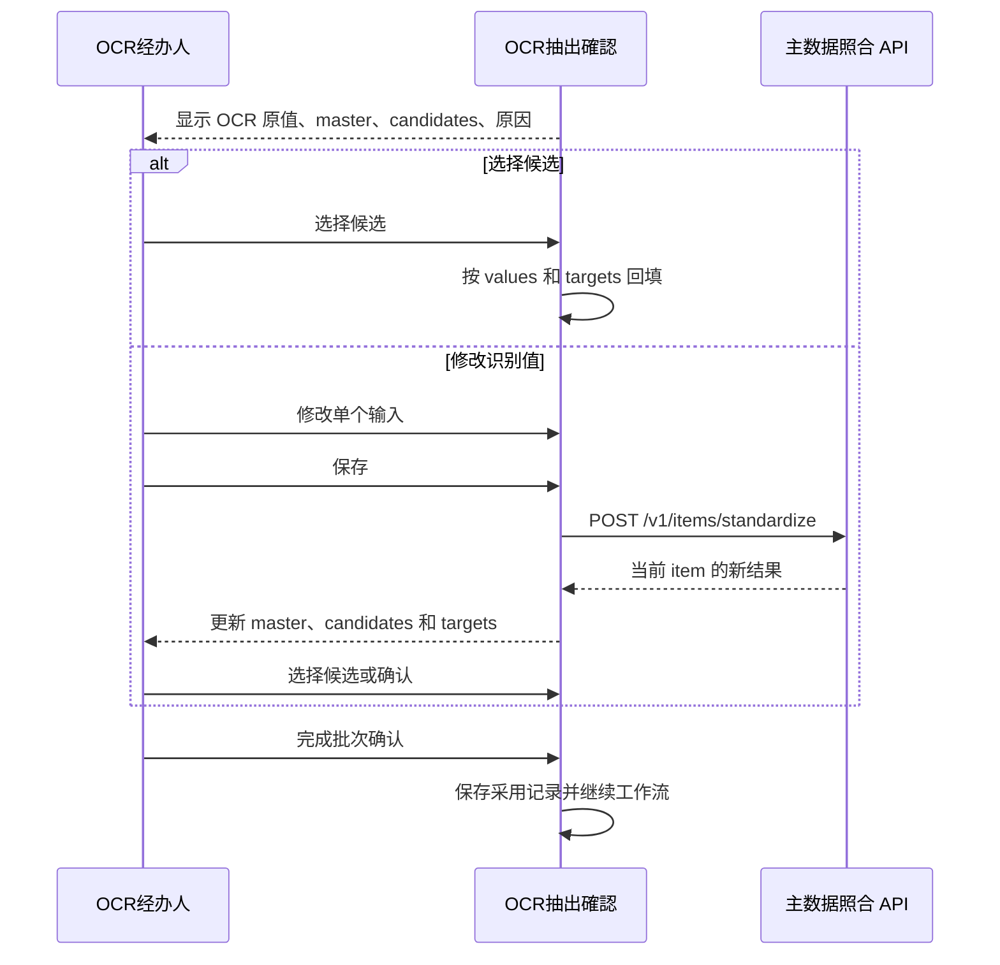
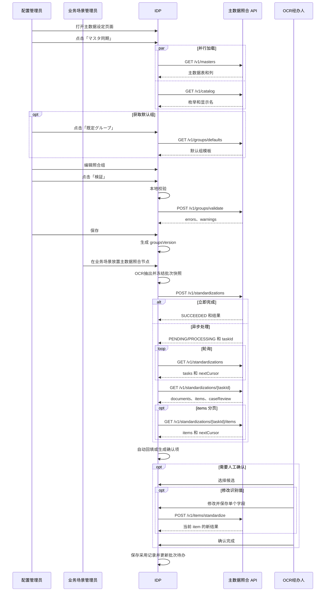

## 第 1 章｜本期范围与优先级

### 1.1 背景与目标

四期接入 Zurich 综合主数据名称标准化 API。上游已有案件集约、文件补件、OCR抽出和 OCR抽出确认任务。主数据照合接入这些既有业务链路，使用独立业务批次、异步任务和现有 OCR抽出确认待办。

本 PRD 的正文、字段说明和流程说明使用简体中文。界面文案、API 字段值、接口返回内容和示例中的日语保留原文。

本期要完成以下结果。

- 配置管理员可以通过 Zurich 返回的主数据 schema 配置可复用的照合组。
- 业务场景管理员可以在 OCR抽出后放置「マスタ照合」节点。节点按当前业务场景自动读取适用的照合组。
- 新文件和补件以批次为单位提交 Zurich，异步获取结果。
- IDP 按结果中的 targets 回填无须确认的项目，将需要确认的结果合并到该批次的 OCR抽出确认。
- 组外字段保持 OCR抽出值。
- 照合组、默认组来源、整体版本和变更履历可追溯。

### 1.2 本期范围

| 范围 | 本期内容 |
| --- | --- |
| API 连接 | 在「API設定 → 外部API」维护 Zurich 标准化 API 的 Base URL 和 API Key |
| 主数据设定 | 获取主数据表、列、hint、显示名和默认组，维护照合组 |
| 业务场景 | 在 OCR抽出后配置「マスタ照合」节点 |
| 批次执行 | 一批文件对应一个业务批次，补件创建新批次，按批次异步执行和合并结果 |
| 结果应用 | 自动回填、人工确认、候选改选和单字段重新照合 |
| 通用性与非功能 | 不写主数据表专用逻辑，兼容动态 schema，并满足认证、超时和缓冲区要求 |
| 追溯 | 保存 groupsVersion、任务快照、组变更履历和任务执行记录 |

### 1.3 本期更新功能清单

本章共 72 项，包含 28 项式样书 P0 业务功能、24 项 IDP 产品支撑功能、8 项文件批次与照合模式、5 项通用性与非功能要求、8 项第 5 期功能。

#### 1.3.1 本期 P0 业务功能

S、Q、A、C、E、G、N 编号来自 Zurich API v1.1 §1.4。P 和 B 编号是 IDP 为落实这些编号补充的产品功能与批次场景。

| 编号 | 功能名 | 一句话 | PRD 章节 | 配置或执行 | 原型状态 |
| --- | --- | --- | --- | --- | --- |
| S-01 | 照合组管理 | 创建、修改、删除照合组，并保持稳定的 `groupId` | 5.2 | 配置 | 已覆盖 |
| S-02 | 主数据 schema 驱动 | 主数据表、列、hint 和显示名由 API 一览生成，版本变化后无需重启 | 5.2 | 配置 | 部分覆盖 |
| S-03 | 字段选择 | 可以选择账票字段、表格列和案件标准字段，组内可以引用其他账票类型 | 5.2 | 配置 | 已覆盖 |
| S-04 | 多组复用与回填警告 | 同一主数据表可以有多个组，同一字段可作为多个组输入，重复回填目标显示警告 | 5.2 | 配置 | 已覆盖 |
| S-05 | 保存前校验 | 调用 `POST /v1/groups/validate`，按组和字段显示错误，有错误的组不保存 | 5.2 | 配置 | 已覆盖 |
| S-06 | 版本与变更履历 | 保存 `groupsVersion` 和完整快照，保留组变更履历 | 5.2 | 配置 | 已覆盖 |
| S-07 | 默认组导入 | 从 `GET /v1/groups/defaults` 获取默认组并作为 IDP 配置保存 | 5.2 | 配置 | 已覆盖 |
| S-10 | 回填目标配置 | `OUTPUT` 和 `INPUT_OUTPUT` 可以使用可写主数据列。`inputRole=NONE` 的列本期按组处理规则只允许 `OUTPUT` | 5.2 | 配置 | 待 Zurich 确认 |
| Q-01 | 批次请求 | OCR抽出后，按当前业务批次发送文件、有效组和组版本，超过 50 份时拆分 | 5.3 | 执行 | 部分覆盖 |
| Q-02 | 标准字段请求 | 组使用 `CASE_FIELD` 时，请求发送案件标准字段容器 `caseResult`，字段值位于 `caseResult.fields[]` | 5.3 | 执行 | 部分覆盖 |
| Q-03 | 请求重发与重新处理 | 超时或 500 时使用相同 `clientRequestId` 重发，重新处理时创建新批次和新请求 | 5.3 | 执行 | 部分覆盖 |
| Q-04 | 并发、限流与退避 | IDP 必须限制发送并发并处理退避，429/503 遵循 `Retry-After`。并发上限、退避间隔和最大重试次数待开发与测试确认 | 5.3 | 执行 | 待实现 |
| Q-05 | 完成轮询与游标 | 查询已完成任务列表并保存 `nextCursor`，IDP 重启后继续查询 | 5.3 | 执行 | 部分覆盖 |
| Q-06 | 终态读取与分页 | 任务结束后读取结果，`items` 超过一页时继续获取 | 5.3 | 执行 | 部分覆盖 |
| Q-07 | Fallback 开关 | 业务场景可以关闭兜底照合，关闭时发送 `options.fallback=false` | 5.3 | 配置、执行 | 部分覆盖 |
| A-01 | 结果分支判断 | 仅使用任务和账票状态、`needsReview`、`master.values`、`targets` 和 `selection` 处理结果 | 5.4 | 执行 | 部分覆盖 |
| A-02 | 自动回填 | `needsReview=false` 时按 `targets` 写入值，并保存 `selection` | 5.4 | 执行 | 部分覆盖 |
| A-03 | 待确认分流 | `needsReview=true` 时不回填，进入 OCR抽出确认 | 5.4 | 执行 | 已覆盖 |
| A-04 | 阻断结果处理 | 未知位置、`FAILED`、`INVALID_GROUP`、`MASTER_TABLE_NOT_ENABLED` 转人工，`CANCELLED` 不反映 | 5.4 | 执行 | 部分覆盖 |
| A-05 | 回填目标防重复采用 | 回填目标项目不重复设置 IDP 的主数据匹配 | 5.4 | 执行 | 待实现 |
| A-06 | 采用记录保存 | 按 `item` 保存所采用记录、`needsReview` 和原因，供确认、审计、输出和反馈使用 | 5.4 | 执行 | 部分覆盖 |
| A-07 | 不使用置信度阈值 | `confidence` 不用于自动采用或转人工判断 | 5.4 | 执行 | 已覆盖 |
| A-08 | Fallback 结果转人工 | `groupId=FALLBACK` 必须转人工，并使用 `FALLBACK_USED` warning 识别未配置账票 | 5.4 | 执行 | 部分覆盖 |
| A-09 | 通用回填处理 | 从所采用行的 `values` 按 `targets` 写入，不按主数据表或列编写专用逻辑 | 5.4 | 执行 | 部分覆盖 |
| C-01 | 确认信息展示 | 显示识别值、主数据推定、候选、原因、依据和备注，并展示拆分要素 | 5.4 | 执行 | 部分覆盖 |
| C-02 | 候选改选 | 选择候选后按该候选的 `values` 和 `targets` 回填，并保存 `selection` | 5.4 | 执行 | 已覆盖 |
| C-03 | 字段级重新照合 | 修改识别值后调用 `POST /v1/items/standardize` 并反映新结果 | 5.4 | 执行 | 已覆盖 |
| C-05 | 自动采用行改选 | 自动采用的结果仍显示所采用行和候选，可以改选其他候选 | 5.4 | 执行 | 已覆盖 |

#### 1.3.2 产品页面与支撑功能

| 编号 | 功能名 | 一句话 | PRD 章节 | 原型状态 |
| --- | --- | --- | --- | --- |
| P-01 | 外部API连接 | 在 API設定中维护连接类型、Base URL、认证方式、API Key 和连接状态 | 5.1 | 已覆盖 |
| P-02 | 主数据菜单替换 | 四期入口显示「マスタデータ設定」，原主数据维护菜单隐藏并保留回滚入口 | 5.2 | 已覆盖 |
| P-03 | 主数据同步与下拉读取 | 点击「マスタ同期」更新主数据和显示名，下拉展示当前可用定义，不清除现有映射 | 5.2 | 已覆盖 |
| P-04 | 照合组列表 | 左侧显示组列表、搜索、追加和当前选中状态 | 5.2 | 已覆盖 |
| P-05 | 组操作 | 支持复制、改名、删除和查看变更履历 | 5.2 | 已覆盖 |
| P-06 | 默认组差异更新 | 显示「新規」「更新」「変更なし」状态，并以固定覆盖方式更新默认组 | 5.2 | 已覆盖 |
| P-07 | 组基本信息 | 配置组名、一个主数据表和多个适用场景 | 5.2 | 已覆盖 |
| P-08 | 通常与标准字段切换 | 在账票字段、表格列和案件标准字段之间切换 | 5.2 | 已覆盖 |
| P-09 | hint 配置 | 从主数据 hint 中选择补充判断信息，限制为只照合 | 5.2 | 已覆盖 |
| P-10 | 角色显示 | 显示「主入力」「補助入力」「反映のみ」角色标签，并随配置重新计算 | 5.2 | 已覆盖 |
| P-11 | 设置验证 | 执行本地规则和 `groups/validate`，错误按组和字段展示 | 5.2 | 已覆盖 |
| P-12 | 版本与履历 | 保存整体版本和快照，查看组变更履历 | 5.2 | 已覆盖 |
| P-13 | 主数据照合节点 | 业务场景内可添加、删除和配置「マスタ照合」节点 | 5.3 | 部分覆盖 |
| P-14 | 场景自动读取组 | 节点按当前场景读取适用组，只显示组数量和配置错误 | 5.3 | 部分覆盖 |
| P-15 | 节点双变量 | 输出处理状态和通过或待确认的处理结果，并控制工作流前进 | 5.3 | 部分覆盖 |
| P-16 | 批次待办 | 新文件和补件分别创建批次，批次结果分别进入 OCR抽出确认 | 5.3、5.4 | 部分覆盖 |
| P-17 | 多任务结果合并 | 同一批次多个 `taskId` 合并为一个确认入口 | 5.3、5.4 | 部分覆盖 |
| P-18 | 同账票多逻辑文件 | 主单据逐文件生成对象，表格列按行生成，辅助输入冲突转人工 | 5.3 | 部分覆盖 |
| P-19 | OCR确认结果展示 | 在同一待办中展示 OCR 原值、主数据、候选、原因、依据和备注 | 5.4 | 已覆盖 |
| P-20 | 自动采用结果查看 | 自动采用后仍可查看主数据行和候选并改选 | 5.4 | 已覆盖 |
| P-21 | 单字段重新照合 | 保存一个修改后的识别字段后提交 `items/standardize` | 5.4 | 已覆盖 |
| P-23 | 审计与快照 | 保存任务快照、采用记录、组变更履历和执行结果 | 5.2、5.3、5.4 | 部分覆盖 |
| P-24 | 空态与错误状态 | 覆盖 API 未配置、主数据未加载、无组、无适用组、连接失败和校验失败 | 5.1、5.2、5.3 | 已覆盖 |

#### 1.3.3 文件批次与照合方式

| 编号 | 场景或模式 | 处理规则 | PRD 章节 |
| --- | --- | --- | --- |
| B-01 | 追加文件到达 | 创建新的独立业务批次，并生成该批次的 OCR抽出确认 | 5.3、5.4 |
| B-02 | 补件到达 | 创建新的独立业务批次，不并入已处理批次 | 5.3、5.4 |
| B-03 | 批次重新处理 | 业务上重新处理时按该批次提交时点的文件集合生成新请求，并使用新的请求序号 | 5.3 |
| B-04 | 多批次排队 | Zurich 在同一优先级内按受理顺序处理，并发量由 Zurich 控制（式样书 §2.7） | 5.3 |
| B-05 | 超过 50 份 | 使用相同 `caseNo` 拆分请求，多个 `taskId` 由一个业务批次合并展示 | 5.3 |
| M-01 | 照合のみ | 参与匹配，不回填。选择候选后保留 OCR 值 | 5.2、5.4 |
| M-02 | 照合して反映 | 参与匹配并回填。选择候选后更新为目标列的值 | 5.2、5.4 |
| M-03 | 反映のみ | 不参与匹配，只回填。结果随同组主输入确认一起更新 | 5.2、5.4 |

#### 1.3.4 本期 P0 通用性与非功能要求

| 编号 | 功能名 | 一句话 | PRD 章节 | 原型状态 |
| --- | --- | --- | --- | --- |
| G-01 | 主数据通用处理 | 配置、请求、回填、确认和输出均不写特定主数据表或列的逻辑 | 5.6 | 部分覆盖 |
| G-02 | 响应兼容性 | 忽略未知字段，可扩展枚举按字符串处理，ID 保持字符串 | 5.6 | 待验证 |
| G-03 | 显示名称来源 | 显示名称从主数据表一览和目录获取 | 5.2、5.6 | 已覆盖 |
| N-01 | 连接安全 | 使用 HTTPS 和内部 CA，API Key 不在界面和日志中显示 | 5.1、5.6 | 部分覆盖 |
| N-02 | 连接与接收限制 | 连接、响应等待时间和接收缓冲区按 v1.1 §8.5 执行 | 5.6 | 待实现 |

#### 1.3.5 第 5 期功能

| 编号 | 功能名 | 一句话 | PRD 章节 | 原型状态 |
| --- | --- | --- | --- | --- |
| S-08 | 废弃项目标记 | 对 `deprecated=true` 的列和 hint 显示标记，新建配置不可选择 | 5.2 | 第 5 期 |
| S-09 | 组设置建议 | 人工确认后导入 Zurich 的组设置建议 | 5.2 | 未覆盖 |
| C-04 | 主数据检索 | 通过 `POST /v1/masters/search` 查找其他候选 | 5.4 | 未覆盖 |
| E-01 | 后续系统登记 | 使用 `selection` 的 `object`、`recordType`、`recordId` 向后续系统登记 | 5.4 | 未覆盖 |
| E-03 | 结果反馈 | 通过 `POST /v1/standardizations/{taskId}/feedback` 返回人工确定结果 | 5.4 | 未覆盖 |
| P-25 | 重复回填详情提示 | 在字段行显示警告标签，并列出涉及的重复组名 | 5.2 | 未覆盖 |
| N-03 | 通知脱敏 | Zurich 通知前可以去除个人信息项目 | 5.6 | 第 5 期 |
| §5.15 | 完成通知 callback | Zurich 在任务进入终态时通知 IDP，结果仍通过任务接口获取 | 5.3 | 未覆盖 |

### 1.4 里程碑与优先级

| 优先级 | 功能 |
| --- | --- |
| 本期 P0 | S-01～S-07、S-10、Q-01～Q-07、A-01～A-09、C-01～C-03、C-05、G-01～G-03、N-01～N-02 |
| 第 5 期 | S-08、S-09、C-04、E-01、E-03、P-25、N-03、完成通知 callback |

`items/standardize` 属于本期 P0，用于 OCR抽出确认中的单个字段重新照合。完成通知和通知脱敏在第 5 期接入，本期使用轮询获取结果。

### 1.5 上下游关系与依赖

| 系统或模块 | 关系 |
| --- | --- |
| API設定 → 外部API | 提供 Zurich Base URL、API Key 和连接状态 |
| 业务场景设定（「業務シーン設定」） | 提供 sceneId、账票类型和字段，供照合组匹配与节点读取 |
| OCR抽出 | 提供需要照合的批次 OCR 快照 |
| OCR抽出确认 | 承接普通 OCR 待确认项和主数据照合待确认项 |
| Zurich 标准化 API | 提供主数据 schema、默认组、组校验、批次标准化和单字段重新照合 |

接口基准为 Zurich 综合主数据名称标准化 API v1.1。配置期使用 GET /v1/masters、GET /v1/catalog、GET /v1/groups/defaults 和 POST /v1/groups/validate。执行期使用 POST /v1/standardizations、GET /v1/standardizations、GET /v1/standardizations/{taskId}、GET /v1/standardizations/{taskId}/items 和 POST /v1/items/standardize。

接口的阶段、调用时机、同步性和字段定义统一放在分模块 API 与字段中。

## 第 2 章｜用户故事与旅程

### 2.1 故事地图

| 使用场景 | 用户要完成的事 | 对应需求 | 版本 | 功能模块 |
| --- | --- | --- | --- | --- |
| 接入 Zurich | 配置地址、认证和 API Key，并确认连接可用 | P-01、N-01 | 本期 | API连接 |
| 准备主数据 | 同步主数据定义和显示名，导入默认组 | P-03、S-07 | 本期 | マスタ与照合组配置 |
| 配置照合组 | 选择业务场景、主数据和照合字段并保存 | S-01～S-06、S-10 | 本期 | マスタ与照合组配置 |
| 配置业务场景 | 在 OCR抽出后加入「マスタ照合」节点 | P-13～P-15 | 本期 | 业务场景与批次照合 |
| 处理业务批次 | 提交 Zurich 任务，等待结果并合并到确认入口 | Q-01～Q-07、B-01～B-05 | 本期 | 业务场景与批次照合 |
| 核对识别结果 | 查看 master、候选项和 OCR 原值，并完成确认 | C-01、C-02、C-05 | 本期 | OCR抽出确认与结果应用 |
| 修改后重新照合 | 修改一个识别值并重新照合当前 item | C-03、P-21 | 本期 | OCR抽出确认与结果应用 |

### 2.2 原子用户故事

| ID | 角色 | 原子目标 | 完成结果 | 需求 |
| --- | --- | --- | --- | --- |
| US-01 | API管理员 | 配置 Zurich 连接 | 连接信息保存，API Key 脱敏显示，可单独执行连接测试 | P-01、N-01 |
| US-02 | マスタ管理员 | 同步主数据定义 | masters 和 catalog 可用，已有组配置不被清除 | P-03 |
| US-03 | マスタ管理员 | 导入默认组 | 显示新規、更新、変更なし，并可覆盖导入 | S-07 |
| US-04 | 配置管理员 | 配置并保存照合组 | 组通过校验后保存，生成 groupsVersion 和版本快照 | S-01～S-06、S-10 |
| US-05 | 配置管理员 | 查看变更履历 | 可查看日時、操作、操作者、内容和所属版本 | S-06、P-12 |
| US-06 | 业务场景管理员 | 配置照合节点并处理业务批次 | 节点按场景读取适用组，一个批次合并为一个确认入口 | P-13～P-15、Q-01～Q-07、B-01～B-05 |
| US-07 | OCR经办人 | 核对主数据照合结果 | 可查看推荐行、候选、OCR 原值、确认理由，并完成确认或改选 | C-01、C-02、C-05 |
| US-08 | OCR经办人 | 修改识别值并重新照合 | 只更新当前 item，不新建 task，不影响其他 item | C-03、P-21 |

### 2.3 现状旅程

| 阶段 | 现在的做法 | 主要问题 | 本期变化 |
| --- | --- | --- | --- |
| 连接 API | 手工填写地址和密钥 | Key 暴露风险，连接是否可用不直观 | 保存后脱敏显示，并提供独立连接测试 |
| 配置主数据 | 依赖旧主数据规则维护组 | 配置项多，字段容易选错 | 字段来自 Zurich schema，保存前统一校验 |
| 执行业务批次 | 任务和确认待办分散查看 | 不清楚任务何时结束，多个 task 难以汇总 | 批次内合并 task，统一进入 OCR抽出确认 |
| 核对结果 | OCR 原值和多个候选混在一起 | 不清楚哪个是推荐行、候选或 OCR 原值 | 固定顺序显示推荐、候选、OCR 原值 |
| 修改结果 | 修改后重新执行整组照合 | 影响范围大，等待时间长 | 单字段保存后只重新照合当前 item |

### 2.4 目标旅程

| 阶段 | 角色 | 动作 | 结果 |
| --- | --- | --- | --- |
| 1 | API管理员 | 配置并测试 Zurich 连接 | 连接可用于主数据配置和照合执行 |
| 2 | マスタ管理员 | 执行「マスタ同期」，按需导入默认组 | 主数据定义、显示名和默认组可用 |
| 3 | 配置管理员 | 创建照合组，选择适用场景、主数据和字段 | 组校验通过并保存 |
| 4 | 业务场景管理员 | 在 OCR抽出后放置「マスタ照合」节点 | 节点按 sceneId 自动读取适用组 |
| 5 | IDP | 批次 OCR 完成后提交 Zurich 并轮询结果 | 多个 task 在批次内合并 |
| 6 | IDP | 根据 `needsReview` 分流 | 自动采用结果回填，其他结果进入确认 |
| 7 | OCR经办人 | 核对结果、改选候选或修改单字段并重新照合 | 当前 item 得到最终采用结果 |
| 8 | IDP | 保存采用记录并更新批次 | OCR抽出确认完成，工作流继续 |

## 第 3 章｜术语、数据结构与权限

### 3.1 术语与词汇表

| 中文 | 日语或界面 | 定义 |
| --- | --- | --- |
| 主数据 | マスタデータ | Zurich 管理的数据表和业务记录。IDP 只读取定义和执行照合，不维护业务记录 |
| 照合组 | 照合グループ | 一组主数据与 IDP 字段的映射设置，包含一个主数据表、适用场景和照合字段 |
| 主数据表 | マスタ | 一个照合组使用的一个 Zurich 主数据 schema，例如 DISEASE、DRUG |
| 主数据列 | マスタ列 | Zurich `columns[]` 中的列，包含 `inputRole` 和 `writable` |
| 提示信息 | ヒント | Zurich `hints[]` 中的补充判断信息，只能用于 INPUT |
| 照合方式 | 照合方式 | 组成员使用 INPUT、OUTPUT 或 INPUT_OUTPUT |
| 角色 | ロール | IDP 根据照合方式和主数据列属性计算的显示值 |
| 主输入 | 主入力 | `inputRole=PRIMARY` 的组输入 |
| 辅助输入 | 補助入力 | 除主输入外参与判断的主数据列或 hint |
| 回填 | 反映 | IDP 按 item 的 `targets` 写入主数据值 |
| 适用场景 | 適用シーン | 照合组生效的业务场景。节点按当前 `sceneId` 匹配 |
| 业务批次 | 批次 | IDP 定义的一次主数据照合处理单位 |
| Zurich 任务 | taskId | 一次 Zurich 标准化请求对应的异步任务 |
| 照合对象 | item | Zurich 返回的一个标准化对象 |
| 候选 | candidates | 包含采用行在内的主数据候选，默认最多 5 条 |
| 组整体版本 | groupsVersion | 全部照合组的一次保存快照版本 |
| 默认组 | 既定グループ | Zurich 返回的推荐组模板 |
| 兜底照合 | FALLBACK | Zurich 对未配置组账票生成的临时照合结果 |

### 3.2 模块与对象关系

| 模块 | 负责内容 | 主要入口 |
| --- | --- | --- |
| API连接 | Zurich 连接、认证和连接状态 | API設定 → 外部API |
| マスタ与照合组配置 | 主数据同步、组配置、默认组、校验和版本 | マスタデータ設定 |
| 业务场景与批次照合 | 节点配置、批次执行、轮询和结果合并 | 業務シーン設定 |
| OCR抽出确认与结果应用 | 候选确认、字段回填和采用记录 | OCR抽出確認 |

| 关系 | 基数 | 规则 |
| --- | --- | --- |
| 主数据表与组 | 1:N | 一个组只能选择一个主数据表，同一主数据表可以创建多个组 |
| 组与适用场景 | N:M | 一个组可以适用多个场景，一个场景可以命中多个组 |
| 组与成员 | 1:N | 一个组包含一个或多个组成员 |
| 成员与主数据项目 | N:1 | 每个成员选择一个主数据列或一个 hint |
| IDP 字段与组输入 | 1:N | 同一个 IDP 字段可以作为多个组的输入 |
| IDP 字段与回填目标 | 1:N | 多个组回填同一位置时允许保存并显示警告，运行时冲突转人工 |

### 3.3 主数据、组与字段结构

| 对象 | 关系 | 规则 |
| --- | --- | --- |
| 主数据表与列 | 1:N | 列来自 Zurich `columns[]` |
| 主数据表与 hint | 1:N | hint 来自 Zurich `hints[]`，只用于补充判断 |
| 主数据行与列值 | 1:N | `values` 包含该主数据行的全部列值 |
| 组成员与 IDP 字段 | N:1 | 每个成员选择一个 IDP 字段和一个主数据项目 |
| 组成员与照合方式 | N:1 | 每个成员选择一个 `INPUT`、`OUTPUT` 或 `INPUT_OUTPUT` |

IDP 字段有三种类型。

| IDP 字段类型 | 含义 | 结果位置 |
| --- | --- | --- |
| FIELD | 单据普通字段 | `FIELD` |
| TABLE_COLUMN | 表格整列配置 | 每个表格行生成 `TABLE_CELL` 位置 |
| CASE_FIELD | 案件级标准字段 | `CASE_FIELD` |

主数据侧有两种可选项目。

| 类型 | 用途 | 可用照合方式 |
| --- | --- | --- |
| 主数据列 | 可作为输入或回填目标 | 受 `inputRole`、`writable` 和组配置限制 |
| hint | 只作为补充判断信息 | 只能使用 `INPUT` |

hint 会进入 item 的 `inputs[]`，不会进入 `targets`，因此不能回填。

组结构约束：

- 同一组内，同一主数据列或 hint 只能出现一次。
- 同一主数据列或 hint 可以在不同组中复用。
- 同一个 IDP 字段可以作为多个组的输入。
- 同一个 IDP 字段作为多个组的回填目标时允许保存并警告，运行时冲突转人工。
- `INPUT` 只参与判断，`OUTPUT` 只回填，`INPUT_OUTPUT` 同时参与判断和回填。

### 3.4 批次、任务与结果结构

| 关系 | 基数 | 规则 |
| --- | --- | --- |
| 业务批次与 task | 1:N | 一个批次因请求拆分可以对应多个 taskId |
| 业务批次与账票 | 1:N | 一个批次包含本次处理的账票快照 |
| task 与组 | N:M | task 保存本次提交使用的组设置快照 |
| task 与 item | 1:N | 一个 task 返回多个照合对象 |
| 组与 item | 1:N | 一个组可以生成 0 个、1 个或多个 item |
| item 与 inputs | 1:N | 本次参与判断的输入可以有多个 |
| item 与 targets | 1:N | 本次回填目标可以有多个 |
| item 与 master | 1:0..1 | 无法确定主数据行时为 null |
| item 与 candidates | 1:N | 包含采用行，默认最多 5 条 |

`itemId` 在 task 内唯一，列表顺序没有业务意义。`FALLBACK` 和 `ADHOC` 是特殊 groupId，不对应 IDP 保存的普通组。

### 3.5 数据结构常见问题

| 问题 | 结论 |
| --- | --- |
| 一个主数据表能否配置多个组？ | 可以 |
| 一个组能否配置多个主数据表？ | 不可以 |
| 同一个场景能否命中多个组？ | 可以 |
| 不同组能否复用同一主数据列或 hint？ | 可以 |
| 同一组内能否重复使用同一主数据列或 hint？ | 不可以 |
| 一个 item 能否回填多个 IDP 字段？ | 可以 |
| 一个组是否有独立版本？ | 没有，使用整体 groupsVersion |
| hint 是否产生回填目标？ | 不会 |
| 已运行任务是否受组配置修改影响？ | 不会，任务使用提交时快照 |

### 3.6 权限

| 角色 | 配置端 | 工作流节点 | OCR抽出确认 |
| --- | --- | --- | --- |
| 配置管理员 | 查看、编辑、保存、同步、查看履历 | 查看 | 查看 |
| 业务场景管理员 | 查看 | 添加、删除和连接节点 | 查看 |
| OCR经办人 | 无 | 无 | 确认、修正和重新照合 |

## 第 4 章｜API 契约

字段名称、类型和必填性以 [综合主数据名称标准化 API 规格书 v1.1 中文版](/attachments/zurich-standardization-api-v1.1-zh-CN.md) 为准。本章只列 IDP 实际发送或使用的字段，不新增 API 字段。

标记说明：`必填` 和 `条件必填` 取自式样书；`可选` 不表示 IDP 不发送；`IDP发送` 只说明实现策略。

### 4.1 API 调用总览

| 模块 | 接口 | IDP阶段 | 调用时机 | 同步性 |
| --- | --- | --- | --- | --- |
| 配置 | `GET /v1/masters` | 本期 | 点击标题栏「マスタ同期」 | 同步 |
| 配置 | `GET /v1/catalog` | 本期 | 点击标题栏「マスタ同期」 | 同步 |
| 配置 | `GET /v1/groups/defaults` | 本期 | 点击「既定グループ」 | 同步 |
| 配置 | `POST /v1/groups/validate` | 本期 | 点击「検証」或「保存」且本地校验通过 | 同步 |
| 照合执行 | `POST /v1/standardizations` | 本期 | 一个业务批次提交 | 异步，可由 `waitSeconds` 同步返回 |
| 照合执行 | `GET /v1/standardizations` | 本期 | 轮询已完成任务 | 同步 |
| 照合执行 | `GET /v1/standardizations/{taskId}` | 本期 | 任务进入终态或查询状态 | 同步 |
| 照合执行 | `GET /v1/standardizations/{taskId}/items` | 本期 | `itemsNextCursor` 存在 | 同步 |
| 照合执行 | `POST /v1/standardizations/{taskId}/cancel` | 本期 | 业务明确中止任务 | 同步 |
| 人工确认 | `POST /v1/items/standardize` | 本期 | 修改识别值并保存成功后 | 同步 |
| 运维 | `GET /v1/health` | 按需 | 连接排障或运行状态确认 | 同步 |
| 后续 | `POST /v1/standardizations/{taskId}/feedback` | 第 5 期 | 本期不调用 | 同步 |
| 后续 | `POST /v1/masters/search` | 第 5 期 | 本期不调用 | 同步 |
| 后续 | `POST /v1/groups/suggest` | 第 5 期 | 本期不调用 | 同步 |

完成通知 `callbackUrl` 在第 5 期接入，本期使用轮询。`GET /v1/health` 不进入本期页面流程。

### 4.2 公共响应与对象

#### 公共响应 `code / msg / requestId / warnings / data`

| 字段 | 类型 | 含义 |
| --- | --- | --- |
| `code` | Integer | 成功为 0，失败时与 HTTP 状态码一致 |
| `msg` | String | 错误或提示说明 |
| `requestId` | String | 排障编号 |
| `warnings` | Object[] | 响应警告。公共响应和单据警告含 `code`、`message`；任务级 `data.warnings[]` 在组相关警告时还含 `groupId` |
| `data` | Object | 当前接口业务数据 |

#### 公共对象

- `Group`：`groupId`必填、`label`可选、`masterTable`必填、`members`必填。
- `Member`：`column` 或 `hint`条件必填、`mode`必填、`field`必填。
- `Member.field`：`type`必填，`documentTypeId`、`fieldName`、`tableName`、`columnName`按字段类型条件必填。
- `Document`：`documentId`、`documentTypeId`、`format`必填；`result` 或 `fields`按格式条件必填。
- `Item`：`itemId`、`groupId`、`masterTable`、`source`、`inputs`、`targets`、`status`、`needsReview` 为核心字段；`master`、`proposedName`、`confidence`、`candidates`、`reviewReasons`、`notices`、`reason`、`notesForAssessor`、`alternatives`、`splitItems`、`webEvidence` 按结果使用。
- `caseReview` 是任务级字段，位于任务结果的 `data.caseReview`，不属于单个 `Item`。

#### 字段归属

| 名称 | 来源 | 含义 |
| --- | --- | --- |
| `sceneId` | Zurich 请求字段，值来自 IDP 业务场景 | 当前业务场景 ID |
| `groupsVersion` | IDP 生成，作为 Zurich 请求字段发送 | 组配置整体版本。Zurich 在 `data.versions.groups` 中回显 |
| `sourceDefaultGroupId` | IDP 内部字段 | IDP 保存的 Zurich 默认组来源 ID，不发送给 Zurich |
| `masterStatus`、`masterResult` | IDP 工作流节点输出变量 | 节点处理状态和业务结果，不是 Zurich 返回字段 |
| 组快照、组变更履历 | IDP 内部数据 | 用于版本留痕和审计，不是 Zurich 返回字段 |

### 4.3 配置接口

#### `GET /v1/masters`

调用条件：点击标题栏「マスタ同期」。请求无业务参数。

| IDP读取并使用的返回字段（式样书字段子集） | 类型 | 必填性 | 用途 |
| --- | --- | --- | --- |
| `data.schemaVersion` | String | 返回 | 判断 schema 是否更新 |
| `data.masterTables[]` | Object[] | 返回 | 主数据表列表 |
| `data.masterTables[].masterTable` | String | 返回 | 组引用的主数据表键 |
| `data.masterTables[].label` | String | 返回 | 主数据表显示名 |
| `data.masterTables[].enabled` | Boolean | 返回 | 是否可用于新配置 |
| `data.masterTables[].deprecated` | Boolean | 返回 | 废弃标记，本期不使用 |
| `data.masterTables[].columns[]` | Object[] | 返回 | 该主数据表的列定义 |
| `data.masterTables[].columns[].column` | String | 返回 | 列键 |
| `data.masterTables[].columns[].label` | String | 返回 | 列显示名 |
| `data.masterTables[].columns[].inputRole` | String | 返回 | `PRIMARY`、`SUPPORTING`、`NONE` |
| `data.masterTables[].columns[].writable` | Boolean | 返回 | 是否可回填 |
| `data.masterTables[].columns[].deprecated` | Boolean | 返回 | 废弃标记，本期不使用 |
| `data.masterTables[].hints[]` | Object[] | 返回 | 该主数据表的 hint 定义 |
| `data.masterTables[].hints[].hint` | String | 返回 | hint 键 |
| `data.masterTables[].hints[].label` | String | 返回 | hint 显示名 |
| `data.masterTables[].hints[].deprecated` | Boolean | 返回 | 废弃标记，本期不使用 |

#### `GET /v1/catalog`

调用条件：点击标题栏「マスタ同期」。请求无业务参数。

| IDP读取并使用的返回字段（式样书字段子集） | 类型 | 必填性 | 用途 |
| --- | --- | --- | --- |
| `data.catalogVersion` | String | 返回 | 枚举版本 |
| `data.enums` | Object | 返回 | 枚举值和显示名 |

#### `GET /v1/groups/defaults`

调用条件：点击「既定グループ」。请求无业务参数。

| IDP读取并使用的返回字段（式样书字段子集） | 类型 | 必填性 | 用途 |
| --- | --- | --- | --- |
| `data.version` | String | 返回 | 默认组版本 |
| `data.groups[]` | Object[] | 返回 | 默认组模板 |
| `data.groups[].groupId` | String | 返回 | Zurich 默认组 ID |
| `data.groups[].label` | String | 返回 | 组名 |
| `data.groups[].masterTable` | String | 返回 | 主数据表键 |
| `data.groups[].members[]` | Object[] | 返回 | 组成员 |

#### `POST /v1/groups/validate`

调用条件：本地校验通过后点击「検証」。本期只发送 `groups`，不发送 `documents`、`caseResult`。

| 请求字段 | 类型 | 必填性 | 说明 |
| --- | --- | --- | --- |
| `groups` | Object[] | 必填 | 要校验的组，结构见公共对象 |

| IDP读取并使用的返回字段（式样书字段子集） | 类型 | 必填性 | 用途 |
| --- | --- | --- | --- |
| `data.groups[].groupId` | String | 返回 | 对应请求组 |
| `data.groups[].valid` | Boolean | 返回 | 是否有错误 |
| `data.groups[].errors[]` | Object[] | 返回 | `code`、`message`、`memberIndex` |
| `data.groups[].warnings[]` | Object[] | 返回 | 不阻止保存的警告 |

### 4.4 照合执行接口

#### `POST /v1/standardizations`

调用条件：一个业务批次 OCR抽出完成。

| 请求字段 | 类型 | 必填性 | IDP发送策略 |
| --- | --- | --- | --- |
| `clientRequestId` | String | 可选 | 每次请求发送，用于幂等 |
| `caseNo` | String | 必填 | IDP 案件编号 |
| `sceneId` | String | 可选 | 当前业务场景 ID |
| `groups` | Object[] | 可选 | IDP 有有效组时发送 |
| `groupsVersion` | String | 可选 | 发送当前保存版本 |
| `waitSeconds` | Integer | 可选 | IDP 设置同步等待秒数 |
| `options.fallback` | Boolean | 可选 | 跟随业务场景开关 |
| `options.maxCandidates` | Integer | 可选 | 默认值 5，可设置范围 1 至 10，候选数包含 `isMaster=true` 的主数据行 |
| `caseResult` | Object | 可选 | 案件标准字段容器，组使用 `CASE_FIELD` 时发送 |
| `caseResult.fields[]` | Object[] | 条件必填 | 标准字段数组，`CASE_FIELD.fieldName` 与其中 `name` 对应 |
| `caseResult.fields[].name` | String | 条件必填 | 案件标准字段名 |
| `caseResult.fields[].value` | JSON value | 条件必填 | 案件标准字段值，按 IDP 输出原样发送 |
| `documents` | Object[] | 必填 | 当前批次账票 |
| `documents[].documentId` | String | 必填 | 逻辑文件 ID |
| `documents[].documentTypeId` | String | 必填 | 账票类别 ID |
| `documents[].format` | String | 必填 | IDP 使用 `IDP_RESULT_JSON` |
| `documents[].result` | Object | 条件必填 | `format=IDP_RESULT_JSON` 时必填 |

`FIELDS` 和 `documents[].fields` 属于式样书能力，本期 IDP 不发送。

IDP读取并使用的返回字段（式样书字段子集）：`data.taskId`、`data.clientRequestId`、`data.caseNo`、`data.status`、`data.queue`、`data.progress`、`data.pollAfterMs`、`data.versions`、`data.summary`、`data.warnings`、`data.failure`、`data.documents`、`data.items`、`data.itemsNextCursor`、`data.caseReview`。

#### `GET /v1/standardizations`

| 查询参数 | 类型 | 必填性 | IDP发送策略 |
| --- | --- | --- | --- |
| `finishedAfter` | Long | 条件必填 | 首次查询发送 |
| `cursor` | String | 条件必填 | 第二次起发送上次 `nextCursor` |
| `limit` | Integer | 可选 | IDP 使用 100 |

IDP读取并使用的返回字段（式样书字段子集）：`data.tasks[].taskId`、`data.tasks[].clientRequestId`、`data.tasks[].caseNo`、`data.tasks[].status`、`data.tasks[].completedAt`、`data.nextCursor`。

#### `GET /v1/standardizations/{taskId}`

| Path/查询参数 | 类型 | 必填性 | IDP使用方式 |
| --- | --- | --- | --- |
| `taskId` | String | 必填 | Path 参数 |
| `includeItems` | Boolean | 可选 | IDP 发送 `true` |

IDP读取并使用的返回字段（式样书字段子集）：完整 `data` 任务对象，使用 `data.status`、`data.documents`、`data.items`、`data.itemsNextCursor`、`data.caseReview`、`data.warnings` 驱动流程和展示。

#### `GET /v1/standardizations/{taskId}/items`

| Path/查询参数 | 类型 | 必填性 | IDP使用方式 |
| --- | --- | --- | --- |
| `taskId` | String | 必填 | Path 参数 |
| `cursor` | String | 可选 | 存在后续页时发送 |
| `limit` | Integer | 可选 | IDP 使用 100 |

IDP读取并使用的返回字段（式样书字段子集）：`data.items[]`、`data.nextCursor`。

#### `POST /v1/standardizations/{taskId}/cancel`

请求只有 Path 参数 `taskId`，无请求体。IDP读取并使用的返回字段（式样书字段子集）：`data.status`。

### 4.5 人工确认与重新照合接口

#### `POST /v1/items/standardize`

| 请求字段 | 类型 | 必填性 | IDP发送策略 |
| --- | --- | --- | --- |
| `clientRequestId` | String | 可选 | IDP 发送 |
| `caseNo` | String | 可选 | IDP 发送用于审计 |
| `ref` | Object | 可选 | 原任务与 item 的引用容器 |
| `ref.taskId` | String | 条件必填 | 指定 `ref` 时发送 |
| `ref.itemId` | String | 条件必填 | 指定 `ref` 时发送 |
| `masterTable` | String | 必填 | 当前 item 的主数据表 |
| `inputs[]` | Object[] | 必填 | 修改后的输入 |
| `inputs[].column` | String | 条件必填 | 与 `hint` 二选一 |
| `inputs[].hint` | String | 条件必填 | 与 `column` 二选一 |
| `inputs[].value` | String | 必填 | 修改后的值 |
| `targets` | Object | 可选 | IDP 有明确 targets 时发送 |
| `options.timeoutSeconds` | Integer | 可选 | IDP 发送超时设置 |

IDP读取并使用的返回字段（式样书字段子集）：`data.itemId`、`data.groupId`、`data.masterTable`、`data.source`、`data.inputs`、`data.targets`、`data.status`、`data.needsReview`、`data.master`、`data.proposedName`、`data.candidates`、`data.reviewReasons`、`data.notices`、`data.reason`、`data.notesForAssessor`、`data.alternatives`、`data.splitItems`、`data.ref`。

重新照合不创建任务，不重跑组，也不修改批次任务状态。

## 第 5 章｜功能详情

### 5.1 标准化 API 连接

#### 页面与入口

| 项目 | 内容 |
| --- | --- |
| 入口 | API設定 → 外部API |
| 使用者 | 配置管理员 |
| 连接使用方 | 主数据设定和主数据照合节点通过 IDP 后端使用该连接 |

#### 字段与参数规格

| 字段 | 必填 | 规则 |
| --- | --- | --- |
| 连接类型 | 是 | 下拉选择。默认不选中任何值，当前选项包含 Zurich |
| 连接名 | 是 | 用于外部API列表显示 |
| Base URL | 是 | Zurich 提供的 HTTPS 环境 URL，与 /v1/{resource} 组合使用 |
| 认证方式 | 是 | 按连接类型选择。Zurich 使用 Bearer API Key |
| API Key | 是 | 后端保存受保护引用，前端只显示「登録済み」和脱敏预览 |
| 接続テスト | 否 | 保存连接后手动执行，不阻断连接配置保存 |

连接名称、提供商、认证方式、Base URL 和首次输入的 API Key 显示「必須」标签。页面底部显示已保存凭证的脱敏预览。浏览器不得持有或直接使用 Zurich Token。「登録済み」只表示 API Key 已保存，不表示连接已验证。

#### 状态与按钮

| 按钮或状态 | 条件 | 结果 |
| --- | --- | --- |
| 保存 | 必填项完整 | 保存 Base URL、连接类型和 API Key 的受保护引用。连接状态保持「未確認」，或在 endpoint 与 API Key 未变化时沿用上一次测试结果 |
| 接続テスト | 连接已保存 | 调用 Zurich 接口确认连接 |
| 登録済み | API Key 已保存 | 只表示凭证已登记，显示脱敏预览，不代表连接有效 |
| 未確認 | 尚未测试，或 Base URL、连接类型、API Key 已修改 | 可以保存，主数据加载前需要确认连接 |
| 有効 | 接続テスト成功 | 可以作为主数据设定的数据源 |
| 無効 | 接続テスト失败 | 显示连接错误，主数据加载失败 |

#### 异常与边界

- 未配置标准化 API 时，「マスタデータ設定」显示「標準化APIが設定されていません」和「API設定へ」入口。
- API 连接失败时，显示「標準化APIに接続できません」。
- Base URL、连接类型或 API Key 变化后，原连接测试状态失效。
- Zurich API Key 有效期为 1 年。到期前签发新 Key，切换期间新旧两个 Key 均可使用。依据式样书 §2.2。
- 连接使用 HTTPS，TLS 版本不低于 1.2。IDP 服务器配置 Zurich 内部 CA 证书。依据式样书 N-01 和 §2.1。

### 5.2 マスタ与照合组配置

#### 页面与入口

| 项目 | 内容 |
| --- | --- |
| 菜单 | 業務ルール設定 → マスタデータ設定 |
| 原主数据维护菜单 | 四期隐藏。源码和路由保留用于回滚 |
| 使用者 | 配置管理员 |

#### 页面结构

| 区域 | 内容 |
| --- | --- |
| 左侧 | 照合组搜索、追加、既定グループ、组列表和组菜单 |
| 右侧 | グループ名、適用シーン、マスタ、照合フィールド |
| 底部 | 閉じる、検証、保存 |

左侧只显示照合组列表，不显示主数据表列表。组内部 groupId 不在界面显示。

#### 接口调用时机

| 用户动作 | Zurich 接口调用 | 调用后处理 |
| --- | --- | --- |
| 打开或刷新页面 | 不调用 | 只读取 API 连接状态和 IDP 已保存的数据 |
| 点击标题栏「マスタ同期」 | 同时发起 `GET /v1/masters` 和 `GET /v1/catalog`，两者独立处理 | masters 成功后刷新主数据缓存。catalog 成功后刷新显示名。任一个失败都保留该部分原数据 |
| 点击「既定グループ」 | 调用 `GET /v1/groups/defaults` | 打开默认组差异弹窗。点击「更新」只更新组配置，不更新 master 定义 |
| 点击「検証」 | 本地校验通过后调用 `POST /v1/groups/validate` | 显示组和字段级错误。本地校验失败时不调用 Zurich |
| 点击「保存」 | 先执行本地校验，再调用 `POST /v1/groups/validate` | 校验通过或仅有警告时保存，生成 `groupsVersion` 和版本快照；有错误时停止保存 |
| 新增、复制、改名、删除组或编辑字段 | 不调用 | 只修改 IDP 本地配置，保存前通过「検証」统一校验 |
| 批量执行照合任务 | 调用 `POST /v1/standardizations` | 发送当前批次文件、有效组和 `groupsVersion` |

#### 主数据同步规则

- masters 和 catalog 独立处理。一个接口失败时，保留该部分上次成功的数据，不使用失败结果覆盖另一部分。
- 同步和刷新不清除现有组的 masterTable、members 或默认组配置。
- `enabled=false` 的主数据表不进入新建配置。`deprecated=true` 的显示标记和禁止选择属于第 5 期，本期读取该字段但不据此禁用选项。
- 主数据表、列、hint、输入角色和可写属性全部来自 API 一览，IDP 不维护固定副本。
- 新的 `schemaVersion` 到达后，配置页面无需重启即可使用新的主数据定义。
- 可见 UI 不显示 `schemaVersion`。

「マスタ同期」位于标题栏右侧，使用蓝底白字主按钮。按钮不显示常驻状态标签。点击后按钮显示 loading，结束后只用 toast 告知成功或失败。失败时保留上一次有效缓存。

#### 空态与异常

| 条件 | 页面表现 | 可用操作 |
| --- | --- | --- |
| 未配置标准化 API | 显示「標準化APIが設定されていません」 | 前往 API設定 |
| 无照合组 | 右侧显示空态和两步引导 | 第一步「既定グループを取得」，第二步「マスタ同期」 |
| 无主数据缓存 | 主数据下拉不可展开，提示先执行「マスタ同期」 | 点击标题栏「マスタ同期」 |
| 主数据同步中 | 按钮显示 loading，已有缓存和组配置保留 | 等待完成 |
| 主数据同步失败 | 保留最近一次有效缓存 | 查看 toast，再次点击「マスタ同期」 |
| 默认组取得中 | 按钮显示 loading | 等待完成 |
| 默认组取得失败 | 不修改现有组配置 | 查看 toast，再次点击「既定グループ」 |
| 当前场景无适用组 | 工作流节点显示配置错误 | 前往設定 |

#### 照合组列表

左侧列表按组名显示，支持搜索。组菜单包含以下操作。

| 操作 | 规则 |
| --- | --- |
| コピー | 复制组名、主数据、适用场景和字段。生成新 groupId 和字段 ID |
| 名称変更 | 输入新组名后更新列表并记录履历 |
| 削除 | 二次确认后删除组。确认按钮为「OK」 |
| 変更履歴 | 查看组级变更记录 |

#### 组基本配置

| 字段 | 必填 | 规则 |
| --- | --- | --- |
| グループ名 | 是 | 界面显示名称 |
| 適用シーン | 是 | 多选。「全シーン」与其他具体场景互斥，最多直接显示 5 个标签，超出后通过折叠标签查看 |
| マスタ | 是 | 从 GET /v1/masters 获取。一个组只能选择一个主数据表 |

「適用シーン」是 IDP 配置字段，不发送给 Zurich。提交任务前从组对象中移除 sceneIds。all 表示「全シーン」，运行时匹配任意当前场景。

选择「全シーン」时清空其他具体场景。选择任一具体场景时取消「全シーン」。多场景配置的字段范围取所有已选场景账票类型的交集。

场景后续删除账票或字段时，已有组字段保留。保存时发现字段不在已选场景交集中，系统提示不兼容错误并阻止保存。

#### 默认组

默认组只在管理员点击左侧「既定グループ」按钮时获取。页面打开、主数据下拉读取和「マスタ同期」都不调用默认组接口。前端不直接调用 Zurich，由 IDP 后端调用 GET /v1/groups/defaults。

「既定グループ」按钮在执行中显示 loading，结束后只用 toast 告知成功或失败。差异状态「新規」「更新」「変更なし」只在默认组弹窗内展示。

首次导入默认组时，IDP 为每个默认组生成 groupId，并将 Zurich 的 groupId 保存为 sourceDefaultGroupId。后续同步优先使用 sourceDefaultGroupId 匹配，不受组名、适用场景和成员修改影响。默认组以「全シーン」导入，管理员可以按账票交集调整适用场景。

| 项目 | 规则 |
| --- | --- |
| 弹窗标题 | 既定グループの更新 |
| 表头 | グループ名、マスタ、項目数、状態 |
| 状態 | 新規、更新、変更なし |
| 执行按钮 | 更新 |
| 更新方式 | 固定覆盖。不提供追加或覆盖方式选择 |

点击「更新」后，「新規」组加入左侧列表。「更新」组覆盖 label、masterTable、members，保留本地 groupId 和「適用シーン」。「変更なし」组不修改。Zurich 本次未返回的默认组不自动删除。

没有 sourceDefaultGroupId 的组视为 IDP 自建组，不参与默认组比对，也不会被默认组覆盖。旧数据缺少来源 ID 时，只有名称、主数据表和成员定义完全一致，才识别为同一默认组并补齐来源关联。

#### 照合字段

| 页面字段 | API 字段 |
| --- | --- |
| 帳票タイプ | field.documentTypeId |
| フィールド | field.type、field.fieldName、field.tableName、field.columnName |
| マスタ項目 | column 或 hint |
| 照合方式 | mode |

表格列顺序为 No.、「フィールド」「マスタ項目」「照合方式」「ロール」「操作」。表头左对齐。No. 从 1 开始连续显示。

「フィールド」列的显示规则如下。普通字段显示为「帳票 › フィールド」。表格列显示为「帳票 › テーブル › 列」。标准字段显示为「標準フィールド › 標準項目」。路径使用纯文字和 `›` 分隔，不添加边框、背景或胶囊标签。

「マスタ項目」下拉为一组项目名称，不显示「マスタ列」「ヒント」来源分组，也不在名称旁显示 PRIMARY、SUPPORTING、NONE 或 HINT。`data.masterTables[].columns[].label` 和 `data.masterTables[].hints[].label` 是具体项目名称。GET /v1/catalog 只返回枚举显示名，不返回主数据列名。项目在组内的用途只在「ロール」列显示。

| 照合方式 | API 值 | 日文显示 | 规则 |
| --- | --- | --- | --- |
| 照合のみ | INPUT | 照合のみ | 参与匹配，不回填 |
| 反映のみ | OUTPUT | 反映のみ | 不参与匹配，只接收回填 |
| 照合して反映 | INPUT_OUTPUT | 照合して反映 | 参与匹配并回填 |

「照合方式」表头提供说明图标。提示分三行显示。

- 照合のみ：判定に使用
- 照合して反映：判定と値の反映に使用
- 反映のみ：判定に使用せず値だけを反映

「フィールド」保留「通常／標準」二选一开关。通常字段对应 FIELD 或 TABLE_COLUMN，从当前适用场景的账票和字段中选择。标准字段对应 CASE_FIELD，从数据映射的标准字段中选择。组内使用 CASE_FIELD 时，请求发送 caseResult。

一个组可以使用其他账票类型的字段。可用账票范围仍受已选适用场景的交集限制。写入目标可以选择账票字段、与主输入同一张表内的列，或案件标准字段。

组内字段编辑统一使用弹窗。弹窗顺序为「マスタ項目」→「照合方式」→「フィールド」。底部按钮为「キャンセル」和「OK」。

组内每一行把「一个主数据列或 hint」对应到「一个 IDP 字段」，并指定一种照合方式。

| 配置对象 | 用途 | 是否参与判断 | 是否回填 |
| --- | --- | --- | --- |
| 主数据列 + `INPUT` | 用 OCR 值帮助确定主数据行 | 是 | 否 |
| 主数据列 + `OUTPUT` | 不参与判断，只把选中行的值写回 | 否 | 是 |
| 主数据列 + `INPUT_OUTPUT` | 既参与判断，也把选中行的值写回 | 是 | 是 |
| hint + `INPUT` | 作为补充条件帮助判断 | 是 | 否 |

hint 只能使用 `INPUT`。hint 的值会出现在结果的 `inputs[]` 中，但不会出现在 `targets` 中，因此不能回填。

`targets` 表示“哪一个主数据列的值要写到哪个 IDP 字段”。这个映射来自组里配置的 `OUTPUT` 或 `INPUT_OUTPUT` 行。一个组的所有输入共同确定一行主数据，随后每个回填目标都从这一行取值写入。

例如药品组：

- 商品名配置为 `INPUT_OUTPUT`：用商品名帮助找到药品行，并把规范商品名回填到 `商品名`。
- 一般名配置为 `INPUT`：只帮助判断，不回填。
- ATC分類配置为 `OUTPUT`：不参与判断，但从确定下来的药品行取出 ATC 分类，回填到账票的 `ATC分類`。

`inputRole=NONE` 表示该主数据列不能用于判断，只允许使用 `OUTPUT` 作为回填目标。`writable=false` 的列不能回填。式样书 S-10 与 §5.1 对 `INPUT_OUTPUT` 的表述存在冲突，本期按组处理规则采用更严格的限制，待 Zurich 确认。

#### 角色显示

「ロール」显示值由 IDP 派生，不是 API 返回值，也不作为 Zurich 字段持久化。默认组导入后立即计算。字段弹窗保存、点击「検証」或切换组后重新计算。编辑弹窗打开期间不持续刷新。

| 输入类型 | inputRole | mode | writable | ロール |
| --- | --- | --- | --- | --- |
| hint | 无 | INPUT | 无 | 補助入力 |
| 主数据列 | PRIMARY | INPUT | true/false | 主入力 |
| 主数据列 | PRIMARY | INPUT_OUTPUT | true | 主入力 |
| 主数据列 | SUPPORTING | INPUT | true/false | 補助入力 |
| 主数据列 | SUPPORTING | INPUT_OUTPUT | true | 補助入力 |
| 主数据列 | PRIMARY/SUPPORTING/NONE | OUTPUT | true | 反映のみ |

前端会直接禁用矩阵外的组合，因此「ロール」列只会出现主入力、補助入力、反映のみ三种结果。角色标签本身不显示悬停说明；如果 Zurich 返回校验错误，在对应字段行显示错误信息，不修改角色文字。

角色尚未计算或主数据定义尚未加载时，「ロール」列显示空态「—」。

#### 按钮与启用条件

| 按钮 | 条件 | 结果 |
| --- | --- | --- |
| フィールドを追加 | 已选择适用场景，且场景交集存在可用账票 | 打开新增字段弹窗。蓝底白字 |
| 編集 | 当前字段存在 | 打开编辑字段弹窗 |
| 削除 | 当前字段存在 | 删除字段 |
| 検証 | 当前组存在 | 执行本地规则校验和 POST /v1/groups/validate。橙色两字 |
| 保存 | 当前组存在 | 先自动执行「検証」，通过或仅有警告时生成新 groupsVersion 和版本快照 |
| 閉じる | 页面可关闭 | 关闭配置页 |

组内容修改后，验证状态回到「未検証」。保存按钮仍可点击，点击后会重新执行本地校验和 groups/validate。校验有错误时停留在配置页，成功或仅有警告时保存。保存成功后显示「保存済み」。

#### 前端控制与校验

前端只使用已同步的 masters、catalog、场景和账票定义。能在控件层拦截的条件直接禁用或限制选择，不提交给后端判断。

| 编号 | 条件 | 前端行为 | 来源 |
| --- | --- | --- | --- |
| F-01 | 组名不能为空 | 显示必填错误，阻止验证和保存 | IDP界面 |
| F-02 | 必须选择一个マスタ | 只显示可用マスタ；未选择时阻止验证和保存 | 式样书 |
| F-03 | 必须选择適用シーン | 未选择时提示并阻止验证和保存 | IDP场景 |
| F-04 | 至少配置一个照合字段 | 无字段时阻止验证和保存 | 式样书 |
| F-05 | 同一组不能重复使用同一主数据列或 hint | 已使用的选项在下拉中禁用 | 式样书 |
| F-06 | hint 只能使用 `INPUT` | 其他照合方式禁用 | 式样书 |
| F-07 | `inputRole=NONE` 只能使用 `OUTPUT` | `INPUT` 和 `INPUT_OUTPUT` 禁用 | 式样书 §5.1，S-10 待确认 |
| F-08 | `writable=false` 只能使用 `INPUT` | `OUTPUT` 和 `INPUT_OUTPUT` 禁用 | 式样书 |
| F-09 | `inputRole=NONE` 且 `writable=false` | 所有照合方式禁用，不允许保存该字段 | IDP前置规则 |
| F-10 | 至少有一个主输入 | 校验后提示，阻止验证和保存 | 式样书 |
| F-11 | 多个主输入必须为同一账票类型 | 校验后提示，阻止验证和保存 | 式样书 |
| F-12 | 多个表格主输入必须位于同一张表 | 校验后提示，阻止验证和保存 | 式样书 |
| F-13 | 同账票类型表格列必须与主输入同表 | 校验后提示，阻止验证和保存 | 式样书 |
| F-14 | 字段必须属于所选场景交集 | 选项只显示可用字段；历史配置不合法时提示 | IDP场景 |
| F-15 | 账票、字段、表、列必须存在 | 选项来自已同步定义；历史配置只有失效项时提示 | 式样书 + IDP定义 |
| F-16 | 标准字段必须来自数据映射 | 下拉只显示现有标准字段 | IDP跨模块 |
| F-17 | 多组将同一 IDP 字段设为回填目标 | 显示重复警告，允许继续保存 | 式样书 S-04 |

处理顺序：

1. 点击「検証」或「保存」后，清除旧校验结果，并根据当前 `hint / inputRole / writable / mode` 重新计算角色。
2. 前端检查 F-01 至 F-17。
3. F-01 至 F-16 中存在 Error 时，不发送 Zurich 请求，不保存。
4. F-17 只是 Warning，不阻止后续接口调用。
5. 前端检查通过后，由后端调用 `POST /v1/groups/validate`。
6. Zurich 返回 errors 时，前端显示组级和字段级错误，不保存。
7. Zurich 无错误但存在 warning 时，底部显示「警告あり（N件）」，并用停留 8 秒的 toast 显示涉及的组名，允许保存。
8. 保存成功后生成 `groupsVersion` 和版本快照。

后端不复刻 F-02、F-05 至 F-09、F-14 至 F-16 等前端选择限制，只负责保持请求字段正确、调用 Zurich、保存通过校验的结果和返回错误。

#### 版本与变更履历

groupsVersion 是全部组配置的整体版本。保存成功后生成形如 2026-11-19-01 的新版本，并保存完整组快照。节点默认使用最近保存版本。任务提交时保存实际使用的 groupsVersion 和组快照。已运行任务不因后续配置修改而变化。

API 请求中的 `groupsVersion` 在结果 `data.versions.groups` 中回显，IDP 原样保存。

| 履历字段 | 内容 |
| --- | --- |
| 日時 | 操作时间 |
| 操作 | 本次操作名称 |
| 操作者 | 执行操作的当前用户 |
| 内容 | 组级变更摘要 |

组变更履历按以下两类记录。

| 操作分类 | 记录时机 | 内容示例 |
| --- | --- | --- |
| 作成 | 新增或复制组后 | 照合グループ「傷病名A」を作成、「傷病名A」からコピー |
| 更新 | 组名、マスタ、适用场景或字段保存后，或导入、覆盖默认组后 | グループ名を「A」から「B」に変更、照合フィールドを追加：診断書 › 傷病名1、既定グループ「傷病名（全シーン）」を取り込み／更新 |

删除组后不再保留该组的可查看履历。照合字段的新增、编辑和删除不逐条写入履历。点击「保存」后，系统比较上一版本和当前组配置，按组生成一条「更新」记录。内容写明组名、マスタ、适用场景以及字段的具体变化。マスタ同期、検証和页面浏览不写入组履历。

履历内部同时保存 groupId、操作时的组名和 groupsVersion，用于定位组和审计。界面表格只展示「日時」「操作」「操作者」「内容」四列。

第 5 期显示 `deprecated=true` 的列和 hint 标记，并在新建配置中禁止选择。已有组继续运行。

#### 5.2.1 配置与接口调用流程

### 5.3 业务场景与批次照合

#### 5.3.1 业务场景与主数据照合节点

##### 节点定义

| 项目 | 内容 |
| --- | --- |
| 节点名称 | マスタ照合 |
| 节点位置 | OCR抽出之后、OCR抽出确认之前 |
| 节点分类 | 業務 Agent |
| 执行单位 | 业务批次 |
| 节点颜色 | 独立颜色，不与其他节点重复 |

##### 节点配置

节点不展示组列表，也不提供组选择下拉框。适用组数量显示在「対象照合グループ（N件）」标题内，不单独占一行。节点正文只保留账票 fallback 开关和原有文字链接「設定ページへ」。

节点说明不常驻在正文中，统一放在节点标题旁的「i」注释里，精简为：

- 当前业务场景会自动获取适用的照合组。
- 设置变更通过「設定ページへ」进行。
- `ON` 时使用 Zurich 默认规则照合并进入确认待ち，`OFF` 时保持 OCR 抽出值。

兜底照合只处理当前批次中“没有被任何适用照合组引用”的账票类型。账票类型已出现在任一适用组的任一字段配置中时，仍按该组正常处理，不受此开关影响。

开关只决定未配置账票的处理方式。

| 开关 | 请求值 | 已配置账票 | 未配置账票 | 是否进入人工确认 |
| --- | --- | --- | --- | --- |
| ON | `options.fallback=true` | 按组正常照合 | Zurich 使用内部默认项目名规则，生成 `groupId=FALLBACK` 的临时照合对象 | 仅 fallback 生成的 item 固定为 `needsReview=true` |
| OFF | `options.fallback=false` | 按组正常照合 | 不执行主数据照合 | 不因主数据照合产生待确认 |

无论开关是否启用，当前批次都必须至少有一个适用组。没有适用组时，节点显示配置错误，不能依靠 fallback 代替照合组配置。批次中全部账票类型都已被适用组覆盖时，开关不产生实际影响。

`FALLBACK` 不是匹配到的既有组，也不是 Zurich 临时返回的组配置。IDP 不需要、也不能从 fallback 结果中导入或保存照合组。fallback item 只是按 Zurich 内部默认规则生成了 `masterTable`、`source`、`inputs`、`targets`、`master` 和 `candidates`，供人工确认时使用。确认后仍按该 item 的 `targets` 和所选候选的 `values` 回填。

执行顺序：

1. 根据当前 `sceneId` 获取已保存且校验通过的适用组。
2. 从适用组中收集全部 `member.field.documentTypeId`，得到已配置账票类型。
3. 批次内不在该集合中的账票类型视为未配置账票。
4. IDP 提交批次内全部账票和适用组，并发送与节点开关一致的 `options.fallback`。
5. 已配置账票按组结果处理，正常执行自动回填或按 `needsReview` 进入确认。
6. 未配置账票在 ON 时由 Zurich 使用内部默认规则推测，不套用现有组。若生成 fallback item，则该 item 固定进入 OCR抽出确认。
7. 未配置账票在 OFF 时不生成主数据照合结果，相关字段保持 OCR 抽出值。
8. 账票 warnings 出现 `FALLBACK_USED` 时，记录该账票类型未配置，并提示管理员补充照合组。

例如，当前场景只配置了「保険金請求書」的照合组，批次中还有一张「領収書」：

- ON 时，请求发送 `options.fallback=true`。請求書走已配置组，領収書由 Zurich 尝试推测。由 fallback 生成的 item 固定进入确认，`needsReview=true`。
- OFF 时，请求发送 `options.fallback=false`。請求書仍走已配置组，領収書不做主数据照合，字段保持 OCR 抽出值。
- 如果该批次没有領収書，或領収書已被某个适用组引用，则该开关对这批结果没有作用。

节点根据当前 sceneId 查询 sceneIds 包含该场景或 all 且校验通过的照合组。实际执行使用当前已保存的最新组版本。

原型中，业务场景页面读取「マスタデータ設定」保存到浏览器存储的组配置。真实实现必须让业务场景和照合组引用同一套稳定 sceneId，不能依赖名称映射。

##### 异步执行规则

节点输出两个变量：`masterStatus` 表示批次执行状态，`masterResult` 表示业务结果。判定顺序如下。

| 条件 | masterStatus | masterResult | 后续 |
| --- | --- | --- | --- |
| 提交后仍有 task 为 `PENDING` / `PROCESSING`，或正在重试、轮询 | processing | 不计算 | 等待 |
| 输入 OCR 尚未确认，暂时不能采用结果 | processing | 不计算 | 等待输入确认 |
| 全部 task 为 `SUCCEEDED`，全部 item 可自动采用，账票均成功且无阻断 warning | success | passed | 进入下一节点 |
| 全部 task 为 `SUCCEEDED`，任一 item 需要人工确认、账票失败或存在阻断 warning | success | reviewRequired | 进入 OCR抽出确认 |
| 任一 task 为 `FAILED` | failed | 不计算 | 失败 task 对应目标人工处理，不进入 passed 分支 |
| 任一 task 为 `CANCELLED` | failed | 不计算 | 不应用该批次结果 |
| 提交失败、重试耗尽、轮询无法恢复或无可执行组 | failed | 不计算 | 进入失败处理 |

节点提交后保存业务批次 ID、taskId 列表、clientRequestId、轮询状态和下次查询时间。页面刷新或服务重启后恢复轮询。终态更新必须原子化，避免重复推进下游。

已完成任务列表首次查询使用 `finishedAfter`，后续查询使用上一次返回的 `nextCursor`。同一业务批次全部 task 进入终态后，再统一汇总节点状态和业务结果。

#### 5.3.2 批次任务与结果合并

##### 批次模型

“业务批次”由 IDP 定义，Zurich 不返回批次实体。批次是同一时点要交给主数据照合的一组文件及其快照，业务批次与 Zurich task 的关系如下：

| 对象 | 所有者 | 定义 |
| --- | --- | --- |
| 案件 | IDP | 业务案件。一个案件可以包含多个批次 |
| 业务批次 | IDP | 一次主数据照合处理单位。以 `batchId` 标识 |
| 请求 | IDP 发往 Zurich | 一次 POST 请求。受 50 份账票和 10 MB 上限约束 |
| 任务 task | Zurich | 一个请求对应的处理任务，通过 `taskId` 标识 |
| 照合对象 item | Zurich | 任务内的一个标准化对象 |

1. 首次上传的一批文件完成 OCR 后创建一个业务批次。
2. 补件文件到达后创建新的业务批次。
3. 案件处理中止后重新开始时创建新的业务批次。
4. 一个业务批次可以对应一个或多个 Zurich task。超过 50 份或 10 MB 时，使用相同 `caseNo` 拆分请求，并在 `clientRequestId` 增加序号。
5. 不同业务批次的 task、确认待办和回填结果分别保存，不互相覆盖。
6. 旧批次结果晚到时，只更新该批次自己的结果和待办，不修改其他批次。
7. 批次保存 `batchId`、`caseNo`、文件快照、OCR 结果版本、groupsVersion、组快照、fallback 设置、taskId 列表、clientRequestId 列表和当前状态。
8. `batchId` 是 IDP 内部字段，不新增到 Zurich API 请求。task 通过保存的关联关系归属到批次。
9. 同一优先级的多个请求由 Zurich 按受理顺序排队处理，并发量由 Zurich 控制（式样书 §2.7）。

##### 请求内容

1. 请求发送当前业务批次内的 OCR 结果。文件内容按 RESULT JSON 原样发送，并附带账票类型 ID。
2. 请求发送当前业务场景中有效的全部照合组和实际使用的 `groupsVersion`。
3. 组里选择「標準フィールド」时，这一项引用的是案件级标准字段，不是某张账票的字段。提交时把案件标准字段统一放入 `caseResult.fields[]`，每项包含 `name` 和 `value`。组项目的 `CASE_FIELD.fieldName` 与 `caseResult.fields[].name` 一致。

提交前检查当前适用组实际引用的标准字段。存在冲突时，从本次请求的组副本中排除对应 `CASE_FIELD`，使用同组已有的 FIELD 或 TABLE_COLUMN 普通字段继续照合，并且不把冲突值放入 `caseResult`。如果排除后该组没有任何可用输入，则不调用 Zurich，设置 `masterStatus=failed`，不推进下游节点。这个回退只影响当前请求，不修改已保存的组配置。

##### 请求编号与重试

1. 每个请求附带 `clientRequestId`。
2. 请求超时或返回 500 时，使用相同的 `clientRequestId` 重发。
3. 返回 429 或 503 时，按照响应中的 `Retry-After` 等待后重试。
4. IDP 必须限制同时发送的请求数。该并发上限由开发、测试和运维结合 IDP 资源及 Zurich 环境配额确认。
5. 请求超时或返回 500 时，IDP 使用递增退避并加入随机波动。具体间隔和最大重试次数待开发和测试确认。
6. 返回 429 或 503 时，以响应中的 `Retry-After` 秒数为准。该类重试也计入确认后的最大重试次数。
7. 达到确认后的最大重试次数时停止自动重试，保留请求记录和批次状态，设置 `masterStatus=failed`，不推进下游节点。
8. 案件处理中止后重新开始时，系统创建新的业务批次和新请求。旧批次继续按自身批次处理，不修改新批次。

##### 待开发与测试确认

以下参数尚未确认，不能直接作为开发和验收依据。

| 编号 | 待确认参数 | 当前候选值 | 确认方 |
| --- | --- | --- | --- |
| R-01 | IDP 同时发送请求上限 | 10 | 开发、测试、运维 |
| R-02 | 超时或 500 的退避间隔 | 10 秒、30 秒、60 秒，每次乘 0.8 至 1.2 | 开发、测试 |
| R-03 | 最大自动重试次数 | 3 次 | 开发、测试 |

Zurich 式样书只给出“同时最多 10 件”的示例，并说明具体流量限制按环境通知。Zurich 内部处理并发由 Zurich 控制，IDP 只控制自己同时发出的请求数。

##### 50 份以上拆分

1. 单次 Zurich 请求最多 50 份文件。
2. 同一业务批次超过 50 份时拆成多个请求。
3. 多个请求使用相同 caseNo，分别使用不同请求序号的 clientRequestId。
4. Zurich 返回多个 taskId，由 IDP 关联到同一个业务批次并合并展示。
5. 同一批次内部的拆分只产生一个 OCR抽出确认入口，不产生多条独立待办。

##### 同一账票类型的多个逻辑文件

1. 组的主输入位于该账票类型的普通字段时，每个逻辑文件生成一个 item。
2. 组的主输入是该账票类型中的表格列时，按每个逻辑文件的每个表格行直接生成一个 item，不再创建额外的账票父级 item。
3. 该账票类型只作为其他账票的辅助输入时，如果同类型的多个逻辑文件值相同，Zurich 用该共同值参与匹配，但不会把辅助账票作为回填目标；值不同时返回 `AMBIGUOUS_SOURCE`，进入人工确认。
4. 每个 item 由独立 `itemId` 标识。`source` 指向具体字段或表格单元格，`groupId` 指向生成该 item 的组。普通字段和表格单元格的 `source` 带 `documentId`，案件标准字段的 `source.type=CASE_FIELD`，不带 `documentId`。

例如一次请求包含 1 份請求書、5 份診断書和 3 份診療明細書。以下三项表示三种不同的组配置，不是同时相加：

- 组的主输入是「診断書.傷病名」时，生成 5 个 item。
- 组的主输入是「診療明細書.薬剤情報.商品名」时，3 份診療明細書的每个表格行分别生成一个 item。
- 組把診断書只作为請求書的辅助输入时，5 份診断書值相同则共同参与匹配，值不同则转人工确认。

账票数量不等于 item 数量。一个账票可能生成多个 item，也可能只作为其他 item 的辅助输入而不单独生成 item。只要这些文件在同一个请求中，生成的全部 item 都属于同一个 `taskId` 对应的任务；单次超过 50 份拆成多个请求时，才会产生多个任务。

##### 请求与结果上限

以下数值全部来自 Zurich API v1.1 式样书 §2.6。

| 项目 | 上限 |
| --- | --- |
| 单次请求体 | 10 MB |
| 单次请求账票数 | 50 件 |
| 单次请求组数 | 200 件 |
| 单个任务处理照合对象数 | 500 件，超出部分不处理并转人工 |
| 照合对象结果每页 | 100 件 |
| 单个照合对象结果大小 | 100 KB |

其中只有请求体、账票数和组数是请求上限。500 件是单个任务的处理上限，100 件是结果分页上限，100 KB 是单个结果大小上限。

##### 任务接口顺序

1. POST /v1/standardizations 提交批次请求。
2. 立即返回 SUCCEEDED、FAILED 或 CANCELLED 时直接处理结果。
3. 返回 PENDING 或 PROCESSING 时保存任务编号并轮询。
4. GET /v1/standardizations 获取已完成任务和 nextCursor。IDP 保存最近一次 `nextCursor`。
5. GET /v1/standardizations/{taskId} 获取任务、账票、items 和 caseReview。
6. items 超过一页时，使用 GET /v1/standardizations/{taskId}/items?cursor=... 继续读取。
7. 同一业务批次的全部任务完成后合并结果。

IDP 重启后从最近保存的 `nextCursor` 继续查询。完成通知 callback 在第 5 期接入，本期以轮询为准。

#### 5.3.3 业务场景与批次流程图

### 5.4 OCR抽出确认与结果应用

#### 5.4.1 范围与入口

| 项目 | 内容 |
| --- | --- |
| 入口 | マイタスク → OCR抽出確認 |
| 使用者 | OCR经办人 |
| 待办单位 | 业务批次 |
| 待办类型 | 沿用现有 OCR抽出确认，不新增主数据照合待办 |

一个业务批次拆分出的多个 Zurich task 在批次内合并，只生成一个 OCR抽出确认入口。普通 OCR 待确认字段和主数据照合待确认字段在同一个任务中处理。确认完成后，批次继续工作流。

##### 账票类别规则

- 主数据照合只保留处理方式「マスタ照合」，不再选择主数据表和字段。
- 保留 5 个确认规则。前 4 个 OCR 人工确认规则继续可配置并生效。
- 「マスタ照合結果の確認」保留显示但取消勾选并禁用，自动采用阈值不参与主数据照合判定。
- 主数据照合是否需要人工确认，只使用 Zurich 返回的 `needsReview`。

##### 字段更新范围

| 字段类型 | 参与照合 | 回填 | 行为 |
| --- | --- | --- | --- |
| 组内 INPUT | 是 | 否 | 保持 OCR 值 |
| 组内 OUTPUT | 否 | 是 | 跟随同一 item 采用行更新 |
| 组内 INPUT_OUTPUT | 是 | 是 | 参与判断，并跟随同一 item 采用行更新 |
| 组外字段 | 否 | 否 | 保持 OCR 值 |

改选候选后，同一 item 的全部 `OUTPUT` 和 `INPUT_OUTPUT` 字段一起更新，`INPUT` 字段保持 OCR 值。其他 item 和其他组不受影响。

#### 5.4.2 处理顺序

每条 item 按以下顺序判断。命中人工确认条件后，不再进入自动采用。

| 顺序 | 判断 | 条件 | 处理结果 |
| --- | --- | --- | --- |
| 1 | 上游结果是否可用 | task 未成功、账票失败、无效组、主数据表不可用或 item 未正常返回 | 进入异常处理，不按正常 item 自动回填 |
| 2 | 是否明确要求确认 | `needsReview=true` | 进入 OCR抽出确认 |
| 3 | 确认标记是否缺失 | `needsReview=null` 或省略 | 强制进入 OCR抽出确认 |
| 4 | 状态与结果是否一致 | `needsReview=false`，但返回组合不满足自动采用条件 | 强制进入 OCR抽出确认 |
| 5 | 是否可以自动处理 | `needsReview=false`，且状态、`master`、`targets` 均满足对应条件 | 自动回填或保持 OCR 值；输入 OCR 未确认时延后采用 |

`needsReview` 决定是否进入人工确认。`item.status` 决定结果类型、确认页展示内容和自动处理方式，不单独形成另一套互斥分支。`confidence` 只用于显示和排序，不作为人工确认阈值。

#### 5.4.3 进入人工确认的场景

##### Zurich 明确要求确认

| 场景 | 触发条件 | 页面必须展示的信息 | 操作与结果 |
| --- | --- | --- | --- |
| 主数据推定确认 | `status=MATCHED` 且 `needsReview=true`，`master!==null` | 推定的 master、candidates、`reviewReasons[].message`、`reason`、`notesForAssessor` | 确认推定行，或改选其他候选 |
| 拆分确认 | `status=SPLIT` 且 `needsReview=true` | 全部 `splitItems`、主要素、各要素的 master、`reviewReasons[].message`、`reason` | 确认主要素和拆分结果 |
| 不适用确认 | `status=NOT_APPLICABLE` 且 `needsReview=true`，`master===null` | `reviewReasons[].message`、`reason`，有值时显示 `proposedName` | 确认是否作为非标准化对象处理 |
| 新名称提案 | `status=NEW_CANDIDATE`，`needsReview=true`，`master===null` | `proposedName`、candidates、`reviewReasons[].message`、`reason` | 确认建议名称，或选择已有候选 |
| 无法判断 | `status=UNRESOLVED`，`needsReview=true`，`master===null` | candidates、`reviewReasons[].message`、`reason`、`notesForAssessor` | 根据候选和原因人工判断 |
| 未配置账票的兜底结果 | `groupId=FALLBACK`，且 `needsReview=true` | 兜底来源、candidates、`reviewReasons[].message`、`reason` | 不自动采用，确认后按当前 item 的 `values` 和 `targets` 回填 |

##### 阻断 warning 强制确认

| 场景 | 触发条件 | 页面必须展示的信息 | 操作与结果 |
| --- | --- | --- | --- |
| 回填冲突 | `reviewReasons` 包含 `WRITE_CONFLICT` | 冲突原因、当前推定行和候补 | 不覆盖已有回填，由操作员确认 |
| 辅助输入来源冲突 | `reviewReasons` 包含 `AMBIGUOUS_SOURCE` | 多来源不一致的原因、candidates | 同一账票类型的多个逻辑文件值不同，不能自动判断 |
| 未知位置 | `targets` 或输入位置不在当前组快照中 | 原始位置、`reviewReasons`、`reason` | 不自动回填，进入人工处理 |

##### 返回契约异常时强制确认

| 场景 | 触发条件 | 页面必须展示的信息 | 操作与结果 |
| --- | --- | --- | --- |
| 确认标记缺失 | `needsReview=null` 或省略 | 原始 `needsReview`、`reviewReasons`、`reason` | 按需要确认处理 |
| 状态要求确认但返回不确认 | `NEW_CANDIDATE` 或 `UNRESOLVED` 返回 `needsReview=false` | 原始 `status`、`needsReview`、`reviewReasons` | 不自动采用，强制人工确认 |
| 自动采用缺少主数据行 | `MATCHED` 或 `SPLIT` 返回 `needsReview=false`，但 `master===null` | 原始 `status`、`master`、`reviewReasons` | 不自动采用，强制人工确认 |
| 拆分缺少主要素 | `SPLIT` 返回 `needsReview=false`，但没有 `primary=true` 的要素 | `splitItems`、`reviewReasons` | 不自动采用，强制人工确认 |
| 兜底结果返回不确认 | `groupId=FALLBACK`，但 `needsReview=false` | 兜底来源、原始 `needsReview`、`reviewReasons` | 按式样书强制人工确认 |
| 未知状态 | `item.status` 不在已知枚举中 | 原始 `status`、`master`、`reviewReasons` | 不自动采用，避免新增枚举被误处理 |

#### 5.4.4 不进入人工确认的场景

| 场景 | 触发条件 | 系统处理 |
| --- | --- | --- |
| 普通照合自动采用 | `status=MATCHED` 且 `needsReview=false` 且 `master!==null` | 按 `master.values` 和 `targets` 自动回填 |
| 唯一正确拆分 | `status=SPLIT` 且 `needsReview=false` 且 `master!==null`，同时存在 `primary=true` 的要素 | 只自动采用主要素，按主要素对应的 item `targets` 回填 |
| 不适用 | `status=NOT_APPLICABLE` 且 `needsReview=false` 且 `master===null` | 不采用主数据值，保持 OCR 值 |

不进入人工确认的 item 仍要保存返回结果和采用记录。自动采用结果在确认页可见，操作员仍可展开候选并改选。

即使 Zurich 返回 `needsReview=false`，如果该 item 的 `inputs[]` 中存在 `idpNeedReview=1`，也只是延后采用，不新增 Zurich 的需确认分支。需求定义见 API 式样书 A-02 与 §8.4。操作员完成对应 OCR 输入确认后，IDP 再自动采用该结果。输入值没有变化时，采用原标准化结果。输入值被修改时，保存后通过 `POST /v1/items/standardize` 重新照合当前 item，并以新结果决定是否采用。

#### 5.4.5 自动采用与回填

自动采用需要同时满足以下条件。

- 任务和账票处理成功。
- `needsReview=false`。
- 输入 OCR 字段已经确认。
- 不存在失败、无效组、主数据表不可用、回填冲突或未知位置。

处理步骤如下。

1. IDP 从所采用行的 `master.values` 取值。
2. 按照 item 的 `targets` 写入目标字段。
3. `selection` 非空时保存，供审计和后续系统登记。
4. 同一个 item 的目标字段一起更新。

Zurich 不直接修改 IDP 的 OCR 字段。任务和账票 `status` 用于结果处理，不在字段行显示「自動採用」「確定」等状态标签。

#### 5.4.6 确认页面

##### 候选与主数据

- `candidates` 在自动采用和需要确认时都显示，按 API 返回顺序排列。
- 默认最多 5 条，包含所采用的主数据行。
- 所采用行标记 `isMaster=true`，显示「マスタ推奨」。
- 其他候选显示「マスタ候補」。
- OCR 原值不属于 API candidates，固定追加到候选列表最后一行。
- 确认页最多显示 6 条，即 5 条 API 候选加 1 条 OCR 原值。
- 自动采用结果仍可展开候选并改选。改选后更新同一 item 的全部目标字段。
- `proposedName` 不是候选。`NEW_CANDIDATE` 时在候选列表外显示「名称提案：proposedName」。

##### 确认理由与展示顺序

- 所有需要确认的字段显示红色边框。
- 主数据照合需要确认时，显示 Zurich 的 `reviewReasons[].message`，并覆盖同时命中的低置信度等 OCR 确认理由。
- 主数据照合不需要确认时，继续显示低置信度、必填为空等现有 OCR 确认理由。
- 本期只显示第一条确认理由。「確認理由：」与原因显示在同一行。
- 删除通用理由「マスタ照合結果の確認」。
- 字段信息按確認理由、名称提案、追加要素、照合根拠、確認メモ的顺序显示。
- 名称提案、追加要素、照合根拠和確認メモ使用固定宽度标签与内容对齐，标签使用深色加粗。

##### SPLIT

1. 一个 OCR 字段包含多个业务对象时返回多个 `splitItems[]`。
2. 每个要素都有自己的 `master`。第一项为主要素，`primary=true`。item 顶层 `master` 与主要素对应。
3. `needsReview=false` 时，只回填和登记主要素，其他要素作为参考信息。
4. `needsReview=true` 时，整个 item 进入人工确认。页面显示全部要素并标记主要素。
5. 主要素通过上方「マスタ推奨」及候选区展示，SPLIT 区域不重复展示主要素。
6. 追加要素使用单行文本，格式为「追加要素　拆分文本　照合結果：照合结果」。
7. 式样书未定义逐要素 targets 和人工确认后的追加要素登记方式，原型不自行增加独立回填控件。

##### 操作

- 主输入字段作为确认入口。
- 与主输入属于同一 item 的 OUTPUT 和 INPUT_OUTPUT 字段跟随主输入确认，不单独计数，不显示独立候选和确认按钮。
- 人工选择候选后，按当前 item 的 `values` 和 `targets` 回填。
- 保存保留当前进度，全部待确认项处理完成后才可办结 OCR抽出确认。

#### 5.4.7 采用记录

每个 item 保存以下数据。

- `itemId`、`groupId`
- 所采用记录的 `object`、`masterId`、`selection`
- `values`、`needsReview`
- 采用原因

采用记录用于人工确认展示、审计、输出和后续结果反馈。回填目标字段不再重复设置 IDP 原有的「主数据匹配」。

#### 5.4.8 异常与边界

| 条件 | 系统处理 | 页面表现 |
| --- | --- | --- |
| INPUT 组件的 targets 为空 | 视为正常无回填 | 保持 OCR 值 |
| DRUG 的 selection 为 null | 只回填 values，不生成登记记录 | 正常显示 |
| NOT_APPLICABLE | 不回填主数据值 | 保持 OCR 值 |
| 任务 FAILED | 不应用结果，相关目标转人工 | 显示失败原因 |
| 任务 CANCELLED | 不应用任何结果 | 不进入正常结果页 |
| 账票部分失败 | 其他成功账票继续处理 | 显示失败账票及对应组 |
| 输入 OCR 尚未确认 | 暂停采用该 item | 保持待确认 |
| 未知 status 或位置类型 | 停止自动采用 | 转人工确认 |

#### 5.4.9 单字段重新照合

单字段重新照合只处理 OCR经办人修改后的当前字段，不重新执行整组照合，也不重新生成业务批次。

##### 触发条件

OCR经办人修改一个识别字段并点击保存。保存成功后，系统才对该字段调用 `POST /v1/items/standardize`。编辑过程中不调用 API。

##### 请求规则

1. `ref` 提交原 `taskId` 和 `itemId`。
2. `inputs` 只提交本次修改的字段。
3. API 同步返回当前 item 的新结果，不创建 task。
4. 新结果只更新当前 item，不重跑组，不修改其他 item、其他组或原批次状态。
5. 选择新主数据行后，按该行 `values` 和当前 item `targets` 回填。

##### 并发与范围

同一 item 在前一次重新照合完成前不能再次提交。旧响应不得覆盖新结果。本期只支持单字段重新照合。

##### 流程

### 5.5 端到端流程与模块交接

#### 5.5.1 端到端流程

#### 5.5.2 模块间数据交接

| 来源模块 | 交接数据 | 接收模块 |
| --- | --- | --- |
| 配置模块 | 有效组、groupsVersion、组快照 | 业务场景与批次执行 |
| 业务场景 | sceneId、适用组、fallback 设置 | 工作流节点 |
| 批次执行 | taskId、tasks、documents、items、caseReview | 结果应用 |
| 结果应用 | needsReview=true 的 item、reviewReasons | OCR抽出确认 |

### 5.6 跨模块通用性与非功能要求

#### 通用处理

- 配置界面、请求、回填和确认界面都不编写针对特定主数据表或列的分支。
- 新增主数据表或列时，通过 API schema 和配置即可使用。
- 响应中的未知字段忽略，不因新增字段导致处理失败。
- 可能增加的枚举值按字符串接收，不将当前枚举集合固定为唯一值。
- 所有 ID 按字符串处理。
- 主数据表、列、hint 和枚举显示名从 GET /v1/masters 与 GET /v1/catalog 获取。

#### 前后端职责边界

| 范围 | 前端负责 | 后端负责 |
| --- | --- | --- |
| API连接 | 表单输入、必填提示、Key 脱敏预览、显示连接状态 | 保存 Key 受保护引用、执行连接测试、代理 Zurich 请求 |
| マスタ与默认组 | 触发同步、展示选项和差异、处理 loading 和错误提示 | 调用 masters、catalog、defaults；保存定义和组配置 |
| 照合组配置 | 限制字段和照合方式选项、执行前端控制与本地校验、显示错误和警告 | 保持请求结构正确、调用 groups/validate、保存通过的配置 |
| 版本与履历 | 显示版本和变更履历 | 生成 groupsVersion、快照和履历记录 |
| 业务场景与批次 | 配置节点、显示节点状态 | 提交批次、轮询任务、保存游标、合并结果 |
| OCR抽出确认 | 展示候选项和原因、接收用户选择、提交修改后的输入 | 调用 items/standardize、保存采用记录、应用 targets |

前端已经能够可靠限制的选项和组合，后端不再重复实现同一套界面规则。后端仍负责请求字段完整性、接口调用、状态持久化和 Zurich 返回结果处理。

#### 连接与数据处理

- 通信使用 HTTPS，并信任 Zurich 内部证书颁发机构的证书。
- API Key 作为机密信息保管，不在界面和日志中显示。
- 连接超时、响应等待时间和接收缓冲区大小按 Zurich API v1.1 §8.5 执行。
- 通知脱敏随完成通知在第 5 期实现，本期不设置 callbackUrl，不发送完成通知。

## 第 6 章｜异常、注意点与附件

### 6.1 跨模块异常情况

| 模块 | 触发条件 | 系统结果 | 用户可见结果 |
| --- | --- | --- | --- |
| API 连接 | 未配置或连接无效 | 不调用 Zurich | 显示未配置或连接错误 |
| masters | 同步失败 | 保留最近一次主数据缓存 | 显示同步失败，可再次点击「マスタ同期」 |
| catalog | 同步失败 | 保留最近一次显示名，不影响 masters 缓存 | 显示显示名更新失败 |
| 默认组 | 请求失败 | 不修改本地组配置 | 显示默认组获取失败 |
| 组校验 | 本地校验失败 | 不调用 groups/validate | 显示字段级错误 |
| 组校验 | Zurich 返回 errors | 不更新 groupsVersion | 显示组级错误，保持未验证 |
| 重复回填目标 | 多个组写同一 IDP 字段 | 不阻止保存，产生配置警告 | 后续冲突结果转人工 |
| 批次提交 | 超时或 500 | 使用相同 clientRequestId 重试 | 节点保持 processing |
| 限流 | 429 或 503 | 按 Retry-After 重试 | 节点保持 processing |
| 批次提交 | 达到已确认的最大重试次数 | 停止自动重试，保留请求记录，节点转为 failed | 显示提交失败，不推进下游 |
| 标准字段 | 被适用组引用的 `CASE_FIELD` 存在冲突 | 排除冲突的标准字段，使用同组普通字段继续照合 | 照合继续进行 |
| 标准字段 | 排除冲突字段后没有可用输入 | 不调用 Zurich，设置 `masterStatus=failed` | 显示照合失败，不推进下游 |
| 任务 | FAILED | 相应目标项目转人工 | 显示失败原因并进入 OCR抽出确认 |
| 任务 | CANCELLED | 不应用任何结果 | 批次不继续应用结果 |
| 任务 | 部分账票 FAILED | 任务仍可为 SUCCEEDED，相关组转人工 | 显示对应账票失败 |
| 结果分流 | needsReview 缺失或 null | 按需确认处理 | 进入 OCR抽出确认 |
| 结果分流 | ITEM 为 UNRESOLVED 或 NEW_CANDIDATE | 不自动回填 | 显示候选、原因和备注 |
| 兜底照合 | groupId=FALLBACK | 必须人工确认 | 显示 FALLBACK 结果 |
| 候选冲突 | WRITE_CONFLICT | 不自动覆盖 | 后续组结果转人工 |
| 重新照合 | 同一 item 前一次请求未结束 | 不再提交下一次 | 不允许旧响应覆盖新结果 |
| 重新照合 | 接口超时 | 保留原结果并显示超时 | 可再次提交 |
| 分页 | itemsNextCursor 存在 | 继续获取 pages | 页面等待完整结果 |
| IDP 重启 | 存在未完成轮询 | 从保存的 nextCursor 继续 | 节点保持 processing |

### 6.2 注意点

1. Zurich 原始 status 和 needsReview 必须原样保存，IDP 状态只用于页面和流程分支。
2. 组配置保存后生成新的 groupsVersion，已运行任务使用冻结版本。
3. 同一业务批次拆成多个 taskId 时只生成一个 OCR抽出确认入口。
4. 组外字段和未选择照合的字段保持 OCR抽出原值。

---

### 6.3 接口规格书附件

- [綜合主データ名称標準化 API 仕様書 v1.1 中文版（下载）](/attachments/zurich-standardization-api-v1.1-zh-CN.md)

完整接口、公共对象、枚举、错误码和通知格式以该附件为准。本 PRD 只列 IDP 实际发送或使用的字段。
