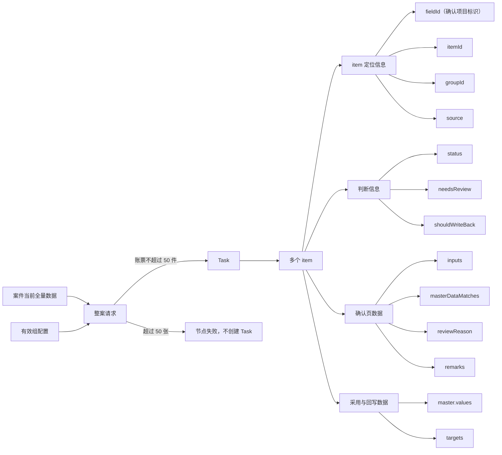
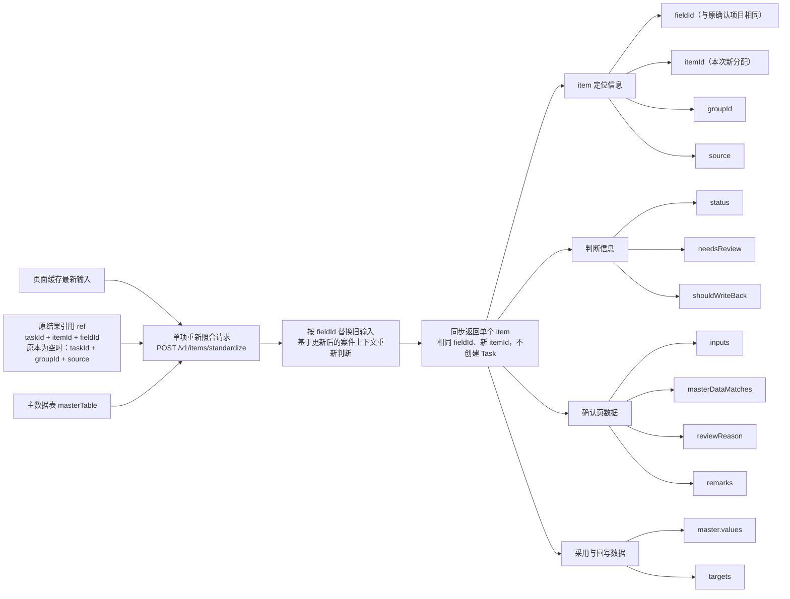
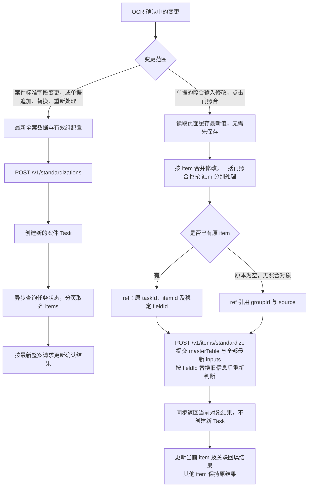

## 第 1 章｜本期范围与优先级

### 1.1 背景与目标

四期接入 Zurich 综合主数据名称标准化 API。上游已有案件集约、文件补件、OCR抽出和 OCR抽出确认任务。主数据照合按案件当前完整资料发起请求，并使用异步任务和现有 OCR抽出确认待办。

本 PRD 的正文、字段说明和流程说明使用简体中文。界面文案、API 字段值、接口返回内容和示例中的日语保留原文。

本期要完成以下结果。

- 配置管理员可以通过 Zurich 返回的主数据 schema 配置可复用的照合组。
- 业务场景管理员可以在 OCR抽出后放置「マスタ照合」节点。节点按当前业务场景自动读取适用的照合组。
- 每次工作流执行到主数据照合节点时，发送该时点案件下已有的全部账票；一次工作流执行中的整案提交对应一个 Task。后续单项重新照合另发同步请求，不创建 Task。工作流等待该 Task 结束后继续。后续工作流再次执行时仍发送当时案件的全部账票，不只发送新增文件。
- IDP 按结果中的 targets 回填无须确认的项目，将需要确认的结果送入本次案件工作流对应的 OCR抽出确认。
- 组外字段保持 OCR抽出值。

### 1.2 本期范围

| 模块 | 本期说明 |
| --- | --- |
| 组配置 | 维护照合组、适用场景和字段映射，支持默认组导入、保存校验及变更履历 |
| API 设定 | 配置 Zurich API 连接与认证，支持连接测试及连接状态展示 |
| 工作流 | 配置「マスタ照合」节点；每次执行使用当时全案文件发起照合，处理异步状态、结果回写和失败情况 |
| OCR 确认 | 展示文本与表格字段的候选及确认说明，支持人工确认和候选选择 |
| 重新照合 | 在 OCR 确认页修改照合输入后，支持对文本与表格字段发起单项或一括重新照合，直接使用页面缓存中的最新值，无需先保存 |

### 1.4 里程碑与优先级

| 优先级 | 功能范围 |
| --- | --- |
| 本期 P0 | API 连接、照合组配置、工作流整案照合、结果回写与人工确认、字段级重新照合、任务与配置追溯 |

### 1.5 上下游关系与依赖

| 系统或模块 | 关系 |
| --- | --- |
| API設定 → 外部API | 提供 Zurich Base URL、API Key 和连接状态 |
| 业务场景设定（「業務シーン設定」） | 提供 sceneId、账票类型和字段，供照合组匹配与节点读取 |
| OCR抽出 | 提供需要照合的案件 OCR 快照 |
| OCR抽出确认 | 承接普通 OCR 待确认项和主数据照合待确认项 |
| Zurich 标准化 API | 提供主数据 schema、默认组、组校验、案件标准化和字段重新照合 |

接口基准为 Zurich 综合主数据名称标准化 API v1.2。配置期使用 GET /v1/masters、GET /v1/catalog和 GET /v1/groups/defaults。执行期使用 POST /v1/standardizations、GET /v1/standardizations、GET /v1/standardizations/{taskId}、GET /v1/standardizations/{taskId}/items 和 POST /v1/items/standardize。

接口的阶段、调用时机、同步性和字段定义统一放在分模块 API 与字段中。

## 第 2 章｜使用流程

### 2.1 配置准备

管理员先在「API 设定」配置连接地址和认证信息，测试连接。然后进入「组配置」，选择主数据表，配置适用场景及 IDP 字段与主数据项目的映射，也可以导入默认组后修改。

配置页面直接使用接口返回的角色和可选照合方式。点击保存后，由后端对完整配置进行校验，通过后保存并记录版本。具体操作和校验见第 5 章。

### 2.2 工作流执行

流程为：**OCR 抽出 → 数据映射 → 主数据照合 → OCR 确认 → 后续节点**。

文件以批次进入案件。每一批文件的 OCR 抽出和数据映射完成后，工作流都会进入主数据照合节点。IDP 收集案件内当前已有的全部文件，连同最新 OCR、数据映射结果和有效照合组，发起一次整案照合请求。该请求同时包含此前批次已经处理过的文件，不只包含当前新增文件。

后续有新增、替换或删除文件并再次经过主数据照合节点时，IDP 重新收集案件当前全部文件，再次发起整案照合请求。最新请求结果用于案件，之前的照合结果由本次结果取代。后续每次文件变化都按相同方式重新提交，直到案件处理完成。

| 触发 | 本次请求包含的文件 | 结果处理 |
| --- | --- | --- |
| 第 1 批次文件 A、B 到达 | A、B | 生成第 1 次整案结果 |
| 第 2 批次新增文件 C | A、B、C | 生成第 2 次整案结果，替换第 1 次结果 |
| 删除文件 B 后再次执行节点 | A、C | 生成第 3 次整案结果，替换第 2 次结果 |
| 替换文件 A 后再次执行节点 | 新 A、C | 生成第 4 次整案结果，替换第 3 次结果 |

API 返回本次任务的 taskId。IDP 等待异步任务结束并取得完整结果，再按结果自动采用或进入 OCR 确认。任务完成表示本次请求结束，不表示案件不会再有文件到达。

### 2.3 OCR 确认与重新照合

- needsReview 决定是否人工确认；shouldWriteBack 决定是否回写，两者分别处理。
- 确认页使用 API 返回的统一候选列表、确认原因和其他信息。有内容则显示，无内容则隐藏；主要素及追加要素使用同一候选列表。
- 操作员选择已有候选后，按该候选的值和目标位置采用结果。
- 修改照合输入后，可单项或一括重新照合，直接使用页面缓存最新值，无需先保存。一括处理已修改的文本和表格输入，不增加勾选框。
- 重新照合只处理被修改字段所属的照合对象：每次提交该对象全部输入的最新缓存值；该对象关联的回填结果可能一起更新，其他对象保持原结果。

## 第 3 章｜数据结构与职责

### 3.1 配置结构

一个照合组选择一个主数据表，包含多个成员。每个成员把一个 IDP 字段映射到一个主数据列或 hint，并指定读取、回写或读写方式。

| 数据 | 用途 |
| --- | --- |
| 主数据定义 | API 提供主数据表、列和 hint；configuration 提供角色名称、允许的方式及主输入资格 |
| 照合组 | IDP 保存 groupId、组名、主数据表和成员；适用场景由 IDP 维护，发送 API 前移除 |
| 组成员 | 包含主数据列或 hint、IDP 字段引用和 mode；普通字段按字段配置，表格按列配置，标准字段引用数据映射结果 |
| 配置版本与来源 | 后端保存 groupsVersion、配置快照及默认组来源，不提供前端版本管理入口 |

同一组不能重复配置同一主数据列或 hint。同一普通字段、表格列或案件标准字段只能加入一个照合组，输入、输出和读写均适用。完整配置由后端在保存时校验。

### 3.2 请求与结果结构

item 是照合组应用到实际账票后生成的一个照合对象。组是配置模板，item 是执行结果。普通字段按每份账票生成 item，表格字段按每个实际表格行生成 item。

例如组的主输入是「診断書.傷病名」，案件中有 3 份诊断书时生成 3 个 item。组的主输入是「診療明細書.薬剤情報.商品名」时，每个药品表格行生成 1 个 item。

#### 整案照合｜请求与结果结构



#### 单字段重新照合｜请求与结果结构

图中请求携带 ref.fieldId、按 fieldId 覆盖旧输入及更新上下文的方案待客户确认。

`ref` 是原照合结果的引用，用于告诉 API 本次要重新照合哪个对象，并继承该对象的上下文和回写位置。已有结果时传原 `taskId + itemId`，并在 `ref.fieldId` 传入同一确认项目的稳定标识。原本为空、没有 item 时传原 `taskId + groupId + source`，定位原任务中的组及主输入位置。



请求中的 `inputs` 使用页面当前编辑的最新值。同一 item 的多个修改合并为一次请求，inputs 显式提交该对象全部最新输入，回写位置由原结果引用定位，照合使用按 fieldId 更新后的最新上下文。响应只更新对应照合对象及关联回填结果，其他对象保持原结果。一括再照合按照合对象分别调用。

| item 数据 | API 含义 | IDP 使用位置 |
| --- | --- | --- |
| `fieldId` | 确认项目标识，重新照合前后保持相同 | 关联重新照合前后的同一确认项目，替换该项目的结果 |
| `itemId` | 一次照合结果的对象标识。整案结果中位于 Task 的 items 内，单项重新照合会分配新值但不创建 Task | 工作流结果处理、局部重新照合和结果更新 |
| `groupId` | 生成该 item 的照合组 | 关联组配置、组名和适用场景 |
| `source` | 主输入在实际账票中的位置 | 定位确认页中的 OCR 字段或表格单元格 |
| `inputs` | 实际参与匹配的值及位置 | 确认页判断依据，重新照合时提交该对象全部最新输入 |
| `status` | API 对单个 item 的判断状态 | 异常解释和契约检查，不用于切换确认页布局 |
| `needsReview` | 是否需要人工确认 | 决定进入自动采用还是 OCR 抽出确认 |
| `shouldWriteBack` | 是否需要回写 | 决定最终结果是否写入 `targets` |
| `masterDataMatches` | 可选择的统一候选列表 | 确认页主数据候选下拉，包含主要素和追加要素 |
| `master` | API 推荐或自动采用的主数据行 | 自动采用时提供 `values` |
| `targets` | 结果应写入的 IDP 字段或表格单元格 | 回写功能按列从 `master.values` 取值写入 |
| `reviewReason` | 需要人工确认的原因 | 确认页「確認理由」 |
| `remarks` | 名称提案、照合依据、补充说明等 | 确认页字段下方附加信息，有内容时显示 |

`masterDataMatches[]` 每一项都包含自己的 `label`、`confidence`、`primary`、`master` 和 `targets`。操作员选择候选后，IDP 使用该候选自己的数据回写，不从 `splitItems` 等详细结果自行拼接。

IDP 使用 `fieldId` 关联重新照合前后的同一确认项目，并替换该项目的结果。`groupId` 关联组配置，`source` 定位主输入在账票中的实际位置，`targets` 定位回写位置。`fieldId` 不用于确定回写位置，也不决定输入数据的版本。

自动采用使用 item 的 `master.values` 和 `targets`。人工确认使用操作员所选项的 `master.values` 和 `targets`。没有值的列保持原值。`selection` 随响应保存为原始记录，本期不参与展示、回写或后续系统登记。

后续文件新增、删除或替换后再次执行工作流时，IDP 提交新的整案请求并生成新的 Task。单项重新照合使用原 `taskId`、`itemId` 和缓存最新输入，按相同 `fieldId` 替换当前确认项目的结果，保存新 `itemId`。

#### 整案照合与字段重新照合



图中的原 `taskId` 用于定位重新照合所依据的原结果。字段重新照合直接取得当前对象的新结果，无需进入案件 Task 的轮询与结果分页流程。一括再照合按 item 合并修改，同一 item 的多个修改只提交一次。

### 3.3 职责与留存

IDP 负责配置、提交请求、等待任务、展示确认页及将结果写入自身字段。API 负责匹配、判断是否需确认和回写，并提供候选及说明；API 不直接修改 IDP 数据。

后端留存本次请求实际使用的文件、字段值、组配置快照和任务结果，供运行和追溯使用。前端只展示业务需要的配置、履历和确认内容。配置修改限有权限的管理员；OCR 确认沿用现有任务权限。

## 第 4 章｜本期接口与主要字段

本章只列 IDP 本期使用的接口及主要字段。必填条件、完整结构和错误码以客户 API v1.2 式样书为准，不在 PRD 重复维护字段字典。下列接口由 IDP 后端对接，前端调用 IDP 自身服务。

### 4.1 API 设定与组配置

| 接口或配置 | 使用时机 | 本期主要数据 |
| --- | --- | --- |
| API 连接设定 | 管理员设置并测试连接 | Base URL、API Key、连接状态；认证信息由后端安全保存，不明文回显 |
| GET /v1/masters | 获取主数据及可配置项目 | schemaVersion、masterTables 中的 masterTable、label、columns、hints；项目的 column 或 hint、label、configuration |
| GET /v1/catalog | 获取照合方式显示名 | `data.enums.memberMode[].value`、`data.enums.memberMode[].label` |
| GET /v1/groups/defaults | 导入默认组 | 默认组的 groupId、label、masterTable、members |
| POST /v1/groups/validate | 保存当前组前校验跨组重复 | 请求包含当前组和其他已保存的有效组；返回每组 valid、errors，以及错误的 memberIndex、relatedGroupId 和 message |

以下 configuration 字段来自 `GET /v1/masters` 响应的 `data.masterTables[].columns[]` 或 `data.masterTables[].hints[]`。

| 配置数据 | 本期用途 |
| --- | --- |
| groupId、label、masterTable、members | 标识组、显示组名、指定主数据表及字段映射 |
| 成员的 column 或 hint、mode、field | 指定主数据项目、读取／回写方式及 IDP 字段引用 |
| `configuration.roleLabel` | 前端直接显示角色 |
| `configuration.allowedModes` | 限定可选照合方式 |
| `configuration.canBePrimary` | 后端保存时判断是否存在有效主输入 |
| sceneIds | IDP 内部适用场景，发送客户 API 前移除 |
| groupsVersion | 后端生成并随整案请求发送，记录本次使用的配置版本 |

### 4.2 工作流整案照合

| 接口 | 调用顺序与用途 |
| --- | --- |
| POST /v1/standardizations | 工作流每次执行到节点，提交当时案件全部文件的结果、数据映射结果及有效组；取得 taskId 和状态 |
| GET /v1/standardizations | 查询已完成任务，按 cursor 继续获取 |
| GET /v1/standardizations/{taskId} | 获取任务状态和结果 |
| GET /v1/standardizations/{taskId}/items | 结果含 itemsNextCursor 时继续取齐照合对象 |
| POST /v1/standardizations/{taskId}/cancel | 需要中止旧任务时请求取消；以后端实际状态为准 |

| 主要字段 | IDP 如何使用 |
| --- | --- |
| sceneId、documents、groups、groupsVersion | 提交当前场景、全案单据结果及本次有效组配置 |
| caseResult、caseFieldConflicts | 使用标准字段时提交数据映射结果及其冲突信息 |
| taskId、status | 关联本次异步任务；完成后取得完整结果再衔接确认或后续流程 |
| cursor、itemsNextCursor | 处理任务列表和结果分页，避免遗漏 |
| items | 当前任务的照合对象结果，交给统一结果处理逻辑 |

请求按当前全案快照提交。Task 状态表示本次请求的处理结果，后续文件到达时由下一次工作流执行提交最新全案。

### 4.3 OCR 确认与重新照合

#### 接口与调用顺序

| 顺序 | 接口 | 调用时机 | 用途 |
| --- | --- | --- | --- |
| 1 | `GET /v1/standardizations/{taskId}` | 工作流完成整案请求后，进入确认页或恢复确认页 | 获取任务状态、主要照合结果及 `itemsNextCursor` |
| 2 | `GET /v1/standardizations/{taskId}/items?cursor=...` | `itemsNextCursor` 或上一页 `nextCursor` 存在时 | 分页取齐当前任务的全部照合对象 |
| 3 | `POST /v1/items/standardize` | 操作员修改照合输入并点击单项或一括「再照合」 | 使用页面缓存最新值重新照合被修改字段所属的 item，同步返回新结果 |
| 4 | `POST /v1/standardizations` | 修改案件标准字段，或单据追加、替换、重新处理导致整案输入变化 | 使用最新全案数据重新提交请求，不用于单据字段的局部重新照合 |

普通候选确认、保留 OCR 原值和选择已有候选不需要调用 Zurich 接口。确认结果由 IDP 保存到自身的确认记录中。

IDP 以 `fieldId` 关联重新照合前后的确认项目及结果。`groupId` 用于关联组配置，`source` 用于定位主输入，`targets` 用于定位回写位置。

#### 重新照合调用规则

请求补充 ref.fieldId、连续引用原 itemId 及后端上下文覆盖行为待客户确认，以下按拟采用方案说明。

重新照合使用 `POST /v1/items/standardize`，主要提交 `ref`、`masterTable` 和该对象全部最新 `inputs`。有原结果时，`ref` 携带原 `taskId`、原 `itemId` 及稳定的 `fieldId`。后端按 fieldId 更新该项目的输入及照合上下文，再重新判断。原本为空、尚无照合对象时，按式样书使用 `groupId` 和 `source` 引用配置及位置。

修改值直接取页面缓存，无需先保存。同一 item 的多个修改合并为一次请求，每次显式提交该对象全部最新输入。接口同步返回，不创建新的 Task。新结果更新当前 item 及关联回填结果，其他 item 保持原结果。文本字段和表格字段均适用。


#### 主要字段

| 结果字段 | 本期用途 |
| --- | --- |
| `status` | 用于识别任务和结果状态，不作为确认页按场景切换结构的依据 |
| itemId、groupId | 关联照合对象及其配置组 |
| inputs | 照合输入及原值；重新照合时提交该对象全部最新输入 |
| needsReview | 决定是否人工确认；缺失或 null 按需确认处理 |
| shouldWriteBack | 决定是否回写；缺失或 null 不回写 |
| `master` | 自动采用或作为初始值的主数据行；使用 `master.values` 回写 |
| `targets` | 回写位置；按列将所采用行的值写入对应位置 |
| `masterDataMatches` | 统一候选列表；使用 label、type、confidence、primary 以及每项自己的 master、targets，不由前端按场景重新拼装 |
| reviewReason、remarks | 确认原因和其他信息，有内容则展示，无内容则隐藏 |

### 4.4 公共处理

- code、msg、requestId 用于判断接口成功与否、提示错误和后端排障；业务任务状态另看 status。
- 保存校验或运行接口失败时保留当前配置或字段值，提示错误并按对应流程重试，不把失败当作成功。
- API Key、请求快照、默认组来源及版本信息由后端维护。前端只展示业务需要的状态和内容。


### 4.5 分模块调用示例

以下示例统一使用展开缩进；每个例子只表达一个调用场景。客户接口均携带已配置的认证头，API Key 不在示例中展示。

#### API 设定｜连接测试

本期连接测试由 IDP 后端调用需要认证的主数据一览接口，验证地址和认证是否可用。请求及响应示例见下一节，认证按式样书通用认证规则携带。IDP 内部测试接口结构后续由开发定义。

```http
GET /v1/masters
```

成功取得合法响应时显示连接成功；认证失败、网络异常或响应错误时显示连接失败，不覆盖已保存配置。

#### 组配置｜获取可配置项目

展开主数据下拉，取得角色及可选方式。

式样书 §4.7 摘录。以下 JSON 仅展示本场景主要字段，省略其他字段，不替代完整契约。

**请求**

```http
GET /v1/masters
```

无请求体。

**响应**

<details>
<summary>展开 JSON 示例</summary>

```json
{
  "code": 0,
  "msg": "",
  "requestId": "req-example",
  "data": {
    "schemaVersion": "2026-11-25",
    "masterTables": [
      {
        "masterTable": "DISEASE",
        "label": "傷病名マスタ",
        "columns": [
          {
            "column": "CLM_ICD10Mst__c.NAME",
            "label": "傷病名",
            "configuration": {
              "roleLabel": "主入力・書き戻し可",
              "allowedModes": [
                "INPUT",
                "OUTPUT",
                "INPUT_OUTPUT"
              ],
              "canBePrimary": true
            }
          },
          {
            "column": "CLM_ICD10Mst__c.ICD10__C",
            "label": "ICD10 コード",
            "configuration": {
              "roleLabel": "補助入力・書き戻し可",
              "allowedModes": [
                "INPUT",
                "OUTPUT",
                "INPUT_OUTPUT"
              ],
              "canBePrimary": false
            }
          }
        ],
        "hints": [
          {
            "hint": "sex",
            "label": "性別",
            "deprecated": false,
            "configuration": {
              "roleLabel": "ヒント（照合に使うだけ）",
              "allowedModes": [
                "INPUT"
              ],
              "canBePrimary": false
            }
          }
        ]
      }
    ]
  }
}
```

</details>

**IDP 处理：** 显示 label 和 roleLabel，按 allowedModes 提供选项。

#### 组配置｜获取方式名称

取得照合方式的日文显示名。

式样书 §4.10 摘录。以下 JSON 仅展示本场景主要字段，省略其他字段，不替代完整契约。

**请求**

```http
GET /v1/catalog
```

无请求体。

**响应**

```json
{
  "code": 0,
  "msg": "",
  "requestId": "req-example",
  "data": {
    "catalogVersion": "2026-11-25",
    "enums": {
      "memberMode": [
        {
          "value": "INPUT",
          "label": "読み取り（照合に使う）"
        },
        {
          "value": "OUTPUT",
          "label": "書き戻し"
        },
        {
          "value": "INPUT_OUTPUT",
          "label": "読み取り・書き戻し"
        }
      ]
    }
  }
}
```

**IDP 处理：** 按 value 关联选项，显示 label。

#### 组配置｜导入默认组

点击既定グループ，获取模板后载入草稿。

式样书 §4.8 摘录。以下 JSON 仅展示本场景主要字段，省略其他字段，不替代完整契约。

**请求**

```http
GET /v1/groups/defaults
```

无请求体。

**响应**

<details>
<summary>展开 JSON 示例</summary>

```json
{
  "code": 0,
  "msg": "",
  "requestId": "req-example",
  "data": {
    "version": "2026-11-19",
    "groups": [
      {
        "groupId": "DEFAULT:HG02-OPE",
        "label": "手術（診療明細書2）",
        "masterTable": "OPERATION",
        "members": [
          {
            "column": "CLM_OperationMst__c.NAME",
            "mode": "INPUT_OUTPUT",
            "field": {
              "type": "TABLE_COLUMN",
              "documentTypeId": "20001",
              "tableName": "手術情報",
              "columnName": "手術名"
            }
          },
          {
            "column": "CLM_OperationMst__c.KCODE__C",
            "mode": "INPUT",
            "field": {
              "type": "TABLE_COLUMN",
              "documentTypeId": "20001",
              "tableName": "手術情報",
              "columnName": "手術コード"
            }
          },
          {
            "hint": "operationDate",
            "mode": "INPUT",
            "field": {
              "type": "TABLE_COLUMN",
              "documentTypeId": "20001",
              "tableName": "手術情報",
              "columnName": "手術日"
            }
          }
        ]
      }
    ]
  }
}
```

</details>

**IDP 处理：** 默认组按已保存的来源组 ID 与本地组匹配，不使用组名匹配。来源 ID 已对应时在当前组内覆盖更新，未对应时追加新组。首次导入时，适用场景和 IDP 字段映射均置空。后续组内覆盖时，保留原适用场景。主数据项目和字段名称完全一致的成员保留原 IDP 字段映射，名称或字段类型变化时只清空该成员字段。保存前仍需完整校验。

#### 组配置｜保存校验

保存当前组时，请求包含当前组和其他已保存的有效组，用于检查跨组重复。以下展示当前组通过校验的结果；跨组重复时返回 FIELD_IN_OTHER_GROUP 并阻止当前组保存。

请求按 §4.9 规则 mock，响应为成功结构示意；实际 groupId 与提交组对应。以下 JSON 仅展示本场景主要字段，省略其他字段，不替代完整契约。

**请求**

```http
POST /v1/groups/validate
```

<details>
<summary>展开 JSON 示例</summary>

```json
{
  "groups": [
    {
      "groupId": "DEFAULT:HG02-OPE",
      "label": "手術（診療明細書2）",
      "masterTable": "OPERATION",
      "members": [
        {
          "column": "CLM_OperationMst__c.NAME",
          "mode": "INPUT_OUTPUT",
          "field": {
            "type": "TABLE_COLUMN",
            "documentTypeId": "20001",
            "tableName": "手術情報",
            "columnName": "手術名"
          }
        },
        {
          "column": "CLM_OperationMst__c.KCODE__C",
          "mode": "INPUT",
          "field": {
            "type": "TABLE_COLUMN",
            "documentTypeId": "20001",
            "tableName": "手術情報",
            "columnName": "手術コード"
          }
        },
        {
          "hint": "operationDate",
          "mode": "INPUT",
          "field": {
            "type": "TABLE_COLUMN",
            "documentTypeId": "20001",
            "tableName": "手術情報",
            "columnName": "手術日"
          }
        }
      ]
    }
  ]
}
```

</details>

**响应**

```json
{
  "code": 0,
  "msg": "",
  "requestId": "req-example",
  "data": {
    "groups": [
      {
        "groupId": "HE03-DIS-1",
        "valid": true,
        "errors": []
      }
    ]
  }
}
```

**IDP 处理：** 存在错误则停止保存，Toast 提示占用组并保留草稿。

#### 工作流｜发起整案照合

工作流执行到节点，以当时全案数据提交；示例仅保留第一组和第一份单据。

式样书 §4.1 摘录。以下 JSON 仅展示本场景主要字段，省略其他字段，不替代完整契约。

**请求**

```http
POST /v1/standardizations
```

<details>
<summary>展开 JSON 示例</summary>

```json
{
  "clientRequestId": "CLAIM-20261118000123-v1-1",
  "caseNo": "CLAIM-20261118000123",
  "sceneId": "1001",
  "groupsVersion": "2026-11-19-01",
  "caseResult": {
    "fields": [
      {
        "name": "性別",
        "value": "女"
      }
    ]
  },
  "groups": [
    {
      "groupId": "HG02-OPE",
      "label": "手術",
      "masterTable": "OPERATION",
      "members": [
        {
          "column": "CLM_OperationMst__c.NAME",
          "mode": "INPUT_OUTPUT",
          "field": {
            "type": "TABLE_COLUMN",
            "documentTypeId": "20001",
            "tableName": "手術情報",
            "columnName": "手術名"
          }
        },
        {
          "column": "CLM_OperationMst__c.KCODE__C",
          "mode": "INPUT",
          "field": {
            "type": "TABLE_COLUMN",
            "documentTypeId": "20001",
            "tableName": "手術情報",
            "columnName": "手術コード"
          }
        },
        {
          "hint": "operationDate",
          "mode": "INPUT",
          "field": {
            "type": "TABLE_COLUMN",
            "documentTypeId": "20001",
            "tableName": "手術情報",
            "columnName": "手術日"
          }
        }
      ]
    }
  ],
  "documents": [
    {
      "documentId": "991243705301",
      "documentTypeId": "20001",
      "documentTypeName": "診療明細書2",
      "docCode": "HG02-001",
      "format": "IDP_RESULT_JSON",
      "result": {
        "fields": [
          {
            "name": "帳票ID",
            "value": "HG02-001",
            "confidence": 1.0,
            "needReview": 0
          },
          {
            "name": "病院住所",
            "value": "東京都〇〇区〇〇町1-2-3",
            "confidence": 0.95,
            "needReview": 0
          },
          {
            "name": "診療科",
            "value": "循環器内科",
            "confidence": 0.98,
            "needReview": 0
          }
        ],
        "table_list": [
          {
            "tableName": "手術情報",
            "table_fields": [
              [
                {
                  "name": "手術名",
                  "value": "経皮的冠動脈形成術（その他のもの）",
                  "confidence": 0.93,
                  "needReview": 0
                },
                {
                  "name": "手術日",
                  "value": "2026-10-02",
                  "confidence": 0.99,
                  "needReview": 0
                },
                {
                  "name": "手術コード",
                  "value": "K5463",
                  "confidence": 0.96,
                  "needReview": 0
                }
              ]
            ]
          },
          {
            "tableName": "薬剤情報",
            "table_fields": [
              [
                {
                  "name": "商品名",
                  "value": "ティーエスワン配合カプセルT20 1C",
                  "confidence": 0.91,
                  "needReview": 0
                },
                {
                  "name": "回数",
                  "value": "28",
                  "confidence": 0.97,
                  "needReview": 0
                },
                {
                  "name": "ATC分類",
                  "value": "",
                  "confidence": null,
                  "needReview": 0
                },
                {
                  "name": "薬効分類",
                  "value": "",
                  "confidence": null,
                  "needReview": 0
                },
                {
                  "name": "薬価基準コード",
                  "value": "",
                  "confidence": null,
                  "needReview": 0
                }
              ]
            ]
          }
        ]
      }
    }
  ]
}
```

</details>

**响应**

```json
{
  "code": 0,
  "msg": "",
  "requestId": "req-example",
  "data": {
    "taskId": "MS-20261118-7Q3K9D",
    "status": "PENDING",
    "pollAfterMs": 5000
  }
}
```

**IDP 处理：** 保存 taskId；未完成时继续等待。后续工作流执行时重新提交最新全案数据。

#### 工作流｜获取已结束任务

后端定期获取结束任务，第二次起带上次返回的 nextCursor。

响应为式样书 §4.4 原例；请求游标为占位 mock。以下 JSON 仅展示本场景主要字段，省略其他字段，不替代完整契约。

**请求**

```http
GET /v1/standardizations?cursor=c-previous&limit=100
```

无请求体。

**响应**

```json
{
  "code": 0,
  "msg": "",
  "requestId": "req-20261118-000141",
  "warnings": [],
  "data": {
    "tasks": [
      {
        "taskId": "MS-20261118-7Q3K9D",
        "clientRequestId": "CLAIM-20261118000123-v1-1",
        "caseNo": "CLAIM-20261118000123",
        "status": "SUCCEEDED",
        "completedAt": 1794963681300
      }
    ],
    "nextCursor": "c-000000001794963681300-7Q3K9D"
  }
}
```

**IDP 处理：** 保存 nextCursor，再按 taskId 获取完整结果。

#### 工作流与 OCR 确认｜取得照合结果

任务完成后，取得供确认页使用的结果。

式样书 §4.2 摘录。以下 JSON 仅展示本场景主要字段，省略其他字段，不替代完整契约。

**请求**

```http
GET /v1/standardizations/MS-20261118-7Q3K9D
```

无请求体。

**响应**

<details>
<summary>展开 JSON 示例</summary>

```json
{
  "code": 0,
  "msg": "",
  "requestId": "req-example",
  "data": {
    "taskId": "MS-20261118-7Q3K9D",
    "status": "SUCCEEDED",
    "items": [
      {
        "itemId": "ope1",
        "fieldId": "fd-9c1e5a20",
        "groupId": "HG02-OPE",
        "needsReview": false,
        "shouldWriteBack": true,
        "masterDataMatches": [
          {
            "type": "recommended",
            "label": "マスタ推奨",
            "value": "経皮的冠動脈形成術（その他のもの）",
            "confidence": 100.0,
            "primary": true,
            "master": {
              "masterTable": "OPERATION",
              "object": "CLM_OperationMst__c",
              "masterId": "a0V000000000000301",
              "displayName": "経皮的冠動脈形成術",
              "values": {
                "CLM_OperationMst__c.NAME": "経皮的冠動脈形成術",
                "CLM_OperationMst__c.KCODE__C": "K546-00",
                "CWF_OperationMstAlias__c.NAME": "経皮的冠動脈形成術（その他のもの）"
              },
              "active": true,
              "selection": {
                "object": "CWF_OperationMstAlias__c",
                "recordType": "ALIAS",
                "recordId": "a0W000000000000301",
                "name": "経皮的冠動脈形成術（その他のもの）"
              }
            },
            "targets": {
              "CLM_OperationMst__c.NAME": {
                "type": "TABLE_CELL",
                "documentId": "991243705301",
                "tableName": "手術情報",
                "tableIndex": 0,
                "rowIndex": 0,
                "columnName": "手術名",
                "columnIndex": 0
              }
            }
          },
          {
            "type": "candidate",
            "label": "マスタ候補",
            "value": "経皮的冠動脈形成術（急性心筋梗塞に対するもの）",
            "confidence": 88.4,
            "primary": true,
            "master": {
              "masterTable": "OPERATION",
              "object": "CLM_OperationMst__c",
              "masterId": "a0V000000000000301",
              "displayName": "経皮的冠動脈形成術",
              "values": {
                "CLM_OperationMst__c.NAME": "経皮的冠動脈形成術",
                "CLM_OperationMst__c.KCODE__C": "K546-00",
                "CWF_OperationMstAlias__c.NAME": "経皮的冠動脈形成術（急性心筋梗塞に対するもの）"
              },
              "active": true,
              "selection": {
                "object": "CWF_OperationMstAlias__c",
                "recordType": "ALIAS",
                "recordId": "a0W000000000000302",
                "name": "経皮的冠動脈形成術（急性心筋梗塞に対するもの）"
              }
            },
            "targets": {
              "CLM_OperationMst__c.NAME": {
                "type": "TABLE_CELL",
                "documentId": "991243705301",
                "tableName": "手術情報",
                "tableIndex": 0,
                "rowIndex": 0,
                "columnName": "手術名",
                "columnIndex": 0
              }
            }
          },
          {
            "type": "candidate",
            "label": "マスタ候補",
            "value": "経皮的冠動脈形成術（不安定狭心症に対するもの）",
            "confidence": 87.9,
            "primary": true,
            "master": {
              "masterTable": "OPERATION",
              "object": "CLM_OperationMst__c",
              "masterId": "a0V000000000000301",
              "displayName": "経皮的冠動脈形成術",
              "values": {
                "CLM_OperationMst__c.NAME": "経皮的冠動脈形成術",
                "CLM_OperationMst__c.KCODE__C": "K546-00",
                "CWF_OperationMstAlias__c.NAME": "経皮的冠動脈形成術（不安定狭心症に対するもの）"
              },
              "active": true,
              "selection": {
                "object": "CWF_OperationMstAlias__c",
                "recordType": "ALIAS",
                "recordId": "a0W000000000000303",
                "name": "経皮的冠動脈形成術（不安定狭心症に対するもの）"
              }
            },
            "targets": {
              "CLM_OperationMst__c.NAME": {
                "type": "TABLE_CELL",
                "documentId": "991243705301",
                "tableName": "手術情報",
                "tableIndex": 0,
                "rowIndex": 0,
                "columnName": "手術名",
                "columnIndex": 0
              }
            }
          },
          {
            "type": "candidate",
            "label": "マスタ候補",
            "value": "経皮的冠動脈形成術（特殊カテーテルによるもの）",
            "confidence": 80.2,
            "primary": true,
            "master": {
              "masterTable": "OPERATION",
              "object": "CLM_OperationMst__c",
              "masterId": "a0V000000000000311",
              "displayName": "経皮的冠動脈形成術（特殊カテーテルによるもの）",
              "values": {
                "CLM_OperationMst__c.NAME": "経皮的冠動脈形成術（特殊カテーテルによるもの）",
                "CLM_OperationMst__c.KCODE__C": "K548-00",
                "CWF_OperationMstAlias__c.NAME": "経皮的冠動脈形成術（特殊カテーテルによるもの）"
              },
              "active": true,
              "selection": {
                "object": "CWF_OperationMstAlias__c",
                "recordType": "ALIAS",
                "recordId": "a0W000000000000311",
                "name": "経皮的冠動脈形成術（特殊カテーテルによるもの）"
              }
            },
            "targets": {
              "CLM_OperationMst__c.NAME": {
                "type": "TABLE_CELL",
                "documentId": "991243705301",
                "tableName": "手術情報",
                "tableIndex": 0,
                "rowIndex": 0,
                "columnName": "手術名",
                "columnIndex": 0
              }
            }
          },
          {
            "type": "candidate",
            "label": "マスタ候補",
            "value": "経皮的冠動脈ステント留置術（その他のもの）",
            "confidence": 76.5,
            "primary": true,
            "master": {
              "masterTable": "OPERATION",
              "object": "CLM_OperationMst__c",
              "masterId": "a0V000000000000312",
              "displayName": "経皮的冠動脈ステント留置術",
              "values": {
                "CLM_OperationMst__c.NAME": "経皮的冠動脈ステント留置術",
                "CLM_OperationMst__c.KCODE__C": "K549-00",
                "CWF_OperationMstAlias__c.NAME": "経皮的冠動脈ステント留置術（その他のもの）"
              },
              "active": true,
              "selection": {
                "object": "CWF_OperationMstAlias__c",
                "recordType": "ALIAS",
                "recordId": "a0W000000000000312",
                "name": "経皮的冠動脈ステント留置術（その他のもの）"
              }
            },
            "targets": {
              "CLM_OperationMst__c.NAME": {
                "type": "TABLE_CELL",
                "documentId": "991243705301",
                "tableName": "手術情報",
                "tableIndex": 0,
                "rowIndex": 0,
                "columnName": "手術名",
                "columnIndex": 0
              }
            }
          }
        ],
        "reviewReason": null,
        "remarks": [
          {
            "label": "照合根拠",
            "value": "読取値が、画面で選べる別名「経皮的冠動脈形成術（その他のもの）」と完全に一致し、帳票の手術コードとも矛盾しないため確定した。"
          }
        ]
      }
    ],
    "itemsNextCursor": null
  }
}
```

</details>

**IDP 处理：** 按 needsReview 和 shouldWriteBack 分流，候选及原因直接交确认页显示。

#### 工作流｜取齐分页结果

itemsNextCursor 非空时继续获取；示例为空末页。

按式样书 §4.3 规则 mock。以下 JSON 仅展示本场景主要字段，省略其他字段，不替代完整契约。

**请求**

```http
GET /v1/standardizations/MS-20261118-7Q3K9D/items?cursor=cursor-example&limit=100
```

无请求体。

**响应**

```json
{
  "code": 0,
  "msg": "",
  "requestId": "req-example",
  "data": {
    "items": [],
    "nextCursor": null
  }
}
```

**IDP 处理：** 汇总所有页，nextCursor 为 null 后结束取数。

#### 工作流｜取消旧任务

案件中止或重新提交整案请求前，需要取消未结束的旧任务。单项重新照合不创建新 Task，不适用此取消流程。

按式样书 §4.5 规则 mock。以下 JSON 仅展示本场景主要字段，省略其他字段，不替代完整契约。

**请求**

```http
POST /v1/standardizations/MS-20261118-7Q3K9D/cancel
```

无请求体。

**响应**

```json
{
  "code": 0,
  "msg": "",
  "requestId": "req-example",
  "data": {
    "taskId": "MS-20261118-7Q3K9D",
    "status": "CANCELLED"
  }
}
```

**IDP 处理：** 取消结果不采用；若任务已完成，按接口实际状态处理。

#### OCR 确认｜修改输入后重新照合

操作员修改伤病名，点击再照合，直接提交缓存最新值。

请求以式样书 §4.6 为基础，暂按待客户确认方案在 ref 中补充 fieldId；响应仅示意 §4.6 的结果关联字段，省略匹配结果与回填字段。以下 JSON 仅展示本场景主要字段，省略其他字段，不替代完整契约。

**请求**

```http
POST /v1/items/standardize
```

```json
{
  "clientRequestId": "CLAIM-20261118000123-dis2-r1",
  "caseNo": "CLAIM-20261118000123",
  "ref": {
    "taskId": "MS-20261118-7Q3K9D",
    "itemId": "dis2",
    "fieldId": "fd-dis2-example"
  },
  "masterTable": "DISEASE",
  "inputs": [
    {
      "column": "CLM_ICD10Mst__c.NAME",
      "value": "乳房下内側部乳癌",
      "source": {
        "type": "FIELD",
        "documentId": "991243705302",
        "fieldName": "傷病名2",
        "fieldIndex": 4
      }
    }
  ],
  "options": {
    "allowWebSearch": false,
    "timeoutSeconds": 30
  }
}
```

**响应**

<details>
<summary>展开 JSON 示例</summary>

```json
{
  "code": 0,
  "msg": "",
  "requestId": "req-example",
  "data": {
    "itemId": "dis2-r1-example",
    "fieldId": "fd-dis2-example",
    "groupId": "HE03-DIS-1",
    "ref": {
      "taskId": "MS-20261118-7Q3K9D",
      "itemId": "dis2",
    "fieldId": "fd-dis2-example"
    }
  }
}
```

</details>

**IDP 处理：** 每次提交该对象全部最新输入，更新当前对象及关联结果；一括按对象合并后分别调用此接口，不新增批量接口。

## 第 5 章｜功能详情

### 5.1 API设定

#### 页面与入口

| 项目 | 内容 |
| --- | --- |
| 入口 | API設定 → 外部API |
| 使用者 | 配置管理员 |
| 本期用途 | 主数据设定和工作流中的主数据照合节点使用同一条 Zurich 标准化 API 连接 |

外部 API 列表显示连接名、用途、Base URL、创建时间、状态、创建人和操作。允许新增、编辑和删除连接。本期「用途割当」只有「マスタデータ照合」，同一用途只能绑定一条连接。已被占用的用途不能再次分配给其他连接。

#### 字段与操作

| 字段或操作 | 规则 |
| --- | --- |
| 接続名 | 必填，用于列表显示 |
| 用途割当 | 必填，本期固定为「マスタデータ照合」 |
| プロバイダ | 必填，本期为「Zurich 標準化API」 |
| 認証方式 | 必填，本期为「APIキー（Bearer）」 |
| Base URL | 必填，使用 Zurich 按环境提供的地址，通信使用 HTTPS（TLS 1.2 及以上） |
| APIキー | 新增时必填。编辑时未输入新密钥则沿用已保存密钥。页面只显示脱敏值 |
| 保存 | 必填项和 URL 格式通过后可用。保存连接信息和模块绑定 |
| 接続テスト | 连接保存后执行，由后端使用已保存的认证信息请求 `GET /v1/masters` 验证连接 |
| 削除 | 二次确认后删除连接并解除用途绑定 |

API Key 由后端安全保存，前端不获取明文密钥。连接保存后可以未测试，但未通过连接测试时不能读取主数据或执行照合。

#### 连接状态

连接状态只有两种。

| 状态 | 判定 |
| --- | --- |
| 有効 | 当前 Base URL 和认证信息测试成功 |
| 無効 | 尚未测试、测试失败，或保存后 Base URL、认证方式、API Key 已发生变化 |

测试失败时显示红色错误提示。Base URL、认证信息、保存、读取和业务执行产生的错误文案均使用日文。

#### 异常处理

| 条件 | 处理 |
| --- | --- |
| 必填项缺失 | 保存不可用，并显示日文错误提示 |
| 认证失败、网络异常或返回错误 | 连接状态设为「無効」，显示日文错误提示，保留已保存连接信息 |
| 用途已被其他连接占用 | 当前连接不能保存 |
| 未配置有效连接 | 组配置显示日文空状态，工作流照合节点以失败结束 |

### 5.2 组配置

#### 页面与操作

入口为「業務ルール設定 → マスタデータ設定 → 外部マスタデータ」。配置管理员在左侧维护照合组，在右侧编辑组信息及字段映射。

| 操作 | 行为 |
| --- | --- |
| 追加 | 新建组草稿，适用场景初始为空 |
| 名称変更 | 修改组名，保存后记录变更履历 |
| 削除 | 二次确认后立即删除。已保存组删除时同步更新 groupsVersion，不记录删除履历。删除菜单悬停使用系统危险色 |
| 変更履歴 | 顶部显示作成者和登録日時，表格显示更新者和更新時間 |
| 既定グループ | 获取默认组并显示新增、更新、变更なし的差异 |
| 保存 | 校验并保存当前组，其他组的草稿和已保存配置不受影响 |
| 閉じる | 关闭当前组的编辑区域，不保存草稿 |

不允许复制组。新增、改名、删除、默认组导入和字段编辑都只修改草稿，保存成功后生效。

当前组存在未保存修改时，点击其他组、追加或閉じる均不执行切换，显示红色日文提示「先に現在の変更を保存してください。」。点击保存并成功保存当前组后，才允许切换。

#### 组与字段

| 字段 | 规则 |
| --- | --- |
| グループ名 | 必填，显示在组列表。所有可见组中不能重名 |
| 適用シーン | 必填，可多选。「全シーン」与具体场景互斥，字段范围取所选场景账票类型的交集 |
| マスタ | 必填，一个组选择一个主数据表 |
| 照合フィールド | 显示マスタ項目、フィールド、照合方式、ロール及操作 |

添加或编辑字段时，依次选择「マスタ項目」「照合方式」「フィールド」。IDP 字段可选择普通账票字段、表格列或数据映射中的案件标准字段。表格列按整列配置，运行时对应该表的实际单元格。

同一组不能混用普通账票字段和表格列。组内已有已完成的表格列映射时，「フィールド」只显示表格列。组内已有已完成的普通账票字段映射时，「フィールド」不再显示表格列。默认组导入后的空字段占位不参与该锁定判断。保存时后端再次检查该规则。

#### 主数据项目

以下 configuration 字段来自 `GET /v1/masters` 响应的 `data.masterTables[].columns[]` 或 `data.masterTables[].hints[]`。

| configuration 字段 | 界面显示与用途 |
| --- | --- |
| `configuration.roleLabel` | 原样显示在「ロール」列和主数据项下拉中 |
| `configuration.allowedModes` | 只显示数组中允许的照合方式，空数组时该项目不可选 |
| `configuration.canBePrimary` | 不直接显示，用于后端判断该项目能否作为主输入 |

照合方式名称取自 `GET /v1/catalog` 响应中的 `data.enums.memberMode[]`。前端按 `value` 对应 mode，并使用该条目的 `label` 作为显示名称。

| value | 界面显示 |
| --- | --- |
| `INPUT` | 読み取り（照合に使う） |
| `OUTPUT` | 書き戻し |
| `INPUT_OUTPUT` | 読み取り・書き戻し |

主数据项下拉按「列」和「ヒント」分组。两个分组标题加粗，并分别使用系统现有的主题色和成功色。右侧角色说明使用较小字号，左右文字垂直居中。

#### 默认组

点击「既定グループ」后，后端调用 `GET /v1/groups/defaults`。默认组按已保存的来源组 ID 与本地组匹配，显示新增、更新或变更なし。名称相同的本地组不会被自动视为同一个默认组。

首次导入默认组时只带入组名、主数据表和主数据项目。默认组中的 `documentTypeId`、字段名、表名和列名属于外部数据，不写入本地 IDP 字段映射。适用场景和 IDP 字段均为空，管理员先选择适用场景，再选择字段。

默认组的更新采用组内覆盖、组外追加。来源组 ID 已对应本地组时，在该组内原地覆盖组名、主数据表、成员及照合方式，不创建重复组。来源组 ID 尚未对应时追加为新组。未出现在默认组响应中的本地组保持不变。

组内覆盖更新时，保留当前组之前选择的适用场景，覆盖组名、主数据表、成员及照合方式。成员的主数据项目和字段名称一致时，保留原 IDP 字段和账票类别。字段名称或字段类型变化时，视为不匹配，只清空该成员的字段并要求重新选择。

默认组载入草稿后，如果更新后仍有未匹配字段，显示提示「既定グループを更新しました。不足している照合フィールドを設定し、対象の組ごとに保存してください。保存後に設定が反映されます。」。全部字段匹配成功时不显示该提示。首次追加的组如果同时缺少场景和字段，提示用户补全后逐组保存。「既定グループの更新」标题旁显示信息图标，悬停或聚焦时说明首次导入和后续更新的处理方式。默认组导入只修改草稿，当前组保存成功后才生效。

默认组客户端字段标识只保存在后端原始响应中。点击「更新」后先载入草稿，保存成功前不替换正式配置。

删除已导入的默认组时同时解除来源组 ID 映射。下次获取默认组时按新组重新追加，不再关联已删除组。

#### 保存规则

保存以当前组为单位。前端先检查当前组可以直接发现的草稿错误，再由后端执行完整业务校验并只保存当前组。其他组继续保留各自草稿或已保存状态。

前端校验包括以下内容。

| 校验项 | 前端处理 |
| --- | --- |
| 组信息完整性 | 组名、适用场景、主数据表和至少一个成员为空时阻止提交 |
| 成员完整性 | 主数据项目、照合方式或 IDP 字段未选择时阻止提交 |
| 照合方式 | 下拉只提供 `configuration.allowedModes` 中的值，提交前再次检查当前 mode |
| 组内主数据项重复 | 同组已使用的主数据列或 hint 从候选中禁用，提交前再次检查 |
| 字段有效性 | 只允许选择当前适用场景涉及的账票字段、表格列或数据映射字段，提交前检查所选字段仍存在 |
| 字段形态一致性 | 同一组不能同时配置普通账票字段和表格列，提交前阻止混用 |
| 主输入排列 | 提交前检查多个主输入是否属于同一账票类型，表格列是否使用同一张表 |
| 跨组重复 | 提交前检查同一普通字段、表格列或案件标准字段是否已经出现在其他组 |

前端校验失败时显示红色日文错误提示，保留草稿，不提交后端。

后端保存校验包括以下内容。

1. 重新检查提交的结构、必填项、主数据项目、IDP 字段、适用场景及 mode 合法性，防止页面数据过期或请求被直接调用。
2. 检查组内主输入是否完整。每组至少有一个成员同时满足 `configuration.canBePrimary=true`，且 mode 为 `INPUT` 或 `INPUT_OUTPUT`。
3. 重新检查同一普通字段、表格列或案件标准字段是否只能属于一个照合组。
4. 重新检查同一组内没有混用普通账票字段和表格列。
5. 每次保存当前组时，向 `POST /v1/groups/validate` 一次提交当前组和其他已保存的有效组，检查跨组重复字段。未保存的其他组草稿不进入请求。
6. 全部通过后只保存当前组，生成新的 `groupsVersion` 和完整配置快照。保存失败时保留原正式配置和其他组状态。

添加或编辑单个成员时只校验当前表单和当前组内可立即判断的重复项。主输入是否完整在保存时由后端判断。

#### 版本与变更履历

保存成功后由后端生成新的 `groupsVersion` 和完整配置快照。默认组来源和整体版本只供后端运行与追溯，前端不提供版本查看入口。

删除已保存组时立即从正式配置中移除该组，生成新的 `groupsVersion` 和完整配置快照。删除草稿中尚未保存的新组不生成版本。组名重复时阻止保存。

变更履历弹窗顶部显示该组的作成者和登録日時。表格按更新时间显示更新者和更新時間。保存草稿并产生正式配置变化后追加更新记录，复制组和删除组的履历不显示，页面浏览、下拉刷新和接口查询不产生履历。

#### 测试关注

| 范围 | 验证内容 |
| --- | --- |
| 下拉与显示 | 角色和可选方式由 `configuration` 决定，三种方式显示日文，列和ヒント分组可区分 |
| 字段形态 | 已有表格列后不能选择普通账票字段，已有普通账票字段后不能选择表格列，混用数据不能保存 |
| 默认组 | 组级按来源 ID 匹配，已对应组内覆盖、未对应组追加；首次导入场景和字段为空，后续保留场景并复用匹配映射；删除后解除来源映射 |
| 保存校验 | 只检查当前组是否完整；无主输入、非法方式、重复字段、跨组重复字段、场景不兼容及表格不对齐均阻止当前组保存 |
| 保存与履历 | 失败保留当前组草稿和其他组状态；成功后只更新当前组并生成新版本，履历只记录当前组的变化 |
| 未保存切换 | 当前组修改后点击其他组、追加或閉じる会被阻止，并显示日文红色提示 |
| 组名与删除 | 同名组不能保存；已保存组删除后立即生成新版本，重新获取默认组时可以再次追加 |

### 5.3 工作流

#### 节点与执行顺序

流程为：OCR抽出 → 数据映射 → 主数据照合 → OCR抽出确认 → 后续节点。

业务场景工作流放置「マスタ照合」节点时，使用本期的外部主数据照合。节点读取当前场景已保存的适用组，并使用这些组的版本快照发起请求。没有该节点时，继续使用原有内部主数据规则。

#### 整案请求

工作流每次执行到主数据照合节点时，IDP 使用该时点案件已有的全部文件、最新 OCR 抽出结果、数据映射结果、有效组和 `groupsVersion` 发起一次整案请求。

| 对象 | 规则 |
| --- | --- |
| 请求 | IDP 发往 Zurich 的一次 `POST /v1/standardizations` |
| Task | API 对一次成功受理请求返回的处理任务 |
| 批次 | 批次只表示 IDP 的工作流执行和文件到达过程，API 始终按当时案件的全量数据执行 |

每次工作流执行直接使用该时点案件已有的全量资料。后续文件到达、删除或替换时，下一次工作流执行使用最新全案数据重新请求。批次标识由 IDP 内部管理。

同一案件已有整案请求处理中，且发生需要整案重新照合的输入变化时，IDP 取消旧 Task，结束旧工作流执行，并从开始节点以最新全案数据重新执行完整工作流。旧 Task 的结果仅保留为执行记录，不应用到案件。

本期每个整案请求最多提交 50 件逻辑账票（`documents[]`）。IDP 在发请求前检查案件账票数，超过 50 件时节点默认失败，不创建 Task。客户式样书中的拆分请求方案属于 IDP 本期范围外。

批次再次执行与超限拆分不同：批次处理是在后续文件到达后重新提交“一个最新全案请求”，每次执行仍对应一个 Task。超限拆分是在同一时点把全案拆成多个请求和多个 Task，并需要合并跨请求结果，本期不实现。如果后续批次累计后案件超过 50 件，下一次整案请求同样直接失败。

#### 异步状态

节点保存 `taskId`、`clientRequestId`、查询游标和轮询状态。`masterStatus` 表示流程状态，`masterResult` 表示业务结果。

| 条件 | masterStatus | masterResult | 后续 |
| --- | --- | --- | --- |
| Task 为 `PENDING` 或 `PROCESSING` | `processing` | 等待结果 | 继续等待 |
| 输入 OCR 尚未确认 | `processing` | 等待结果 | 等待 OCR 输入确认 |
| Task 成功且无需主数据人工确认 | `success` | `passed` | 进入后续节点 |
| Task 成功但存在主数据人工确认项 | `success` | `reviewRequired` | 进入 OCR抽出确认 |
| Task 为 `FAILED` | `failed` | 无业务结果 | 进入失败处理 |

`CANCELLED` 不属于照合节点状态。因输入变化或重新识别取消旧 Task 时，结束旧执行并从开始节点重跑完整工作流；点击「案件中止」时将案件标记为中止并结束工作流。两种情况都不应用被取消 Task 的结果。

人工确认节点的「完了」「补件」「案件中止」出口可以连接到任意有效工作流节点，包括前处理、OCR 和 AI 检证；不强制出口穿过特定节点，也不强制补件出口回流到指定上游。发布时按整条工作流结构和结束节点可达性校验。

Task 进入终态并且最新请求的结果处理完成后，工作流继续。Task 完成表示本次请求结束，后续文件到达时由下一次工作流执行重新请求。

#### 输出变量与引用位置

「マスタ照合」节点向下游输出以下变量。

| 变量 | 值 | 条件节点 | 通知规则 |
| --- | --- | --- | --- |
| `masterStatus` | `processing`、`success`、`failed` | 用于运行控制 | 可作为对象节点事件变量 |
| `masterResult` | `passed`、`reviewRequired` | 变量选择器中显示在「マスタ照合」分组，可比较这两个值 | 可作为对象节点事件变量 |

条件节点的变量选择器包含「マスタ照合」分组，可选择 `masterResult` 配置 `passed` 或 `reviewRequired` 分支。通知规则的「対象ノード」列表包含「マスタ照合」，可选择 `masterStatus` 和 `masterResult` 对应的触发事件。

自定义函数节点保持原行为，不加入本次条件变量和通知对象节点的新增范围。

#### 查询与结果

后端通过已完成任务列表持续发现 Zurich 结束的 Task。列表按结束时间排序，任务不会在同一调用方的列表中重复出现。

1. **首次建立轮询**　首次请求不传 `cursor`。如需限定首次扫描的起点，可传 `finishedAfter`，值为 Unix 毫秒。每次请求的 `limit` 为 1～500，默认 100。

   ```http
   GET /v1/standardizations?finishedAfter={首次同步起点}&limit=100
   ```

2. **保存续读位置**　响应包含 `tasks` 和 `nextCursor`。后端先持久化响应中的 `taskId`，再保存本次返回的 `nextCursor`。这样服务重启后可以从已保存的位置继续，未处理的 Task 也能从持久化记录中恢复。

3. **继续轮询**　之后每 5～10 秒调用一次列表接口，把上次保存的 `nextCursor` 原样作为 `cursor` 传回。

   ```http
   GET /v1/standardizations?cursor={上次保存的nextCursor}&limit=100
   ```

   `nextCursor` 是任务列表的续读位置。不要拆解或自行生成它。若响应的 `tasks` 为空且 `nextCursor` 未变化，表示此轮没有新结束的任务，等待下一个轮询间隔后继续使用同一游标。游标仅在任务可查询期限内有效。

4. **读取任务结果**　对列表返回的每个 `taskId` 调用 `GET /v1/standardizations/{taskId}` 获取终态和主要结果。若需要的 `items` 未随响应返回，或存在 `itemsNextCursor`，继续调用 `GET /v1/standardizations/{taskId}/items` 取齐结果页。

5. **区分两种游标**　`nextCursor` 用于继续读取已完成 Task 列表。`itemsNextCursor` 只用于同一个 Task 内的照合对象分页。两者不能互换。

6. **恢复与结果归属**　IDP 重启后从持久化的 `nextCursor` 继续轮询，并重试持久化队列中未处理的 `taskId`。整案轮询仅将最新整案请求的结果更新到案件，旧 Task 的结果保留为执行记录。单项重新照合的同步结果按 fieldId 更新对应确认项目。

7. **取消旧 Task**　取消未结束请求时调用 `POST /v1/standardizations/{taskId}/cancel`。取消结果不应用到案件。
#### 失败与边界

| 条件 | 处理 |
| --- | --- |
| 无有效 API 连接 | 节点失败，显示日文错误提示 |
| 无适用照合组 | 节点失败，显示日文错误提示 |
| 请求超过 50 件逻辑账票 | 节点默认失败并提示超出上限，不创建 Task |
| 请求超时或返回 HTTP 500 | 使用相同 `clientRequestId` 和相同请求内容重发 |
| 返回 429 或 503 | 按 `Retry-After` 等待后重试 |
| Task `FAILED` 或轮询不可恢复地终止 | 节点失败，保留原数据和可重试状态 |


### 5.4 OCR抽出确认

#### 结果分流

任务成功后，IDP 按每条照合对象处理结果。是否进入人工确认只查看 `needsReview`，是否回写只查看 `shouldWriteBack`。

| 条件 | 处理 |
| --- | --- |
| `needsReview=false` | 不需要主数据照合人工确认 |
| `needsReview=true`、缺失或 null | 进入 OCR抽出确认 |
| `shouldWriteBack=true` | 采用结果时按所采用行和 `targets` 回写 |
| `shouldWriteBack=false`、缺失或 null | 不回写，保留原值 |
| 输入 OCR 的 `idpNeedReview=1` | 延迟采用该结果，等待对应 OCR 输入完成确认 |

`confidence` 只用于显示和排序，不作为是否人工确认或自动采用的阈值。`status` 用于结果解释和接口契约检查，不用于按场景切换确认页结构。

#### 自动采用

同时满足以下条件时自动采用。

1. Task 和账票处理成功。
2. `needsReview=false`。
3. 用于匹配的 OCR 输入不需要人工确认。
4. `shouldWriteBack=true` 时存在可采用的 `master` 和有效 `targets`。

自动采用时，从 `master.values` 取所采用行各列的值，按 `targets` 写入目标位置。没有值的列保持原值。`shouldWriteBack=false` 时只记录结果，不修改 OCR 原值。API 返回的 `selection` 作为原始响应保存，本期不向后续系统登记。

自动采用的 item 仍可在确认页查看和改选候选。

#### 确认页结构

确认页统一使用 API 返回的固定结构。

| 数据 | 页面行为 |
| --- | --- |
| OCR 原值 | 主字段默认显示 OCR 原值 |
| `masterDataMatches` | 非空时显示主数据候选下拉。按返回顺序显示 `label`、`value`、`confidence` 和主要素／追加要素标签 |
| `primary` | 区分主要素和追加要素，不另行按 `SPLIT` 状态拼装选项 |
| `reviewReason` | 有值时显示在「確認理由」 |
| `remarks` | 有内容时按返回顺序显示标签和值，没有内容时隐藏 |

确认页不为不同主数据表、状态或确认原因创建独立场景。展示内容只由 API 是否返回对应数据和字段配置决定。

多份账票导致回写目标不能唯一确定时，页面显示「書き込み先の帳票」选择框。只有存在多个候选写入位置时才要求操作员选择，其他情况不显示该选择框。

#### 候选确认与回写

1. 操作员可以保留 OCR 原值，也可以选择一个 `masterDataMatches`。
2. 没有候选时不显示下拉，允许保留 OCR 原值结束确认。
3. 选择候选后，使用该候选自己的 `master.values` 和 `targets` 回写。
4. `shouldWriteBack=false` 时不回写，只保存确认结果。
5. 没有值的列不覆盖原值。
6. 同一 item 的所有目标字段作为一个结果一起更新。

#### 拆分结果

`splitItems` 的主要素和追加要素由 API 整合到 `masterDataMatches` 返回。`primary=true` 显示为「主要素」，`primary=false` 显示为「追加要素」。

操作员可以改选主要素或追加要素。最终采用后，回写值仍取所选项的 `master.values`，写入所选项的 `targets`。页面不根据 `SPLIT` 状态另建一套候选组件。

#### 采用记录

每个 item 保存 `fieldId`、`itemId`、`groupId`、所采用的主数据行、`values`、`needsReview`、确认原因和最终采用方式。采用记录用于确认页展示和审计。`selection` 仅作为 API 原始响应留存，本期不向后续系统登记。

#### 异常处理

| 条件 | 处理 |
| --- | --- |
| 任务失败或取消 | 不采用该任务结果 |
| 账票部分失败 | 成功账票可继续处理，失败账票显示日文错误并转人工 |
| `INVALID_GROUP`、`MASTER_TABLE_NOT_ENABLED` | 对应组结果不自动采用，转人工确认 |
| 位置类型未知 | 不自动采用，转人工确认 |
| `needsReview=false` 但缺少自动采用所需值 | 不自动采用，按异常转人工确认 |

所有错误文案使用日文，错误提示使用红色样式。

### 5.5 重新照合

#### 入口与调用范围

主数据输入字段右侧显示「再照合」。`OUTPUT` 字段和其他不参与读取的字段不显示重新照合按钮。恢复 OCR 原值按钮仍按现有规则显示。

| 操作 | 范围 |
| --- | --- |
| 单个再照合 | 只处理当前字段所属的 item |
| 一括再照合 | 处理所有已修改且参与主数据读取的文本字段和表格字段 |

重新照合直接使用页面缓存中的最新值，无需先保存。

同一 item 的多个修改合并为一次 `POST /v1/items/standardize`。每次显式提交该照合对象全部最新输入，包括此前修改后已完成照合的输入。ref 携带原整案 Task、原 item 和稳定 fieldId。回写位置由原引用定位，照合参考按 fieldId 更新后的最新案件上下文。接口同步返回新结果，不创建新的 Task。

重新照合更新当前 item 及其关联回填结果。同一 item 中未修改的回填字段也可能随新结果变化，其他 item 保持原结果。旧响应不能覆盖较新的重新照合结果。

#### 原结果引用 ref

`ref` 是原照合结果的引用，用于定位本次重新照合的对象，并继承其案件上下文和回写位置。传法如下。

| 场景 | 请求中的 ref | API 如何使用 |
| --- | --- | --- |
| 已有照合结果 | 原 `taskId`、原 `itemId` 和稳定 `fieldId` | 原任务与原对象定位执行上下文及回写位置，fieldId 定位需要覆盖的确认项目。用全部最新输入替换旧输入，更新上下文后重新匹配 |
| 原主输入为空，尚未生成 item | 原 `taskId`、`groupId` 和主输入位置 `source` | 将原任务中的组配置应用到该位置，生成该位置的照合结果 |

#### 关联字段变化与示例

`ref` 用于定位和继承原结果，不表示只替换被编辑的一个字段。重新照合的处理单位是字段所属的整个照合对象。输入名称变化后，匹配到的主数据记录可能改变，该记录对应的名称、编码等关联值也可能一起改变。候选列表、确认原因和是否需要人工确认等判断信息也以新结果为准。

例如，某个手术照合对象包含“手术名称”和“手术编码”两个回填目标。操作员将名称从“手术 A”改为“手术 B”后点击「再照合」，即使没有编辑编码字段，新结果采用后，编码也可能随主数据记录从“A 对应编码”更新为“B 对应编码”。这是为了让同一对象的名称和编码来自同一条采用记录。以下值仅作流程示意。

| 项目 | 重新照合前 | 本次编辑 | 新结果采用后 |
| --- | --- | --- | --- |
| 手术名称 | 手术 A | 改为手术 B | 手术 B 的主数据名称 |
| 同一对象的手术编码 | A 对应编码 | 未编辑 | B 对应编码 |
| 另一照合对象的字段 | 原结果 | 未编辑 | 保持原结果 |

新结果返回不等于立即覆盖所有字段。是否需要人工确认由新结果的 `needsReview` 决定，回写遵循 `shouldWriteBack`、采用记录的 `master.values` 和 `targets`。需要人工确认时，确认采用前不回写。新结果没有值的列保持原值。

#### 结果关联与替换

响应中的 `itemId` 是本次调用新分配的标识，`fieldId` 与原确认项目保持相同。IDP 按返回的 `fieldId` 找到对应确认项目，替换其照合结果并保存新 `itemId`。需要更新的候选、确认原因、判断信息及关联回填结果均属于该确认项目，其他确认项目保持原结果。

例如，原结果为 `fieldId=F1、itemId=I1`，第一次重新照合返回 `fieldId=F1、itemId=I2`。IDP 更新 F1 的结果，保留 F1 与界面项目的关联，不因为 itemId 变化新增一个确认项目。

#### 连续重新照合的引用与输入规则（待客户确认）

以下为拟采用方案，待客户确认后作为接口实现依据。式样书 §4.6 已定义响应 fieldId，但请求 ref 尚未包含 fieldId，也未明确连续调用时 itemId 的引用及后端上下文覆盖规则。

确认问题：是否支持在 ref 中携带原 taskId、原 itemId 和稳定 fieldId，每次提交同一对象全部最新输入，由后端按 fieldId 替换旧输入并更新照合上下文，响应返回相同 fieldId 和新 itemId，后续仍引用原 taskId、原 itemId？如不支持，请客户明确现有接口的连续调用及覆盖方式。

影响范围：连续重新照合的请求组装、后端输入覆盖和上下文更新。该接口实现需在客户确认后定稿，当前不假定现有服务已经支持。

后端收到请求后，按当前案件任务上下文中的 fieldId 找到原确认项目，用本次 inputs 替换其旧输入。后续照合参考该项目更新后的输入，其他项目保留各自最新有效状态，不能重新引入已被替换的旧值。重新判断后返回相同 fieldId 和新 itemId。此更新用于照合上下文，不等同于直接覆盖尚待人工确认的 IDP 回填值。

每次重新照合均提交新请求，同步返回新 itemId，不创建 Task。

- `ref.taskId` 和 `ref.itemId` 保留原整案任务及原对象引用，`ref.fieldId` 指定本次覆盖的稳定确认项目。后续新 itemId 作为结果标识保存，连续更新由 fieldId 关联。
- 每次 `inputs` 显式提交该对象全部最新输入及照合参考输入，以点击按钮时的页面缓存为准。纯输出字段不作为输入提交。
- 原本为空、没有 item 的项目，持续使用原 taskId、groupId 和 source 引用原位置，同样提交全部最新输入。
- 返回的新 itemId 保存为本次结果标识，按相同 fieldId 更新同一确认项目。原任务引用单独保留。
- IDP 直接应用单项接口返回结果，不依赖原 Task 查询结果是否随之更新。

例如原输入为 A0、B0，第一次改 A 后提交 A1、B0，第二次改 B 后提交 A1、B1。两次 ref 均携带原 Task、原 item 和相同 fieldId。后端按 fieldId 覆盖输入，第二次参考 A1、B1，不能重新继承 A0。

#### 多次重新照合的边界处理

同一确认项目以 `fieldId` 关联。每次提交使用点击「再照合」时的输入快照，返回结果只对应这次提交的输入。页面当前编辑值、上次已返回的照合结果和原任务引用需要分别保存，不能因为保存了新 itemId 就自动将其与原 taskId 组合为下一次 ref。

| 场景 | 处理与结果 |
| --- | --- |
| 第一次改 A，完成后再改同一对象的 B | 第二次使用该对象当前最新输入，保留第一次对 A 的修改。不能仅因本次只编辑 B，就从原始 ref 继承旧 A。固定使用原 ref，并显式提交 A、B 全部最新输入 |
| 同一对象的 A、B 均在提交前修改 | 合并为一次请求，同时带入 A、B 最新值 |
| 同一对象的请求尚未结束，再次点击单个或一括再照合 | 不重复提交该对象。单个与一括使用同一处理中判断，不能由另一入口绕过限制 |
| 请求处理中再次修改同一对象的输入 | 保留新的编辑值。返回结果对应提交时的旧输入，不能覆盖新编辑值、回写关联字段或将当前输入视为已完成照合。请求结束后，操作员可使用最新输入再次照合 |
| 较早请求的响应延迟返回 | 仅当前对象仍对应本次提交的输入及执行记录时应用结果。旧响应不能覆盖后续请求的结果。fieldId 相同不代表可以直接采用任意一次响应 |
| 第二次重新照合失败或超时 | 保留最近一次已返回结果及当前编辑值，显示错误并允许重试。上一次结果不能表示本次修改已照合成功 |
| 新结果从无需确认变为需要确认 | 更新候选、确认原因及确认状态，等待操作员确认采用后再按回写规则处理 |
| 新结果从需要确认变为无需确认 | 使用本次新结果重新判断自动采用条件，满足条件时才采用及回写 |
| 另一个照合对象被修改 | 按其自身 fieldId 处理，当前对象结果不随之替换 |
| 原案件已重新执行整案照合 | 已失效的旧整案上下文下的单项响应不应用到新整案结果，避免覆盖新执行的数据 |

示例中 A、B 均为同一对象的照合输入。

| 步骤 | 页面最新输入 | 本次提交的依据 | 界面处理 |
| --- | --- | --- | --- |
| 原始结果 | A0、B0 | 原任务结果 | 展示原结果 |
| 修改 A 并第一次提交 | A1、B0 | A1、B0 | 等待第一次结果 |
| 第一次结果返回后修改 B 并第二次提交 | A1、B1 | A1、B1 | 第二次不能退回 A0；成功后替换同一 fieldId 的结果 |
| 第二次等待期间又将 A 改为 A2 | A2、B1 | 在途请求仍对应 A1、B1 | 保留 A2，不将第二次响应当作 A2、B1 的结果应用 |
| 第二次结束后再次点击再照合 | A2、B1 | A2、B1 | 发起第三次请求，返回并适用时更新同一确认项目 |

表中的“本次提交的依据”即每次 inputs 使用的全部最新输入。各次请求携带原任务、原对象引用及稳定 fieldId，后端替换旧输入，IDP 按响应 fieldId 更新结果。


#### 异常处理

| 条件 | 处理 |
| --- | --- |
| 重新照合失败 | 保留原结果和缓存最新输入，显示日文红色错误提示，允许重试 |


## 第 6 章｜异常、注意点与附件

### 6.1 跨模块异常情况

| 模块 | 触发条件 | 系统结果 | 用户可见结果 |
| --- | --- | --- | --- |
| API 连接 | 未配置或连接无效 | 不调用 Zurich | 显示未配置或连接错误 |
| masters | 同步失败 | 保留最近一次主数据缓存 | 显示取数失败，可重新展开下拉重试 |
| catalog | 同步失败 | 保留最近一次显示名，不影响 masters 缓存 | 显示显示名更新失败 |
| 默认组 | 请求失败 | 不修改本地组配置 | 显示默认组获取失败 |
| 组校验 | 本地校验失败 | 保留草稿 | 显示字段级错误 |
| 跨组重复字段 | 同一账票字段或表格列加入多个组 | 阻止保存并提示占用组 | 修改映射后重新保存 |
| 案件请求 | 超时或 500 | 使用相同 clientRequestId 重试 | 节点保持 processing |
| 限流 | 429 或 503 | 按 Retry-After 重试 | 节点保持 processing |
| 案件请求 | 自动重试结束仍失败 | 停止自动重试，保留请求记录，节点转为 failed | 显示提交失败，不推进下游 |
| 标准字段 | 同一 `CASE_FIELD` 有多个来源值 | `caseResult` 的传值方式和采用规则待 Zurich 确认 | 确认画面待接口示例明确 |
| 任务 | FAILED | 相应目标项目转人工 | 显示失败原因并进入 OCR抽出确认 |
| 任务 | 需要整案重新照合的输入变化或重新识别导致旧 Task CANCELLED | 不应用旧结果 | 结束旧执行，从开始节点重新执行完整工作流 |
| 任务 | 点击「案件中止」导致 Task CANCELLED | 不应用任何结果 | 案件标记为中止并结束整条工作流，不设置照合节点状态 |
| 任务 | 部分账票 FAILED | 任务仍可为 SUCCEEDED，相关组转人工 | 显示对应账票失败 |
| 结果分流 | needsReview 缺失或 null | 按需确认处理 | 进入 OCR抽出确认 |
| 结果分流 | ITEM 为 UNRESOLVED 或 NEW_CANDIDATE | 不自动回填 | 显示候选、原因和备注 |
| 兜底照合 | `groupId=FALLBACK`、`needsReview=true` | 进入人工确认 | 是否单独标注 fallback 待客户确认 |
| 候选冲突 | WRITE_CONFLICT | 不自动覆盖 | 后续组结果转人工 |
| 重新照合 | 同一确认项目（相同 fieldId）前一次请求未结束 | 不再提交下一次 | 不允许旧响应覆盖新结果 |
| 重新照合 | 接口超时 | 保留原结果并显示超时 | 可再次提交 |
| 分页 | itemsNextCursor 存在 | 继续获取 pages | 页面等待完整结果 |
| IDP 重启 | 存在未完成轮询 | 从保存的 nextCursor 继续 | 节点保持 processing |

---

### 6.3 组配置边界场景

#### 输入与保存

| 场景 | 系统处理 | 用户可见结果 |
| --- | --- | --- |
| 组名为空或只有空格 | 阻止保存当前组 | 日文红色提示 |
| 组名与其他组重复 | 阻止保存当前组 | 显示同名不可用 |
| 适用场景为空 | 阻止保存 | 提示选择适用场景 |
| “全シーン”与具体场景同时选择 | 只保留其中一种选择 | 页面立即纠正选择 |
| 场景交集没有账票类型 | 禁止添加字段 | 字段下拉显示日文空状态 |
| 主数据表为空 | 阻止保存 | 提示选择主数据 |
| 成员或 IDP 字段未完成 | 阻止保存 | 提示补齐照合字段 |
| mode 不在 `allowedModes` 中 | 下拉不可选，保存时再次阻止 | 显示当前角色和日文错误 |
| `allowedModes` 为空 | 该项目不可选 | 不提供照合方式 |
| hint 使用非 `INPUT` | 阻止保存 | 显示日文错误 |
| 同组重复使用主数据项 | 后续候选项禁用，保存时再次检查 | 显示重复错误 |
| 字段已从账票或数据映射删除 | 阻止保存 | 要求重新选择字段 |
| 无主输入或主输入全为 `OUTPUT` | 阻止保存 | 提示配置主输入 |
| 主输入账票类型不一致 | 阻止保存 | 提示主输入必须在同一账票类型 |
| 表格主输入或同账票表格列不对齐 | 阻止保存 | 提示表格不一致 |
| 普通字段与表格列混用 | 后续候选项锁定，保存时再次阻止 | 只保留已选择的字段形态 |
| 普通字段、表格列或标准字段跨组重复 | 阻止当前组保存 | 提示被其他组占用 |
| 当前组有未保存修改 | 阻止切换其他组、追加和关闭 | 显示「先に現在の変更を保存してください。」 |
| 保存期间重复点击 | 只提交一次 | 保存按钮保持禁用直到完成 |

#### 默认组更新

| 场景 | 系统处理 | 用户可见结果 |
| --- | --- | --- |
| 首次导入默认组 | 适用场景和 IDP 字段为空 | 提示选择场景和字段后逐组保存 |
| 后续更新且字段全部匹配 | 保留适用场景和原 IDP 字段 | 不显示补全提示 |
| 后续更新且部分字段不匹配 | 保留已匹配项，只清空未匹配项的 IDP 字段 | 提示补全未设置字段，显示 5 秒 |
| 默认组来源 ID 未对应本地组 | 追加新组 | 显示“新建” |
| 默认组来源 ID 已对应本地组 | 在原组内覆盖更新 | 显示“更新” |
| 默认组内容未变化 | 不修改现有配置 | 显示“无变更” |
| 删除已导入默认组后再次同步 | 来源映射已解除，按新组追加 | 默认组重新出现 |

#### 删除与版本

| 场景 | 系统处理 | 用户可见结果 |
| --- | --- | --- |
| 删除已保存组 | 立即移除正式组，更新 `groupsVersion` 和完整快照 | 组从列表消失 |
| 删除未保存的新组 | 只移除草稿，不生成版本 | 组从草稿列表消失 |
| 删除当前组 | 自动选中相邻组；无剩余组时显示空状态 | 页面保持可用 |
| 删除默认组 | 同时解除默认组来源映射 | 后续同步可以重新追加 |

#### 接口失败与恢复

| 场景 | 系统处理 | 恢复方式 |
| --- | --- | --- |
| 主数据获取失败 | 保留最近一次缓存和已选字段 | 重新展开下拉或同步 |
| 目录获取失败 | 保留已缓存的方式显示名 | 重新同步目录 |
| 默认组获取失败 | 不修改本地组配置 | 重新获取默认组 |
| 当前组校验失败 | 不保存当前组，保留草稿 | 修改后重新保存 |
| 校验接口超时或报错 | 不保存当前组，其他组状态不变 | 再次保存 |
| 客户返回未知错误码 | 显示接口返回的日文消息，保留草稿 | 根据消息修正后重试 |
| 主数据 schema 在编辑过程中更新 | 刷新后重新校验字段和 mode | 重新选择失效字段 |

#### 延期与产品限制

- `deprecated=true` 字段的显示和禁用属于下一期。
- 多用户同时编辑同一组的冲突检测属于下一期。
- 默认组批量导入后，其他未保存组允许通过重新同步恢复。
- 普通字段与表格列不能混用、案件标准字段只能属于一个组，属于 IDP 产品限制。
- 外部 `documentTypeId` 与 IDP 不一致，不直接使用外部 ID。字段名称或类型变化时由用户核对。

#### 待确认

- 组名最大长度尚未定义。
- 删除接口失败时，页面如何恢复被删除组尚未定义。
- 主数据响应缺少 `configuration` 时，应禁用项目还是显示接口原始值尚未定义。
- 默认组返回未知字段类型时，应清空字段还是直接阻止导入尚未定义。

### 6.4 接口规格书附件

- [综合主数据名称标准化 API 规格书 v1.2 中文版](/主数据API/综合主数据名称标准化API规格书_v1.2_zh-CN.md)

完整接口、公共对象、枚举、错误码和通知格式以该附件为准。本 PRD 只列 IDP 实际发送或使用的字段。

### 6.5 主数据照合功能列表附件

#### 设置（标准化组）

| 编号 | 原式样书要求（v1.2 原文） | 原式样书期数 | IDP 实际优先级 |
| --- | --- | --- | --- |
| S-01 | 具有可以创建、修改、删除标准化组的设置界面。组具有不变的唯一 `groupId`、显示名称、主数据表、项目（列或提示信息、使用方式、IDP 的项目指定） | 必须 | P0（本期） |
| S-02 | 设置界面根据主数据表一览（`GET /v1/masters`）生成。不在 IDP 中用固定的表持有主数据表、列、提示信息、显示名称、输入角色、可否回写。各列的角色显示名称、可选的使用方式、能否作为主输入，从列的 `configuration` 中获取并显示。一览的版本（`schemaVersion`）变化时，无需重启即可反映 | 必须 | P0（本期） |
| S-03 | 项目指定中，可以选择单据的项目（单据类型＋项目名）、单据中表的列（单据类型＋表名＋列名）、案件的标准项目。在一个组中，可以选择其他单据类型的项目 | 必须 | P0（本期） |
| S-04 | 可以创建同一个主数据表的多个组。单据的项目、表的列，只能放入一个组（无论是输入、回写还是两者）。选择了已在其他组中使用的项目时，显示正在使用它的组，并且不允许保存。案件的标准项目可以作为多个组的输入（可以作为回写目标的只有一个组） | 必须 | P0（本期） |
| S-05 | 保存之前，一次性校验所有有效组的设置（`POST /v1/groups/validate`。以便同时确认跨组的项目重复）。按项目显示错误，有错误的组不保存 | 必须 | P0（本期） |
| S-06 | 为设置附加版本（`groupsVersion`），保留变更的履历。可以在验证环境中确认后再放入生产环境 | 必须 | P0（本期） |
| S-07 | 可以将 Zurich 的默认组（`GET /v1/groups/defaults`）导入到设置中。导入后，作为 IDP 的设置持有 | 必须 | P0（本期） |
| S-08 | 不再使用的列和提示信息（`deprecated=true`）加上标记显示，在新的设置中不让选择（已有的设置继续运行） | 必须 | P1（IDP 第 5 期） |
| S-09 | 可以在由人确认之后，将 AI 对组设置的建议（`POST /v1/groups/suggest`）导入到设置中 | 第 2 期 | P1（IDP 第 5 期） |
| S-10 | 写入值的设置：组的 `OUTPUT`、`INPUT_OUTPUT` 的项目中，可以选择主数据表一览中的任意列（包括不用于匹配的列〔`inputRole=NONE`〕）。写入目标可以选择单据的项目、表的列（与主输入相同的表）、案件的标准项目 | 必须 | P0（本期） |

#### 请求与结束的确认

| 编号 | 原式样书要求（v1.2 原文） | 原式样书期数 | IDP 实际优先级 |
| --- | --- | --- | --- |
| Q-01 | 案件的单据齐全、OCR 抽取和数据映射（生成案件的标准项目）完成之后，通过一次请求发送案件的所有单据（按 RESULT JSON 的原样，附带单据类型 ID）、有效的所有组的设置及其版本（仅在单据超过 50 件时拆分） | 必须 | P0（≤50 件）／P2 候选（超 50 件拆分部分） |
| Q-02 | 组中有使用案件标准项目（`CASE_FIELD`）的设置时，发送案件的标准项目（`caseResult`） | 必须 | P0（本期） |
| Q-03 | 附带 `clientRequestId`，超时或 500 时使用相同的值重发。重新识别后用新的版本发出请求，并取消旧的任务 | 必须 | P0（本期） |
| Q-04 | 限制请求的发送并行数，429、503 时遵循 `Retry-After`。500 时一边延长间隔，一边加入随机波动后重试 | 必须 | P0（本期） |
| Q-05 | 通过定期查询已完成任务列表（`GET /v1/standardizations?cursor=…`）得知结束。保存游标，即使 IDP 重启也从后续开始查询 | 必须 | P0（本期） |
| Q-06 | 在任务进入终止状态之后读取结果。标准化对象较多时，分页获取 | 必须 | P0（本期） |
| Q-07 | 使用回退时，可以发送 `options.fallback=true`（可通过设置切换。第 1 期不发送） | 第 2 期 | P1（IDP 第 5 期） |
| Q-08 | 因单据的重新处理（重新识别）、追加、替换，或案件标准项目的修改，导致匹配的输入变化时，用最新的单据和标准项目，以新的版本对案件整体重新请求（取消尚未结束的旧任务）。推进工作流，应在该案件最后发送的请求的任务进入终止状态、并反映其结果之后进行 | 必须 | P0（本期） |
| Q-09 | 业务上应为一个值的标准项目，其来源单据的值不一致时，将该标准项目通过 `caseFieldConflicts` 发送 | 必须 | P0（本期） |

#### 结果的反映

| 编号 | 原式样书要求（v1.2 原文） | 原式样书期数 | IDP 实际优先级 |
| --- | --- | --- | --- |
| A-01 | 处理的分支只使用 `status`（任务、单据）、`needsReview`、`shouldWriteBack`、`master.values` 与 `targets`、`master.selection`（对于选项，为该选项的 `master` 和 `targets`）。`needsReview` 缺失或为 `null` 时作为需确认处理，`shouldWriteBack` 缺失或为 `null` 时不回写 | 必须 | P0（本期） |
| A-02 | `needsReview=false` 的标准化对象，如果 `shouldWriteBack=true`，将 `master`（与第一个选项“マスタ推奨”相同的行）的 `values` 的值写入 `targets` 的位置（写入值。A-09），并保存 `selection` 用于登记。但是，用于匹配的输入中有 IDP 的 `needReview=1` 时，在识别确认之后采用 | 必须 | P0（本期） |
| A-03 | `needsReview=true` 的标准化对象，在确认结束之前不回写，作为 OCR 抽取确认的对象（追加确认条件“标准化需确认”） | 必须 | P0（本期） |
| A-04 | 位置的 `type` 为未知的值、单据或任务为 `FAILED`、有 `INVALID_GROUP`、`MASTER_TABLE_NOT_ENABLED` 的提示时，将相应组的项目转为人工确认。不反映 `CANCELLED` 的结果 | 必须 | P0（本期） |
| A-05 | 对于组的回写目标的项目，不重复设置 IDP 的“主数据匹配” | 必须 | P0（本期） |
| A-06 | 按标准化对象，保存 `itemId`、`groupId`、所采用的记录（`object`、`masterId`、`selection`、`values`）、`needsReview`、原因（用于确认、审计、输出、返回确定的结果） | 必须 | P0（本期） |
| A-07 | 不将 `confidence` 作为阈值使用 | 必须 | P0（本期） |
| A-08 | `groupId` 为 `FALLBACK` 的标准化对象（回退的结果），一定转为人工确认（以 `needsReview=true` 返回）。使用单据 `warnings` 中的 `FALLBACK_USED` 来发现没有设置的单据类型 | 第 2 期 | P1（IDP 第 5 期） |
| A-09 | 开发**写入值的功能**：从所采用的行（选项〔`masterDataMatches`〕的 `master`、`master`、候选、`alternatives`、`splitItems` 的 `master`、检索的结果均可）的 `values` 中，将 `targets`（对于选项，为该选项的 `targets`）中各列的值写入该位置的项目（没有值的列不写入）。不用于匹配的列（编码、分类等）的值，也用同一处理写入。作为与主数据表、列无关的通用处理，在自动采用时、在确认界面中选择候选时、重新标准化时，使用同一处理 | 必须 | P0（本期） |

#### 确认界面

| 编号 | 原式样书要求（v1.2 原文） | 原式样书期数 | IDP 实际优先级 |
| --- | --- | --- | --- |
| C-01 | 确认界面按标准化对象的固定结构（§5.10）构建。确认项目显示在主输入的位置（`source`），并显示组的项目的识别值、选项（`masterDataMatches`。显示种类的显示名称〔`label`〕和 `confidence`，并可以通过 `primary` 区分主要素和追加要素。初始值为第一个“マスタ推奨”，没有时保持识别值）、确认原因（`reviewReason`）、其他信息（`remarks`。“照合根拠”（照合依据）、“確認時の備考”（确认备注）、“提案名称”（建议名称）等。只将有内容的部分显示在输入栏下方）。选项为空时，不显示下拉列表，可以保持识别值结束确认 | 必须 | P0（本期） |
| C-02 | 操作人员选择选项并结束确认后，如果 `shouldWriteBack=true`，将该选项的 `master.values` 的值写入该选项的 `targets`（覆盖原来的值。A-09），并保存该选项的 `master.selection`。`shouldWriteBack=false` 时不回写 | 必须 | P0（本期） |
| C-03 | 操作人员修改组的输入的识别值并点击“再照合”（重新照合）后，用确认界面中正在编辑的最新值，通过单个值的标准化（`ref` 中为原结果。最初为空、没有标准化对象的项目，`ref` 中为组和位置）重新标准化，并替换 `fieldId` 相同的确认项目的结果。涉及案件整体的变更，按 Q-08 重新请求 | 必须 | P0（本期） |
| C-04 | 可以通过主数据的检索（`POST /v1/masters/search`）查找并选择其他候选 | 第 2 期 | P1（IDP 第 5 期） |
| C-05 | 自动采用的标准化对象，也可以在确认界面中显示选项，操作人员可以改为其他选项（包括拆分的追加要素）（改选时与 C-02 同样处理） | 必须 | P0（本期） |

#### 输出与后续系统

| 编号 | 原式样书要求（v1.2 原文） | 原式样书期数 | IDP 实际优先级 |
| --- | --- | --- | --- |
| E-01 | 向后续系统（SFDC）登记时，将确定的记录的 `selection`（`object`、`recordType`、`recordId`）成对使用。`selection` 为 `null` 的主数据表（`DRUG`）仅用于写入值 | 必须 | P1（IDP 第 5 期） |
| E-02 | 在数据映射中，可以将写入的值和 `selection` 对应到输出的项目（也可以将所采用的行的 `values` 中的列，直接对应到输出的项目） | 必须 | P1（IDP 第 5 期） |
| E-03 | 返回确定的结果（`POST /v1/standardizations/{taskId}/feedback`） | 第 2 期 | P1（IDP 第 5 期） |

#### 通用性与兼容性

| 编号 | 原式样书要求（v1.2 原文） | 原式样书期数 | IDP 实际优先级 |
| --- | --- | --- | --- |
| G-01 | 设置界面、请求、回写、确认界面、输出的任何地方，都不编写针对主数据表或列的专门处理（即使主数据表或列增加，只需设置即可使用） | 必须 | P0（本期） |
| G-02 | 忽略响应中的未知字段，用字符串接收“会增加”的枚举值，ID 保持字符串处理 | 必须 | P0（本期） |
| G-03 | 显示名称从主数据表一览和目录中获取 | 必须 | P0（本期） |

#### 非功能

| 编号 | 原式样书要求（v1.2 原文） | 原式样书期数 | IDP 实际优先级 |
| --- | --- | --- | --- |
| N-01 | 通信使用 HTTPS，并信任内部证书颁发机构的证书。API Key 作为机密信息保管，不在界面和日志中显示 | 必须 | P0（本期） |
| N-02 | 连接、等待响应的时间，以及接收缓冲区的大小，与 §8.5 一致 | 必须 | P0（本期） |
| N-03 | Zurich 通知时，可以去除个人信息项目后再发送 | 必须 | P0（本期） |
