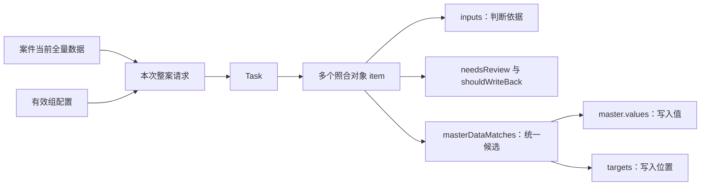

## 第 1 章｜本期范围与优先级

### 1.1 背景与目标

四期接入 Zurich 综合主数据名称标准化 API。上游已有案件集约、文件补件、OCR抽出和 OCR抽出确认任务。主数据照合按案件当前完整资料发起请求，并使用异步任务和现有 OCR抽出确认待办。

本 PRD 的正文、字段说明和流程说明使用简体中文。界面文案、API 字段值、接口返回内容和示例中的日语保留原文。

本期要完成以下结果。

- 配置管理员可以通过 Zurich 返回的主数据 schema 配置可复用的照合组。
- 业务场景管理员可以在 OCR抽出后放置「マスタ照合」节点。节点按当前业务场景自动读取适用的照合组。
- 每次工作流执行到主数据照合节点时，发送该时点案件下已有的全部账票；一次工作流执行对应一次 API 请求和一个 Task。工作流等待该 Task 结束后继续。后续工作流再次执行时仍发送当时案件的全部账票，不只发送新增文件。
- IDP 按结果中的 targets 回填无须确认的项目，将需要确认的结果送入本次案件工作流对应的 OCR抽出确认。
- 组外字段保持 OCR抽出值。
- 前端展示照合组变更履历；默认组来源、整体版本和配置快照由后端留存，用于追溯。

### 1.2 本期范围

| 模块 | 本期说明 |
| --- | --- |
| 组配置 | 维护照合组、适用场景和字段映射，支持默认组导入、保存校验及变更履历 |
| API 设定 | 配置 Zurich API 连接与认证，支持连接测试及连接状态展示 |
| 工作流 | 配置「マスタ照合」节点；每次执行使用当时全案文件发起照合，处理异步状态、结果回写和失败情况 |
| OCR 确认 | 展示候选及确认说明，支持人工确认、候选选择和使用缓存最新值重新照合，包含文本字段与表格字段 |

### 1.4 里程碑与优先级

| 优先级 | 功能范围 |
| --- | --- |
| 本期 P0 | API 连接、照合组配置、工作流整案照合、结果回写与人工确认、字段级重新照合、任务与配置追溯 |

### 1.5 上下游关系与依赖

| 系统或模块 | 关系 |
| --- | --- |
| API設定 → 外部API | 提供 Zurich Base URL、API Key 和连接状态 |
| 业务场景设定（「業務シーン設定」） | 提供 sceneId、账票类型和字段，供照合组匹配与节点读取 |
| OCR抽出 | 提供需要照合的案件 OCR 快照 |
| OCR抽出确认 | 承接普通 OCR 待确认项和主数据照合待确认项 |
| Zurich 标准化 API | 提供主数据 schema、默认组、组校验、案件标准化和字段重新照合 |

接口基准为 Zurich 综合主数据名称标准化 API v1.2。配置期使用 GET /v1/masters、GET /v1/catalog和 GET /v1/groups/defaults。执行期使用 POST /v1/standardizations、GET /v1/standardizations、GET /v1/standardizations/{taskId}、GET /v1/standardizations/{taskId}/items 和 POST /v1/items/standardize。

接口的阶段、调用时机、同步性和字段定义统一放在分模块 API 与字段中。

## 第 2 章｜使用流程

### 2.1 配置准备

管理员先在「API 设定」配置连接地址和认证信息，测试连接。然后进入「组配置」，选择主数据表，配置适用场景及 IDP 字段与主数据项目的映射，也可以导入默认组后修改。

配置页面直接使用接口返回的角色和可选照合方式。点击保存后，由后端对完整配置进行校验，通过后保存并记录版本。具体操作和校验见第 5 章。

### 2.2 工作流执行

流程为：**OCR 抽出 → 数据映射 → 主数据照合 → OCR 确认 → 后续节点**。

每次工作流执行到主数据照合节点，IDP 使用该时点案件已有的全部文件、最新 OCR 及数据映射结果和有效照合组，发起一次整案请求。IDP 不判断最后一批；后续工作流再次执行时，重新提交当时全案数据。

API 返回本次任务的 taskId。IDP 等待异步任务结束并取得完整结果，再按结果自动采用或进入 OCR 确认。任务完成表示本次请求结束，不表示案件不会再有文件到达。

### 2.3 OCR 确认与重新照合

- needsReview 决定是否人工确认；shouldWriteBack 决定是否回写，两者分别处理。
- 确认页使用 API 返回的统一候选列表、确认原因和其他信息。有内容则显示，无内容则隐藏；主要素及追加要素使用同一候选列表。
- 操作员选择已有候选后，按该候选的值和目标位置采用结果。
- 修改照合输入后，可单项或一括重新照合，直接使用页面缓存最新值，无需先保存。一括处理已修改的文本和表格输入，不增加勾选框。
- 重新照合只处理被修改字段所属的照合对象：修改值使用最新缓存，其他输入继承原结果；该对象关联的回填结果可能一起更新，其他对象保持原结果。

## 第 3 章｜数据结构与职责

### 3.1 配置结构

一个照合组选择一个主数据表，包含多个成员。每个成员把一个 IDP 字段映射到一个主数据列或 hint，并指定读取、回写或读写方式。

| 数据 | 用途 |
| --- | --- |
| 主数据定义 | API 提供主数据表、列和 hint；configuration 提供角色名称、允许的方式及主输入资格 |
| 照合组 | IDP 保存 groupId、组名、主数据表和成员；适用场景由 IDP 维护，发送 API 前移除 |
| 组成员 | 包含主数据列或 hint、IDP 字段引用和 mode；普通字段按字段配置，表格按列配置，标准字段引用数据映射结果 |
| 配置版本与来源 | 后端保存 groupsVersion、配置快照及默认组来源，不提供前端版本管理入口 |

同一组不能重复配置同一主数据列或 hint。同一普通字段、表格列或案件标准字段只能加入一个照合组，输入、输出和读写均适用。完整配置由后端在保存时校验。

### 3.2 请求与结果结构



| 数据 | 含义 |
| --- | --- |
| 请求与 Task | 一次成功受理的整案请求对应一个 Task；同一案件可以有多次请求 |
| item | 组应用到实际单据后生成的照合对象；一个组可以生成零个、一个或多个对象，不等同于一个配置字段 |
| taskId、itemId | 分别标识本次任务及任务中的照合对象；单项重新照合通过 ref 引用原对象 |
| fieldId | API 提供的跨任务和重新照合项目关联标识，由后端保留，不展示，不决定回写位置 |
| inputs | 本次判断使用的值；重新照合时可只传修改的输入，其他输入从原对象继承 |
| needsReview | 是否人工确认；缺失或 null 按需要确认处理 |
| shouldWriteBack | 是否回写；缺失或 null 按不回写处理 |
| masterDataMatches | 确认页统一候选，含 label、confidence、primary，以及各候选自己的 master 和 targets；不由前端从拆分明细重新拼装 |
| master.values、targets | 分别提供写入值和位置；自动采用使用结果的 master 和 targets，人工选候选使用所选候选自己的数据 |
| reviewReason、remarks | 确认原因和其他信息，按返回内容展示 |

单项重新照合同步返回，不创建新 Task，不改变原任务状态。IDP 根据请求上下文更新对应对象；实际回写位置以 targets 为准。

### 3.3 职责与留存

IDP 负责配置、提交请求、等待任务、展示确认页及将结果写入自身字段。API 负责匹配、判断是否需确认和回写，并提供候选及说明；API 不直接修改 IDP 数据。

后端留存本次请求实际使用的文件、字段值、组配置快照和任务结果，供运行和追溯使用。前端只展示业务需要的配置、履历和确认内容。配置修改限有权限的管理员；OCR 确认沿用现有任务权限。

## 第 4 章｜本期接口与主要字段

本章只列 IDP 本期使用的接口及主要字段。必填条件、完整结构和错误码以客户 API v1.2 式样书为准，不在 PRD 重复维护字段字典。下列接口由 IDP 后端对接，前端调用 IDP 自身服务。

### 4.1 API 设定与组配置

| 接口或配置 | 使用时机 | 本期主要数据 |
| --- | --- | --- |
| API 连接设定 | 管理员设置并测试连接 | Base URL、API Key、连接状态；认证信息由后端安全保存，不明文回显 |
| GET /v1/masters | 获取主数据及可配置项目 | schemaVersion、masterTables 中的 masterTable、label、columns、hints；项目的 column 或 hint、label、configuration |
| GET /v1/catalog | 获取照合方式显示名 | `data.enums.memberMode[].value`、`data.enums.memberMode[].label` |
| GET /v1/groups/defaults | 导入默认组 | 默认组的 groupId、label、masterTable、members |
| POST /v1/groups/validate | 保存当前组前校验跨组重复 | 请求包含当前组和其他已保存的有效组；返回每组 valid、errors，以及错误的 memberIndex、relatedGroupId 和 message |

以下 configuration 字段来自 `GET /v1/masters` 响应的 `data.masterTables[].columns[]` 或 `data.masterTables[].hints[]`。

| 配置数据 | 本期用途 |
| --- | --- |
| groupId、label、masterTable、members | 标识组、显示组名、指定主数据表及字段映射 |
| 成员的 column 或 hint、mode、field | 指定主数据项目、读取／回写方式及 IDP 字段引用 |
| `configuration.roleLabel` | 前端直接显示角色 |
| `configuration.allowedModes` | 限定可选照合方式 |
| `configuration.canBePrimary` | 后端保存时判断是否存在有效主输入 |
| sceneIds | IDP 内部适用场景，发送客户 API 前移除 |
| groupsVersion | 后端生成并随整案请求发送，记录本次使用的配置版本 |

### 4.2 工作流整案照合

| 接口 | 调用顺序与用途 |
| --- | --- |
| POST /v1/standardizations | 工作流每次执行到节点，提交当时案件全部文件的结果、数据映射结果及有效组；取得 taskId 和状态 |
| GET /v1/standardizations | 查询已完成任务，按 cursor 继续获取 |
| GET /v1/standardizations/{taskId} | 获取任务状态和结果 |
| GET /v1/standardizations/{taskId}/items | 结果含 itemsNextCursor 时继续取齐照合对象 |
| POST /v1/standardizations/{taskId}/cancel | 需要中止旧任务时请求取消；以后端实际状态为准 |

| 主要字段 | IDP 如何使用 |
| --- | --- |
| sceneId、documents、groups、groupsVersion | 提交当前场景、全案单据结果及本次有效组配置 |
| caseResult、caseFieldConflicts | 使用标准字段时提交数据映射结果及其冲突信息 |
| taskId、status | 关联本次异步任务；完成后取得完整结果再衔接确认或后续流程 |
| cursor、itemsNextCursor | 处理任务列表和结果分页，避免遗漏 |
| items | 当前任务的照合对象结果，交给统一结果处理逻辑 |

不提交“最后一批”标识。Task 状态只表示本次调用是否结束，不表示案件资料已经齐全。

### 4.3 OCR 确认与重新照合

| 结果字段 | 本期用途 |
| --- | --- |
| itemId、groupId | 关联照合对象及其配置组 |
| fieldId | 后端保留的项目关联标识，不展示；不作为回写位置 |
| inputs | 照合输入及原值；重新照合时继承未修改的输入 |
| needsReview | 决定是否人工确认；缺失或 null 按需确认处理 |
| shouldWriteBack | 决定是否回写；缺失或 null 不回写 |
| master、targets | 自动采用的主数据行及写入位置；使用 master.values 中的值写入对应 targets，并保留 master.selection |
| masterDataMatches | 统一候选列表；使用候选的 label、type、confidence、primary 以及自己的 master、targets，不由前端按场景重新拼装 |
| reviewReason、remarks | 确认原因和其他信息，有内容则展示，无内容则隐藏 |

重新照合使用 `POST /v1/items/standardize`，主要提交 `ref`、`masterTable` 和修改后的 `inputs`。有原结果时，ref 引用原 taskId 和 itemId；原本为空、尚无对象时按式样书使用 groupId 和 source 引用配置及位置。

修改值直接取页面缓存，无需先保存；同一对象多个修改合并请求，其余输入继承原结果。接口同步返回，不新建 Task。更新当前对象及关联回填结果，其他对象保持原结果。文本字段和表格输入均适用。

### 4.4 公共处理

- code、msg、requestId 用于判断接口成功与否、提示错误和后端排障；业务任务状态另看 status。
- 保存校验或运行接口失败时保留当前配置或字段值，提示错误并按对应流程重试，不把失败当作成功。
- API Key、请求快照、默认组来源及版本信息由后端维护。前端只展示业务需要的状态和内容。


### 4.5 分模块调用示例

以下示例统一使用展开缩进；每个例子只表达一个调用场景。客户接口均携带已配置的认证头，API Key 不在示例中展示。

#### API 设定｜连接测试

本期连接测试由 IDP 后端调用需要认证的主数据一览接口，验证地址和认证是否可用。请求及响应示例见下一节，认证按式样书通用认证规则携带。IDP 内部测试接口结构后续由开发定义。

```http
GET /v1/masters
```

成功取得合法响应时显示连接成功；认证失败、网络异常或响应错误时显示连接失败，不覆盖已保存配置。

#### 组配置｜获取可配置项目

展开主数据下拉，取得角色及可选方式。

式样书 §4.7 摘录。以下 JSON 仅展示本场景主要字段，省略其他字段，不替代完整契约。

**请求**

```http
GET /v1/masters
```

无请求体。

**响应**

<details>
<summary>展开 JSON 示例</summary>

```json
{
  "code": 0,
  "msg": "",
  "requestId": "req-example",
  "data": {
    "schemaVersion": "2026-11-25",
    "masterTables": [
      {
        "masterTable": "DISEASE",
        "label": "傷病名マスタ",
        "columns": [
          {
            "column": "CLM_ICD10Mst__c.NAME",
            "label": "傷病名",
            "configuration": {
              "roleLabel": "主入力・書き戻し可",
              "allowedModes": [
                "INPUT",
                "OUTPUT",
                "INPUT_OUTPUT"
              ],
              "canBePrimary": true
            }
          },
          {
            "column": "CLM_ICD10Mst__c.ICD10__C",
            "label": "ICD10 コード",
            "configuration": {
              "roleLabel": "補助入力・書き戻し可",
              "allowedModes": [
                "INPUT",
                "OUTPUT",
                "INPUT_OUTPUT"
              ],
              "canBePrimary": false
            }
          }
        ],
        "hints": [
          {
            "hint": "sex",
            "label": "性別",
            "deprecated": false,
            "configuration": {
              "roleLabel": "ヒント（照合に使うだけ）",
              "allowedModes": [
                "INPUT"
              ],
              "canBePrimary": false
            }
          }
        ]
      }
    ]
  }
}
```

</details>

**IDP 处理：** 显示 label 和 roleLabel，按 allowedModes 提供选项。

#### 组配置｜获取方式名称

取得照合方式的日文显示名。

式样书 §4.10 摘录。以下 JSON 仅展示本场景主要字段，省略其他字段，不替代完整契约。

**请求**

```http
GET /v1/catalog
```

无请求体。

**响应**

```json
{
  "code": 0,
  "msg": "",
  "requestId": "req-example",
  "data": {
    "catalogVersion": "2026-11-25",
    "enums": {
      "memberMode": [
        {
          "value": "INPUT",
          "label": "読み取り（照合に使う）"
        },
        {
          "value": "OUTPUT",
          "label": "書き戻し"
        },
        {
          "value": "INPUT_OUTPUT",
          "label": "読み取り・書き戻し"
        }
      ]
    }
  }
}
```

**IDP 处理：** 按 value 关联选项，显示 label。

#### 组配置｜导入默认组

点击既定グループ，获取模板后载入草稿。

式样书 §4.8 摘录。以下 JSON 仅展示本场景主要字段，省略其他字段，不替代完整契约。

**请求**

```http
GET /v1/groups/defaults
```

无请求体。

**响应**

<details>
<summary>展开 JSON 示例</summary>

```json
{
  "code": 0,
  "msg": "",
  "requestId": "req-example",
  "data": {
    "version": "2026-11-19",
    "groups": [
      {
        "groupId": "DEFAULT:HG02-OPE",
        "label": "手術（診療明細書2）",
        "masterTable": "OPERATION",
        "members": [
          {
            "column": "CLM_OperationMst__c.NAME",
            "mode": "INPUT_OUTPUT",
            "field": {
              "type": "TABLE_COLUMN",
              "documentTypeId": "20001",
              "tableName": "手術情報",
              "columnName": "手術名"
            }
          },
          {
            "column": "CLM_OperationMst__c.KCODE__C",
            "mode": "INPUT",
            "field": {
              "type": "TABLE_COLUMN",
              "documentTypeId": "20001",
              "tableName": "手術情報",
              "columnName": "手術コード"
            }
          },
          {
            "hint": "operationDate",
            "mode": "INPUT",
            "field": {
              "type": "TABLE_COLUMN",
              "documentTypeId": "20001",
              "tableName": "手術情報",
              "columnName": "手術日"
            }
          }
        ]
      }
    ]
  }
}
```

</details>

**IDP 处理：** 默认组按已保存的来源组 ID 与本地组匹配，不使用组名匹配。来源 ID 已对应时在当前组内覆盖更新，未对应时追加新组。首次导入时，适用场景和 IDP 字段映射均置空。后续组内覆盖时，保留原适用场景。主数据项目和字段名称完全一致的成员保留原 IDP 字段映射，名称或字段类型变化时只清空该成员字段。保存前仍需完整校验。

#### 组配置｜保存校验

保存当前组时，请求包含当前组和其他已保存的有效组，用于检查跨组重复。以下展示当前组通过校验的结果；跨组重复时返回 FIELD_IN_OTHER_GROUP 并阻止当前组保存。

请求按 §4.9 规则 mock，响应为成功结构示意；实际 groupId 与提交组对应。以下 JSON 仅展示本场景主要字段，省略其他字段，不替代完整契约。

**请求**

```http
POST /v1/groups/validate
```

<details>
<summary>展开 JSON 示例</summary>

```json
{
  "groups": [
    {
      "groupId": "DEFAULT:HG02-OPE",
      "label": "手術（診療明細書2）",
      "masterTable": "OPERATION",
      "members": [
        {
          "column": "CLM_OperationMst__c.NAME",
          "mode": "INPUT_OUTPUT",
          "field": {
            "type": "TABLE_COLUMN",
            "documentTypeId": "20001",
            "tableName": "手術情報",
            "columnName": "手術名"
          }
        },
        {
          "column": "CLM_OperationMst__c.KCODE__C",
          "mode": "INPUT",
          "field": {
            "type": "TABLE_COLUMN",
            "documentTypeId": "20001",
            "tableName": "手術情報",
            "columnName": "手術コード"
          }
        },
        {
          "hint": "operationDate",
          "mode": "INPUT",
          "field": {
            "type": "TABLE_COLUMN",
            "documentTypeId": "20001",
            "tableName": "手術情報",
            "columnName": "手術日"
          }
        }
      ]
    }
  ]
}
```

</details>

**响应**

```json
{
  "code": 0,
  "msg": "",
  "requestId": "req-example",
  "data": {
    "groups": [
      {
        "groupId": "HE03-DIS-1",
        "valid": true,
        "errors": []
      }
    ]
  }
}
```

**IDP 处理：** 存在错误则停止保存，Toast 提示占用组并保留草稿。

#### 工作流｜发起整案照合

工作流执行到节点，以当时全案数据提交；示例仅保留第一组和第一份单据。

式样书 §4.1 摘录。以下 JSON 仅展示本场景主要字段，省略其他字段，不替代完整契约。

**请求**

```http
POST /v1/standardizations
```

<details>
<summary>展开 JSON 示例</summary>

```json
{
  "clientRequestId": "CLAIM-20261118000123-v1-1",
  "caseNo": "CLAIM-20261118000123",
  "sceneId": "1001",
  "groupsVersion": "2026-11-19-01",
  "caseResult": {
    "fields": [
      {
        "name": "性別",
        "value": "女"
      }
    ]
  },
  "groups": [
    {
      "groupId": "HG02-OPE",
      "label": "手術",
      "masterTable": "OPERATION",
      "members": [
        {
          "column": "CLM_OperationMst__c.NAME",
          "mode": "INPUT_OUTPUT",
          "field": {
            "type": "TABLE_COLUMN",
            "documentTypeId": "20001",
            "tableName": "手術情報",
            "columnName": "手術名"
          }
        },
        {
          "column": "CLM_OperationMst__c.KCODE__C",
          "mode": "INPUT",
          "field": {
            "type": "TABLE_COLUMN",
            "documentTypeId": "20001",
            "tableName": "手術情報",
            "columnName": "手術コード"
          }
        },
        {
          "hint": "operationDate",
          "mode": "INPUT",
          "field": {
            "type": "TABLE_COLUMN",
            "documentTypeId": "20001",
            "tableName": "手術情報",
            "columnName": "手術日"
          }
        }
      ]
    }
  ],
  "documents": [
    {
      "documentId": "991243705301",
      "documentTypeId": "20001",
      "documentTypeName": "診療明細書2",
      "docCode": "HG02-001",
      "format": "IDP_RESULT_JSON",
      "result": {
        "fields": [
          {
            "name": "帳票ID",
            "value": "HG02-001",
            "confidence": 1.0,
            "needReview": 0
          },
          {
            "name": "病院住所",
            "value": "東京都〇〇区〇〇町1-2-3",
            "confidence": 0.95,
            "needReview": 0
          },
          {
            "name": "診療科",
            "value": "循環器内科",
            "confidence": 0.98,
            "needReview": 0
          }
        ],
        "table_list": [
          {
            "tableName": "手術情報",
            "table_fields": [
              [
                {
                  "name": "手術名",
                  "value": "経皮的冠動脈形成術（その他のもの）",
                  "confidence": 0.93,
                  "needReview": 0
                },
                {
                  "name": "手術日",
                  "value": "2026-10-02",
                  "confidence": 0.99,
                  "needReview": 0
                },
                {
                  "name": "手術コード",
                  "value": "K5463",
                  "confidence": 0.96,
                  "needReview": 0
                }
              ]
            ]
          },
          {
            "tableName": "薬剤情報",
            "table_fields": [
              [
                {
                  "name": "商品名",
                  "value": "ティーエスワン配合カプセルT20 1C",
                  "confidence": 0.91,
                  "needReview": 0
                },
                {
                  "name": "回数",
                  "value": "28",
                  "confidence": 0.97,
                  "needReview": 0
                },
                {
                  "name": "ATC分類",
                  "value": "",
                  "confidence": null,
                  "needReview": 0
                },
                {
                  "name": "薬効分類",
                  "value": "",
                  "confidence": null,
                  "needReview": 0
                },
                {
                  "name": "薬価基準コード",
                  "value": "",
                  "confidence": null,
                  "needReview": 0
                }
              ]
            ]
          }
        ]
      }
    }
  ]
}
```

</details>

**响应**

```json
{
  "code": 0,
  "msg": "",
  "requestId": "req-example",
  "data": {
    "taskId": "MS-20261118-7Q3K9D",
    "status": "PENDING",
    "pollAfterMs": 5000
  }
}
```

**IDP 处理：** 保存 taskId；未完成时继续等待，本期不判断最后一批。

#### 工作流｜获取已结束任务

后端定期获取结束任务，第二次起带上次返回的 nextCursor。

响应为式样书 §4.4 原例；请求游标为占位 mock。以下 JSON 仅展示本场景主要字段，省略其他字段，不替代完整契约。

**请求**

```http
GET /v1/standardizations?cursor=c-previous&limit=100
```

无请求体。

**响应**

```json
{
  "code": 0,
  "msg": "",
  "requestId": "req-20261118-000141",
  "warnings": [],
  "data": {
    "tasks": [
      {
        "taskId": "MS-20261118-7Q3K9D",
        "clientRequestId": "CLAIM-20261118000123-v1-1",
        "caseNo": "CLAIM-20261118000123",
        "status": "SUCCEEDED",
        "completedAt": 1794963681300
      }
    ],
    "nextCursor": "c-000000001794963681300-7Q3K9D"
  }
}
```

**IDP 处理：** 保存 nextCursor，再按 taskId 获取完整结果。

#### 工作流与 OCR 确认｜取得照合结果

任务完成后，取得供确认页使用的结果。

式样书 §4.2 摘录。以下 JSON 仅展示本场景主要字段，省略其他字段，不替代完整契约。

**请求**

```http
GET /v1/standardizations/MS-20261118-7Q3K9D
```

无请求体。

**响应**

<details>
<summary>展开 JSON 示例</summary>

```json
{
  "code": 0,
  "msg": "",
  "requestId": "req-example",
  "data": {
    "taskId": "MS-20261118-7Q3K9D",
    "status": "SUCCEEDED",
    "items": [
      {
        "itemId": "ope1",
        "fieldId": "fd-9c1e5a20",
        "groupId": "HG02-OPE",
        "needsReview": false,
        "shouldWriteBack": true,
        "masterDataMatches": [
          {
            "type": "recommended",
            "label": "マスタ推奨",
            "value": "経皮的冠動脈形成術（その他のもの）",
            "confidence": 100.0,
            "primary": true,
            "master": {
              "masterTable": "OPERATION",
              "object": "CLM_OperationMst__c",
              "masterId": "a0V000000000000301",
              "displayName": "経皮的冠動脈形成術",
              "values": {
                "CLM_OperationMst__c.NAME": "経皮的冠動脈形成術",
                "CLM_OperationMst__c.KCODE__C": "K546-00",
                "CWF_OperationMstAlias__c.NAME": "経皮的冠動脈形成術（その他のもの）"
              },
              "active": true,
              "selection": {
                "object": "CWF_OperationMstAlias__c",
                "recordType": "ALIAS",
                "recordId": "a0W000000000000301",
                "name": "経皮的冠動脈形成術（その他のもの）"
              }
            },
            "targets": {
              "CLM_OperationMst__c.NAME": {
                "type": "TABLE_CELL",
                "documentId": "991243705301",
                "tableName": "手術情報",
                "tableIndex": 0,
                "rowIndex": 0,
                "columnName": "手術名",
                "columnIndex": 0
              }
            }
          },
          {
            "type": "candidate",
            "label": "マスタ候補",
            "value": "経皮的冠動脈形成術（急性心筋梗塞に対するもの）",
            "confidence": 88.4,
            "primary": true,
            "master": {
              "masterTable": "OPERATION",
              "object": "CLM_OperationMst__c",
              "masterId": "a0V000000000000301",
              "displayName": "経皮的冠動脈形成術",
              "values": {
                "CLM_OperationMst__c.NAME": "経皮的冠動脈形成術",
                "CLM_OperationMst__c.KCODE__C": "K546-00",
                "CWF_OperationMstAlias__c.NAME": "経皮的冠動脈形成術（急性心筋梗塞に対するもの）"
              },
              "active": true,
              "selection": {
                "object": "CWF_OperationMstAlias__c",
                "recordType": "ALIAS",
                "recordId": "a0W000000000000302",
                "name": "経皮的冠動脈形成術（急性心筋梗塞に対するもの）"
              }
            },
            "targets": {
              "CLM_OperationMst__c.NAME": {
                "type": "TABLE_CELL",
                "documentId": "991243705301",
                "tableName": "手術情報",
                "tableIndex": 0,
                "rowIndex": 0,
                "columnName": "手術名",
                "columnIndex": 0
              }
            }
          },
          {
            "type": "candidate",
            "label": "マスタ候補",
            "value": "経皮的冠動脈形成術（不安定狭心症に対するもの）",
            "confidence": 87.9,
            "primary": true,
            "master": {
              "masterTable": "OPERATION",
              "object": "CLM_OperationMst__c",
              "masterId": "a0V000000000000301",
              "displayName": "経皮的冠動脈形成術",
              "values": {
                "CLM_OperationMst__c.NAME": "経皮的冠動脈形成術",
                "CLM_OperationMst__c.KCODE__C": "K546-00",
                "CWF_OperationMstAlias__c.NAME": "経皮的冠動脈形成術（不安定狭心症に対するもの）"
              },
              "active": true,
              "selection": {
                "object": "CWF_OperationMstAlias__c",
                "recordType": "ALIAS",
                "recordId": "a0W000000000000303",
                "name": "経皮的冠動脈形成術（不安定狭心症に対するもの）"
              }
            },
            "targets": {
              "CLM_OperationMst__c.NAME": {
                "type": "TABLE_CELL",
                "documentId": "991243705301",
                "tableName": "手術情報",
                "tableIndex": 0,
                "rowIndex": 0,
                "columnName": "手術名",
                "columnIndex": 0
              }
            }
          },
          {
            "type": "candidate",
            "label": "マスタ候補",
            "value": "経皮的冠動脈形成術（特殊カテーテルによるもの）",
            "confidence": 80.2,
            "primary": true,
            "master": {
              "masterTable": "OPERATION",
              "object": "CLM_OperationMst__c",
              "masterId": "a0V000000000000311",
              "displayName": "経皮的冠動脈形成術（特殊カテーテルによるもの）",
              "values": {
                "CLM_OperationMst__c.NAME": "経皮的冠動脈形成術（特殊カテーテルによるもの）",
                "CLM_OperationMst__c.KCODE__C": "K548-00",
                "CWF_OperationMstAlias__c.NAME": "経皮的冠動脈形成術（特殊カテーテルによるもの）"
              },
              "active": true,
              "selection": {
                "object": "CWF_OperationMstAlias__c",
                "recordType": "ALIAS",
                "recordId": "a0W000000000000311",
                "name": "経皮的冠動脈形成術（特殊カテーテルによるもの）"
              }
            },
            "targets": {
              "CLM_OperationMst__c.NAME": {
                "type": "TABLE_CELL",
                "documentId": "991243705301",
                "tableName": "手術情報",
                "tableIndex": 0,
                "rowIndex": 0,
                "columnName": "手術名",
                "columnIndex": 0
              }
            }
          },
          {
            "type": "candidate",
            "label": "マスタ候補",
            "value": "経皮的冠動脈ステント留置術（その他のもの）",
            "confidence": 76.5,
            "primary": true,
            "master": {
              "masterTable": "OPERATION",
              "object": "CLM_OperationMst__c",
              "masterId": "a0V000000000000312",
              "displayName": "経皮的冠動脈ステント留置術",
              "values": {
                "CLM_OperationMst__c.NAME": "経皮的冠動脈ステント留置術",
                "CLM_OperationMst__c.KCODE__C": "K549-00",
                "CWF_OperationMstAlias__c.NAME": "経皮的冠動脈ステント留置術（その他のもの）"
              },
              "active": true,
              "selection": {
                "object": "CWF_OperationMstAlias__c",
                "recordType": "ALIAS",
                "recordId": "a0W000000000000312",
                "name": "経皮的冠動脈ステント留置術（その他のもの）"
              }
            },
            "targets": {
              "CLM_OperationMst__c.NAME": {
                "type": "TABLE_CELL",
                "documentId": "991243705301",
                "tableName": "手術情報",
                "tableIndex": 0,
                "rowIndex": 0,
                "columnName": "手術名",
                "columnIndex": 0
              }
            }
          }
        ],
        "reviewReason": null,
        "remarks": [
          {
            "label": "照合根拠",
            "value": "読取値が、画面で選べる別名「経皮的冠動脈形成術（その他のもの）」と完全に一致し、帳票の手術コードとも矛盾しないため確定した。"
          }
        ]
      }
    ],
    "itemsNextCursor": null
  }
}
```

</details>

**IDP 处理：** 按 needsReview 和 shouldWriteBack 分流，候选及原因直接交确认页显示。

#### 工作流｜取齐分页结果

itemsNextCursor 非空时继续获取；示例为空末页。

按式样书 §4.3 规则 mock。以下 JSON 仅展示本场景主要字段，省略其他字段，不替代完整契约。

**请求**

```http
GET /v1/standardizations/MS-20261118-7Q3K9D/items?cursor=cursor-example&limit=100
```

无请求体。

**响应**

```json
{
  "code": 0,
  "msg": "",
  "requestId": "req-example",
  "data": {
    "items": [],
    "nextCursor": null
  }
}
```

**IDP 处理：** 汇总所有页，nextCursor 为 null 后结束取数。

#### 工作流｜取消旧任务

案件中止或重新请求前，需要取消未结束的旧任务。

按式样书 §4.5 规则 mock。以下 JSON 仅展示本场景主要字段，省略其他字段，不替代完整契约。

**请求**

```http
POST /v1/standardizations/MS-20261118-7Q3K9D/cancel
```

无请求体。

**响应**

```json
{
  "code": 0,
  "msg": "",
  "requestId": "req-example",
  "data": {
    "taskId": "MS-20261118-7Q3K9D",
    "status": "CANCELLED"
  }
}
```

**IDP 处理：** 取消结果不采用；若任务已完成，按接口实际状态处理。

#### OCR 确认｜修改输入后重新照合

操作员修改伤病名，点击再照合，直接提交缓存最新值。

请求为式样书 §4.6 原例；响应为 §4.6 规定的对象结构 mock，业务值仅示意，非该输入的真实匹配结果。以下 JSON 仅展示本场景主要字段，省略其他字段，不替代完整契约。

**请求**

```http
POST /v1/items/standardize
```

```json
{
  "clientRequestId": "CLAIM-20261118000123-dis2-r1",
  "caseNo": "CLAIM-20261118000123",
  "ref": {
    "taskId": "MS-20261118-7Q3K9D",
    "itemId": "dis2"
  },
  "masterTable": "DISEASE",
  "inputs": [
    {
      "column": "CLM_ICD10Mst__c.NAME",
      "value": "乳房下内側部乳癌",
      "source": {
        "type": "FIELD",
        "documentId": "991243705302",
        "fieldName": "傷病名2",
        "fieldIndex": 4
      }
    }
  ],
  "options": {
    "allowWebSearch": false,
    "timeoutSeconds": 30
  }
}
```

**响应**

<details>
<summary>展开 JSON 示例</summary>

```json
{
  "code": 0,
  "msg": "",
  "requestId": "req-example",
  "data": {
    "itemId": "restandardized-example",
    "fieldId": "fd-9c1e5a20",
    "groupId": "HG02-OPE",
    "needsReview": false,
    "shouldWriteBack": true,
    "master": {
      "masterTable": "OPERATION",
      "object": "CLM_OperationMst__c",
      "masterId": "a0V000000000000301",
      "displayName": "経皮的冠動脈形成術",
      "values": {
        "CLM_OperationMst__c.NAME": "経皮的冠動脈形成術",
        "CLM_OperationMst__c.KCODE__C": "K546-00",
        "CLM_OperationMst__c.KCODEOPNAME__C": "経皮的冠動脈形成術（その他のもの）",
        "CLM_OperationMst__c.KANA1__C": "ケイヒテキカンドウミャクケイセイジュツ",
        "CLM_OperationMst__c.CANCEROPERATION__C": "false",
        "CLM_OperationMst__c.CWFDENTISTRY__C": "false",
        "CWF_OperationMstAlias__c.NAME": "経皮的冠動脈形成術（その他のもの）",
        "CWF_OperationMstAlias__c.ID": "a0W000000000000301"
      },
      "active": true,
      "selection": {
        "object": "CWF_OperationMstAlias__c",
        "recordType": "ALIAS",
        "recordId": "a0W000000000000301",
        "name": "経皮的冠動脈形成術（その他のもの）"
      }
    },
    "targets": {
      "CLM_OperationMst__c.NAME": {
        "type": "TABLE_CELL",
        "documentId": "991243705301",
        "tableName": "手術情報",
        "tableIndex": 0,
        "rowIndex": 0,
        "columnName": "手術名",
        "columnIndex": 0
      }
    },
    "masterDataMatches": [
      {
        "type": "recommended",
        "label": "マスタ推奨",
        "value": "経皮的冠動脈形成術（その他のもの）",
        "confidence": 100.0,
        "primary": true,
        "master": {
          "masterTable": "OPERATION",
          "object": "CLM_OperationMst__c",
          "masterId": "a0V000000000000301",
          "displayName": "経皮的冠動脈形成術",
          "values": {
            "CLM_OperationMst__c.NAME": "経皮的冠動脈形成術",
            "CLM_OperationMst__c.KCODE__C": "K546-00",
            "CWF_OperationMstAlias__c.NAME": "経皮的冠動脈形成術（その他のもの）"
          },
          "active": true,
          "selection": {
            "object": "CWF_OperationMstAlias__c",
            "recordType": "ALIAS",
            "recordId": "a0W000000000000301",
            "name": "経皮的冠動脈形成術（その他のもの）"
          }
        },
        "targets": {
          "CLM_OperationMst__c.NAME": {
            "type": "TABLE_CELL",
            "documentId": "991243705301",
            "tableName": "手術情報",
            "tableIndex": 0,
            "rowIndex": 0,
            "columnName": "手術名",
            "columnIndex": 0
          }
        }
      },
      {
        "type": "candidate",
        "label": "マスタ候補",
        "value": "経皮的冠動脈形成術（急性心筋梗塞に対するもの）",
        "confidence": 88.4,
        "primary": true,
        "master": {
          "masterTable": "OPERATION",
          "object": "CLM_OperationMst__c",
          "masterId": "a0V000000000000301",
          "displayName": "経皮的冠動脈形成術",
          "values": {
            "CLM_OperationMst__c.NAME": "経皮的冠動脈形成術",
            "CLM_OperationMst__c.KCODE__C": "K546-00",
            "CWF_OperationMstAlias__c.NAME": "経皮的冠動脈形成術（急性心筋梗塞に対するもの）"
          },
          "active": true,
          "selection": {
            "object": "CWF_OperationMstAlias__c",
            "recordType": "ALIAS",
            "recordId": "a0W000000000000302",
            "name": "経皮的冠動脈形成術（急性心筋梗塞に対するもの）"
          }
        },
        "targets": {
          "CLM_OperationMst__c.NAME": {
            "type": "TABLE_CELL",
            "documentId": "991243705301",
            "tableName": "手術情報",
            "tableIndex": 0,
            "rowIndex": 0,
            "columnName": "手術名",
            "columnIndex": 0
          }
        }
      },
      {
        "type": "candidate",
        "label": "マスタ候補",
        "value": "経皮的冠動脈形成術（不安定狭心症に対するもの）",
        "confidence": 87.9,
        "primary": true,
        "master": {
          "masterTable": "OPERATION",
          "object": "CLM_OperationMst__c",
          "masterId": "a0V000000000000301",
          "displayName": "経皮的冠動脈形成術",
          "values": {
            "CLM_OperationMst__c.NAME": "経皮的冠動脈形成術",
            "CLM_OperationMst__c.KCODE__C": "K546-00",
            "CWF_OperationMstAlias__c.NAME": "経皮的冠動脈形成術（不安定狭心症に対するもの）"
          },
          "active": true,
          "selection": {
            "object": "CWF_OperationMstAlias__c",
            "recordType": "ALIAS",
            "recordId": "a0W000000000000303",
            "name": "経皮的冠動脈形成術（不安定狭心症に対するもの）"
          }
        },
        "targets": {
          "CLM_OperationMst__c.NAME": {
            "type": "TABLE_CELL",
            "documentId": "991243705301",
            "tableName": "手術情報",
            "tableIndex": 0,
            "rowIndex": 0,
            "columnName": "手術名",
            "columnIndex": 0
          }
        }
      },
      {
        "type": "candidate",
        "label": "マスタ候補",
        "value": "経皮的冠動脈形成術（特殊カテーテルによるもの）",
        "confidence": 80.2,
        "primary": true,
        "master": {
          "masterTable": "OPERATION",
          "object": "CLM_OperationMst__c",
          "masterId": "a0V000000000000311",
          "displayName": "経皮的冠動脈形成術（特殊カテーテルによるもの）",
          "values": {
            "CLM_OperationMst__c.NAME": "経皮的冠動脈形成術（特殊カテーテルによるもの）",
            "CLM_OperationMst__c.KCODE__C": "K548-00",
            "CWF_OperationMstAlias__c.NAME": "経皮的冠動脈形成術（特殊カテーテルによるもの）"
          },
          "active": true,
          "selection": {
            "object": "CWF_OperationMstAlias__c",
            "recordType": "ALIAS",
            "recordId": "a0W000000000000311",
            "name": "経皮的冠動脈形成術（特殊カテーテルによるもの）"
          }
        },
        "targets": {
          "CLM_OperationMst__c.NAME": {
            "type": "TABLE_CELL",
            "documentId": "991243705301",
            "tableName": "手術情報",
            "tableIndex": 0,
            "rowIndex": 0,
            "columnName": "手術名",
            "columnIndex": 0
          }
        }
      },
      {
        "type": "candidate",
        "label": "マスタ候補",
        "value": "経皮的冠動脈ステント留置術（その他のもの）",
        "confidence": 76.5,
        "primary": true,
        "master": {
          "masterTable": "OPERATION",
          "object": "CLM_OperationMst__c",
          "masterId": "a0V000000000000312",
          "displayName": "経皮的冠動脈ステント留置術",
          "values": {
            "CLM_OperationMst__c.NAME": "経皮的冠動脈ステント留置術",
            "CLM_OperationMst__c.KCODE__C": "K549-00",
            "CWF_OperationMstAlias__c.NAME": "経皮的冠動脈ステント留置術（その他のもの）"
          },
          "active": true,
          "selection": {
            "object": "CWF_OperationMstAlias__c",
            "recordType": "ALIAS",
            "recordId": "a0W000000000000312",
            "name": "経皮的冠動脈ステント留置術（その他のもの）"
          }
        },
        "targets": {
          "CLM_OperationMst__c.NAME": {
            "type": "TABLE_CELL",
            "documentId": "991243705301",
            "tableName": "手術情報",
            "tableIndex": 0,
            "rowIndex": 0,
            "columnName": "手術名",
            "columnIndex": 0
          }
        }
      }
    ],
    "reviewReason": null,
    "remarks": [
      {
        "label": "照合根拠",
        "value": "読取値が、画面で選べる別名「経皮的冠動脈形成術（その他のもの）」と完全に一致し、帳票の手術コードとも矛盾しないため確定した。"
      }
    ],
    "ref": {
      "taskId": "MS-20261118-7Q3K9D",
      "itemId": "dis2"
    }
  }
}
```

</details>

**IDP 处理：** 继承未修改输入，更新当前对象及关联结果；一括按对象合并后分别调用此接口，不新增批量接口。

## 第 5 章｜功能详情

### 5.1 API设定

#### 页面与入口

| 项目 | 内容 |
| --- | --- |
| 入口 | API設定 → 外部API |
| 使用者 | 配置管理员 |
| 本期用途 | 主数据设定和工作流中的主数据照合节点使用同一条 Zurich 标准化 API 连接 |

外部 API 列表显示连接名、用途、Base URL、创建时间、状态、创建人和操作。允许新增、编辑和删除连接。本期「用途割当」只有「マスタデータ照合」，同一用途只能绑定一条连接。已被占用的用途不能再次分配给其他连接。

#### 字段与操作

| 字段或操作 | 规则 |
| --- | --- |
| 接続名 | 必填，用于列表显示 |
| 用途割当 | 必填，本期固定为「マスタデータ照合」 |
| プロバイダ | 必填，本期为「Zurich 標準化API」 |
| 認証方式 | 必填，本期为「APIキー（Bearer）」 |
| Base URL | 必填，使用 Zurich 按环境提供的地址，通信使用 HTTPS（TLS 1.2 及以上） |
| APIキー | 新增时必填。编辑时未输入新密钥则沿用已保存密钥。页面只显示脱敏值 |
| 保存 | 必填项和 URL 格式通过后可用。保存连接信息和模块绑定 |
| 接続テスト | 连接保存后执行，由后端使用已保存的认证信息请求 `GET /v1/masters` 验证连接 |
| 削除 | 二次确认后删除连接并解除用途绑定 |

API Key 由后端安全保存，前端不获取明文密钥。连接保存后可以未测试，但未通过连接测试时不能读取主数据或执行照合。

#### 连接状态

连接状态只有两种。

| 状态 | 判定 |
| --- | --- |
| 有効 | 当前 Base URL 和认证信息测试成功 |
| 無効 | 尚未测试、测试失败，或保存后 Base URL、认证方式、API Key 已发生变化 |

测试失败时显示红色错误提示。Base URL、认证信息、保存、读取和业务执行产生的错误文案均使用日文。

#### 异常处理

| 条件 | 处理 |
| --- | --- |
| 必填项缺失 | 保存不可用，并显示日文错误提示 |
| 认证失败、网络异常或返回错误 | 连接状态设为「無効」，显示日文错误提示，保留已保存连接信息 |
| 用途已被其他连接占用 | 当前连接不能保存 |
| 未配置有效连接 | 组配置显示日文空状态，工作流照合节点以失败结束 |

### 5.2 组配置

#### 页面与操作

入口为「業務ルール設定 → マスタデータ設定 → 外部マスタデータ」。配置管理员在左侧维护照合组，在右侧编辑组信息及字段映射。

| 操作 | 行为 |
| --- | --- |
| 追加 | 新建组草稿，适用场景初始为空 |
| 名称変更 | 修改组名，保存后记录变更履历 |
| 削除 | 二次确认后立即删除。已保存组删除时同步更新 groupsVersion，不记录删除履历。删除菜单悬停使用系统危险色 |
| 変更履歴 | 顶部显示作成者和登録日時，表格显示更新者和更新時間 |
| 既定グループ | 获取默认组并显示新增、更新、变更なし的差异 |
| 保存 | 校验并保存当前组，其他组的草稿和已保存配置不受影响 |
| 閉じる | 关闭当前组的编辑区域，不保存草稿 |

不允许复制组。新增、改名、删除、默认组导入和字段编辑都只修改草稿，保存成功后生效。

当前组存在未保存修改时，点击其他组、追加或閉じる均不执行切换，显示红色日文提示「先に現在の変更を保存してください。」。点击保存并成功保存当前组后，才允许切换。

#### 组与字段

| 字段 | 规则 |
| --- | --- |
| グループ名 | 必填，显示在组列表。所有可见组中不能重名 |
| 適用シーン | 必填，可多选。「全シーン」与具体场景互斥，字段范围取所选场景账票类型的交集 |
| マスタ | 必填，一个组选择一个主数据表 |
| 照合フィールド | 显示マスタ項目、フィールド、照合方式、ロール及操作 |

添加或编辑字段时，依次选择「マスタ項目」「照合方式」「フィールド」。IDP 字段可选择普通账票字段、表格列或数据映射中的案件标准字段。表格列按整列配置，运行时对应该表的实际单元格。

同一组不能混用普通账票字段和表格列。组内已有已完成的表格列映射时，「フィールド」只显示表格列。组内已有已完成的普通账票字段映射时，「フィールド」不再显示表格列。默认组导入后的空字段占位不参与该锁定判断。保存时后端再次检查该规则。

#### 主数据项目

以下 configuration 字段来自 `GET /v1/masters` 响应的 `data.masterTables[].columns[]` 或 `data.masterTables[].hints[]`。

| configuration 字段 | 界面显示与用途 |
| --- | --- |
| `configuration.roleLabel` | 原样显示在「ロール」列和主数据项下拉中 |
| `configuration.allowedModes` | 只显示数组中允许的照合方式，空数组时该项目不可选 |
| `configuration.canBePrimary` | 不直接显示，用于后端判断该项目能否作为主输入 |

照合方式名称取自 `GET /v1/catalog` 响应中的 `data.enums.memberMode[]`。前端按 `value` 对应 mode，并使用该条目的 `label` 作为显示名称。

| value | 界面显示 |
| --- | --- |
| `INPUT` | 読み取り（照合に使う） |
| `OUTPUT` | 書き戻し |
| `INPUT_OUTPUT` | 読み取り・書き戻し |

主数据项下拉按「列」和「ヒント」分组。两个分组标题加粗，并分别使用系统现有的主题色和成功色。右侧角色说明使用较小字号，左右文字垂直居中。

#### 默认组

点击「既定グループ」后，后端调用 `GET /v1/groups/defaults`。默认组按已保存的来源组 ID 与本地组匹配，显示新增、更新或变更なし。名称相同的本地组不会被自动视为同一个默认组。

首次导入默认组时只带入组名、主数据表和主数据项目。默认组中的 `documentTypeId`、字段名、表名和列名属于外部数据，不写入本地 IDP 字段映射。适用场景和 IDP 字段均为空，管理员先选择适用场景，再选择字段。

默认组的更新采用组内覆盖、组外追加。来源组 ID 已对应本地组时，在该组内原地覆盖组名、主数据表、成员及照合方式，不创建重复组。来源组 ID 尚未对应时追加为新组。未出现在默认组响应中的本地组保持不变。

组内覆盖更新时，保留当前组之前选择的适用场景，覆盖组名、主数据表、成员及照合方式。成员的主数据项目和字段名称一致时，保留原 IDP 字段和账票类别。字段名称或字段类型变化时，视为不匹配，只清空该成员的字段并要求重新选择。

默认组载入草稿后，如果更新后仍有未匹配字段，显示提示「既定グループを更新しました。不足している照合フィールドを設定し、対象の組ごとに保存してください。保存後に設定が反映されます。」。全部字段匹配成功时不显示该提示。首次追加的组如果同时缺少场景和字段，提示用户补全后逐组保存。「既定グループの更新」标题旁显示信息图标，悬停或聚焦时说明首次导入和后续更新的处理方式。默认组导入只修改草稿，当前组保存成功后才生效。

默认组客户端字段标识只保存在后端原始响应中。点击「更新」后先载入草稿，保存成功前不替换正式配置。

删除已导入的默认组时同时解除来源组 ID 映射。下次获取默认组时按新组重新追加，不再关联已删除组。

#### 保存规则

保存以当前组为单位。前端先检查当前组可以直接发现的草稿错误，再由后端执行完整业务校验并只保存当前组。其他组继续保留各自草稿或已保存状态。

前端校验包括以下内容。

| 校验项 | 前端处理 |
| --- | --- |
| 组信息完整性 | 组名、适用场景、主数据表和至少一个成员为空时阻止提交 |
| 成员完整性 | 主数据项目、照合方式或 IDP 字段未选择时阻止提交 |
| 照合方式 | 下拉只提供 `configuration.allowedModes` 中的值，提交前再次检查当前 mode |
| 组内主数据项重复 | 同组已使用的主数据列或 hint 从候选中禁用，提交前再次检查 |
| 字段有效性 | 只允许选择当前适用场景涉及的账票字段、表格列或数据映射字段，提交前检查所选字段仍存在 |
| 字段形态一致性 | 同一组不能同时配置普通账票字段和表格列，提交前阻止混用 |
| 主输入排列 | 提交前检查多个主输入是否属于同一账票类型，表格列是否使用同一张表 |
| 跨组重复 | 提交前检查同一普通字段、表格列或案件标准字段是否已经出现在其他组 |

前端校验失败时显示红色日文错误提示，保留草稿，不提交后端。

后端保存校验包括以下内容。

1. 重新检查提交的结构、必填项、主数据项目、IDP 字段、适用场景及 mode 合法性，防止页面数据过期或请求被直接调用。
2. 检查组内主输入是否完整。每组至少有一个成员同时满足 `configuration.canBePrimary=true`，且 mode 为 `INPUT` 或 `INPUT_OUTPUT`。
3. 重新检查同一普通字段、表格列或案件标准字段是否只能属于一个照合组。
4. 重新检查同一组内没有混用普通账票字段和表格列。
5. 每次保存当前组时，向 `POST /v1/groups/validate` 一次提交当前组和其他已保存的有效组，检查跨组重复字段。未保存的其他组草稿不进入请求。
6. 全部通过后只保存当前组，生成新的 `groupsVersion` 和完整配置快照。保存失败时保留原正式配置和其他组状态。

添加或编辑单个成员时只校验当前表单和当前组内可立即判断的重复项。主输入是否完整在保存时由后端判断。

#### 版本与变更履历

保存成功后由后端生成新的 `groupsVersion` 和完整配置快照。默认组来源和整体版本只供后端运行与追溯，前端不提供版本查看入口。

删除已保存组时立即从正式配置中移除该组，生成新的 `groupsVersion` 和完整配置快照。删除草稿中尚未保存的新组不生成版本。组名重复时阻止保存。

变更履历弹窗顶部显示该组的作成者和登録日時。表格按更新时间显示更新者和更新時間。保存草稿并产生正式配置变化后追加更新记录，复制组和删除组的履历不显示，页面浏览、下拉刷新和接口查询不产生履历。

#### 测试关注

| 范围 | 验证内容 |
| --- | --- |
| 下拉与显示 | 角色和可选方式由 `configuration` 决定，三种方式显示日文，列和ヒント分组可区分 |
| 字段形态 | 已有表格列后不能选择普通账票字段，已有普通账票字段后不能选择表格列，混用数据不能保存 |
| 默认组 | 组级按来源 ID 匹配，已对应组内覆盖、未对应组追加；首次导入场景和字段为空，后续保留场景并复用匹配映射；删除后解除来源映射 |
| 保存校验 | 只检查当前组是否完整；无主输入、非法方式、重复字段、跨组重复字段、场景不兼容及表格不对齐均阻止当前组保存 |
| 保存与履历 | 失败保留当前组草稿和其他组状态；成功后只更新当前组并生成新版本，履历只记录当前组的变化 |
| 未保存切换 | 当前组修改后点击其他组、追加或閉じる会被阻止，并显示日文红色提示 |
| 组名与删除 | 同名组不能保存；已保存组删除后立即生成新版本，重新获取默认组时可以再次追加 |

### 5.3 工作流

#### 节点与执行顺序

流程为：OCR抽出 → 数据映射 → 主数据照合 → OCR抽出确认 → 后续节点。

业务场景工作流放置「マスタ照合」节点时，使用本期的外部主数据照合。节点读取当前场景已保存的适用组，并使用这些组的版本快照发起请求。没有该节点时，继续使用原有内部主数据规则。

#### 整案请求

工作流每次执行到主数据照合节点时，IDP 使用该时点案件已有的全部文件、最新 OCR 抽出结果、数据映射结果、有效组和 `groupsVersion` 发起一次整案请求。

| 对象 | 规则 |
| --- | --- |
| 请求 | IDP 发往 Zurich 的一次 `POST /v1/standardizations` |
| Task | API 对一次成功受理请求返回的处理任务 |
| 批次 | IDP 的工作流执行和文件到达过程，不作为 API 字段或 Task 状态发送 |

IDP 不等待或判断「最后一批」，也不要求客户返回最后批次标识。后续文件到达或案件输入发生变化时，下一次工作流执行再次使用最新的全案数据请求。

同一案件已提交的请求尚未结束时，如果输入发生变化，IDP 取消旧 Task，并提交最新全案数据。旧 Task 即使随后返回结果，也不覆盖最新结果。工作流只采用该案件最后发送请求的终态结果。

本期每个请求最多提交 50 张账票。超过 50 张时节点以失败结束，不拆分请求，也不合并多个 Task。

#### 异步状态

节点保存 `taskId`、`clientRequestId`、查询游标和轮询状态。`masterStatus` 表示流程状态，`masterResult` 表示业务结果。

| 条件 | masterStatus | masterResult | 后续 |
| --- | --- | --- | --- |
| Task 为 `PENDING` 或 `PROCESSING` | `processing` | 不计算 | 继续等待 |
| 输入 OCR 尚未确认，结果暂不能采用 | `processing` | 不计算 | 等待输入确认 |
| Task 成功且无需主数据人工确认 | `success` | `passed` | 进入后续节点 |
| Task 成功但存在主数据人工确认项 | `success` | `reviewRequired` | 进入 OCR抽出确认 |
| Task 为 `FAILED` 或 `CANCELLED` | `failed` | 不计算 | 不采用结果，按失败处理 |

Task 进入终态并且最新请求的结果处理完成后，工作流才继续。Task 完成只表示本次请求完成，不表示案件后续不会追加文件。

#### 查询与结果

1. 后端定期调用 `GET /v1/standardizations` 获取已结束任务，并保存 `nextCursor`。
2. 使用 `GET /v1/standardizations/{taskId}` 获取任务及主要结果。
3. `itemsNextCursor` 存在时，继续调用 `GET /v1/standardizations/{taskId}/items` 取齐所有结果页。
4. 取消未结束请求时调用 `POST /v1/standardizations/{taskId}/cancel`。
5. 已完成或被取消的旧 Task 不覆盖最新请求结果。

#### 失败与边界

| 条件 | 处理 |
| --- | --- |
| 无有效 API 连接 | 节点失败，显示日文错误提示 |
| 无适用照合组 | 节点失败，显示日文错误提示 |
| 请求超过 50 张账票 | 节点失败，不拆分为多个 Task |
| 请求超时或返回 HTTP 500 | 使用相同 `clientRequestId` 和相同请求内容重发 |
| 返回 429 或 503 | 按 `Retry-After` 等待后重试 |
| Task 失败、取消或轮询无法继续 | 不应用结果，节点失败并保留可重试状态 |

fallback、主数据检索和组设置建议属于第 2 期，本期不调用。

### 5.4 OCR抽出确认

#### 结果分流

任务成功后，IDP 按每条标准化对象处理结果。是否进入人工确认只查看 `needsReview`，是否回写只查看 `shouldWriteBack`。

| 条件 | 处理 |
| --- | --- |
| `needsReview=false` | 不需要主数据照合人工确认 |
| `needsReview=true`、缺失或 null | 进入 OCR抽出确认 |
| `shouldWriteBack=true` | 采用结果时按所采用行和 `targets` 回写 |
| `shouldWriteBack=false`、缺失或 null | 不回写，保留原值 |
| 输入 OCR 的 `idpNeedReview=1` | 延迟采用该结果，等待对应 OCR 输入完成确认 |

`confidence` 只用于显示和排序，不作为是否人工确认或自动采用的阈值。`status` 用于结果解释和接口契约检查，不用于按场景切换确认页结构。

#### 自动采用

同时满足以下条件时自动采用。

1. Task 和账票处理成功。
2. `needsReview=false`。
3. 用于匹配的 OCR 输入不需要人工确认。
4. `shouldWriteBack=true` 时存在可采用的 `master` 和有效 `targets`。

自动采用时，从 `master.values` 取所采用行各列的值，按 `targets` 写入目标位置。`selection` 非空时保存 `object`、`recordType`、`recordId`，用于记录和后续输出。没有值的列不写入。`shouldWriteBack=false` 时只记录结果，不修改 OCR 原值。

自动采用的 item 仍可在确认页查看和改选候选。

#### 确认页结构

确认页统一使用 API 返回的固定结构。

| 数据 | 页面行为 |
| --- | --- |
| OCR 原值 | 主字段默认显示 OCR 原值 |
| `masterDataMatches` | 非空时显示主数据候选下拉。按返回顺序显示 `label`、`value`、`confidence` 和主要素／追加要素标签 |
| `primary` | 区分主要素和追加要素，不另行按 `SPLIT` 状态拼装选项 |
| `reviewReason` | 有值时显示在「確認理由」 |
| `remarks` | 有内容时按返回顺序显示标签和值，没有内容时隐藏 |
| `fieldId` | 后端用于关联重新照合前后的同一项目，不展示给操作员 |

确认页不为不同主数据表、状态或确认原因创建独立场景。展示内容只由 API 是否返回对应数据和字段配置决定。

多份账票导致回写目标不能唯一确定时，页面显示「書き込み先の帳票」选择框。只有存在多个候选写入位置时才要求操作员选择，其他情况不显示该选择框。

#### 候选确认与回写

1. 操作员可以保留 OCR 原值，也可以选择一个 `masterDataMatches`。
2. 没有候选时不显示下拉，允许保留 OCR 原值结束确认。
3. 选择候选后，使用该候选自己的 `master.values` 和 `targets` 回写。
4. `shouldWriteBack=false` 时不回写，只保存确认结果。
5. 没有值的列不覆盖原值。
6. 同一 item 的所有目标字段作为一个结果一起更新。

#### 拆分结果

`splitItems` 的主要素和追加要素由 API 整合到 `masterDataMatches` 返回。`primary=true` 显示为「主要素」，`primary=false` 显示为「追加要素」。

操作员可以改选主要素或追加要素。最终采用后，回写值仍取所选项的 `master.values`，写入所选项的 `targets`。页面不根据 `SPLIT` 状态另建一套候选组件。

#### 字段重新照合

主数据输入字段右侧显示「再照合」。`OUTPUT` 字段和其他不参与读取的字段不显示重新照合按钮。恢复 OCR 原值按钮仍按现有规则显示。

| 操作 | 范围 |
| --- | --- |
| 单个再照合 | 只处理当前字段所属的 item |
| 一括再照合 | 处理所有已修改且参与主数据读取的文本字段和表格字段 |

一括再照合不受当前文本／表格 Tab 限制，不增加字段勾选框。重新照合直接使用页面缓存中的最新值，无需先保存。

同一 item 的多个修改合并为一次 `POST /v1/items/standardize`。请求只提交修改过的输入，其他输入从原结果继承。接口使用原 `taskId`、`itemId` 和最新输入值同步返回新结果，不创建新的 Task。

重新照合更新当前 item 及其关联回填结果。同一 item 中未修改的回填字段也可能随新结果变化，其他 item 保持原结果。旧响应不能覆盖较新的重新照合结果。

#### 采用记录

每个 item 保存 `itemId`、`groupId`、所采用的主数据行、`selection`、`values`、`needsReview`、确认原因和最终采用方式。采用记录用于确认页展示、审计、结果输出和后续人工结果反馈。

#### 异常处理

| 条件 | 处理 |
| --- | --- |
| 任务失败或取消 | 不采用该任务结果 |
| 账票部分失败 | 成功账票可继续处理，失败账票显示日文错误并转人工 |
| `INVALID_GROUP`、`MASTER_TABLE_NOT_ENABLED` | 对应组结果不自动采用，转人工确认 |
| 位置类型未知 | 不自动采用，转人工确认 |
| `needsReview=false` 但缺少自动采用所需值 | 不自动采用，按异常转人工确认 |
| 重新照合失败 | 保留原结果和缓存最新输入，显示日文红色错误提示，允许重试 |

所有错误文案使用日文，错误提示使用红色样式。

## 第 6 章｜异常、注意点与附件

### 6.1 跨模块异常情况

| 模块 | 触发条件 | 系统结果 | 用户可见结果 |
| --- | --- | --- | --- |
| API 连接 | 未配置或连接无效 | 不调用 Zurich | 显示未配置或连接错误 |
| masters | 同步失败 | 保留最近一次主数据缓存 | 显示取数失败，可重新展开下拉重试 |
| catalog | 同步失败 | 保留最近一次显示名，不影响 masters 缓存 | 显示显示名更新失败 |
| 默认组 | 请求失败 | 不修改本地组配置 | 显示默认组获取失败 |
| 组校验 | 本地校验失败 | 保留草稿 | 显示字段级错误 |
| 跨组重复字段 | 同一账票字段或表格列加入多个组 | 阻止保存并提示占用组 | 修改映射后重新保存 |
| 案件请求 | 超时或 500 | 使用相同 clientRequestId 重试 | 节点保持 processing |
| 限流 | 429 或 503 | 按 Retry-After 重试 | 节点保持 processing |
| 案件请求 | 自动重试结束仍失败 | 停止自动重试，保留请求记录，节点转为 failed | 显示提交失败，不推进下游 |
| 标准字段 | 同一 `CASE_FIELD` 有多个来源值 | `caseResult` 的传值方式和采用规则待 Zurich 确认 | 确认画面待接口示例明确 |
| 任务 | FAILED | 相应目标项目转人工 | 显示失败原因并进入 OCR抽出确认 |
| 任务 | CANCELLED | 不应用任何结果 | 本次工作流执行按取消处理 |
| 任务 | 部分账票 FAILED | 任务仍可为 SUCCEEDED，相关组转人工 | 显示对应账票失败 |
| 结果分流 | needsReview 缺失或 null | 按需确认处理 | 进入 OCR抽出确认 |
| 结果分流 | ITEM 为 UNRESOLVED 或 NEW_CANDIDATE | 不自动回填 | 显示候选、原因和备注 |
| 兜底照合 | `groupId=FALLBACK`、`needsReview=true` | 进入人工确认 | 是否单独标注 fallback 待客户确认 |
| 候选冲突 | WRITE_CONFLICT | 不自动覆盖 | 后续组结果转人工 |
| 重新照合 | 同一 item 前一次请求未结束 | 不再提交下一次 | 不允许旧响应覆盖新结果 |
| 重新照合 | 接口超时 | 保留原结果并显示超时 | 可再次提交 |
| 分页 | itemsNextCursor 存在 | 继续获取 pages | 页面等待完整结果 |
| IDP 重启 | 存在未完成轮询 | 从保存的 nextCursor 继续 | 节点保持 processing |

### 6.2 注意点

1. Zurich 原始 status 和 needsReview 必须原样保存，IDP 状态只用于页面和流程分支。
2. 组配置保存后生成新的 groupsVersion，已运行任务使用冻结版本。
3. 本期一个案件快照只提交一个 Task；超过 50 张账票时拦截，不拆分并合并多个 taskId。
4. 组外字段和未选择照合的字段保持 OCR抽出原值。


---

### 6.3 接口规格书附件

- [综合主数据名称标准化 API 规格书 v1.2 中文版](/主数据API/综合主数据名称标准化API规格书_v1.2_zh-CN.md)

完整接口、公共对象、枚举、错误码和通知格式以该附件为准。本 PRD 只列 IDP 实际发送或使用的字段。
#### 版本与变更履历

保存成功后由后端生成新的 `groupsVersion` 和完整配置快照。默认组来源和整体版本只供后端运行与追溯，前端不提供版本查看入口。

变更履历弹窗顶部显示该组的作成者和登録日時。表格按更新时间显示更新者和更新時間。保存草稿并产生正式配置变化后追加更新记录，复制组和删除组的履历不显示，页面浏览、下拉刷新和接口查询不产生履历。

#### 测试关注

| 范围 | 验证内容 |
| --- | --- |
| 下拉与显示 | 角色和可选方式由 `configuration` 决定，三种方式显示日文，列和ヒント分组可区分 |
| 默认组 | 组级按来源 ID 匹配，已对应组内覆盖、未对应组追加；首次导入场景和字段为空，后续保留场景并复用匹配映射；删除后解除来源映射 |
| 保存校验 | 无主输入、非法方式、重复字段、跨组重复字段、场景不兼容及表格不对齐均阻止保存 |
| 保存与履历 | 失败保留当前组草稿和其他组状态，成功后只保存当前组并生成新版本，履历只记录当前组的变化 |

### 5.3 工作流

#### 节点与执行顺序

流程为：OCR抽出 → 数据映射 → 主数据照合 → OCR抽出确认 → 后续节点。

业务场景工作流放置「マスタ照合」节点时，使用本期的外部主数据照合。节点读取当前场景已保存的适用组，并使用这些组的版本快照发起请求。没有该节点时，继续使用原有内部主数据规则。

#### 整案请求

工作流每次执行到主数据照合节点时，IDP 使用该时点案件已有的全部文件、最新 OCR 抽出结果、数据映射结果、有效组和 `groupsVersion` 发起一次整案请求。

| 对象 | 规则 |
| --- | --- |
| 请求 | IDP 发往 Zurich 的一次 `POST /v1/standardizations` |
| Task | API 对一次成功受理请求返回的处理任务 |
| 批次 | IDP 的工作流执行和文件到达过程，不作为 API 字段或 Task 状态发送 |

IDP 不等待或判断「最后一批」，也不要求客户返回最后批次标识。后续文件到达或案件输入发生变化时，下一次工作流执行再次使用最新的全案数据请求。

同一案件已提交的请求尚未结束时，如果输入发生变化，IDP 取消旧 Task，并提交最新全案数据。旧 Task 即使随后返回结果，也不覆盖最新结果。工作流只采用该案件最后发送请求的终态结果。

本期每个请求最多提交 50 张账票。超过 50 张时节点以失败结束，不拆分请求，也不合并多个 Task。

#### 异步状态

节点保存 `taskId`、`clientRequestId`、查询游标和轮询状态。`masterStatus` 表示流程状态，`masterResult` 表示业务结果。

| 条件 | masterStatus | masterResult | 后续 |
| --- | --- | --- | --- |
| Task 为 `PENDING` 或 `PROCESSING` | `processing` | 不计算 | 继续等待 |
| 输入 OCR 尚未确认，结果暂不能采用 | `processing` | 不计算 | 等待输入确认 |
| Task 成功且无需主数据人工确认 | `success` | `passed` | 进入后续节点 |
| Task 成功但存在主数据人工确认项 | `success` | `reviewRequired` | 进入 OCR抽出确认 |
| Task 为 `FAILED` 或 `CANCELLED` | `failed` | 不计算 | 不采用结果，按失败处理 |

Task 进入终态并且最新请求的结果处理完成后，工作流才继续。Task 完成只表示本次请求完成，不表示案件后续不会追加文件。

#### 查询与结果

1. 后端定期调用 `GET /v1/standardizations` 获取已结束任务，并保存 `nextCursor`。
2. 使用 `GET /v1/standardizations/{taskId}` 获取任务及主要结果。
3. `itemsNextCursor` 存在时，继续调用 `GET /v1/standardizations/{taskId}/items` 取齐所有结果页。
4. 取消未结束请求时调用 `POST /v1/standardizations/{taskId}/cancel`。
5. 已完成或被取消的旧 Task 不覆盖最新请求结果。

#### 失败与边界

| 条件 | 处理 |
| --- | --- |
| 无有效 API 连接 | 节点失败，显示日文错误提示 |
| 无适用照合组 | 节点失败，显示日文错误提示 |
| 请求超过 50 张账票 | 节点失败，不拆分为多个 Task |
| 请求超时或返回 HTTP 500 | 使用相同 `clientRequestId` 和相同请求内容重发 |
| 返回 429 或 503 | 按 `Retry-After` 等待后重试 |
| Task 失败、取消或轮询无法继续 | 不应用结果，节点失败并保留可重试状态 |

fallback、主数据检索和组设置建议属于第 2 期，本期不调用。

### 5.4 OCR抽出确认

#### 结果分流

任务成功后，IDP 按每条标准化对象处理结果。是否进入人工确认只查看 `needsReview`，是否回写只查看 `shouldWriteBack`。

| 条件 | 处理 |
| --- | --- |
| `needsReview=false` | 不需要主数据照合人工确认 |
| `needsReview=true`、缺失或 null | 进入 OCR抽出确认 |
| `shouldWriteBack=true` | 采用结果时按所采用行和 `targets` 回写 |
| `shouldWriteBack=false`、缺失或 null | 不回写，保留原值 |
| 输入 OCR 的 `idpNeedReview=1` | 延迟采用该结果，等待对应 OCR 输入完成确认 |

`confidence` 只用于显示和排序，不作为是否人工确认或自动采用的阈值。`status` 用于结果解释和接口契约检查，不用于按场景切换确认页结构。

#### 自动采用

同时满足以下条件时自动采用。

1. Task 和账票处理成功。
2. `needsReview=false`。
3. 用于匹配的 OCR 输入不需要人工确认。
4. `shouldWriteBack=true` 时存在可采用的 `master` 和有效 `targets`。

自动采用时，从 `master.values` 取所采用行各列的值，按 `targets` 写入目标位置。`selection` 非空时保存 `object`、`recordType`、`recordId`，用于记录和后续输出。没有值的列不写入。`shouldWriteBack=false` 时只记录结果，不修改 OCR 原值。

自动采用的 item 仍可在确认页查看和改选候选。

#### 确认页结构

确认页统一使用 API 返回的固定结构。

| 数据 | 页面行为 |
| --- | --- |
| OCR 原值 | 主字段默认显示 OCR 原值 |
| `masterDataMatches` | 非空时显示主数据候选下拉。按返回顺序显示 `label`、`value`、`confidence` 和主要素／追加要素标签 |
| `primary` | 区分主要素和追加要素，不另行按 `SPLIT` 状态拼装选项 |
| `reviewReason` | 有值时显示在「確認理由」 |
| `remarks` | 有内容时按返回顺序显示标签和值，没有内容时隐藏 |
| `fieldId` | 后端用于关联重新照合前后的同一项目，不展示给操作员 |

确认页不为不同主数据表、状态或确认原因创建独立场景。展示内容只由 API 是否返回对应数据和字段配置决定。

多份账票导致回写目标不能唯一确定时，页面显示「書き込み先の帳票」选择框。只有存在多个候选写入位置时才要求操作员选择，其他情况不显示该选择框。

#### 候选确认与回写

1. 操作员可以保留 OCR 原值，也可以选择一个 `masterDataMatches`。
2. 没有候选时不显示下拉，允许保留 OCR 原值结束确认。
3. 选择候选后，使用该候选自己的 `master.values` 和 `targets` 回写。
4. `shouldWriteBack=false` 时不回写，只保存确认结果。
5. 没有值的列不覆盖原值。
6. 同一 item 的所有目标字段作为一个结果一起更新。

#### 拆分结果

`splitItems` 的主要素和追加要素由 API 整合到 `masterDataMatches` 返回。`primary=true` 显示为「主要素」，`primary=false` 显示为「追加要素」。

操作员可以改选主要素或追加要素。最终采用后，回写值仍取所选项的 `master.values`，写入所选项的 `targets`。页面不根据 `SPLIT` 状态另建一套候选组件。

#### 字段重新照合

主数据输入字段右侧显示「再照合」。`OUTPUT` 字段和其他不参与读取的字段不显示重新照合按钮。恢复 OCR 原值按钮仍按现有规则显示。

| 操作 | 范围 |
| --- | --- |
| 单个再照合 | 只处理当前字段所属的 item |
| 一括再照合 | 处理所有已修改且参与主数据读取的文本字段和表格字段 |

一括再照合不受当前文本／表格 Tab 限制，不增加字段勾选框。重新照合直接使用页面缓存中的最新值，无需先保存。

同一 item 的多个修改合并为一次 `POST /v1/items/standardize`。请求只提交修改过的输入，其他输入从原结果继承。接口使用原 `taskId`、`itemId` 和最新输入值同步返回新结果，不创建新的 Task。

重新照合更新当前 item 及其关联回填结果。同一 item 中未修改的回填字段也可能随新结果变化，其他 item 保持原结果。旧响应不能覆盖较新的重新照合结果。

#### 采用记录

每个 item 保存 `itemId`、`groupId`、所采用的主数据行、`selection`、`values`、`needsReview`、确认原因和最终采用方式。采用记录用于确认页展示、审计、结果输出和后续人工结果反馈。

#### 异常处理

| 条件 | 处理 |
| --- | --- |
| 任务失败或取消 | 不采用该任务结果 |
| 账票部分失败 | 成功账票可继续处理，失败账票显示日文错误并转人工 |
| `INVALID_GROUP`、`MASTER_TABLE_NOT_ENABLED` | 对应组结果不自动采用，转人工确认 |
| 位置类型未知 | 不自动采用，转人工确认 |
| `needsReview=false` 但缺少自动采用所需值 | 不自动采用，按异常转人工确认 |
| 重新照合失败 | 保留原结果和缓存最新输入，显示日文红色错误提示，允许重试 |

所有错误文案使用日文，错误提示使用红色样式。

## 第 6 章｜异常、注意点与附件

### 6.1 跨模块异常情况

| 模块 | 触发条件 | 系统结果 | 用户可见结果 |
| --- | --- | --- | --- |
| API 连接 | 未配置或连接无效 | 不调用 Zurich | 显示未配置或连接错误 |
| masters | 同步失败 | 保留最近一次主数据缓存 | 显示取数失败，可重新展开下拉重试 |
| catalog | 同步失败 | 保留最近一次显示名，不影响 masters 缓存 | 显示显示名更新失败 |
| 默认组 | 请求失败 | 不修改本地组配置 | 显示默认组获取失败 |
| 组校验 | 本地校验失败 | 保留草稿 | 显示字段级错误 |
| 跨组重复字段 | 同一账票字段或表格列加入多个组 | 阻止保存并提示占用组 | 修改映射后重新保存 |
| 案件请求 | 超时或 500 | 使用相同 clientRequestId 重试 | 节点保持 processing |
| 限流 | 429 或 503 | 按 Retry-After 重试 | 节点保持 processing |
| 案件请求 | 自动重试结束仍失败 | 停止自动重试，保留请求记录，节点转为 failed | 显示提交失败，不推进下游 |
| 标准字段 | 同一 `CASE_FIELD` 有多个来源值 | `caseResult` 的传值方式和采用规则待 Zurich 确认 | 确认画面待接口示例明确 |
| 任务 | FAILED | 相应目标项目转人工 | 显示失败原因并进入 OCR抽出确认 |
| 任务 | CANCELLED | 不应用任何结果 | 本次工作流执行按取消处理 |
| 任务 | 部分账票 FAILED | 任务仍可为 SUCCEEDED，相关组转人工 | 显示对应账票失败 |
| 结果分流 | needsReview 缺失或 null | 按需确认处理 | 进入 OCR抽出确认 |
| 结果分流 | ITEM 为 UNRESOLVED 或 NEW_CANDIDATE | 不自动回填 | 显示候选、原因和备注 |
| 兜底照合 | `groupId=FALLBACK`、`needsReview=true` | 进入人工确认 | 是否单独标注 fallback 待客户确认 |
| 候选冲突 | WRITE_CONFLICT | 不自动覆盖 | 后续组结果转人工 |
| 重新照合 | 同一 item 前一次请求未结束 | 不再提交下一次 | 不允许旧响应覆盖新结果 |
| 重新照合 | 接口超时 | 保留原结果并显示超时 | 可再次提交 |
| 分页 | itemsNextCursor 存在 | 继续获取 pages | 页面等待完整结果 |
| IDP 重启 | 存在未完成轮询 | 从保存的 nextCursor 继续 | 节点保持 processing |

### 6.2 注意点

1. Zurich 原始 status 和 needsReview 必须原样保存，IDP 状态只用于页面和流程分支。
2. 组配置保存后生成新的 groupsVersion，已运行任务使用冻结版本。
3. 本期一个案件快照只提交一个 Task；超过 50 张账票时拦截，不拆分并合并多个 taskId。
4. 组外字段和未选择照合的字段保持 OCR抽出原值。


---

### 6.3 接口规格书附件

- [综合主数据名称标准化 API 规格书 v1.2 中文版](/主数据API/综合主数据名称标准化API规格书_v1.2_zh-CN.md)

完整接口、公共对象、枚举、错误码和通知格式以该附件为准。本 PRD 只列 IDP 实际发送或使用的字段。
