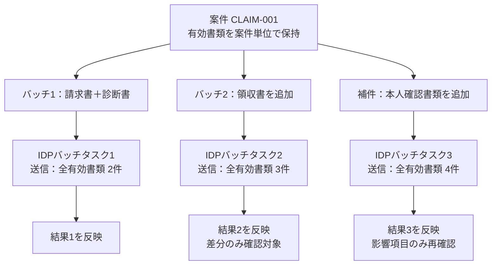
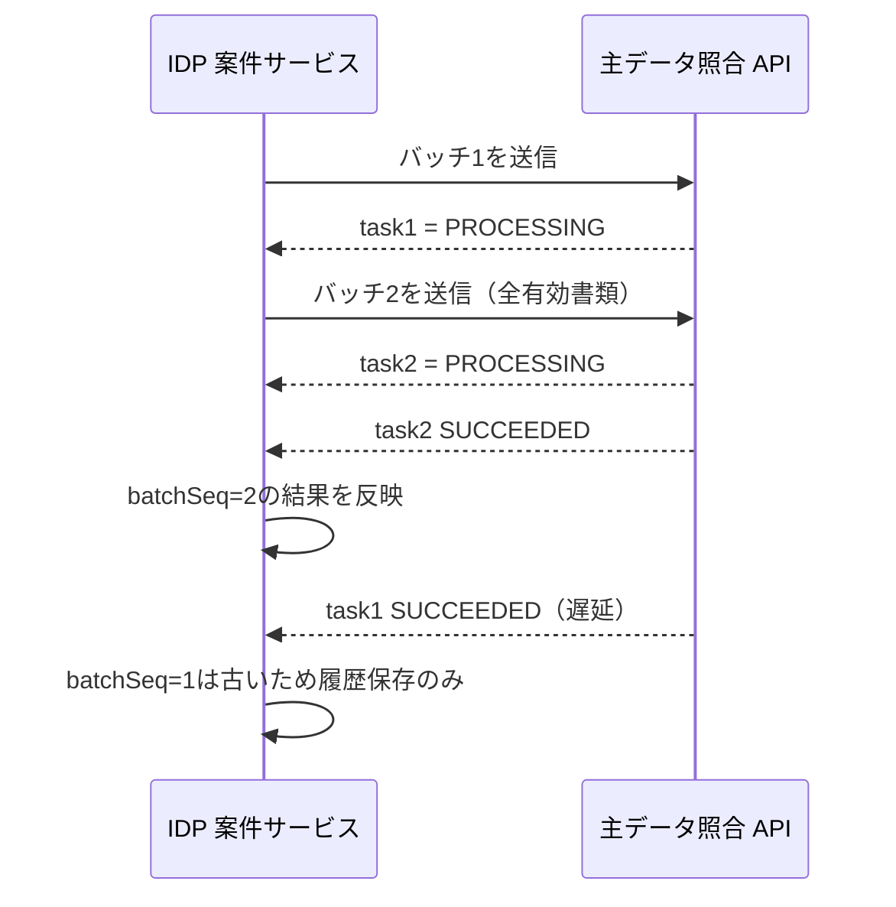

# 主データ照合 API｜案件・バッチ・補件の取扱い確認

## 結論として確認したい運用案

- 案件は1つのまま保持する
- 1回のファイル受信単位を「バッチタスク」とする
- 新しいバッチまたは補件が届いたら、新しいバッチタスクを追加する
- 各バッチタスクのリクエストには、その時点の案件の全有効書類を含める
- 古いバッチの遅延結果は、新しいバッチの結果を上書きしない

## 図1 バッチと補件

## 図2 遅延結果の扱い

## Zurich様への確認事項

| No. | 確認内容 | IDP側の提案 |
|---|---|---|
| 1 | 同一案件で複数のタスクを同時実行できますか | 可能。新バッチ到着時は旧タスクを取消さない |
| 2 | 新バッチ到着時に旧タスクを取消す必要がありますか | 同一バッチの再アップロード・再OCR時のみ取消す |
| 3 | 旧タスクの遅延結果はどう扱いますか | 履歴保存のみ。最新バッチを上書きしない |
| 4 | 補件は新しいバッチタスクとして扱えますか | 新しいタスクを追加し、全有効書類を送信する |
| 5 | 同じ案件の複数タスクで `itemId` は再利用されますか | タスク間の同一性判定には使用しない |
| 6 | `caseRevision` または `snapshotId` を追加できますか | IDP側の `clientRequestId` で代替可能だが、API項目があると照合しやすい |

## 回答欄

| No. | 問題なし | 条件付き | 要変更 | コメント |
|---|---|---|---|---|
| 1 | □ | □ | □ |  |
| 2 | □ | □ | □ |  |
| 3 | □ | □ | □ |  |
| 4 | □ | □ | □ |  |
| 5 | □ | □ | □ |  |
| 6 | □ | □ | □ |  |

