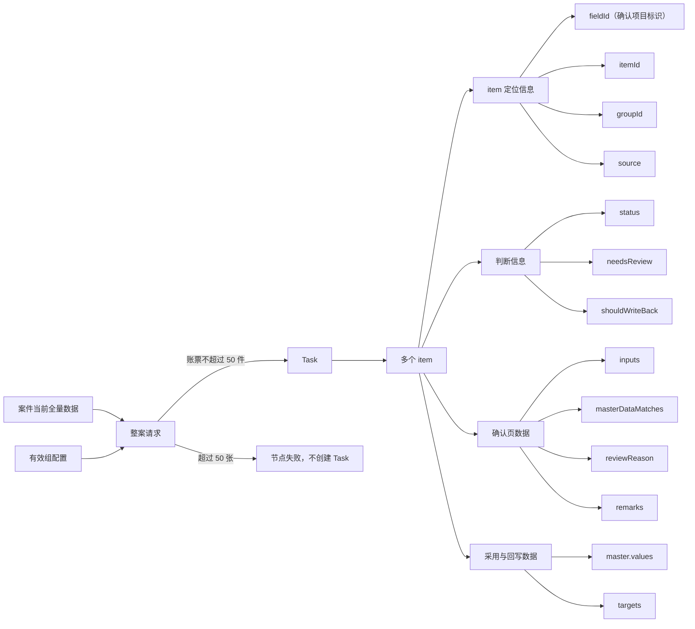
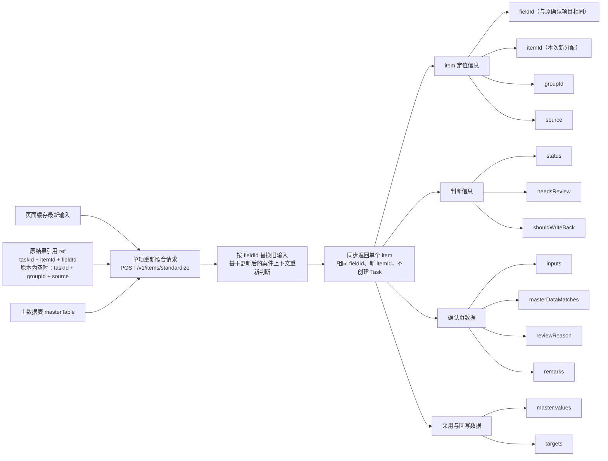
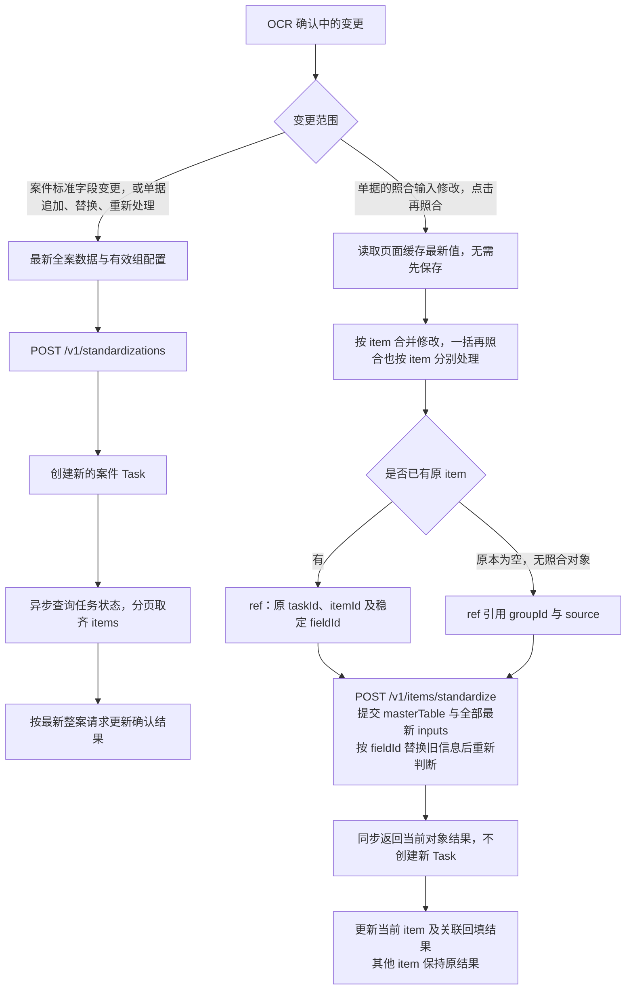

## 第 3 章｜数据结构与职责

### 3.1 配置结构

一个照合组选择一个主数据表，包含多个成员。每个成员把一个 IDP 字段映射到一个主数据列或 hint，并指定读取、回写或读写方式。

| 数据 | 用途 |
| --- | --- |
| 主数据定义 | API 提供主数据表、列和 hint；configuration 提供角色名称、允许的方式及主输入资格 |
| 照合组 | IDP 保存 groupId、组名、主数据表和成员；适用场景由 IDP 维护，发送 API 前移除 |
| 组成员 | 包含主数据列或 hint、IDP 字段引用和 mode；普通字段按字段配置，表格按列配置，标准字段引用数据映射结果 |
| 配置版本与来源 | 后端保存 groupsVersion、配置快照及默认组来源，不提供前端版本管理入口 |

同一组不能重复配置同一主数据列或 hint。同一普通字段、表格列或案件标准字段只能加入一个照合组，输入、输出和读写均适用。完整配置由后端在保存时校验。

### 3.2 请求与结果结构

item 是照合组应用到实际账票后生成的一个照合对象。组是配置模板，item 是执行结果。普通字段按每份账票生成 item，表格字段按每个实际表格行生成 item。

例如组的主输入是「診断書.傷病名」，案件中有 3 份诊断书时生成 3 个 item。组的主输入是「診療明細書.薬剤情報.商品名」时，每个药品表格行生成 1 个 item。

#### 整案照合｜请求与结果结构

#### 单字段重新照合｜请求与结果结构

图中请求携带 ref.fieldId、按 fieldId 覆盖旧输入及更新上下文的方案待客户确认。

`ref` 是原照合结果的引用，用于告诉 API 本次要重新照合哪个对象，并继承该对象的上下文和回写位置。已有结果时传原 `taskId + itemId`，并在 `ref.fieldId` 传入同一确认项目的稳定标识。原本为空、没有 item 时传原 `taskId + groupId + source`，定位原任务中的组及主输入位置。

请求中的 `inputs` 使用页面当前编辑的最新值。同一 item 的多个修改合并为一次请求，inputs 显式提交该对象全部最新输入，回写位置由原结果引用定位，照合使用按 fieldId 更新后的最新上下文。响应只更新对应照合对象及关联回填结果，其他对象保持原结果。一括再照合按照合对象分别调用。

| item 数据 | API 含义 | IDP 使用位置 |
| --- | --- | --- |
| `fieldId` | 确认项目标识，重新照合前后保持相同 | 关联重新照合前后的同一确认项目，替换该项目的结果 |
| `itemId` | 一次照合结果的对象标识。整案结果中位于 Task 的 items 内，单项重新照合会分配新值但不创建 Task | 工作流结果处理、局部重新照合和结果更新 |
| `groupId` | 生成该 item 的照合组 | 关联组配置、组名和适用场景 |
| `source` | 主输入在实际账票中的位置 | 定位确认页中的 OCR 字段或表格单元格 |
| `inputs` | 实际参与匹配的值及位置 | 确认页判断依据，重新照合时提交该对象全部最新输入 |
| `status` | API 对单个 item 的判断状态 | 异常解释和契约检查，不用于切换确认页布局 |
| `needsReview` | 是否需要人工确认 | 决定进入自动采用还是 OCR 抽出确认 |
| `shouldWriteBack` | 是否需要回写 | 决定最终结果是否写入 `targets` |
| `masterDataMatches` | 可选择的统一候选列表 | 确认页主数据候选下拉，包含主要素和追加要素 |
| `master` | API 推荐或自动采用的主数据行 | 自动采用时提供 `values` |
| `targets` | 结果应写入的 IDP 字段或表格单元格 | 回写功能按列从 `master.values` 取值写入 |
| `reviewReason` | 需要人工确认的原因 | 确认页「確認理由」 |
| `remarks` | 名称提案、照合依据、补充说明等 | 确认页字段下方附加信息，有内容时显示 |

`masterDataMatches[]` 每一项都包含自己的 `label`、`confidence`、`primary`、`master` 和 `targets`。操作员选择候选后，IDP 使用该候选自己的数据回写，不从 `splitItems` 等详细结果自行拼接。

IDP 使用 `fieldId` 关联重新照合前后的同一确认项目，并替换该项目的结果。`groupId` 关联组配置，`source` 定位主输入在账票中的实际位置，`targets` 定位回写位置。`fieldId` 不用于确定回写位置，也不决定输入数据的版本。

自动采用使用 item 的 `master.values` 和 `targets`。人工确认使用操作员所选项的 `master.values` 和 `targets`。没有值的列保持原值。`selection` 随响应保存为原始记录，本期不参与展示、回写或后续系统登记。

后续文件新增、删除或替换后再次执行工作流时，IDP 提交新的整案请求并生成新的 Task。单项重新照合使用原 `taskId`、`itemId` 和缓存最新输入，按相同 `fieldId` 替换当前确认项目的结果，保存新 `itemId`。

#### 整案照合与字段重新照合

图中的原 `taskId` 用于定位重新照合所依据的原结果。字段重新照合直接取得当前对象的新结果，无需进入案件 Task 的轮询与结果分页流程。一括再照合按 item 合并修改，同一 item 的多个修改只提交一次。

### 3.3 职责与留存

IDP 负责配置、提交请求、等待任务、展示确认页及将结果写入自身字段。API 负责匹配、判断是否需确认和回写，并提供候选及说明；API 不直接修改 IDP 数据。

后端留存本次请求实际使用的文件、字段值、组配置快照和任务结果，供运行和追溯使用。前端只展示业务需要的配置、履历和确认内容。配置修改限有权限的管理员；OCR 确认沿用现有任务权限。
