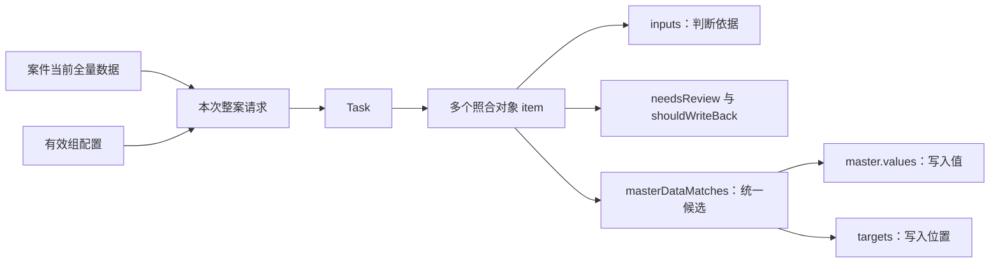

## 第 3 章｜数据结构与职责

### 3.1 配置结构

一个照合组选择一个主数据表，包含多个成员。每个成员把一个 IDP 字段映射到一个主数据列或 hint，并指定读取、回写或读写方式。

| 数据 | 用途 |
| --- | --- |
| 主数据定义 | API 提供主数据表、列和 hint；configuration 提供角色名称、允许的方式及主输入资格 |
| 照合组 | IDP 保存 groupId、组名、主数据表和成员；适用场景由 IDP 维护，发送 API 前移除 |
| 组成员 | 包含主数据列或 hint、IDP 字段引用和 mode；普通字段按字段配置，表格按列配置，标准字段引用数据映射结果 |
| 配置版本与来源 | 后端保存 groupsVersion、配置快照及默认组来源，不提供前端版本管理入口 |

同一组不能重复配置同一主数据列或 hint。同一普通字段、表格列或案件标准字段只能加入一个照合组，输入、输出和读写均适用。完整配置由后端在保存时校验。

### 3.2 请求与结果结构

| 数据 | 含义 |
| --- | --- |
| 请求与 Task | 一次成功受理的整案请求对应一个 Task；同一案件可以有多次请求 |
| item | 组应用到实际单据后生成的照合对象；一个组可以生成零个、一个或多个对象，不等同于一个配置字段 |
| taskId、itemId | 分别标识本次任务及任务中的照合对象；单项重新照合通过 ref 引用原对象 |
| fieldId | API 提供的跨任务和重新照合项目关联标识，由后端保留，不展示，不决定回写位置 |
| inputs | 本次判断使用的值；重新照合时可只传修改的输入，其他输入从原对象继承 |
| needsReview | 是否人工确认；缺失或 null 按需要确认处理 |
| shouldWriteBack | 是否回写；缺失或 null 按不回写处理 |
| masterDataMatches | 确认页统一候选，含 label、confidence、primary，以及各候选自己的 master 和 targets；不由前端从拆分明细重新拼装 |
| master.values、targets | 分别提供写入值和位置；自动采用使用结果的 master 和 targets，人工选候选使用所选候选自己的数据 |
| reviewReason、remarks | 确认原因和其他信息，按返回内容展示 |

单项重新照合同步返回，不创建新 Task，不改变原任务状态。IDP 根据请求上下文更新对应对象；实际回写位置以 targets 为准。

### 3.3 职责与留存

IDP 负责配置、提交请求、等待任务、展示确认页及将结果写入自身字段。API 负责匹配、判断是否需确认和回写，并提供候选及说明；API 不直接修改 IDP 数据。

后端留存本次请求实际使用的文件、字段值、组配置快照和任务结果，供运行和追溯使用。前端只展示业务需要的配置、履历和确认内容。配置修改限有权限的管理员；OCR 确认沿用现有任务权限。
