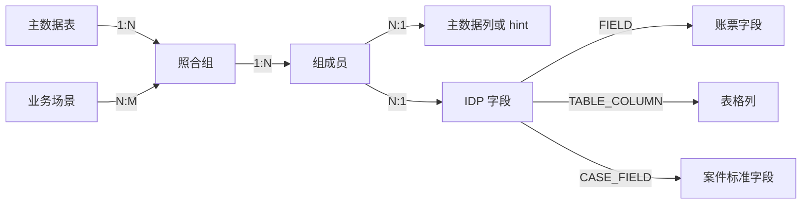
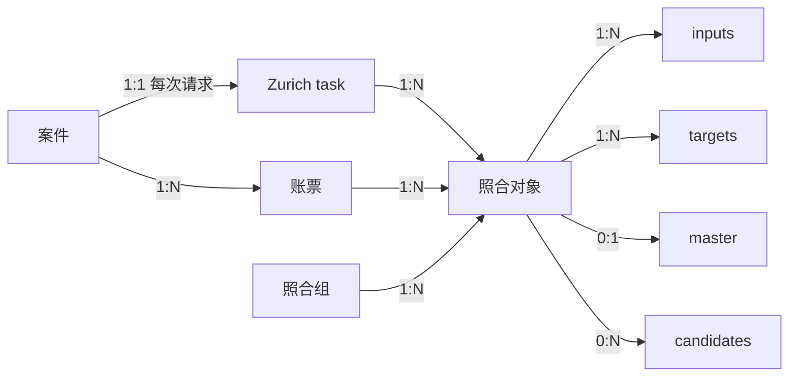

## 第 3 章｜术语、数据结构与权限

### 3.1 术语与词汇表

| 中文 | 日语或界面 | 定义 |
| --- | --- | --- |
| 主数据 | マスタデータ | Zurich 管理的数据表和业务记录。IDP 只读取定义和执行照合，不维护业务记录 |
| 照合组 | 照合グループ | 一组主数据与 IDP 字段的映射设置，包含一个主数据表、适用场景和照合字段 |
| 主数据表 | マスタ | 一个照合组使用的一个 Zurich 主数据 schema，例如 DISEASE、DRUG |
| 主数据列 | マスタ列 | Zurich `columns[]` 中的列，包含 `inputRole` 和 `writable` |
| 提示信息 | ヒント | Zurich `hints[]` 中的补充判断信息，只能用于 INPUT |
| 照合方式 | 照合方式 | 组成员使用 INPUT、OUTPUT 或 INPUT_OUTPUT |
| 主输入 | 主入力 | `inputRole=PRIMARY` 的组输入 |
| 辅助输入 | 補助入力 | 除主输入外参与判断的主数据列或 hint |
| 回填 | 反映 | IDP 按 item 的 `targets` 写入主数据值 |
| 适用场景 | 適用シーン | 照合组生效的业务场景。节点按当前 `sceneId` 匹配 |
| 业务批次 | 批次 | IDP 收件和追溯使用的内部概念，不是 Zurich API 的处理单位 |
| Zurich 任务 | taskId | 一次 Zurich 标准化请求对应的异步任务 |
| 照合对象 | item | Zurich 返回的一个标准化对象 |
| 候选 | candidates | 包含采用行在内的主数据候选，默认最多 5 条 |
| 组整体版本 | groupsVersion | 全部照合组的一次保存快照版本 |
| 默认组 | 既定グループ | Zurich 返回的推荐组模板 |
| 兜底照合 | FALLBACK | Zurich 对未配置组账票生成的临时照合结果 |

### 3.2 模块与对象关系

| 模块 | 负责内容 | 主要入口 |
| --- | --- | --- |
| API连接 | Zurich 连接、认证和连接状态 | API設定 → 外部API |
| 外部照合组配置 | 主数据下拉、组配置、默认组、校验和版本 | 外部マスタデータ |
| 业务场景与案件照合 | 节点配置、整案请求、轮询和结果应用 | 業務シーン設定 |
| OCR抽出确认与结果应用 | 候选确认、字段回填和采用记录 | OCR抽出確認 |

| 关系 | 基数 | 规则 |
| --- | --- | --- |
| 主数据表与组 | 1:N | 一个组只能选择一个主数据表，同一主数据表可以创建多个组 |
| 组与适用场景 | N:M | 一个组可以适用多个场景，一个场景可以命中多个组 |
| 组与成员 | 1:N | 一个组包含一个或多个组成员 |
| 成员与主数据项目 | N:1 | 每个成员选择一个主数据列或一个 hint |
| 普通字段／表格列与照合组 | N:1 | 同一账票字段或表格列只能配置到一个组 |
| 案件标准字段与回填目标 | 1:N | 多个组回填同一案件标准字段时允许保存并显示警告，运行时冲突转人工 |

### 3.3 主数据、组与字段结构

| 对象 | 关系 | 规则 |
| --- | --- | --- |
| 主数据表与列 | 1:N | 列来自 Zurich `columns[]` |
| 主数据表与 hint | 1:N | hint 来自 Zurich `hints[]`，只用于补充判断 |
| 主数据行与列值 | 1:N | `values` 包含该主数据行的全部列值 |
| 组成员与 IDP 字段 | N:1 | 每个成员选择一个 IDP 字段和一个主数据项目 |
| 组成员与照合方式 | N:1 | 每个成员选择一个 `INPUT`、`OUTPUT` 或 `INPUT_OUTPUT` |

IDP 字段有三种类型。

| IDP 字段类型 | 含义 | 结果位置 |
| --- | --- | --- |
| FIELD | 单据普通字段 | `FIELD` |
| TABLE_COLUMN | 表格整列配置 | 每个表格行生成 `TABLE_CELL` 位置 |
| CASE_FIELD | 案件级标准字段 | `CASE_FIELD` |

主数据侧有两种可选项目。

| 类型 | 用途 | 可用照合方式 |
| --- | --- | --- |
| 主数据列 | 可作为输入或回填目标 | 受 `inputRole`、`writable` 和组配置限制 |
| hint | 只作为补充判断信息 | 只能使用 `INPUT` |

hint 会进入 item 的 `inputs[]`，不会进入 `targets`，因此不能回填。

组结构约束：

- 同一组内，同一主数据列或 hint 只能出现一次。
- 同一主数据列或 hint 可以在不同组中复用。
- 同一个账票普通字段或表格列只能配置到一个组。
- 一个组只能包含一种字段类型：普通字段、表格字段、案件标准字段三选一。
- 同一个案件标准字段可以作为多个组的输入，但只能由一个组回填。
- 同一个 IDP 字段作为多个组的回填目标时允许保存并警告，运行时冲突转人工。
- `INPUT` 只参与判断，`OUTPUT` 只回填，`INPUT_OUTPUT` 同时参与判断和回填。

### 3.4 批次、任务与结果结构

| 关系 | 基数 | 规则 |
| --- | --- | --- |
| 案件快照与 task | 1:1 | 一次整案请求对应一个 taskId；本期超过 50 张时拦截，不拆分 |
| 案件与账票 | 1:N | 案件包含账票；每次请求发送案件当前全部账票快照 |
| task 与组 | N:M | task 保存本次提交使用的组设置快照 |
| task 与 item | 1:N | 一个 task 返回多个照合对象 |
| 组与 item | 1:N | 一个组可以生成 0 个、1 个或多个 item |
| item 与 inputs | 1:N | 本次参与判断的输入可以有多个 |
| item 与 targets | 1:N | 本次回填目标可以有多个 |
| item 与 master | 1:0..1 | 无法确定主数据行时为 null |
| item 与 candidates | 1:N | 包含采用行，默认最多 5 条 |

`itemId` 在 task 内唯一，列表顺序没有业务意义。`FALLBACK` 和 `ADHOC` 是特殊 groupId，不对应 IDP 保存的普通组。

### 3.5 数据结构常见问题

| 问题 | 结论 |
| --- | --- |
| 一个主数据表能否配置多个组？ | 可以 |
| 一个组能否配置多个主数据表？ | 不可以 |
| 同一个场景能否命中多个组？ | 可以 |
| 不同组能否复用同一主数据列或 hint？ | 可以 |
| 同一组内能否重复使用同一主数据列或 hint？ | 不可以 |
| 一个 item 能否回填多个 IDP 字段？ | 可以 |
| 一个组是否有独立版本？ | 没有，使用整体 groupsVersion |
| hint 是否产生回填目标？ | 不会 |
| 已运行任务是否受组配置修改影响？ | 不会，任务使用提交时快照 |

### 3.6 权限

| 角色 | 配置端 | 工作流节点 | OCR抽出确认 |
| --- | --- | --- | --- |
| 配置管理员 | 查看、编辑、保存、同步、查看履历 | 查看 | 查看 |
| 业务场景管理员 | 查看 | 添加、删除和连接节点 | 查看 |
| OCR经办人 | 无 | 无 | 确认、修正和重新照合 |
