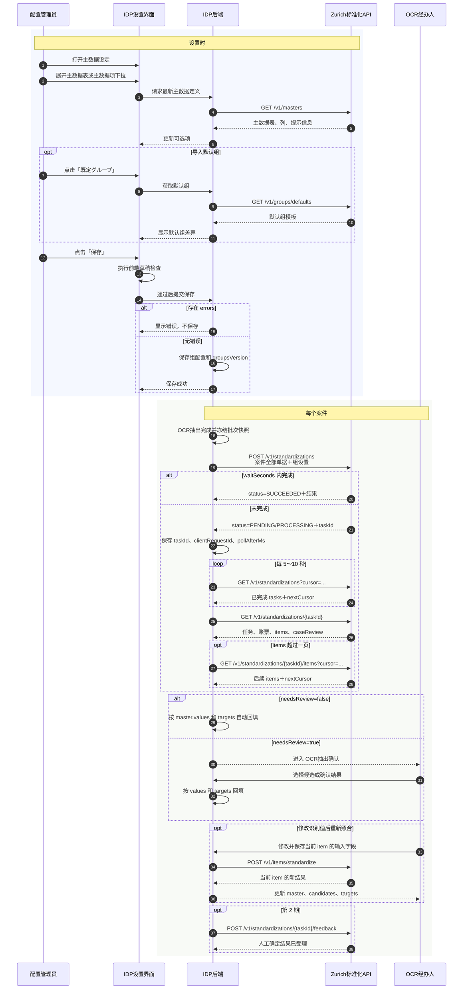

## 第 4 章｜API 契约

字段名称、类型和必填性以 [综合主数据名称标准化 API 规格书 v1.1 中文版](/attachments/zurich-standardization-api-v1.1-zh-CN.md) 为准。本章只列 IDP 实际发送或使用的字段，不新增 API 字段。

标记说明：`必填` 和 `条件必填` 取自式样书；`可选` 不表示 IDP 不发送；`IDP发送` 只说明实现策略。

### 4.1 API 调用总览

| 模块 | 接口 | IDP阶段 | 调用时机 | 同步性 |
| --- | --- | --- | --- | --- |
| 配置 | `GET /v1/masters` | 本期 | 展开「マスタ」或「マスタ項目」下拉 | 同步 |
| 配置 | `GET /v1/catalog` | 本期 | 展开「マスタ」或「マスタ項目」下拉 | 同步 |
| 配置 | `GET /v1/groups/defaults` | 本期 | 点击「既定グループ」 | 同步 |
| 照合执行 | `POST /v1/standardizations` | 本期 | 一个业务批次提交 | 异步，可由 `waitSeconds` 同步返回 |
| 照合执行 | `GET /v1/standardizations` | 本期 | 轮询已完成任务 | 同步 |
| 照合执行 | `GET /v1/standardizations/{taskId}` | 本期 | 任务进入终态或查询状态 | 同步 |
| 照合执行 | `GET /v1/standardizations/{taskId}/items` | 本期 | `itemsNextCursor` 存在 | 同步 |
| 照合执行 | `POST /v1/standardizations/{taskId}/cancel` | 本期 | 业务明确中止任务 | 同步 |
| 人工确认 | `POST /v1/items/standardize` | 本期 | 修改识别值并保存成功后 | 同步 |
| 运维 | `GET /v1/health` | 按需 | 连接排障或运行状态确认 | 同步 |
| 后续 | `POST /v1/standardizations/{taskId}/feedback` | 第 5 期 | 本期不调用 | 同步 |
| 后续 | `POST /v1/masters/search` | 第 5 期 | 本期不调用 | 同步 |
| 后续 | `POST /v1/groups/suggest` | 第 5 期 | 本期不调用 | 同步 |

完成通知 `callbackUrl` 在第 5 期接入，本期使用轮询。`GET /v1/health` 不进入本期页面流程。

#### 总览时序图

### 4.2 公共响应与对象

#### 公共响应 `code / msg / requestId / warnings / data`

| 字段 | 类型 | 含义 |
| --- | --- | --- |
| `code` | Integer | 成功为 0，失败时与 HTTP 状态码一致 |
| `msg` | String | 错误或提示说明 |
| `requestId` | String | 排障编号 |
| `warnings` | Object[] | 响应警告。公共响应和单据警告含 `code`、`message`；任务级 `data.warnings[]` 在组相关警告时还含 `groupId` |
| `data` | Object | 当前接口业务数据 |

#### 公共对象

- `Group`：`groupId`必填、`label`可选、`masterTable`必填、`members`必填。
- `Member`：`column` 或 `hint`条件必填、`mode`必填、`field`必填。
- `Member.field`：`type`必填，`documentTypeId`、`fieldName`、`tableName`、`columnName`按字段类型条件必填。
- `Document`：`documentId`、`documentTypeId`、`format`必填；`result` 或 `fields`按格式条件必填。
- `Item`：`itemId`、`groupId`、`masterTable`、`source`、`inputs`、`targets`、`status`、`needsReview` 为核心字段；`master`、`proposedName`、`confidence`、`candidates`、`reviewReasons`、`notices`、`reason`、`notesForAssessor`、`alternatives`、`splitItems`、`webEvidence` 按结果使用。
- `caseReview` 是任务级字段，位于任务结果的 `data.caseReview`，不属于单个 `Item`。

#### 字段归属

| 名称 | 来源 | 含义 |
| --- | --- | --- |
| `sceneId` | Zurich 请求字段，值来自 IDP 业务场景 | 当前业务场景 ID |
| `groupsVersion` | IDP 生成，作为 Zurich 请求字段发送 | 组配置整体版本。Zurich 在 `data.versions.groups` 中回显 |
| `sourceDefaultGroupId` | IDP 内部字段 | IDP 保存的 Zurich 默认组来源 ID，不发送给 Zurich |
| `masterStatus`、`masterResult` | IDP 工作流节点输出变量 | 节点处理状态和业务结果，不是 Zurich 返回字段 |
| 组快照、组变更履历 | IDP 内部数据 | 用于版本留痕和审计，不是 Zurich 返回字段 |

### 4.3 配置接口

#### `GET /v1/masters`

调用条件：展开「マスタ」或「マスタ項目」下拉。请求无业务参数。

| IDP读取并使用的返回字段（式样书字段子集） | 类型 | 必填性 | 用途 |
| --- | --- | --- | --- |
| `data.schemaVersion` | String | 返回 | 判断 schema 是否更新 |
| `data.masterTables[]` | Object[] | 返回 | 主数据表列表 |
| `data.masterTables[].masterTable` | String | 返回 | 组引用的主数据表键 |
| `data.masterTables[].label` | String | 返回 | 主数据表显示名 |
| `data.masterTables[].enabled` | Boolean | 返回 | 是否可用于新配置 |
| `data.masterTables[].deprecated` | Boolean | 返回 | 废弃标记，本期不使用 |
| `data.masterTables[].columns[]` | Object[] | 返回 | 该主数据表的列定义 |
| `data.masterTables[].columns[].column` | String | 返回 | 列键 |
| `data.masterTables[].columns[].label` | String | 返回 | 列显示名 |
| `data.masterTables[].columns[].inputRole` | String | 返回 | `PRIMARY`、`SUPPORTING`、`NONE` |
| `data.masterTables[].columns[].writable` | Boolean | 返回 | 是否可回填 |
| `data.masterTables[].columns[].deprecated` | Boolean | 返回 | 废弃标记，本期不使用 |
| `data.masterTables[].hints[]` | Object[] | 返回 | 该主数据表的 hint 定义 |
| `data.masterTables[].hints[].hint` | String | 返回 | hint 键 |
| `data.masterTables[].hints[].label` | String | 返回 | hint 显示名 |
| `data.masterTables[].hints[].deprecated` | Boolean | 返回 | 废弃标记，本期不使用 |

#### `GET /v1/catalog`

调用条件：展开「マスタ」或「マスタ項目」下拉。请求无业务参数。

| IDP读取并使用的返回字段（式样书字段子集） | 类型 | 必填性 | 用途 |
| --- | --- | --- | --- |
| `data.catalogVersion` | String | 返回 | 枚举版本 |
| `data.enums` | Object | 返回 | 枚举值和显示名 |

#### `GET /v1/groups/defaults`

调用条件：点击「既定グループ」。请求无业务参数。

| IDP读取并使用的返回字段（式样书字段子集） | 类型 | 必填性 | 用途 |
| --- | --- | --- | --- |
| `data.version` | String | 返回 | 默认组版本 |
| `data.groups[]` | Object[] | 返回 | 默认组模板 |
| `data.groups[].groupId` | String | 返回 | Zurich 默认组 ID |
| `data.groups[].label` | String | 返回 | 组名 |
| `data.groups[].masterTable` | String | 返回 | 主数据表键 |
| `data.groups[].members[]` | Object[] | 返回 | 组成员 |

#### 组配置校验

保存时由 IDP 前端检查照合组草稿，通过后提交保存。配置服务负责保存和版本记录，不重复执行前端控件的业务校验。四期配置流程不调用 Zurich 的 `POST /v1/groups/validate`。

### 4.4 照合执行接口

#### `POST /v1/standardizations`

调用条件：一个业务批次 OCR抽出完成。

| 请求字段 | 类型 | 必填性 | IDP发送策略 |
| --- | --- | --- | --- |
| `clientRequestId` | String | 可选 | 每次请求发送，用于幂等 |
| `caseNo` | String | 必填 | IDP 案件编号 |
| `sceneId` | String | 可选 | 当前业务场景 ID |
| `groups` | Object[] | 可选 | IDP 有有效组时发送 |
| `groupsVersion` | String | 可选 | 发送当前保存版本 |
| `waitSeconds` | Integer | 可选 | IDP 设置同步等待秒数 |
| `options.fallback` | Boolean | 可选 | Zurich 通过此参数控制 fallback，接口默认 `true`。本期取值及配置入口待确认 |
| `options.maxCandidates` | Integer | 可选 | 默认值 5，可设置范围 1 至 10，候选数包含 `isMaster=true` 的主数据行 |
| `caseResult` | Object | 可选 | 案件标准字段容器，组使用 `CASE_FIELD` 时发送 |
| `caseResult.fields[]` | Object[] | 条件必填 | 标准字段数组，`CASE_FIELD.fieldName` 与其中 `name` 对应 |
| `caseResult.fields[].name` | String | 条件必填 | 案件标准字段名 |
| `caseResult.fields[].value` | JSON value | 条件必填 | 案件标准字段值，按 IDP 输出原样发送 |
| `documents` | Object[] | 必填 | 当前批次账票 |
| `documents[].documentId` | String | 必填 | 逻辑文件 ID |
| `documents[].documentTypeId` | String | 必填 | 账票类别 ID |
| `documents[].format` | String | 必填 | IDP 使用 `IDP_RESULT_JSON` |
| `documents[].result` | Object | 条件必填 | `format=IDP_RESULT_JSON` 时必填 |

`FIELDS` 和 `documents[].fields` 属于式样书能力，本期 IDP 不发送。

本接口不传输原始文件的二进制内容。`documents[].result` 发送每张账票完整的 OCR RESULT JSON，包含 `fields`、`table_list` 和 OCR 状态信息。请求发送当前批次内的全部账票；组只决定哪些账票项目参与照合，不用于裁剪 `documents[].result`。

IDP读取并使用的返回字段（式样书字段子集）：`data.taskId`、`data.clientRequestId`、`data.caseNo`、`data.status`、`data.queue`、`data.progress`、`data.pollAfterMs`、`data.versions`、`data.summary`、`data.warnings`、`data.failure`、`data.documents`、`data.items`、`data.itemsNextCursor`、`data.caseReview`。

#### `GET /v1/standardizations`

| 查询参数 | 类型 | 必填性 | IDP发送策略 |
| --- | --- | --- | --- |
| `finishedAfter` | Long | 条件必填 | 首次查询发送 |
| `cursor` | String | 条件必填 | 第二次起发送上次 `nextCursor` |
| `limit` | Integer | 可选 | IDP 使用 100 |

IDP读取并使用的返回字段（式样书字段子集）：`data.tasks[].taskId`、`data.tasks[].clientRequestId`、`data.tasks[].caseNo`、`data.tasks[].status`、`data.tasks[].completedAt`、`data.nextCursor`。

#### `GET /v1/standardizations/{taskId}`

| Path/查询参数 | 类型 | 必填性 | IDP使用方式 |
| --- | --- | --- | --- |
| `taskId` | String | 必填 | Path 参数 |
| `includeItems` | Boolean | 可选 | IDP 发送 `true` |

IDP读取并使用的返回字段（式样书字段子集）：完整 `data` 任务对象，使用 `data.status`、`data.documents`、`data.items`、`data.itemsNextCursor`、`data.caseReview`、`data.warnings` 驱动流程和展示。

#### `GET /v1/standardizations/{taskId}/items`

| Path/查询参数 | 类型 | 必填性 | IDP使用方式 |
| --- | --- | --- | --- |
| `taskId` | String | 必填 | Path 参数 |
| `cursor` | String | 可选 | 存在后续页时发送 |
| `limit` | Integer | 可选 | IDP 使用 100 |

IDP读取并使用的返回字段（式样书字段子集）：`data.items[]`、`data.nextCursor`。

#### `POST /v1/standardizations/{taskId}/cancel`

请求只有 Path 参数 `taskId`，无请求体。IDP读取并使用的返回字段（式样书字段子集）：`data.status`。

### 4.5 人工确认与重新照合接口

#### `POST /v1/items/standardize`

| 请求字段 | 类型 | 必填性 | IDP发送策略 |
| --- | --- | --- | --- |
| `clientRequestId` | String | 可选 | IDP 发送 |
| `caseNo` | String | 可选 | IDP 发送用于审计 |
| `ref` | Object | 可选 | 原任务与 item 的引用容器 |
| `ref.taskId` | String | 条件必填 | 指定 `ref` 时发送 |
| `ref.itemId` | String | 条件必填 | 指定 `ref` 时发送 |
| `masterTable` | String | 必填 | 当前 item 的主数据表 |
| `inputs[]` | Object[] | 必填 | 修改后的输入 |
| `inputs[].column` | String | 条件必填 | 与 `hint` 二选一 |
| `inputs[].hint` | String | 条件必填 | 与 `column` 二选一 |
| `inputs[].value` | String | 必填 | 修改后的值 |
| `targets` | Object | 可选 | IDP 有明确 targets 时发送 |
| `options.timeoutSeconds` | Integer | 可选 | Zurich 重新照合处理时限，5～30 秒，默认 30 秒 |

IDP读取并使用的返回字段（式样书字段子集）：`data.itemId`、`data.groupId`、`data.masterTable`、`data.source`、`data.inputs`、`data.targets`、`data.status`、`data.needsReview`、`data.master`、`data.proposedName`、`data.candidates`、`data.reviewReasons`、`data.notices`、`data.reason`、`data.notesForAssessor`、`data.alternatives`、`data.splitItems`、`data.ref`。

该接口不发送文件、`documents` 或完整 OCR 结果。它只发送原任务引用、主数据表和修改过的输入字段。接口以 item 为执行单位，同一 item 的多个修改字段可以放入同一个 `inputs[]`；不同 item 需要分别调用。`mode` 不随请求发送，由原任务组快照决定字段用途。重新照合不创建任务，不重跑组，也不修改批次任务状态。
