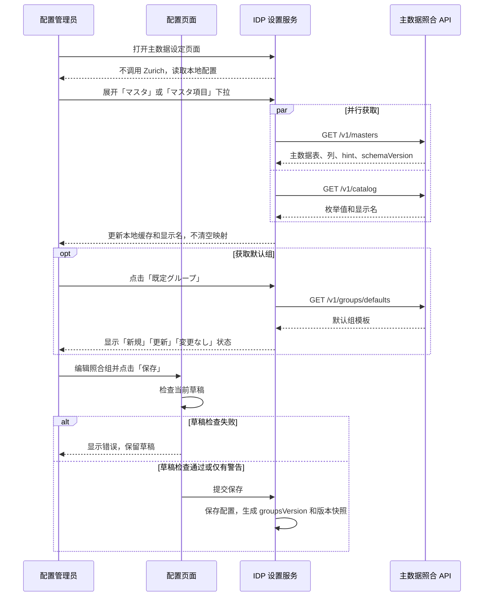
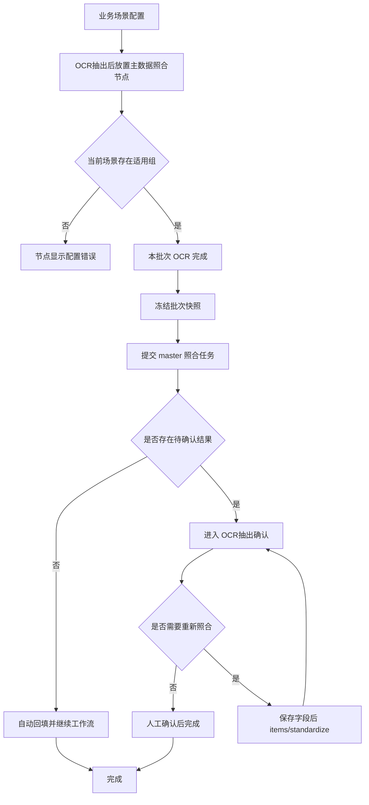
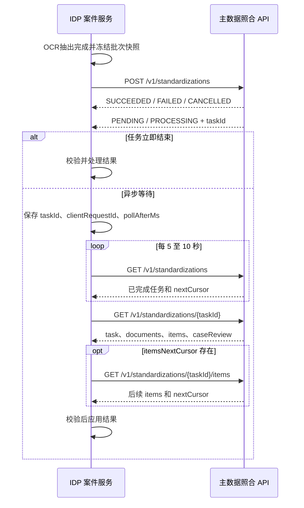
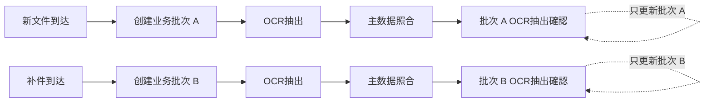
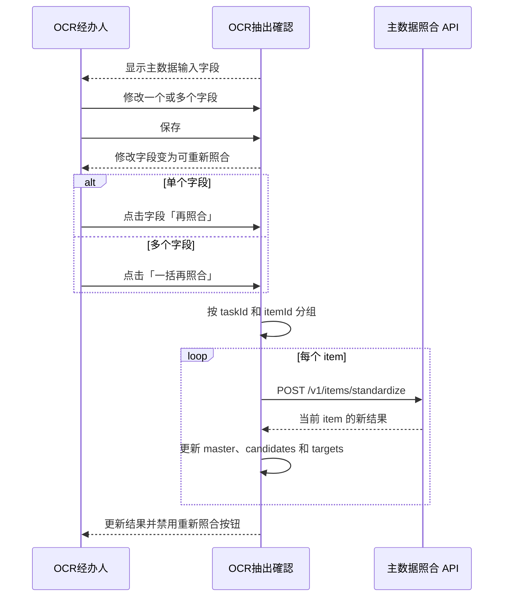
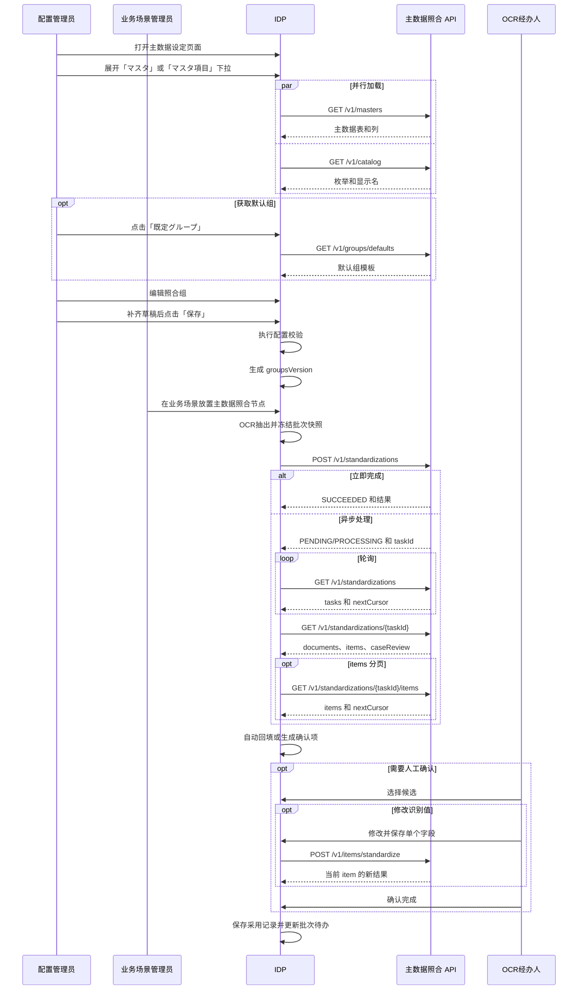

## 第 5 章｜功能详情

### 5.1 标准化 API 连接

#### 页面与入口

| 项目 | 内容 |
| --- | --- |
| 入口 | API設定 → 外部API |
| 使用者 | 配置管理员 |
| 连接使用方 | 主数据设定和主数据照合节点通过 IDP 后端使用该连接 |

外部 API 列表允许登记多条连接，始终提供「接続を追加」，并显示每条连接的「利用モジュール」。新增和编辑表单的「用途割当」使用单选下拉，四期仅提供「マスタデータ照合」，打开表单默认选中。

每个模块最多绑定一条连接。模块已被其他连接占用时，表单提示占用连接名称并禁止保存。四期更换连接信息可直接编辑现有连接。后端按模块标识保证绑定唯一，并拒绝并发重复绑定。

主数据设定和照合服务按模块标识读取绑定连接。没有绑定或连接测试未通过时，提示前往 API 設定。修改 URL、认证方式或密钥时重置测试状态，保留模块绑定。API Key 由服务端保存和使用。

#### 字段与参数规格

| 字段 | 必填 | 规则 |
| --- | --- | --- |
| 连接类型 | 是 | 下拉选择。默认不选中任何值，当前选项包含 Zurich |
| 连接名 | 是 | 用于外部API列表显示 |
| 用途割当 | 是 | 单选下拉，四期仅有「マスタデータ照合」且默认选中。同一模块只能绑定一条连接 |
| Base URL | 是 | 填写 Zurich 为生产或验证环境提供的 HTTPS Base URL，用于拼接接口路径。URL 为 HTTP 时，保存按钮不可用 |
| 认证方式 | 是 | 按连接类型选择。Zurich 使用 Bearer API Key |
| API Key | 是 | 填写环境对应的 Bearer API Key。后端保存受保护引用，编辑时显示「登録済み」和脱敏预览 |
| 接続テスト | 否 | 保存连接后手动执行，不阻断连接配置保存 |

连接名称、提供商、认证方式、Base URL 和首次输入的 API Key 显示「必須」标签。页面底部显示已保存凭证的脱敏预览。浏览器不得持有或直接使用 Zurich Token。「登録済み」只表示 API Key 已保存，不表示连接已验证。

#### 状态与按钮

| 按钮或状态 | 条件 | 结果 |
| --- | --- | --- |
| 保存 | 必填项完整 | 保存 Base URL、连接类型和 API Key 的受保护引用。连接状态保持「未確認」，或在 endpoint 与 API Key 未变化时沿用上一次测试结果 |
| 接続テスト | 连接已保存 | 调用 Zurich 接口确认连接 |
| 削除 | 连接已保存，包含已分配用途的连接 | 打开「削除確認」，显示连接名称及「用途割当」中已分配的用途。点「OK」删除连接并解除用途绑定，点「キャンセル」保留连接和绑定 |
| 登録済み | API Key 已保存 | 只表示凭证已登记，显示脱敏预览，不代表连接有效 |
| 未確認 | 尚未测试，或 Base URL、连接类型、API Key 已修改 | 可以保存，主数据加载前需要确认连接 |
| 有効 | 接続テスト成功 | 可以作为主数据设定的数据源 |
| 無効 | 接続テスト失败 | 显示连接错误，主数据加载失败 |

#### 异常与边界

- 未配置标准化 API 时，「外部マスタデータ」显示「標準化APIが設定されていません」和「API設定へ」入口。
- API 连接失败时，显示「標準化APIに接続できません」。
- Base URL、连接类型或 API Key 变化后，原连接测试状态失效。
- Zurich API Key 有效期为 1 年。到期前签发新 Key，切换期间新旧两个 Key 均可使用。依据式样书 §2.2。
- 连接使用 HTTPS，TLS 版本不低于 1.2。IDP 服务器配置 Zurich 内部 CA 证书。依据式样书 N-01 和 §2.1。

### 5.2 マスタ与照合组配置

#### 页面与入口

| 项目 | 内容 |
| --- | --- |
| 外部照合组入口 | 業務ルール設定 → マスタデータ設定 → 外部マスタデータ Tab |
| 内部主数据入口 | 業務ルール設定 → マスタデータ設定 → 内部マスタデータ Tab，菜单默认打开此页 |
| 内部账票规则 | 帳票タイプ設定 → ルール設定 → マスタ照合，恢复内部主数据及字段选择 |
| 使用者 | 配置管理员 |

#### 页面结构

| 区域 | 内容 |
| --- | --- |
| 左侧 | 照合组搜索、追加、既定グループ、组列表和组菜单 |
| 右侧 | グループ名、適用シーン、マスタ、照合フィールド |
| 底部 | 「閉じる」「保存」靠右排列 |

左侧只显示照合组列表，不显示主数据表列表。组内部 groupId 不在界面显示。

#### 接口调用时机

| 用户动作 | Zurich 接口调用 | 调用后处理 |
| --- | --- | --- |
| 打开或刷新页面 | 不调用 | 只读取 API 连接状态和 IDP 已保存的数据 |
| 展开「マスタ」或「マスタ項目」下拉 | 调用 `GET /v1/masters` 和 `GET /v1/catalog` | masters 成功后刷新主数据缓存。catalog 成功后刷新显示名。任一个失败都保留该部分原数据 |
| 点击「既定グループ」 | 调用 `GET /v1/groups/defaults` | 打开默认组差异弹窗。点击「更新」载入页面草稿 |
| 点击「保存」 | 仅执行前端草稿检查 | 校验通过或仅有警告时保存，生成 `groupsVersion` 和版本快照；有错误时停止保存 |
| 新增、复制、改名、删除组或编辑字段 | 不调用 | 只修改页面草稿，点击「保存」时由 IDP 统一校验 |
| 批量执行照合任务 | 调用 `POST /v1/standardizations` | 发送当前批次全部账票的 OCR 结果、有效组和 `groupsVersion` |

#### 主数据下拉刷新

展开「マスタ」或「マスタ項目」时，通过已通过连接测试的外部 API 获取最新主数据定义。主数据项按当前主数据表显示 Column 和 Hint。masters 和 catalog 独立请求。取数失败时提示重新展开重试，保留已选配置。刷新下拉不触发默认组获取，也不保存照合组。

首次进入且没有已保存的照合组时，展示空态和「既定グループ」入口。已有保存配置时，重新进入显示已保存的照合组。默认组获取失败时保留现有配置。

#### 照合组列表

左侧列表按组名显示，支持搜索。组菜单包含以下操作。

| 操作 | 规则 |
| --- | --- |
| コピー | 复制组名、主数据、适用场景和字段。生成新 groupId 和字段 ID |
| 名称変更 | 输入新组名后更新列表并记录履历 |
| 削除 | 二次确认后删除组。确认按钮为「OK」 |
| 変更履歴 | 查看组级变更记录 |

#### 组基本配置

| 字段 | 必填 | 规则 |
| --- | --- | --- |
| グループ名 | 是 | 界面显示名称 |
| 適用シーン | 是 | 多选。「全シーン」与其他具体场景互斥，最多直接显示 5 个标签，超出后通过折叠标签查看 |
| マスタ | 是 | 从 GET /v1/masters 获取。一个组只能选择一个主数据表 |

「適用シーン」是 IDP 配置字段，不发送给 Zurich。提交任务前从组对象中移除 sceneIds。all 表示「全シーン」，运行时匹配任意当前场景。

选择「全シーン」时清空其他具体场景。选择任一具体场景时取消「全シーン」。多场景配置的字段范围取所有已选场景账票类型的交集。

场景后续删除账票或字段时，已有组字段保留。保存时发现字段不在已选场景交集中，系统提示不兼容错误并阻止保存。

#### 默认组

点击「既定グループを取得」调用 `GET /v1/groups/defaults`，显示「新規」「更新」「変更なし」及项目数。点击差异弹窗中的「更新」后，将新增和变更的组载入页面草稿。

按外部 `Group ID` 跟踪默认组。新增组生成本地 groupId，已有组保留本地 groupId 和适用场景。自建组和本次未返回的默认组保留。

外部仅提供字段名称时，映射列表的 IDP 字段单元格留空，编辑时可查看来源名称供对照。新导入的组允许适用场景留空。管理员手动补全场景与 IDP 字段后点击「保存」，通过前端草稿检查才入库并生效。离开页面未保存的草稿不入库。更新已有默认组时，保存成功前继续使用原正式配置。

#### 照合字段

一个组由若干字段行组成。每一行把 1 个主数据列或 hint 对应到 1 个 IDP 字段，并设置 1 种照合方式。

| 页面字段 | API 字段 |
| --- | --- |
| 帳票タイプ | `field.documentTypeId` |
| フィールド | `field.type`、`field.fieldName`、`field.tableName`、`field.columnName` |
| マスタ項目 | `column` 或 `hint` |
| 照合方式 | `mode` |

##### 照合方式

字段编辑下拉和映射列表直接显示接口的 `mode` 原值。

| 照合方式 | 是否参与判断 | 是否回填 |
| --- | --- | --- |
| `INPUT` | 是 | 否 |
| `OUTPUT` | 否 | 是 |
| `INPUT_OUTPUT` | 是 | 是 |

「照合方式」表头提供说明图标。提示分三行显示。

- INPUT：判定に使用
- INPUT_OUTPUT：判定と値の反映に使用
- OUTPUT：判定に使用せず値だけを反映

##### 主数据列、hint 与前端控件

主数据列和 hint 的定义及名称从 `GET /v1/masters` 获取。这里使用的 GET /v1/catalog 只返回枚举显示名，不提供主数据列名。

本小节定义前端编辑控件如何限制可选项目。用户选择主数据列或 hint 后，前端根据 `inputRole` 与 `writable` 控制可用照合方式，直接展示两项接口属性。

| 主数据项目 | inputRole | writable | 可选照合方式 |
| --- | --- | --- | --- |
| 主数据列 | PRIMARY | true | `INPUT`、`OUTPUT`、`INPUT_OUTPUT` |
| 主数据列 | SUPPORTING | true | `INPUT`、`OUTPUT`、`INPUT_OUTPUT` |
| 主数据列 | PRIMARY / SUPPORTING | false | `INPUT` |
| 主数据列 | NONE | true | `OUTPUT` |
| 主数据列 | NONE | false | 不可选择 |
| hint | 无 | 无 | `INPUT` |

hint 只能使用 `INPUT`，用于补充判断。hint 会出现在结果的 `inputs[]` 中，不进入 `targets`，不能回填。

`OUTPUT` 和 `INPUT_OUTPUT` 可以使用任意可写的主数据列，包括 `inputRole=NONE` 的列。前端不可选择的组合不会出现在照合方式下拉中。

`inputRole=NONE` 且 `writable=true` 的主数据列，本身就是只能回填的项目。当前原型 mock 中包括以下内容。

| 主数据表 | 只能回填的列 |
| --- | --- |
| 傷病名マスタ | 傷病名カナ |
| 手術マスタ | 手術番号 |
| 医療機関マスタ | 无 |
| 薬剤マスタ | 一般名（英語）、ATC分類、薬効分類、薬価収載日、収載終了日 |

##### 字段选择与编辑

一个组可以使用其他账票类型的字段。可用账票范围仍受已选适用场景的交集限制。

「フィールド」保留「通常／標準」二选一开关。

- 通常字段对应 `FIELD` 或 `TABLE_COLUMN`，从当前适用场景的账票和字段中选择。
- 标准字段对应 `CASE_FIELD`，从数据映射的标准字段中选择。
- 组内使用 `CASE_FIELD` 时，请求发送 `caseResult`。

字段编辑统一使用弹窗。弹窗顺序为「マスタ項目」→「照合方式」→「フィールド」，底部按钮为「キャンセル」和「OK」。

组内每一行表示以下关系。

| 配置 | 含义 |
| --- | --- |
| 主数据列或 hint | 当前行使用的判断来源或回填来源 |
| IDP 字段 | 从哪个账票字段、表格列或标准字段取值，或把值回填到哪里 |
| 照合方式 | 当前主数据项参与判断、参与回填，或两者都参与 |

`targets` 表示「哪一个主数据列的值要写到哪个 IDP 字段」。该映射来自组内配置为 `OUTPUT` 或 `INPUT_OUTPUT` 的行。组内所有输入共同确定一行主数据，随后每个回填目标都从这一行取值写入。

例如药品组：

- 商品名配置为 `INPUT_OUTPUT`，使用商品名帮助判断，并把规范商品名回填到商品名。
- 一般名配置为 `INPUT`，只帮助判断，不回填。
- ATC分類配置为 `OUTPUT`，不参与判断，但从确定的药品行取出 ATC 分類并回填。

#### 字段属性显示

「マスタ項目」下拉按 Column 和 Hint 分组。每项显示接口返回的字段名称。Column 选项右侧显示接口的 `inputRole` 原值（`PRIMARY`、`SUPPORTING`、`NONE`）。Hint 显示名称。选中后的输入框只显示字段名称。

照合字段列表依次显示 No.、マスタ項目、フィールド、照合方式、ロール（角色）、反映可否（是否可回填）和操作。角色与是否可回填分别展示主数据 API 返回的 `input_role` 和 `writable` 原值。接口未提供属性时显示「—」。照合方式的可选规则沿用现有定义。

#### 按钮与启用条件

| 按钮 | 条件 | 结果 |
| --- | --- | --- |
| フィールドを追加 | 已选择适用场景，且场景交集存在可用账票 | 打开新增字段弹窗。蓝底白字 |
| 編集 | 当前字段存在 | 打开编辑字段弹窗 |
| 削除 | 当前字段存在 | 删除字段 |
| 保存 | 当前组存在 | 执行前端草稿检查，通过或仅有警告时入库并生成新 groupsVersion 和版本快照 |
| 閉じる | 页面可关闭 | 关闭配置页 |

点击保存时执行前端草稿检查，有错误时保留草稿并提示。保存成功后显示「保存済み」。

#### 本地校验与保存条件

编辑时，前端下拉限制同组重复选择的主数据列或 Hint，按主数据项属性限制照合方式，并只展示选定场景范围内的账票及字段。点击「保存」时，前端检查默认组导入、场景变更等可能绕过编辑控件的情况，并检查跨成员组合规则。后端接收已检查的配置并保存版本。

`PRIMARY` 由主数据定义提供，允许同组选择多个。按 Zurich 式样书，至少一条 `PRIMARY` 映射必须使用 `INPUT` 或 `INPUT_OUTPUT`，多个主输入须满足账票类型和表格对齐规则。普通字段和表格列可以共存，适用 F-09、F-10 的表格对齐规则。

| 编号 | 检查项 | 不通过时 |
| --- | --- | --- |
| F-01 | 组名不能为空 | 阻止保存 |
| F-02 | 必须选择一个主数据表 | 阻止保存 |
| F-03 | 必须选择适用场景 | 阻止保存 |
| F-04 | 至少配置一个照合字段 | 阻止保存 |
| F-05 | 同一组不能重复使用同一主数据列或 hint | 阻止保存 |
| F-06 | 每个成员必须使用当前主数据项允许的照合方式 | 阻止保存 |
| F-07 | 至少有一个主输入 | 阻止保存 |
| F-08 | 多个主输入必须属于同一账票类型 | 阻止保存 |
| F-09 | 多个表格主输入必须位于同一张表 | 阻止保存 |
| F-10 | 同账票类型的表格列必须与主输入使用同一张表 | 阻止保存 |
| F-11 | 字段必须属于所选适用场景的交集 | 阻止保存 |
| F-12 | 账票类型、字段、表、列必须存在；标准字段必须来自数据映射 | 阻止保存 |
| F-13 | 多个组将同一 IDP 字段设为回填目标 | 显示警告，允许继续保存 |

保存条件如下。

| 检查结果 | 是否允许保存 | 页面处理 |
| --- | --- | --- |
| F-01 至 F-12 任一失败 | 否 | 显示对应组和字段错误 |
| F-13 出现重复回填警告 | 是 | 显示警告涉及的组名 |
| 前端检查无错误 | 是 | 生成新的 `groupsVersion` 和版本快照 |

点击「保存」时执行 F-01 至 F-13。F-01 至 F-12 有错误时显示对应提示并保留当前草稿。F-13 提示涉及的组，允许保存。保存成功后生成新的 `groupsVersion` 和版本快照。

式样书允许同一字段作为多个组的输入。是否在本期限制同一 OCR 字段只能加入一个照合组，待客户确认。

#### 版本与变更履历

groupsVersion 是全部组配置的整体版本。保存成功后生成形如 2026-11-19-01 的新版本，并保存完整组快照。节点默认使用最近保存版本。任务提交时保存实际使用的 groupsVersion 和组快照。已运行任务不因后续配置修改而变化。

API 请求中的 `groupsVersion` 在结果 `data.versions.groups` 中回显，IDP 原样保存。

| 履历字段 | 内容 |
| --- | --- |
| 日時 | 操作时间 |
| 操作 | 本次操作名称 |
| 操作者 | 执行操作的当前用户 |
| 内容 | 组级变更摘要 |

组变更履历按以下两类记录。

| 操作分类 | 记录时机 | 内容示例 |
| --- | --- | --- |
| 作成 | 新增或复制组后 | 照合グループ「傷病名A」を作成、「傷病名A」からコピー |
| 更新 | 组名、マスタ、适用场景或字段保存后，或导入、覆盖默认组后 | グループ名を「A」から「B」に変更、照合フィールドを追加：診断書 › 傷病名1、既定グループ「傷病名（全シーン）」を取り込み／更新 |

删除组后不再保留该组的可查看履历。照合字段的新增、编辑和删除不逐条写入履历。点击「保存」后，系统比较上一版本和当前组配置，按组生成一条「更新」记录。内容写明组名、マスタ、适用场景以及字段的具体变化。下拉刷新和页面浏览不写入组履历。

履历内部同时保存 groupId、操作时的组名和 groupsVersion，用于定位组和审计。界面表格只展示「日時」「操作」「操作者」「内容」四列。

第 5 期显示 `deprecated=true` 的列和 hint 标记，并在新建配置中禁止选择。已有组继续运行。

#### 5.2.1 配置与接口调用流程

### 5.3 业务场景与批次照合

原始文件通过 IDP 现有上传入口或 IDP Open API 的 `POST /files/upload` 进入 IDP，随后由 IDP 完成 OCR抽出。Zurich 标准化接口不接收原始文件，只在 OCR 完成后接收账票的 RESULT JSON。

#### 5.3.1 业务场景与主数据照合节点

##### 节点定义

| 项目 | 内容 |
| --- | --- |
| 节点名称 | マスタ照合 |
| 节点位置 | OCR抽出之后、OCR抽出确认之前 |
| 节点分类 | 業務 Agent |
| 执行单位 | 业务批次 |
| 节点颜色 | 独立颜色，不与其他节点重复 |

##### 主数据来源

以当前业务场景生效的工作流是否包含「マスタ照合」节点决定主数据来源。工作流放置该节点时，由节点调用外部 API，按当前场景执行适用照合组。同一场景跳过账票类别里的内部主数据照合规则。工作流未放置该节点时，沿用账票类别已配置的内部主数据及字段，无配置的字段沿用原有行为。

账票类别配置可跨场景复用，切换工作流节点时保留其中的内部配置。外部 API 连接不可用、没有适用组或调用失败时，按外部节点错误处理。

##### 节点配置

节点显示「対象照合グループ（N件）」和「設定ページへ」。配置管理员通过链接进入「外部マスタデータ」维护照合组。

##### Fallback

Zurich v1.1 §4.1、§5.2 和 §8.4 规定，`options.fallback=true` 时，Zurich 可对本次请求中未被照合组引用的账票按字段名推断照合。返回的照合项带 `groupId=FALLBACK` 和 `needsReview=true`，账票级 `FALLBACK_USED` 用于识别未配置的账票类型。`FALLBACK` 是返回标记，IDP 照合组配置中没有此组。

待 Zurich 确认本期是否关闭 fallback，以及启用时的 OCR 提交范围、Task 归属及拆分后的覆盖范围、item 划分和确认页展示。原型里的节点开关用于讨论，配置入口待定。普通照合组按适用场景配置并执行。

节点根据当前 sceneId 查询 sceneIds 包含该场景或 all 且校验通过的照合组。实际执行使用当前已保存的最新组版本。

原型中，业务场景页面读取「外部マスタデータ」保存到浏览器存储的组配置。真实实现必须让业务场景和照合组引用同一套稳定 sceneId，不能依赖名称映射。

##### 异步执行规则

节点输出两个变量：`masterStatus` 表示批次执行状态，`masterResult` 表示业务结果。判定顺序如下。

| 条件 | masterStatus | masterResult | 后续 |
| --- | --- | --- | --- |
| 提交后仍有 task 为 `PENDING` / `PROCESSING`，或正在重试、轮询 | processing | 不计算 | 等待 |
| 输入 OCR 尚未确认，暂时不能采用结果 | processing | 不计算 | 等待输入确认 |
| 全部 task 为 `SUCCEEDED`，全部 item 可自动采用，账票均成功且无阻断 warning | success | passed | 进入下一节点 |
| 全部 task 为 `SUCCEEDED`，任一 item 需要人工确认、账票失败或存在阻断 warning | success | reviewRequired | 进入 OCR抽出确认 |
| 任一 task 为 `FAILED` | failed | 不计算 | 失败 task 对应目标人工处理，不进入 passed 分支 |
| 任一 task 为 `CANCELLED` | failed | 不计算 | 不应用该批次结果 |
| 提交失败、重试结束仍失败、轮询无法恢复或无可执行组 | failed | 不计算 | 进入失败处理 |

节点提交后保存业务批次 ID、taskId 列表、clientRequestId、轮询状态和下次查询时间。页面刷新或服务重启后恢复轮询。终态更新必须原子化，避免重复推进下游。

已完成任务列表首次查询使用 `finishedAfter`，后续查询使用上一次返回的 `nextCursor`。同一业务批次全部 task 进入终态后，再统一汇总节点状态和业务结果。

#### 5.3.2 批次任务与结果合并

##### 批次模型

“业务批次”由 IDP 定义，Zurich 不返回批次实体。批次是同一时点要交给主数据照合的一组文件及其快照，业务批次与 Zurich task 的关系如下：

| 对象 | 所有者 | 定义 |
| --- | --- | --- |
| 案件 | IDP | 业务案件。一个案件可以包含多个批次 |
| 业务批次 | IDP | 一次主数据照合处理单位。以 `batchId` 标识 |
| 请求 | IDP 发往 Zurich | 一次 POST 请求。受 50 份账票和 10 MB 上限约束 |
| 任务 task | Zurich | 一个请求对应的处理任务，通过 `taskId` 标识 |
| 照合对象 item | Zurich | 任务内的一个标准化对象 |

以下规则适用于 IDP 已决定提交的业务批次。同一案件分次收件时，何时提交、补件只发新增文件还是重发整案，以及工作流需要等待哪些 Task，待 Zurich 确认。

1. 首次上传的一批文件完成 OCR 后，IDP 可将其组织为业务批次。
2. 按批次执行方案独立处理的补件，创建新的业务批次。
3. 案件处理中止后重新开始时创建新的业务批次。
4. 一个业务批次可以对应一个或多个 Zurich task。超过 50 份或 10 MB 时，使用相同 `caseNo` 拆分请求，并在 `clientRequestId` 增加序号。
5. 不同业务批次的 task、确认待办和回填结果分别保存，不互相覆盖。
6. 旧批次结果晚到时，只更新该批次自己的结果和待办，不修改其他批次。
7. 批次保存 `batchId`、`caseNo`、文件快照、OCR 结果版本、groupsVersion、组快照、fallback 设置、taskId 列表、clientRequestId 列表和当前状态。
8. `batchId` 是 IDP 内部字段，不新增到 Zurich API 请求。task 通过保存的关联关系归属到批次。
9. 同一优先级的多个请求由 Zurich 按受理顺序排队处理，并发量由 Zurich 控制（式样书 §2.7）。

##### 请求内容

1. 请求发送当前业务批次内的 OCR 结果。文件内容按 RESULT JSON 原样发送，并附带账票类型 ID。
2. 请求发送当前业务场景中有效的全部照合组和实际使用的 `groupsVersion`。
3. 组里选择「標準フィールド」时，这一项引用的是案件级标准字段，不是某张账票的字段。提交时把案件标准字段统一放入 `caseResult.fields[]`，每项包含 `name` 和 `value`。组项目的 `CASE_FIELD.fieldName` 与 `caseResult.fields[].name` 一致。

同一个标准字段从多张账票得到不同值时，`caseResult` 的传值方式、由谁决定采用值以及如何返回人工确认标记，待 Zurich 提供示例确认。

##### 超时、重试与发送的并行数

按 Zurich v1.1 §2.5、§2.7、§8.5 执行。连接超时统一为 5 秒。

| 接口 | 读取超时 | 重发条件 |
| --- | --- | --- |
| 提交照合 `POST /v1/standardizations` | `waitSeconds + 15` 秒 | 超时或 HTTP 500 时使用相同的 `clientRequestId` 和请求内容 |
| 查询照合任务、任务详情或结果明细 | 30 秒 | 可以重试 |
| 取消任务 | 15 秒 | 可以重试 |
| 重新照合 `POST /v1/items/standardize` | `timeoutSeconds + 15` 秒 | 附带 `clientRequestId` 时可以重试 |
| 主数据、默认组、目录和健康检查 | 15 秒 | 可以重试 |

- HTTP 429 或 503 按 `Retry-After` 指定的秒数等待后重试。HTTP 500 使用递增间隔，并加入随机波动。10、30、60 秒是式样书示例，式样书未指定固定最大重试次数。
- IDP 按 Zurich 通知的环境配额限制同时发出的请求数。式样书以同时最多 10 件为例，实际并行数按 §9 确认。Zurich 控制服务端处理并发。
- 案件处理中止后重新开始时，系统创建新的业务批次和新请求。旧批次继续按自身批次处理。

##### 50 份以上拆分

1. 单次 Zurich 请求最多 50 份文件。
2. 同一业务批次超过 50 份时拆成多个请求。
3. 多个请求使用相同 caseNo，分别使用不同请求序号的 clientRequestId。
4. Zurich 返回多个 taskId，由 IDP 关联到同一个业务批次并合并展示。
5. 同一批次内部的拆分只产生一个 OCR抽出确认入口，不产生多条独立待办。

##### 同一账票类型的多个逻辑文件

1. 组的主输入位于该账票类型的普通字段时，每个逻辑文件生成一个 item。
2. 组的主输入是该账票类型中的表格列时，按每个逻辑文件的每个表格行直接生成一个 item，不再创建额外的账票父级 item。
3. 该账票类型只作为其他账票的辅助输入时，如果同类型的多个逻辑文件值相同，Zurich 用该共同值参与匹配，但不会把辅助账票作为回填目标；值不同时返回 `AMBIGUOUS_SOURCE`，进入人工确认。
4. 每个 item 由独立 `itemId` 标识。`source` 指向具体字段或表格单元格，`groupId` 指向生成该 item 的组。普通字段和表格单元格的 `source` 带 `documentId`，案件标准字段的 `source.type=CASE_FIELD`，不带 `documentId`。

例如一次请求包含 1 份請求書、5 份診断書和 3 份診療明細書。以下三项表示三种不同的组配置，不是同时相加：

- 组的主输入是「診断書.傷病名」时，生成 5 个 item。
- 组的主输入是「診療明細書.薬剤情報.商品名」时，3 份診療明細書的每个表格行分别生成一个 item。
- 組把診断書只作为請求書的辅助输入时，5 份診断書值相同则共同参与匹配，值不同则转人工确认。

账票数量不等于 item 数量。一个账票可能生成多个 item，也可能只作为其他 item 的辅助输入而不单独生成 item。只要这些文件在同一个请求中，生成的全部 item 都属于同一个 `taskId` 对应的任务；单次超过 50 份拆成多个请求时，才会产生多个任务。

##### 请求与结果上限

以下数值全部来自 Zurich API v1.1 式样书 §2.6。

| 项目 | 上限 |
| --- | --- |
| 单次请求体 | 10 MB |
| 单次请求账票数 | 50 件 |
| 单次请求组数 | 200 件 |
| 单个任务处理照合对象数 | 500 件，超出部分不处理并转人工 |
| 照合对象结果每页 | 100 件 |
| 单个照合对象结果大小 | 100 KB |

其中只有请求体、账票数和组数是请求上限。500 件是单个任务的处理上限，100 件是结果分页上限，100 KB 是单个结果大小上限。

##### 任务接口顺序

1. POST /v1/standardizations 提交批次请求。
2. 立即返回 SUCCEEDED、FAILED 或 CANCELLED 时直接处理结果。
3. 返回 PENDING 或 PROCESSING 时保存任务编号并轮询。
4. GET /v1/standardizations 获取已完成任务和 nextCursor。IDP 保存最近一次 `nextCursor`。
5. GET /v1/standardizations/{taskId} 获取任务、账票、items 和 caseReview。
6. items 超过一页时，使用 GET /v1/standardizations/{taskId}/items?cursor=... 继续读取。
7. 同一业务批次的全部任务完成后合并结果。

IDP 重启后从最近保存的 `nextCursor` 继续查询。完成通知 callback 在第 5 期接入，本期以轮询为准。

#### 5.3.3 业务场景与批次流程图

以下示意图仅用于说明新文件和补件被分别提交时，结果怎样按批次归属。补件是否独立提交尚待确认。

### 5.4 OCR抽出确认与结果应用

#### 5.4.1 范围与入口

| 项目 | 内容 |
| --- | --- |
| 入口 | マイタスク → OCR抽出確認 |
| 使用者 | OCR经办人 |
| 待办单位 | 业务批次 |
| 待办类型 | 沿用现有 OCR抽出确认，不新增主数据照合待办 |

一个业务批次拆分出的多个 Zurich task 在批次内合并，只生成一个 OCR抽出确认入口。普通 OCR 待确认字段和主数据照合待确认字段在同一个任务中处理。确认完成后，批次继续工作流。

##### 账票类别规则

- 未放置「マスタ照合」节点的场景，沿用账票类别规则选择的内部主数据及原有确认规则。放置节点的场景，按外部 API 返回的照合结果处理。
- 保留 5 个确认规则。前 4 个 OCR 人工确认规则继续可配置并生效。
- 「マスタ照合結果の確認」保留显示但取消勾选并禁用，自动采用阈值不参与主数据照合判定。
- 主数据照合是否需要人工确认，只使用 Zurich 返回的 `needsReview`。

##### 字段更新范围

| 字段类型 | 参与照合 | 回填 | 行为 |
| --- | --- | --- | --- |
| 组内 INPUT | 是 | 否 | 保持 OCR 值 |
| 组内 OUTPUT | 否 | 是 | 跟随同一 item 采用行更新 |
| 组内 INPUT_OUTPUT | 是 | 是 | 参与判断，并跟随同一 item 采用行更新 |
| 组外字段 | 否 | 否 | 保持 OCR 值 |

改选候选后，同一 item 的全部 `OUTPUT` 和 `INPUT_OUTPUT` 字段一起更新，`INPUT` 字段保持 OCR 值。其他 item 和其他组不受影响。

#### 5.4.2 处理顺序

`needsReview` 是正常照合项的人工确认标记。对于失败或无照合项等情况，能否由 API 统一返回受影响字段及 `needsReview=true`，待 Zurich 确认。下列异常处理为现有响应结构下的处理方案。

每条 item 按以下顺序判断。命中人工确认条件后，不再进入自动采用。

| 顺序 | 判断 | 条件 | 处理结果 |
| --- | --- | --- | --- |
| 1 | 上游结果是否可用 | task 未成功、账票失败、无效组、主数据表不可用或 item 未正常返回 | 进入异常处理，不按正常 item 自动回填 |
| 2 | 是否明确要求确认 | `needsReview=true` | 进入 OCR抽出确认 |
| 3 | 确认标记是否缺失 | `needsReview=null` 或省略 | 强制进入 OCR抽出确认 |
| 4 | 状态与结果是否一致 | `needsReview=false`，但返回组合不满足自动采用条件 | 强制进入 OCR抽出确认 |
| 5 | 是否可以自动处理 | `needsReview=false`，且状态、`master`、`targets` 均满足对应条件 | 自动回填或保持 OCR 值；输入 OCR 未确认时延后采用 |

`needsReview` 决定是否进入人工确认。`item.status` 决定结果类型、确认页展示内容和自动处理方式，不单独形成另一套互斥分支。`confidence` 只用于显示和排序，不作为人工确认阈值。

#### 5.4.3 进入人工确认的场景

##### Zurich 明确要求确认

| 场景 | 触发条件 | 页面必须展示的信息 | 操作与结果 |
| --- | --- | --- | --- |
| 主数据推定确认 | `status=MATCHED` 且 `needsReview=true`，`master!==null` | 推定的 master、candidates、`reviewReasons[].message`、`reason`、`notesForAssessor` | 确认推定行，或改选其他候选 |
| 拆分确认 | `status=SPLIT` 且 `needsReview=true` | 全部 `splitItems`、主要素、各要素的 master、`reviewReasons[].message`、`reason` | 确认主要素和拆分结果 |
| 不适用确认 | `status=NOT_APPLICABLE` 且 `needsReview=true`，`master===null` | `reviewReasons[].message`、`reason`，有值时显示 `proposedName` | 确认是否作为非标准化对象处理 |
| 新名称提案 | `status=NEW_CANDIDATE`，`needsReview=true`，`master===null` | `proposedName`、candidates、`reviewReasons[].message`、`reason` | 确认建议名称，或选择已有候选 |
| 无法判断 | `status=UNRESOLVED`，`needsReview=true`，`master===null` | candidates、`reviewReasons[].message`、`reason`、`notesForAssessor` | 根据候选和原因人工判断 |
| 未配置账票的兜底结果 | `groupId=FALLBACK`，且 `needsReview=true` | 展示方式待客户确认 | 转人工确认，确认后按当前 item 的 `values` 和 `targets` 回填 |

##### 阻断 warning 强制确认

| 场景 | 触发条件 | 页面必须展示的信息 | 操作与结果 |
| --- | --- | --- | --- |
| 回填冲突 | `reviewReasons` 包含 `WRITE_CONFLICT` | 冲突原因、当前推定行和候补 | 不覆盖已有回填，由操作员确认 |
| 辅助输入来源冲突 | `reviewReasons` 包含 `AMBIGUOUS_SOURCE` | 多来源不一致的原因、candidates | 同一账票类型的多个逻辑文件值不同，不能自动判断 |
| 未知位置 | `targets` 或输入位置不在当前组快照中 | 原始位置、`reviewReasons`、`reason` | 不自动回填，进入人工处理 |

##### 返回契约异常时强制确认

| 场景 | 触发条件 | 页面必须展示的信息 | 操作与结果 |
| --- | --- | --- | --- |
| 确认标记缺失 | `needsReview=null` 或省略 | 原始 `needsReview`、`reviewReasons`、`reason` | 按需要确认处理 |
| 状态要求确认但返回不确认 | `NEW_CANDIDATE` 或 `UNRESOLVED` 返回 `needsReview=false` | 原始 `status`、`needsReview`、`reviewReasons` | 不自动采用，强制人工确认 |
| 自动采用缺少主数据行 | `MATCHED` 或 `SPLIT` 返回 `needsReview=false`，但 `master===null` | 原始 `status`、`master`、`reviewReasons` | 不自动采用，强制人工确认 |
| 拆分缺少主要素 | `SPLIT` 返回 `needsReview=false`，但没有 `primary=true` 的要素 | `splitItems`、`reviewReasons` | 不自动采用，强制人工确认 |
| 未知状态 | `item.status` 不在已知枚举中 | 原始 `status`、`master`、`reviewReasons` | 不自动采用，避免新增枚举被误处理 |

#### 5.4.4 不进入人工确认的场景

| 场景 | 触发条件 | 系统处理 |
| --- | --- | --- |
| 普通照合自动采用 | `status=MATCHED` 且 `needsReview=false` 且 `master!==null` | 按 `master.values` 和 `targets` 自动回填 |
| 唯一正确拆分 | `status=SPLIT` 且 `needsReview=false` 且 `master!==null`，同时存在 `primary=true` 的要素 | 只自动采用主要素，按主要素对应的 item `targets` 回填 |
| 不适用 | `status=NOT_APPLICABLE` 且 `needsReview=false` 且 `master===null` | 不采用主数据值，保持 OCR 值 |

不进入人工确认的 item 仍要保存返回结果和采用记录。自动采用结果在确认页可见，操作员仍可展开候选并改选。

即使 Zurich 返回 `needsReview=false`，如果该 item 的 `inputs[]` 中存在 `idpNeedReview=1`，也只是延后采用，不新增 Zurich 的需确认分支。需求定义见 API 式样书 A-02 与 §8.4。操作员完成对应 OCR 输入确认后，IDP 再自动采用该结果。输入值没有变化时，采用原标准化结果。输入值被修改时，保存后通过 `POST /v1/items/standardize` 重新照合当前 item，并以新结果决定是否采用。

#### 5.4.5 自动采用与回填

自动采用需要同时满足以下条件。

- 任务和账票处理成功。
- `needsReview=false`。
- 输入 OCR 字段已经确认。
- 不存在失败、无效组、主数据表不可用、回填冲突或未知位置。

处理步骤如下。

1. IDP 从所采用行的 `master.values` 取值。
2. 按照 item 的 `targets` 写入目标字段。
3. `selection` 非空时保存，供审计和后续系统登记。
4. 同一个 item 的目标字段一起更新。

Zurich 不直接修改 IDP 的 OCR 字段。任务和账票 `status` 用于结果处理，不在字段行显示「自動採用」「確定」等状态标签。

#### 5.4.6 确认页面

##### 候选与主数据

- 自动采用和需要确认的照合项都有候选时，按 API 返回顺序展示 `candidates`。
- 默认最多 5 条，包含所采用的主数据行。
- 所采用行标记 `isMaster=true`，显示「マスタ推奨」。
- 其他候选显示「マスタ候補」。
- OCR 原值不属于 API candidates，固定追加到候选列表最后一行。
- 确认页最多显示 6 条，即 5 条 API 候选加 1 条 OCR 原值。
- 自动采用结果仍可展开候选并改选。改选后更新同一 item 的全部目标字段。
- `proposedName` 不是候选。`NEW_CANDIDATE` 时在候选列表外显示「名称提案：proposedName」。

##### 确认理由与展示顺序

- 所有需要确认的字段显示红色边框。
- 主数据照合需要确认时，显示 Zurich 的 `reviewReasons[].message`，并覆盖同时命中的低置信度等 OCR 确认理由。
- 主数据照合不需要确认时，继续显示低置信度、必填为空等现有 OCR 确认理由。
- 本期只显示第一条确认理由。「確認理由：」与原因显示在同一行。
- 删除通用理由「マスタ照合結果の確認」。
- 字段信息按確認理由、名称提案、追加要素、照合根拠、確認メモ的顺序显示。
- 名称提案、追加要素、照合根拠和確認メモ使用固定宽度标签与内容对齐，标签使用深色加粗。

##### SPLIT

第二个及后续要素是否需随原字段保存或传给下游，待客户确认。

1. 一个 OCR 字段包含多个业务对象时返回多个 `splitItems[]`。
2. 每个要素都有自己的 `master`。第一项为主要素，`primary=true`。item 顶层 `master` 与主要素对应。
3. `needsReview=false` 时，只回填和登记主要素，其他要素作为参考信息。
4. `needsReview=true` 时，整个 item 进入人工确认。页面显示全部要素并标记主要素。
5. 主要素通过上方「マスタ推奨」及候选区展示，SPLIT 区域不重复展示主要素。
6. 追加要素使用单行文本，格式为「追加要素　拆分文本　照合結果：照合结果」。
7. 式样书未定义逐要素 targets 和人工确认后的追加要素登记方式，原型不自行增加独立回填控件。

##### 操作

- 主输入字段作为整条 item 的人工确认入口。同一 item 只计一次。
- 有候选时，`INPUT` 和 `INPUT_OUTPUT` 字段都可展开同一份 `item.candidates`，需确认和自动采用均适用。`OUTPUT` 字段不展示候选入口。改选候选只更新回填目标，`INPUT` 保留原值。
- 人工选择候选后，按当前 item 的 `values` 和 `targets` 回填。
- 保存保留当前进度，全部待确认项处理完成后才可办结 OCR抽出确认。

#### 5.4.7 采用记录

每个 item 保存以下数据。

- `itemId`、`groupId`
- 所采用记录的 `object`、`masterId`、`selection`
- `values`、`needsReview`
- 采用原因

采用记录用于人工确认展示、审计、输出和后续结果反馈。回填目标字段不再重复设置 IDP 原有的「主数据匹配」。

#### 5.4.8 异常与边界

| 条件 | 系统处理 | 页面表现 |
| --- | --- | --- |
| INPUT 组件的 targets 为空 | 视为正常无回填 | 保持 OCR 值 |
| DRUG 的 selection 为 null | 只回填 values，不生成登记记录 | 正常显示 |
| NOT_APPLICABLE | 不回填主数据值 | 保持 OCR 值 |
| 任务 FAILED | 不应用结果，相关目标转人工 | 显示失败原因 |
| 任务 CANCELLED | 不应用任何结果 | 不进入正常结果页 |
| 账票部分失败 | 其他成功账票继续处理 | 显示失败账票及对应组 |
| 输入 OCR 尚未确认 | 暂停采用该 item | 保持待确认 |
| 未知 status 或位置类型 | 停止自动采用 | 转人工确认 |

#### 5.4.9 字段重新照合

字段重新照合用于 OCR经办人修改主数据输入字段后的局部重算。单个字段和多个字段共用同一套接口与结果更新规则。

##### 可操作字段

只有当前 item 的主数据输入字段可以执行重新照合。

| 字段条件 | 是否可重新照合 |
| --- | --- |
| `INPUT` | 是 |
| `INPUT_OUTPUT` | 是 |
| `OUTPUT` | 否 |
| 跟随主输入更新的回填字段 | 否 |
| 非主数据照合字段 | 否 |

##### item 与照合方式

item 本身不保存照合方式。照合方式保存在任务提交时使用的组快照中，item 通过 `groupId` 关联到该组。

1. 从 `item.groupId` 找到当前 task 使用的 group 快照。
2. 根据 `item.inputs[].column` 或 `item.inputs[].hint` 找到对应的 group member。
3. 读取该 member 的 IDP 字段和 `mode`。
4. 确认页据此决定哪些字段可以执行重新照合，以及哪些字段只跟随回填。

重新照合请求不发送 `mode`：

- `ref` 指定原 `taskId` 和 `itemId`。
- `inputs[]` 只发送修改后的输入字段。
- 其他输入从原结果继承。
- `targets` 从原结果继承，响应也会返回当前 item 的 `targets`。
- 响应返回新的 `itemId`，`groupId` 保持原结果的值。

IDP 不根据 item 猜测照合方式。确认页通过原任务组快照识别 `INPUT`、`INPUT_OUTPUT` 和 `OUTPUT`，请求完成后按响应的 `targets` 和 `master.values` 应用结果。

`OUTPUT` 字段不能用重新照合触发。它跟随同一 item 的 `INPUT` 或 `INPUT_OUTPUT` 字段更新。`FALLBACK` 和 `ADHOC` 没有普通组快照，直接使用 item 返回的 `inputs`、`targets` 和 `master.values` 处理。

##### 页面操作

- 主数据输入字段右侧显示「再照合」按钮。该按钮替代原来的「OCR 提取值恢复」按钮位置。
- 字段所在列表顶部提供「一括再照合」按钮。
- 「一括確認」与字段重新照合无关。
- 「一括再照合」处理当前所有已经保存且可以重新照合的主数据输入字段。
- 未保存修改时，单个「再照合」按钮和「一括再照合」按钮均不可点击。
- 修改并点击页面「保存」后，本次修改的字段变为可重新照合。
- 已保存字段再次被修改后，重新照合权限立即失效，必须再次保存。
- 重新照合成功后，相关字段重新变为不可点击，直到下一次修改并保存。

##### 触发与请求

1. OCR经办人修改一个或多个主数据输入字段。
2. 点击页面「保存」，IDP 保存当前字段值并标记本次修改字段。
3. 点击字段右侧「再照合」，只提交当前字段。
4. 点击「一括再照合」，提交当前所有已保存且可重新照合的字段。
5. IDP 按 `taskId` 和 `itemId` 对所选字段分组。
6. 同一 item 的多个修改字段合并为一个 `POST /v1/items/standardize` 请求，多个字段放入同一个 `inputs[]`。未修改的输入由 `ref` 继承。
7. 不同 item 的字段分别发送请求，其他 item 不受影响。
8. `ref` 提交对应原 `taskId` 和 `itemId`。
9. API 同步返回当前 item 的新结果，不创建 task。
10. 新结果只更新对应 item 的 `master`、`candidates`、`targets` 和采用记录。

##### 并发与结果

- 同一 item 在前一次重新照合完成前不能再次提交。
- 不同 item 的批量字段按 item 分别提交，当前原型按顺序执行。
- 旧响应不得覆盖较新的结果。
- 重新照合不重跑组，不修改其他 item、其他组或原批次状态。

##### 流程

### 5.5 端到端流程与模块交接

#### 5.5.1 端到端流程

#### 5.5.2 模块间数据交接

| 来源模块 | 交接数据 | 接收模块 |
| --- | --- | --- |
| 配置模块 | 有效组、groupsVersion、组快照 | 业务场景与批次执行 |
| 业务场景 | sceneId、适用组、fallback 设置 | 工作流节点 |
| 批次执行 | taskId、tasks、documents、items、caseReview | 结果应用 |
| 结果应用 | needsReview=true 的 item、reviewReasons | OCR抽出确认 |

### 5.6 跨模块通用性与非功能要求

#### 通用处理

- 配置界面、请求、回填和确认界面都不编写针对特定主数据表或列的分支。
- 新增主数据表或列时，通过 API schema 和配置即可使用。
- 响应中的未知字段忽略，不因新增字段导致处理失败。
- 可能增加的枚举值按字符串接收，不将当前枚举集合固定为唯一值。
- 所有 ID 按字符串处理。
- 主数据表、列、hint 和枚举显示名从 GET /v1/masters 与 GET /v1/catalog 获取。

#### 前后端职责边界

| 范围 | 前端负责 | 后端负责 |
| --- | --- | --- |
| API连接 | 表单输入、必填提示、Key 脱敏预览、显示连接状态 | 保存 Key 受保护引用、执行连接测试、代理 Zurich 请求 |
| マスタ与默认组 | 触发同步、展示选项和差异、处理 loading 和错误提示 | 调用 masters、catalog、defaults；保存定义和组配置 |
| 照合组配置 | 限制字段和照合方式选项、执行前端控制与本地校验、显示错误和警告 | 保存配置、生成版本及快照 |
| 版本与履历 | 显示版本和变更履历 | 生成 groupsVersion、快照和履历记录 |
| 业务场景与批次 | 配置节点、显示节点状态 | 提交批次、轮询任务、保存游标、合并结果 |
| OCR抽出确认 | 展示候选项和原因、接收用户选择、提交修改后的输入 | 调用 items/standardize、保存采用记录、应用 targets |

前端已经能够可靠限制的选项和组合，后端不再重复实现同一套界面规则。后端仍负责请求字段完整性、接口调用、状态持久化和 Zurich 返回结果处理。

#### 连接与数据处理

- 通信使用 HTTPS，并信任 Zurich 内部证书颁发机构的证书。
- API Key 作为机密信息保管，不在界面和日志中显示。
- 连接超时、响应等待时间和接收缓冲区大小按 Zurich API v1.1 §8.5 执行。
- 通知脱敏随完成通知在第 5 期实现，本期不设置 callbackUrl，不发送完成通知。
