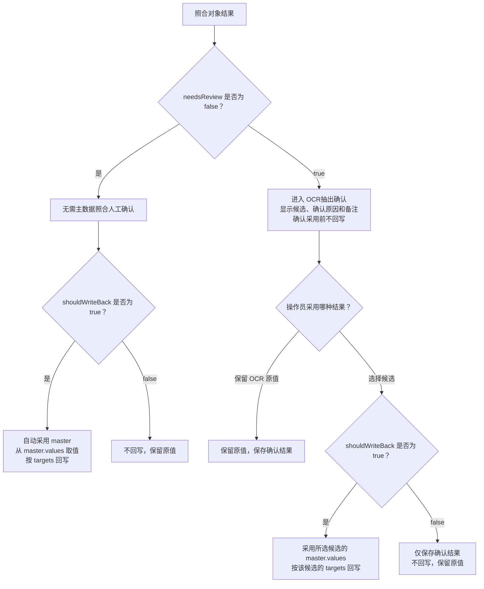

## 第 5 章｜功能详情

### 5.1 API设定

#### 页面与入口

| 项目 | 内容 |
| --- | --- |
| 入口 | API設定 → 外部API |
| 使用者 | 配置管理员 |
| 本期用途 | 主数据设定和工作流中的主数据照合节点使用同一条 Zurich 标准化 API 连接 |

外部 API 列表显示连接名、用途、Base URL、创建时间、状态、创建人和操作。允许新增、编辑和删除连接。本期「用途割当」只有「マスタデータ照合」，同一用途只能绑定一条连接。已被占用的用途不能再次分配给其他连接。

#### 字段与操作

| 字段或操作 | 规则 |
| --- | --- |
| 接続名 | 必填，用于列表显示 |
| 用途割当 | 必填，本期固定为「マスタデータ照合」 |
| プロバイダ | 必填，本期为「Zurich 標準化API」 |
| 認証方式 | 必填，本期为「APIキー（Bearer）」 |
| Base URL | 必填，使用 Zurich 按环境提供的地址，通信使用 HTTPS（TLS 1.2 及以上） |
| APIキー | 新增时必填。编辑时未输入新密钥则沿用已保存密钥。页面只显示脱敏值 |
| 保存 | 必填项和 URL 格式通过后可用。保存连接信息和模块绑定 |
| 接続テスト | 连接保存后执行，由后端使用已保存的认证信息请求 `GET /v1/masters` 验证连接 |
| 削除 | 二次确认后删除连接并解除用途绑定 |

API Key 由后端安全保存，前端不获取明文密钥。连接保存后可以未测试，但未通过连接测试时不能读取主数据或执行照合。

#### 连接状态

连接状态只有两种。

| 状态 | 判定 |
| --- | --- |
| 有効 | 当前 Base URL 和认证信息测试成功 |
| 無効 | 尚未测试、测试失败，或保存后 Base URL、认证方式、API Key 已发生变化 |

测试失败时显示红色错误提示。Base URL、认证信息、保存、读取和业务执行产生的错误文案均使用日文。

#### 异常处理

| 条件 | 处理 |
| --- | --- |
| 必填项缺失 | 保存不可用，并显示日文错误提示 |
| 认证失败、网络异常或返回错误 | 连接状态设为「無効」，显示日文错误提示，保留已保存连接信息 |
| 用途已被其他连接占用 | 当前连接不能保存 |
| 未配置有效连接 | 组配置显示日文空状态，工作流照合节点以失败结束 |

### 5.2 组配置

#### 页面与操作

入口为「業務ルール設定 → マスタデータ設定 → 外部マスタデータ」。配置管理员在左侧维护照合组，在右侧编辑组信息及字段映射。

| 操作 | 行为 |
| --- | --- |
| 追加 | 新建组草稿，适用场景初始为空 |
| 名称変更 | 修改组名，保存后记录变更履历 |
| 削除 | 二次确认后立即删除。已保存组删除时同步更新 groupsVersion，不记录删除履历。删除菜单悬停使用系统危险色 |
| 変更履歴 | 顶部显示作成者和登録日時，表格显示更新者和更新時間 |
| 既定グループ | 获取默认组并显示新增、更新、变更なし的差异 |
| 保存 | 校验并保存当前组，其他组的草稿和已保存配置不受影响 |
| 閉じる | 关闭当前组的编辑区域，不保存草稿 |

不允许复制组。新增、改名、删除、默认组导入和字段编辑都只修改草稿，保存成功后生效。

当前组存在未保存修改时，点击其他组、追加或閉じる均不执行切换，显示红色日文提示「先に現在の変更を保存してください。」。点击保存并成功保存当前组后，才允许切换。

#### 组与字段

| 字段 | 规则 |
| --- | --- |
| グループ名 | 必填，显示在组列表。所有可见组中不能重名 |
| 適用シーン | 必填，可多选。「全シーン」与具体场景互斥，字段范围取所选场景账票类型的交集 |
| マスタ | 必填，一个组选择一个主数据表 |
| 照合フィールド | 显示マスタ項目、フィールド、照合方式、ロール及操作 |

添加或编辑字段时，依次选择「マスタ項目」「照合方式」「フィールド」。IDP 字段可选择普通账票字段、表格列或数据映射中的案件标准字段。表格列按整列配置，运行时对应该表的实际单元格。

同一组不能混用普通账票字段和表格列。组内已有已完成的表格列映射时，「フィールド」只显示表格列。组内已有已完成的普通账票字段映射时，「フィールド」不再显示表格列。默认组导入后的空字段占位不参与该锁定判断。保存时后端再次检查该规则。

#### 主数据项目

以下 configuration 字段来自 `GET /v1/masters` 响应的 `data.masterTables[].columns[]` 或 `data.masterTables[].hints[]`。

| configuration 字段 | 界面显示与用途 |
| --- | --- |
| `configuration.roleLabel` | 原样显示在「ロール」列和主数据项下拉中 |
| `configuration.allowedModes` | 只显示数组中允许的照合方式，空数组时该项目不可选 |
| `configuration.canBePrimary` | 不直接显示，用于后端判断该项目能否作为主输入 |

照合方式名称取自 `GET /v1/catalog` 响应中的 `data.enums.memberMode[]`。前端按 `value` 对应 mode，并使用该条目的 `label` 作为显示名称。

| value | 界面显示 |
| --- | --- |
| `INPUT` | 読み取り（照合に使う） |
| `OUTPUT` | 書き戻し |
| `INPUT_OUTPUT` | 読み取り・書き戻し |

主数据项下拉按「列」和「ヒント」分组。两个分组标题加粗，并分别使用系统现有的主题色和成功色。右侧角色说明使用较小字号，左右文字垂直居中。

#### 默认组

点击「既定グループ」后，后端调用 `GET /v1/groups/defaults`。默认组按已保存的来源组 ID 与本地组匹配，显示新增、更新或变更なし。名称相同的本地组不会被自动视为同一个默认组。

首次导入默认组时只带入组名、主数据表和主数据项目。默认组中的 `documentTypeId`、字段名、表名和列名属于外部数据，不写入本地 IDP 字段映射。适用场景和 IDP 字段均为空，管理员先选择适用场景，再选择字段。

默认组的更新采用组内覆盖、组外追加。来源组 ID 已对应本地组时，在该组内原地覆盖组名、主数据表、成员及照合方式，不创建重复组。来源组 ID 尚未对应时追加为新组。未出现在默认组响应中的本地组保持不变。

组内覆盖更新时，保留当前组之前选择的适用场景，覆盖组名、主数据表、成员及照合方式。成员的主数据项目和字段名称一致时，保留原 IDP 字段和账票类别。字段名称或字段类型变化时，视为不匹配，只清空该成员的字段并要求重新选择。

默认组载入草稿后，如果更新后仍有未匹配字段，显示提示「既定グループを更新しました。不足している照合フィールドを設定し、対象の組ごとに保存してください。保存後に設定が反映されます。」。全部字段匹配成功时不显示该提示。首次追加的组如果同时缺少场景和字段，提示用户补全后逐组保存。「既定グループの更新」标题旁显示信息图标，悬停或聚焦时说明首次导入和后续更新的处理方式。默认组导入只修改草稿，当前组保存成功后才生效。

默认组客户端字段标识只保存在后端原始响应中。点击「更新」后先载入草稿，保存成功前不替换正式配置。

删除已导入的默认组时同时解除来源组 ID 映射。下次获取默认组时按新组重新追加，不再关联已删除组。

#### 保存规则

保存以当前组为单位。前端先检查当前组可以直接发现的草稿错误，再由后端执行完整业务校验并只保存当前组。其他组继续保留各自草稿或已保存状态。

前端校验包括以下内容。

| 校验项 | 前端处理 |
| --- | --- |
| 组信息完整性 | 组名、适用场景、主数据表和至少一个成员为空时阻止提交 |
| 成员完整性 | 主数据项目、照合方式或 IDP 字段未选择时阻止提交 |
| 照合方式 | 下拉只提供 `configuration.allowedModes` 中的值，提交前再次检查当前 mode |
| 组内主数据项重复 | 同组已使用的主数据列或 hint 从候选中禁用，提交前再次检查 |
| 字段有效性 | 只允许选择当前适用场景涉及的账票字段、表格列或数据映射字段，提交前检查所选字段仍存在 |
| 字段形态一致性 | 同一组不能同时配置普通账票字段和表格列，提交前阻止混用 |
| 主输入排列 | 提交前检查多个主输入是否属于同一账票类型，表格列是否使用同一张表 |
| 跨组重复 | 提交前检查同一普通字段、表格列或案件标准字段是否已经出现在其他组 |

前端校验失败时显示红色日文错误提示，保留草稿，不提交后端。

后端保存校验包括以下内容。

1. 重新检查提交的结构、必填项、主数据项目、IDP 字段、适用场景及 mode 合法性，防止页面数据过期或请求被直接调用。
2. 检查组内主输入是否完整。每组至少有一个成员同时满足 `configuration.canBePrimary=true`，且 mode 为 `INPUT` 或 `INPUT_OUTPUT`。
3. 重新检查同一普通字段、表格列或案件标准字段是否只能属于一个照合组。
4. 重新检查同一组内没有混用普通账票字段和表格列。
5. 每次保存当前组时，向 `POST /v1/groups/validate` 一次提交当前组和其他已保存的有效组，检查跨组重复字段。未保存的其他组草稿不进入请求。
6. 全部通过后只保存当前组，生成新的 `groupsVersion` 和完整配置快照。保存失败时保留原正式配置和其他组状态。

添加或编辑单个成员时只校验当前表单和当前组内可立即判断的重复项。主输入是否完整在保存时由后端判断。

#### 版本与变更履历

保存成功后由后端生成新的 `groupsVersion` 和完整配置快照。默认组来源和整体版本只供后端运行与追溯，前端不提供版本查看入口。

删除已保存组时立即从正式配置中移除该组，生成新的 `groupsVersion` 和完整配置快照。删除草稿中尚未保存的新组不生成版本。组名重复时阻止保存。

变更履历弹窗顶部显示该组的作成者和登録日時。表格按更新时间显示更新者和更新時間。保存草稿并产生正式配置变化后追加更新记录，复制组和删除组的履历不显示，页面浏览、下拉刷新和接口查询不产生履历。

#### 测试关注

| 范围 | 验证内容 |
| --- | --- |
| 下拉与显示 | 角色和可选方式由 `configuration` 决定，三种方式显示日文，列和ヒント分组可区分 |
| 字段形态 | 已有表格列后不能选择普通账票字段，已有普通账票字段后不能选择表格列，混用数据不能保存 |
| 默认组 | 组级按来源 ID 匹配，已对应组内覆盖、未对应组追加；首次导入场景和字段为空，后续保留场景并复用匹配映射；删除后解除来源映射 |
| 保存校验 | 只检查当前组是否完整；无主输入、非法方式、重复字段、跨组重复字段、场景不兼容及表格不对齐均阻止当前组保存 |
| 保存与履历 | 失败保留当前组草稿和其他组状态；成功后只更新当前组并生成新版本，履历只记录当前组的变化 |
| 未保存切换 | 当前组修改后点击其他组、追加或閉じる会被阻止，并显示日文红色提示 |
| 组名与删除 | 同名组不能保存；已保存组删除后立即生成新版本，重新获取默认组时可以再次追加 |

### 5.3 工作流

#### 节点与执行顺序

流程为：OCR抽出 → 数据映射 → 主数据照合 → OCR抽出确认 → 后续节点。

业务场景工作流放置「マスタ照合」节点时，使用本期的外部主数据照合。节点读取当前场景已保存的适用组，并使用这些组的版本快照发起请求。没有该节点时，继续使用原有内部主数据规则。

#### 整案请求

工作流每次执行到主数据照合节点时，IDP 使用该时点案件已有的全部文件、最新 OCR 抽出结果、数据映射结果、有效组和 `groupsVersion` 发起一次整案请求。

| 对象 | 规则 |
| --- | --- |
| 请求 | IDP 发往 Zurich 的一次 `POST /v1/standardizations` |
| Task | API 对一次成功受理请求返回的处理任务 |
| 批次 | 批次只表示 IDP 的工作流执行和文件到达过程，API 始终按当时案件的全量数据执行 |

每次工作流执行直接使用该时点案件已有的全量资料。后续文件到达、删除或替换时，下一次工作流执行使用最新全案数据重新请求。批次标识由 IDP 内部管理。

同一案件已有整案请求处理中，且发生需要整案重新照合的输入变化时，IDP 取消旧 Task，结束旧工作流执行，并从开始节点以最新全案数据重新执行完整工作流。旧 Task 的结果仅保留为执行记录，不应用到案件。

本期每个整案请求最多提交 50 件逻辑账票（`documents[]`）。IDP 在发请求前检查案件账票数，超过 50 件时节点默认失败，不创建 Task。客户式样书中的拆分请求方案属于 IDP 本期范围外。

批次再次执行与超限拆分不同：批次处理是在后续文件到达后重新提交“一个最新全案请求”，每次执行仍对应一个 Task。超限拆分是在同一时点把全案拆成多个请求和多个 Task，并需要合并跨请求结果，本期不实现。如果后续批次累计后案件超过 50 件，下一次整案请求同样直接失败。

#### 异步状态

节点保存 `taskId`、`clientRequestId`、查询游标和轮询状态。`masterStatus` 表示流程状态，`masterResult` 表示业务结果。

| 条件 | masterStatus | masterResult | 后续 |
| --- | --- | --- | --- |
| Task 为 `PENDING` 或 `PROCESSING` | `processing` | 等待结果 | 继续等待 |
| 输入 OCR 尚未确认 | `processing` | 等待结果 | 等待 OCR 输入确认 |
| Task 成功且无需主数据人工确认 | `success` | `passed` | 进入后续节点 |
| Task 成功但存在主数据人工确认项 | `success` | `reviewRequired` | 进入 OCR抽出确认 |
| Task 为 `FAILED` | `failed` | 无业务结果 | 进入失败处理 |

`CANCELLED` 不属于照合节点状态。因输入变化或重新识别取消旧 Task 时，结束旧执行并从开始节点重跑完整工作流；点击「案件中止」时将案件标记为中止并结束工作流。两种情况都不应用被取消 Task 的结果。

人工确认节点的「完了」「补件」「案件中止」出口可以连接到任意有效工作流节点，包括前处理、OCR 和 AI 检证；不强制出口穿过特定节点，也不强制补件出口回流到指定上游。发布时按整条工作流结构和结束节点可达性校验。

Task 进入终态并且最新请求的结果处理完成后，工作流继续。Task 完成表示本次请求结束，后续文件到达时由下一次工作流执行重新请求。

#### 输出变量与引用位置

「マスタ照合」节点向下游输出以下变量。

| 变量 | 值 | 条件节点 | 通知规则 |
| --- | --- | --- | --- |
| `masterStatus` | `processing`、`success`、`failed` | 用于运行控制 | 可作为对象节点事件变量 |
| `masterResult` | `passed`、`reviewRequired` | 变量选择器中显示在「マスタ照合」分组，可比较这两个值 | 可作为对象节点事件变量 |

条件节点的变量选择器包含「マスタ照合」分组，可选择 `masterResult` 配置 `passed` 或 `reviewRequired` 分支。通知规则的「対象ノード」列表包含「マスタ照合」，可选择 `masterStatus` 和 `masterResult` 对应的触发事件。

自定义函数节点保持原行为，不加入本次条件变量和通知对象节点的新增范围。

#### 查询与结果

后端通过已完成任务列表持续发现 Zurich 结束的 Task。列表按结束时间排序，任务不会在同一调用方的列表中重复出现。

1. **首次建立轮询**　首次请求不传 `cursor`。如需限定首次扫描的起点，可传 `finishedAfter`，值为 Unix 毫秒。每次请求的 `limit` 为 1～500，默认 100。

   ```http
   GET /v1/standardizations?finishedAfter={首次同步起点}&limit=100
   ```

2. **保存续读位置**　响应包含 `tasks` 和 `nextCursor`。后端先持久化响应中的 `taskId`，再保存本次返回的 `nextCursor`。这样服务重启后可以从已保存的位置继续，未处理的 Task 也能从持久化记录中恢复。

3. **继续轮询**　之后每 5～10 秒调用一次列表接口，把上次保存的 `nextCursor` 原样作为 `cursor` 传回。

   ```http
   GET /v1/standardizations?cursor={上次保存的nextCursor}&limit=100
   ```

   `nextCursor` 是任务列表的续读位置。不要拆解或自行生成它。若响应的 `tasks` 为空且 `nextCursor` 未变化，表示此轮没有新结束的任务，等待下一个轮询间隔后继续使用同一游标。游标仅在任务可查询期限内有效。

4. **读取任务结果**　对列表返回的每个 `taskId` 调用 `GET /v1/standardizations/{taskId}` 获取终态和主要结果。若需要的 `items` 未随响应返回，或存在 `itemsNextCursor`，继续调用 `GET /v1/standardizations/{taskId}/items` 取齐结果页。

5. **区分两种游标**　`nextCursor` 用于继续读取已完成 Task 列表。`itemsNextCursor` 只用于同一个 Task 内的照合对象分页。两者不能互换。

6. **恢复与结果归属**　IDP 重启后从持久化的 `nextCursor` 继续轮询，并重试持久化队列中未处理的 `taskId`。整案轮询仅将最新整案请求的结果更新到案件，旧 Task 的结果保留为执行记录。单项重新照合的同步结果按 fieldId 更新对应确认项目。

7. **取消旧 Task**　取消未结束请求时调用 `POST /v1/standardizations/{taskId}/cancel`。取消结果不应用到案件。
#### 失败与边界

| 条件 | 处理 |
| --- | --- |
| 无有效 API 连接 | 节点失败，显示日文错误提示 |
| 无适用照合组 | 节点失败，显示日文错误提示 |
| 请求超过 50 件逻辑账票 | 节点默认失败并提示超出上限，不创建 Task |
| 请求超时或返回 HTTP 500 | 使用相同 `clientRequestId` 和相同请求内容重发 |
| 返回 429 或 503 | 按 `Retry-After` 等待后重试 |
| Task `FAILED` 或轮询不可恢复地终止 | 节点失败，保留原数据和可重试状态 |


### 5.4 OCR抽出确认

#### 结果分流与自动采用

任务成功后，IDP 按每个照合对象的 `needsReview` 判断是否需要人工确认，再按 `shouldWriteBack` 判断是否回写。正常响应中，这两个字段均为 true 或 false。



回写时，没有值的列保持原值。API 返回的 `selection` 作为原始响应保存，本期不向后续系统登记。自动采用的照合对象仍可在确认页查看和改选候选。

`confidence` 只用于显示，不作为人工确认或自动采用的阈值。`status` 用于结果解释和接口契约检查，不用于按场景切换确认页结构。

异常兜底：按式样书 §2.8，needsReview 缺失或为 null 时按需人工确认处理，shouldWriteBack 缺失或为 null 时不回写。这属于响应异常的兼容处理，不是正常业务状态。

#### 确认页结构

确认页统一使用 API 返回的固定结构。

以下“所属结构”指接口返回的数据对象，不是数据库物理表。整案详情以 `data.items[]` 为照合对象，结果分页以 `data.items[]` 为照合对象，单项重新照合以 `data` 为照合对象。下表统一用 `item` 表示当前照合对象。

| 数据 | 所属结构 | 字段／路径 | 页面行为 |
| --- | --- | --- | --- |
| OCR 原值 | IDP 原始 OCR 结果 | 按 `item.source` 的 documentId、fieldIndex 或表格位置定位原始字段值；不使用候选值替代原始 OCR 值 | 保留原始识别值；候选初始项为第一个推荐，没有推荐时保持识别值（式样书 §5.10、§1.4 C-01） |
| 候选列表 | 照合对象 → 候选项 | `item.masterDataMatches[]`；每项的 `label`、`value`、`confidence` | 非空时显示主数据候选下拉，按返回顺序显示 |
| 主要素／追加要素 | 照合对象 → 候选项 | `item.masterDataMatches[].primary` | true 为主要素，false 为追加要素，不另行按 SPLIT 状态拼装选项 |
| 确认原因 | 照合对象 | `item.reviewReason` | 有值时显示在「確認理由」 |
| 其他信息 | 照合对象 → 备注项 | `item.remarks[].label`、`item.remarks[].value` | 按返回顺序显示标签和值，没有内容时隐藏 |

例如，从整案详情取得候选名称时读取 `data.items[i].masterDataMatches[j].label`，取得该对象确认原因时读取 `data.items[i].reviewReason`。从单项重新照合响应取得同类数据时，分别读取 `data.masterDataMatches[j].label` 和 `data.reviewReason`。

确认页不为不同主数据表、状态或确认原因创建独立场景。展示内容只由 API 是否返回对应数据和字段配置决定。

#### 回写目标文件选择

选择项显示为“账票类别-序号・字段名”，例如“诊断书-1・ICD 编码”“诊断书-2・ICD 编码”。其中“账票类别-序号”与顶部文件名称完全一致，序号沿用顶部既有顺序，不显示内部 documentId。

多份账票导致回写目标不能唯一确定时，页面显示「書き込み先のファイル」选择框。只有存在多个候选写入位置时才要求操作员选择，其他情况不显示该选择框。

示例：

```text
照合组配置
  输入：诊断书 → 伤病名
  输出：申请书 → ICD 编码

案件中的账票
  诊断书 D1：提供伤病名输入
  申请书 A：有“ICD 编码”字段
  申请书 B：也有“ICD 编码”字段

照合结果
  已确定采用的伤病名记录及 ICD 编码
  但无法唯一确定写入申请书 A 还是 B

界面处理
  显示「書き込み先のファイル」
  可选：申请书 A / 申请书 B
  未选择前：不向该位置回写

操作员选择“申请书 B”后
  申请书 B → ICD 编码：写入采用记录中的编码
  申请书 A → ICD 编码：保持原值

只有一份适用申请书时
  目标可以唯一确定，不显示该选择框
```

这里选择的是结果写入哪份逻辑文件，与主数据候选下拉中选择采用哪条记录是两个不同操作。


#### 候选确认与回写

1. 操作员可以保留 OCR 原值，也可以选择一个 `masterDataMatches`。
2. 没有候选时不显示下拉，允许保留 OCR 原值结束确认。
3. 选择候选后，使用该候选自己的 `master.values` 和 `targets` 回写。
4. `shouldWriteBack=false` 时不回写，只保存确认结果。
5. 没有值的列不覆盖原值。
6. 同一 item 的所有目标字段作为一个结果一起更新。

候选选择与字段回写是两个不同动作。前端不能在选中 `masterDataMatches` 后直接把候选的显示值写入 OCR 字段，也不能因操作员选择了候选就将 `shouldWriteBack` 改为 true。

| 情况 | 候选交互 | 回写行为 |
| --- | --- | --- |
| `shouldWriteBack=false`，没有可回写位置 | 有候选时仍可展示和选择，保存所选候选的确认记录 | 不更新 OCR 字段或关联输出字段，保留原值 |
| `shouldWriteBack=true`，部分回写位置明确、部分不明确 | 操作员选择采用记录；目标不唯一的位置按“回写目标文件选择”处理 | 仅向已确定的 targets 写入。未确定位置不能直接回写；操作员明确选择后，由 IDP 补齐当前采用结果的对应 targets，再沿用统一回写逻辑 |

例如 F1 申请书的伤病名位置明确，而 F2、F3 诊断书的 ICD 编码位置需要选择。API 可返回 shouldWriteBack=true，targets 只包含 F1 的伤病名。选择主数据候选后，可以按确认规则回写 F1；在目标文件尚未确定前，不能向 F2 或 F3 的编码栏写入。确定目标后，使用同一采用记录的编码值回写到选定位置。

界面应分别保存“当前采用的候选”和“实际字段值”。只有允许回写并且目标位置已确定时，才从所选候选的 master.values 取对应列值，写入该候选的 targets。缺失或 null 的 shouldWriteBack 按不回写处理。

#### 拆分结果

`splitItems` 的主要素和追加要素由 API 整合到 `masterDataMatches` 返回。`primary=true` 显示为「主要素」，`primary=false` 显示为「追加要素」。

操作员可以改选主要素或追加要素。最终采用后，回写值仍取所选项的 `master.values`，写入所选项的 `targets`。页面不根据 `SPLIT` 状态另建一套候选组件。

#### 采用记录

每个 item 保存 `fieldId`、`itemId`、`groupId`、所采用的主数据行、`values`、`needsReview`、确认原因和最终采用方式。采用记录用于确认页展示和审计。`selection` 仅作为 API 原始响应留存，本期不向后续系统登记。

#### 异常处理

| 条件 | 处理 |
| --- | --- |
| 任务失败或取消 | 不采用该任务结果 |
| 账票部分失败 | 成功账票可继续处理，失败账票显示日文错误并转人工 |
| `INVALID_GROUP`、`MASTER_TABLE_NOT_ENABLED` | 获取任务详情后读取 `data.warnings[]`，通过 `code` 判断警告类型、`groupId` 定位未处理组、`message` 获取原因。该组未执行照合，相关项目按下述人工确认规则处理，其他有效组照常处理。 |
| 位置类型未知，无法定位输入或回写字段 | 不向无法定位的位置写入，保持 OCR 原值；不因位置无法定位而新增人工确认。已能定位的正常结果仍按 needsReview、shouldWriteBack 处理。 |

位置无法定位的处理为 IDP 已确认规则：保留 OCR 原值，不通过人工确认猜测目标位置。式样书 §2.8、§8.4 原有“未知位置类型转人工”表述与此不同，附件原文保留，执行按本节规则处理。

| 无法定位的范围 | 候选下拉展示 | 选择后的处理 |
| --- | --- | --- |
| 能定位输入字段，仅回写位置无法定位 | masterDataMatches 非空时，在对应输入字段展示候选下拉；为空时不展示 | 可以保存候选选择，但不能向无法定位的位置回写，OCR 原值保持不变 |
| 输入字段也无法定位 | 无法确定所属字段，不将候选下拉挂到任意字段 | 不更新字段，保留 OCR 原值 |

候选内容由 masterDataMatches 决定。显示或选择候选不代表允许回写，回写仍受 shouldWriteBack 和目标位置是否明确共同约束。


组级警告的取得与处理（式样书 §4.2、§4.7、§4.9、§8.4）：

```text
GET /v1/standardizations/{taskId}
  → data.warnings[]
      code = INVALID_GROUP
        组配置不合法，例如缺少主输入、字段跨组重复
      code = MASTER_TABLE_NOT_ENABLED
        当前 API Key 未开通该组使用的主数据表
      groupId
        定位 IDP 保存的组配置和该组涉及的项目
      message
        获取 API 返回的具体原因
```

警告表示该组未执行照合，不是“返回了一个待选候选”。该组可能没有生成 item，不能要求操作员从不存在的候选中选择，也不能把其他组的候选用于该组。

人工确认按式样书 §8.4 的异常规则，将该组对应的 OCR 项目交由操作员核对原始文件与识别值。操作员保留正确识别值，或按原始文件修正识别值，沿用普通 OCR 确认操作；没有有效主数据结果时不进行主数据回写，也不能将 OCR 确认视为主数据照合成功。式样书未要求操作员手动编造主数据编码或处理 API 权限。

组配置错误需由配置管理员修正，主数据表未授权需核对 API Key 的授权范围。修正后如需获得主数据结果，再按工作流规则重新执行照合。其他已正常完成的组仍按自身返回结果处理。

单项接口区别：`POST /v1/items/standardize` 使用未授权的主数据表时，按式样书 §4.6、§7 返回 HTTP 400、`MASTER_TABLE_NOT_ENABLED`，不是任务详情中的组级 warnings。此时属于本次重新照合请求失败，不能展示为新的照合结果。


所有错误文案使用日文，错误提示使用红色样式。

### 5.5 重新照合

#### 入口与调用范围

主数据输入字段右侧显示「再照合」。`OUTPUT` 字段和其他不参与读取的字段不显示重新照合按钮。恢复 OCR 原值按钮仍按现有规则显示。

| 操作 | 范围 |
| --- | --- |
| 单个再照合 | 只处理当前字段所属的 item |
| 一括再照合 | 处理所有已修改且参与主数据读取的文本字段和表格字段 |

重新照合直接使用页面缓存中的最新值，无需先保存。

同一 item 的多个修改合并为一次 `POST /v1/items/standardize`。每次显式提交该照合对象全部最新输入，包括此前修改后已完成照合的输入。ref 携带原整案 Task、原 item 和稳定 fieldId。回写位置由原引用定位，照合参考按 fieldId 更新后的最新案件上下文。接口同步返回新结果，不创建新的 Task。

重新照合更新当前 item 及其关联回填结果。同一 item 中未修改的回填字段也可能随新结果变化，其他 item 保持原结果。旧响应不能覆盖较新的重新照合结果。

#### 原结果引用 ref

`ref` 是原照合结果的引用，用于定位本次重新照合的对象，并继承其案件上下文和回写位置。传法如下。

| 场景 | 请求中的 ref | API 如何使用 |
| --- | --- | --- |
| 已有照合结果 | 原 `taskId`、原 `itemId` 和稳定 `fieldId` | 原任务与原对象定位执行上下文及回写位置，fieldId 定位需要覆盖的确认项目。用全部最新输入替换旧输入，更新上下文后重新匹配 |
| 原主输入为空，尚未生成 item | 原 `taskId`、`groupId` 和主输入位置 `source` | 将原任务中的组配置应用到该位置，生成该位置的照合结果 |

#### 关联字段变化与示例

`ref` 用于定位和继承原结果，不表示只替换被编辑的一个字段。重新照合的处理单位是字段所属的整个照合对象。输入名称变化后，匹配到的主数据记录可能改变，该记录对应的名称、编码等关联值也可能一起改变。候选列表、确认原因和是否需要人工确认等判断信息也以新结果为准。

例如，某个手术照合对象包含“手术名称”和“手术编码”两个回填目标。操作员将名称从“手术 A”改为“手术 B”后点击「再照合」，即使没有编辑编码字段，新结果采用后，编码也可能随主数据记录从“A 对应编码”更新为“B 对应编码”。这是为了让同一对象的名称和编码来自同一条采用记录。以下值仅作流程示意。

| 项目 | 重新照合前 | 本次编辑 | 新结果采用后 |
| --- | --- | --- | --- |
| 手术名称 | 手术 A | 改为手术 B | 手术 B 的主数据名称 |
| 同一对象的手术编码 | A 对应编码 | 未编辑 | B 对应编码 |
| 另一照合对象的字段 | 原结果 | 未编辑 | 保持原结果 |

新结果返回不等于立即覆盖所有字段。是否需要人工确认由新结果的 `needsReview` 决定，回写遵循 `shouldWriteBack`、采用记录的 `master.values` 和 `targets`。需要人工确认时，确认采用前不回写。新结果没有值的列保持原值。

#### 结果关联与替换

响应中的 `itemId` 是本次调用新分配的标识，`fieldId` 与原确认项目保持相同。IDP 按返回的 `fieldId` 找到对应确认项目，替换其照合结果并保存新 `itemId`。需要更新的候选、确认原因、判断信息及关联回填结果均属于该确认项目，其他确认项目保持原结果。

例如，原结果为 `fieldId=F1、itemId=I1`，第一次重新照合返回 `fieldId=F1、itemId=I2`。IDP 更新 F1 的结果，保留 F1 与界面项目的关联，不因为 itemId 变化新增一个确认项目。

#### 连续重新照合的引用与输入规则（待客户确认）

以下为拟采用方案，待客户确认后作为接口实现依据。式样书 §4.6 已定义响应 fieldId，但请求 ref 尚未包含 fieldId，也未明确连续调用时 itemId 的引用及后端上下文覆盖规则。

确认问题：是否支持在 ref 中携带原 taskId、原 itemId 和稳定 fieldId，每次提交同一对象全部最新输入，由后端按 fieldId 替换旧输入并更新照合上下文，响应返回相同 fieldId 和新 itemId，后续仍引用原 taskId、原 itemId？如不支持，请客户明确现有接口的连续调用及覆盖方式。

影响范围：连续重新照合的请求组装、后端输入覆盖和上下文更新。该接口实现需在客户确认后定稿，当前不假定现有服务已经支持。

后端收到请求后，按当前案件任务上下文中的 fieldId 找到原确认项目，用本次 inputs 替换其旧输入。后续照合参考该项目更新后的输入，其他项目保留各自最新有效状态，不能重新引入已被替换的旧值。重新判断后返回相同 fieldId 和新 itemId。此更新用于照合上下文，不等同于直接覆盖尚待人工确认的 IDP 回填值。

每次重新照合均提交新请求，同步返回新 itemId，不创建 Task。

- `ref.taskId` 和 `ref.itemId` 保留原整案任务及原对象引用，`ref.fieldId` 指定本次覆盖的稳定确认项目。后续新 itemId 作为结果标识保存，连续更新由 fieldId 关联。
- 每次 `inputs` 显式提交该对象全部最新输入及照合参考输入，以点击按钮时的页面缓存为准。纯输出字段不作为输入提交。
- 原本为空、没有 item 的项目，持续使用原 taskId、groupId 和 source 引用原位置，同样提交全部最新输入。
- 返回的新 itemId 保存为本次结果标识，按相同 fieldId 更新同一确认项目。原任务引用单独保留。
- IDP 直接应用单项接口返回结果，不依赖原 Task 查询结果是否随之更新。

例如原输入为 A0、B0，第一次改 A 后提交 A1、B0，第二次改 B 后提交 A1、B1。两次 ref 均携带原 Task、原 item 和相同 fieldId。后端按 fieldId 覆盖输入，第二次参考 A1、B1，不能重新继承 A0。

#### 多次重新照合的边界处理

同一确认项目以 `fieldId` 关联。每次提交使用点击「再照合」时的输入快照，返回结果只对应这次提交的输入。页面当前编辑值、上次已返回的照合结果和原任务引用需要分别保存，不能因为保存了新 itemId 就自动将其与原 taskId 组合为下一次 ref。

| 场景 | 处理与结果 |
| --- | --- |
| 第一次改 A，完成后再改同一对象的 B | 第二次使用该对象当前最新输入，保留第一次对 A 的修改。不能仅因本次只编辑 B，就从原始 ref 继承旧 A。固定使用原 ref，并显式提交 A、B 全部最新输入 |
| 同一对象的 A、B 均在提交前修改 | 合并为一次请求，同时带入 A、B 最新值 |
| 同一对象的请求尚未结束，再次点击单个或一括再照合 | 不重复提交该对象。单个与一括使用同一处理中判断，不能由另一入口绕过限制 |
| 请求处理中再次修改同一对象的输入 | 保留新的编辑值。返回结果对应提交时的旧输入，不能覆盖新编辑值、回写关联字段或将当前输入视为已完成照合。请求结束后，操作员可使用最新输入再次照合 |
| 较早请求的响应延迟返回 | 仅当前对象仍对应本次提交的输入及执行记录时应用结果。旧响应不能覆盖后续请求的结果。fieldId 相同不代表可以直接采用任意一次响应 |
| 第二次重新照合失败或超时 | 保留最近一次已返回结果及当前编辑值，显示错误并允许重试。上一次结果不能表示本次修改已照合成功 |
| 新结果从无需确认变为需要确认 | 更新候选、确认原因及确认状态，等待操作员确认采用后再按回写规则处理 |
| 新结果从需要确认变为无需确认 | 使用本次新结果重新判断自动采用条件，满足条件时才采用及回写 |
| 另一个照合对象被修改 | 按其自身 fieldId 处理，当前对象结果不随之替换 |
| 原案件已重新执行整案照合 | 已失效的旧整案上下文下的单项响应不应用到新整案结果，避免覆盖新执行的数据 |

示例中 A、B 均为同一对象的照合输入。

| 步骤 | 页面最新输入 | 本次提交的依据 | 界面处理 |
| --- | --- | --- | --- |
| 原始结果 | A0、B0 | 原任务结果 | 展示原结果 |
| 修改 A 并第一次提交 | A1、B0 | A1、B0 | 等待第一次结果 |
| 第一次结果返回后修改 B 并第二次提交 | A1、B1 | A1、B1 | 第二次不能退回 A0；成功后替换同一 fieldId 的结果 |
| 第二次等待期间又将 A 改为 A2 | A2、B1 | 在途请求仍对应 A1、B1 | 保留 A2，不将第二次响应当作 A2、B1 的结果应用 |
| 第二次结束后再次点击再照合 | A2、B1 | A2、B1 | 发起第三次请求，返回并适用时更新同一确认项目 |

表中的“本次提交的依据”即每次 inputs 使用的全部最新输入。各次请求携带原任务、原对象引用及稳定 fieldId，后端替换旧输入，IDP 按响应 fieldId 更新结果。


#### 异常处理

| 条件 | 处理 |
| --- | --- |
| 重新照合失败 | 保留原结果和缓存最新输入，显示日文红色错误提示，允许重试 |
