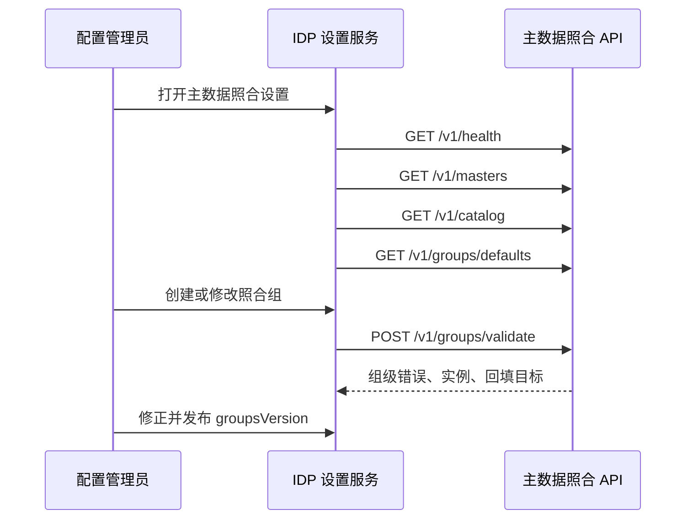
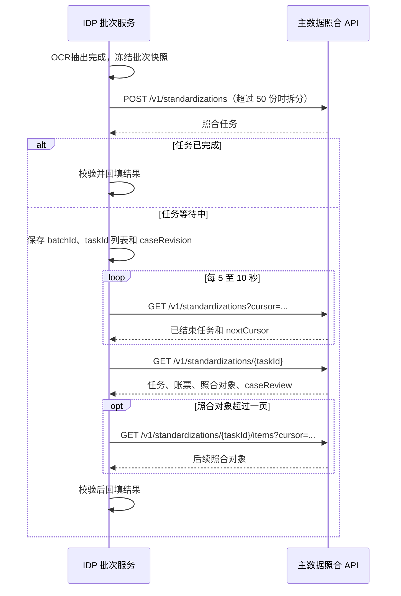
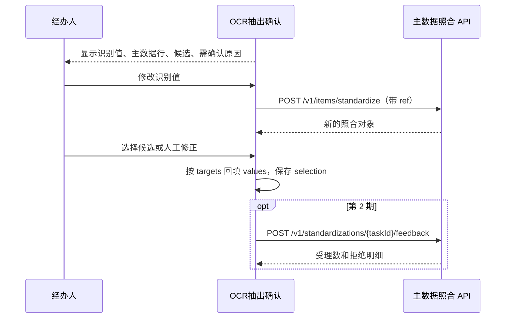

# 主数据照合 API 一览

本文使用 IDP 现有术语。客户文档中的“标准化 API”统一称为“主数据照合 API”，“标准化请求”统一称为“照合请求”，“标准化任务”统一称为“照合任务”，“标准化对象”统一称为“照合对象”。

## 1. 术语约定

| 本文用语   | 含义                                          |
| ------ | ------------------------------------------- |
| 主数据照合  | 把账票上的 OCR 值对应到 Zurich 主数据的具体一行              |
| 照合请求   | IDP 调用 `POST /v1/standardizations` 时提交的请求内容 |
| 照合任务   | 这次请求在 Zurich 生成的任务，用 `taskId` 标识            |
| 照合组    | IDP 在设置中维护的一组字段绑定关系                         |
| 照合对象   | 任务中生成的一个具体照合结果，对应 `items[]` 的一个元素           |
| 主数据行   | 照合得到的主数据记录，对应 `master`                      |
| 自动采用   | `needsReview=false` 时，IDP 按结果自动回填           |
| 需确认    | `needsReview=true` 时，进入 OCR抽出确认             |
| 回填     | 把 `master.values` 写入 `targets` 指定的字段位置      |
| 登记记录   | 后续系统登记使用的 `selection`                       |
| 账票     | 客户文档中的“单据”                                  |
| 账票类别   | 客户文档中的“单据类型”                                |
| 案件标准项目 | `caseResult` 中可供 `CASE_FIELD` 读取的项目         |
| 兜底照合   | 没有配置照合组时，由 Zurich 按项目名推测，对应客户文档的 fallback   |

## 2. API 一览

| 编号  | 分类   | 方法   | 路径                                       | 接口含义            | 主要输入                             | 主要输出                  | 调用时机                | 同步性                         | 阶段    |
| --- | ---- | ---- | ---------------------------------------- | --------------- | -------------------------------- | --------------------- | ------------------- | --------------------------- | ----- |
| 1   | 批次执行 | POST | `/v1/standardizations`                   | 提交批次照合请求        | 案件号、批次账票、照合组、案件标准项目              | 照合任务                  | 批次 OCR抽出完成后        | 异步任务，可在 `waitSeconds` 内直接完成 | 第 1 期 |
| 2   | 案件执行 | GET  | `/v1/standardizations/{taskId}`          | 查询照合任务状态和结果     | `taskId`、`includeItems`          | 任务、账票状态、照合对象、案件整体判断   | 任务终止后优先调用           | 同步查询                        | 第 1 期 |
| 3   | 批次执行 | GET  | `/v1/standardizations/{taskId}/items`    | 分页读取照合对象        | `taskId`、`cursor`、`limit`        | 照合对象列表、下一页游标          | 结果超过单页 100 件时     | 同步查询                        | 第 1 期 |
| 4   | 案件执行 | GET  | `/v1/standardizations`                   | 查询已完成任务列表       | `cursor`、`finishedAfter`、`limit` | 已结束任务摘要、下一页游标         | 每 5 至 10 秒汇总轮询      | 同步查询                        | 第 1 期 |
| 5   | 批次执行 | POST | `/v1/standardizations/{taskId}/cancel`   | 取消照合任务          | `taskId`                         | 最新任务状态                | 重新识别、批次中止        | 同步操作                        | 第 1 期 |
| 6   | 人工确认 | POST | `/v1/items/standardize`                  | 单个照合对象重新照合      | 主数据表、输入值、原结果引用                   | 新的照合对象                | 修改识别值后              | 同步照合，5 至 30 秒超时             | 第 1 期 |
| 7   | 配置   | GET  | `/v1/masters`                            | 获取主数据表和列        | 无业务参数                            | 主数据表、列、提示信息、schema 版本 | 启动、每日刷新、schema 变化时  | 同步查询                        | 第 1 期 |
| 8   | 配置   | GET  | `/v1/groups/defaults`                    | 获取 Zurich 默认照合组 | 无业务参数                            | 默认照合组模板               | 首次创建照合组时            | 同步查询                        | 第 1 期 |
| 9   | 配置   | POST | `/v1/groups/validate`                    | 校验照合组设置         | 照合组、样例账票、案件标准项目                  | 组级错误、实例、回填目标          | 保存照合组前              | 同步校验                        | 第 1 期 |
| 10  | 配置   | GET  | `/v1/catalog`                            | 获取枚举值和显示名称      | 无业务参数                            | 枚举目录                  | 启动、每日刷新、catalog 变化时 | 同步查询                        | 第 1 期 |
| 11  | 运维   | GET  | `/v1/health`                             | 查询服务状态          | 无业务参数                            | 服务状态、是否就绪             | 启动、告警、调度前           | 同步查询                        | 第 1 期 |
| 12  | 人工确认 | POST | `/v1/standardizations/{taskId}/feedback` | 回传人工确定结果        | 照合对象编号、决定、登记记录                   | 受理数、拒绝明细              | 确认或理赔审核确定后          | 同步提交                        | 第 2 期 |
| 13  | 人工确认 | POST | `/v1/masters/search`                     | 检索主数据行          | 主数据表、关键词、过滤条件                    | 候选列表                  | OCR抽出确认中查找其他候选      | 同步查询                        | 第 2 期 |
| 14  | 配置   | POST | `/v1/groups/suggest`                     | 让 AI 建议照合组      | 样例账票、案件标准项目、主数据表范围               | 建议照合组、说明              | 配置期，人工确认前           | 同步建议                        | 第 2 期 |
| 15  | 运维   | POST | `callbackUrl`                            | 任务完成通知          | Zurich 主动发起                      | 通知请求体                 | 指定回调地址且任务终止时        | 外部回调                        | 可选    |

## 3. 按用途分组

### 3.1 配置类

| 接口 | 用途 |
| --- | --- |
| `GET /v1/masters` | 获取主数据表、列、提示信息、输入角色和回填能力 |
| `GET /v1/catalog` | 获取枚举显示名称 |
| `GET /v1/groups/defaults` | 获取默认照合组模板 |
| `POST /v1/groups/validate` | 保存前校验照合组 |
| `POST /v1/groups/suggest` | 第 2 期获取 AI 建议 |

### 3.2 批次执行类

| 接口 | 用途 |
| --- | --- |
| `POST /v1/standardizations` | 创建照合任务 |
| `GET /v1/standardizations/{taskId}` | 读取任务和结果 |
| `GET /v1/standardizations/{taskId}/items` | 分页读取照合对象 |
| `GET /v1/standardizations` | 发现已结束任务 |
| `POST /v1/standardizations/{taskId}/cancel` | 取消任务 |

### 3.3 人工确认类

| 接口 | 用途 |
| --- | --- |
| `POST /v1/items/standardize` | 修改识别值后重新照合 |
| `POST /v1/masters/search` | 第 2 期查找其他主数据行 |
| `POST /v1/standardizations/{taskId}/feedback` | 第 2 期回传人工确定结果 |

### 3.4 运维类

| 接口 | 用途 |
| --- | --- |
| `GET /v1/health` | 健康检查 |
| `callbackUrl` | 任务完成通知 |

## 4. 照合请求、任务和对象的关系

```text
1 个业务批次
  -> 1 个或多个照合请求（超过 50 份时拆分）
  -> 每个请求 1 个照合任务
  -> N 个照合对象
  -> 每个照合对象有 0 或 1 个主数据行
  -> 每个主数据行包含 values 和 selection
```

| 概念 | 对应字段或接口 | 作用 |
| --- | --- | --- |
| 照合请求 | `POST /v1/standardizations` 的请求体 | 提交一个业务批次内最多 50 份文件 |
| 照合任务 | 响应 `data`、`taskId`、`status` | 跟踪这次作业的处理状态 |
| 照合组 | `groups[]` | 定义账票字段和主数据列的绑定关系 |
| 照合对象 | `items[]`、`itemId`、`groupId` | 表示某个具体值的照合结果 |
| 主数据行 | `master` | 照合得到的规范名称、编码和登记记录 |
| 回填位置 | `targets` | 告诉 IDP 把规范值写到哪里 |

一个照合组可以生成多个照合对象。例如手术表有 2 行时，同一个手术组会生成 2 个照合对象。

一个照合对象可以回填多个字段。例如药品组照合到一行后，可以同时回填商品名、一般名、ATC 分类、药效分类和药价基准编码。

## 5. 调用流程

### 5.1 首次配置流程



配置步骤。

1. 调用 `GET /v1/health` 确认服务可用。
2. 调用 `GET /v1/masters` 获取主数据表、列和提示信息。
3. 调用 `GET /v1/catalog` 获取枚举显示名称。
4. 首次配置时调用 `GET /v1/groups/defaults` 获取模板。
5. 管理员创建照合组，绑定账票字段、主数据列和 mode。
6. 保存前调用 `POST /v1/groups/validate`。
7. 校验通过后发布新的 `groupsVersion`。

### 5.2 批次照合流程



批次步骤。

1. 新文件或补件到达时创建独立业务批次。
2. OCR抽出完成后冻结该批次快照。
3. 汇总批次账票、案件标准项目、有效照合组和 `groupsVersion`。
4. 超过 50 份时按相同 `caseNo` 和不同 `clientRequestId` 请求序号拆分。
5. 调用 `POST /v1/standardizations`。
6. 合并多个 `taskId` 为同一业务批次。
7. 如果任务已完成，读取 `items` 并处理。
8. 如果任务为 `PENDING` 或 `PROCESSING`，保存 `taskId`。
9. 每 5 至 10 秒调用 `GET /v1/standardizations?cursor=...`。
10. 发现任务结束后调用 `GET /v1/standardizations/{taskId}`。
11. `itemsNextCursor` 存在时调用 `GET /v1/standardizations/{taskId}/items`。
12. `needsReview=false` 时自动采用。
13. `needsReview=true` 时进入该批次的 OCR抽出确认。

### 5.3 人工确认流程



人工确认步骤。

1. 展示 OCR 原值、当前值、`master`、`candidates`、`alternatives`、`reviewReasons` 和 `reason`。
2. 修改识别值后调用 `POST /v1/items/standardize`。
3. 使用新结果的 `master` 或 `candidates` 回填 `targets`。
4. 保存 `selection`、人工决定、决定角色和决定时间。
5. 第 2 期调用 `feedback` 回传确定结果。

### 5.4 重新识别或补件流程

```text
补件到达 → 创建新的独立业务批次
新文件到达 → 创建新的独立业务批次
每个批次独立发送和确认
旧批次结果晚到 → 只更新旧批次
保留已经人工确定的照合对象
```

### 5.5 50 份以上拆分

```text
1 个业务批次
→ 超过 50 份时拆成多个请求
→ 使用相同 caseNo
→ clientRequestId 递增请求序号
→ Zurich 返回多个 taskId
→ IDP 合并为同一业务批次
→ 只生成一个 OCR抽出确认入口
```

### 5.6 同一账票类型的多个逻辑文件

1. 主单据来源的每个逻辑文件分别生成 item。
2. 主输入是表格列时，按每个逻辑文件中的行继续生成 item。
3. 辅助输入值相同时用于匹配，值不同时返回 `AMBIGUOUS_SOURCE` 并转人工。
4. item 通过 `documentId`、`groupId`、`source` 对应文件、组和字段位置。

### 5.7 自动采用结果改选 C-05

`needsReview=false` 时仍返回 `candidates`。候选中包含 `master` 并标记 `isMaster=true`。操作人员可以在 OCR抽出确认中改选其他候选，改选后与需确认结果使用相同的 `values` 到 `targets` 回填处理。

## 6. 最短调用链

### 6.1 配置最短链路

```text
GET /v1/health
GET /v1/masters
GET /v1/catalog
GET /v1/groups/defaults
POST /v1/groups/validate
保存并发布 groupsVersion
```

### 6.2 批次最短链路

```text
POST /v1/standardizations
超过 50 份时按相同 caseNo 和递增 clientRequestId 拆分
若 PENDING 或 PROCESSING
  保存 batchId 和 taskId 列表
  GET /v1/standardizations?cursor=...
  GET /v1/standardizations/{taskId}
  GET /v1/standardizations/{taskId}/items?cursor=...
校验结果
按 targets 回填 values
保存 selection
按业务批次合并结果
需确认项进入该批次的 OCR抽出确认
```

## 7. 必须关注的关键字段

| 字段 | 含义 |
| --- | --- |
| `taskId` | 照合任务编号 |
| `status` | 任务、账票或照合对象的状态，按所在层级解释 |
| `needsReview` | 是否需要人工确认 |
| `master` | 照合得到的主数据行 |
| `master.values` | 可回填的规范值 |
| `master.selection` | 后续系统登记记录 |
| `candidates` | 候选行，包含 `master` 并标记 `isMaster=true` |
| `isMaster` | 是否与 `master` 为同一主数据行 |
| `targets` | 回填位置 |
| `source` | 主输入位置 |
| `inputs` | 参与照合的输入和 OCR 状态 |
| `reviewReasons` | 需确认原因 |
| `alternatives` | 未采用的候选和原因 |
| `splitItems` | 拆分项 |
| `proposedName` | 新登记候选名称 |

## 8. 详细字段字典

每个接口的完整请求字段、响应字段、公共对象、枚举和错误码见 [主数据照合 API 接口字段字典与调用流程](/Users/jade/project/NeosAI/IDP/四期/主数据API/主数据照合API_接口字段字典与调用流程.md)。
