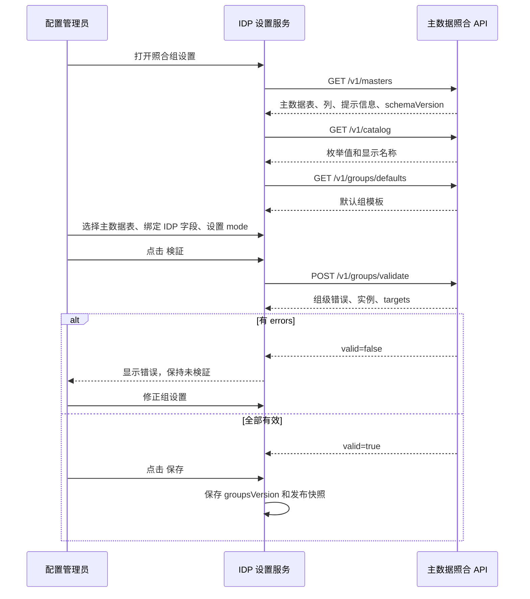
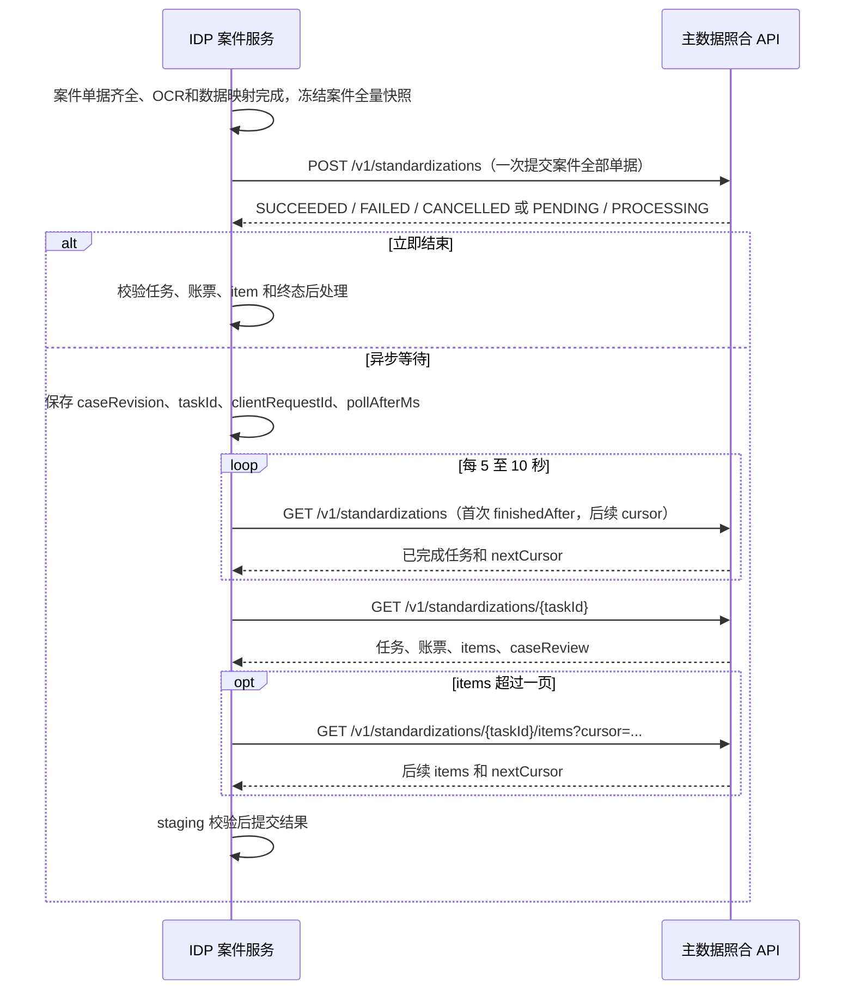
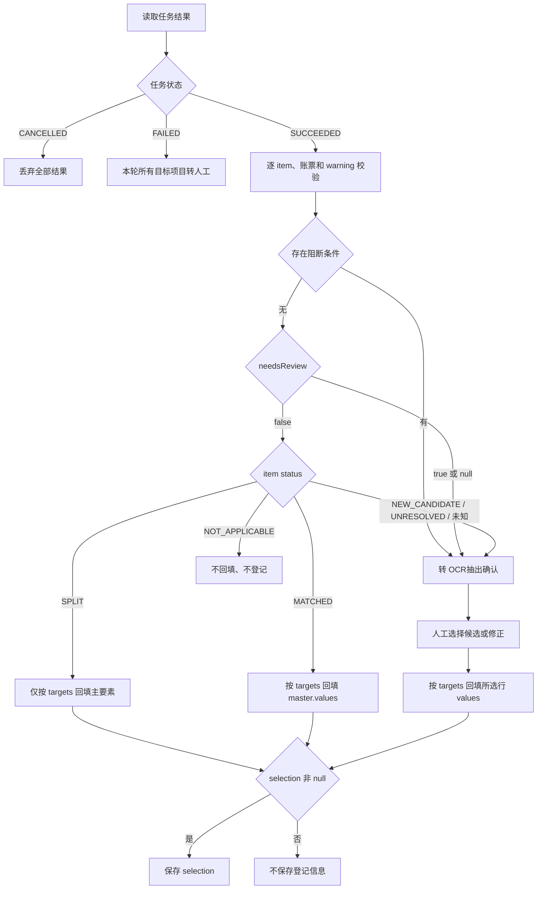
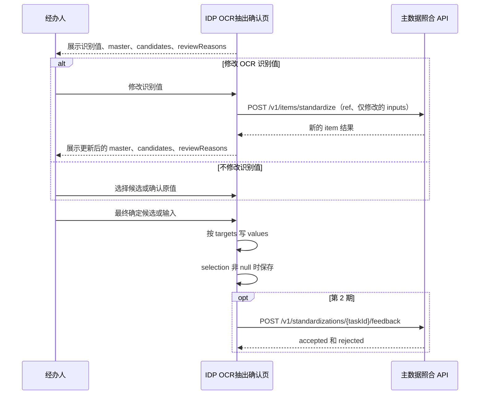

# 主数据照合 API 接口、字段与调用流程

本文依据《综合主数据名称标准化 API 规格书（IDP 对接 · v1）》1.2 版（2026-11-25）整理。接口字段、行为及示例以 v1.2 正本为准；本期另有 IDP 内部范围约束：单案超过 50 张不拆分请求，直接拦截。接口路径均相对于 `{BASE_URL}`。

### 术语统一说明

| 客户文档用语 | 本文和 IDP 统一用语 |
| --- | --- |
| 标准化 API | 主数据照合 API |
| 标准化请求 | 照合请求 |
| 标准化任务 | 照合任务 |
| 标准化对象 | 照合对象 |
| 标准化组 | 照合组 |
| 单据 | 账票 |
| 单据类型 | 账票类别 |
| 回写 | 回填 |
| 回退 | 兜底照合 |
| caseResult 中的标准项目 | 案件标准项目 |

“照合请求”指一次提交动作或请求内容，“照合任务”指这次请求生成的任务，“照合对象”指任务中生成的一个具体照合结果。

## 0. 快速索引

### 0.1 API 一览

| 编号 | 方法 | 路径 | 含义 | 调用时机 | 同步性 | 阶段 |
| --- | --- | --- | --- | --- | --- | --- |
| 1 | POST | `/v1/standardizations` | 提交案件照合请求 | 案件 OCR抽出完成后 | 异步任务，可在 `waitSeconds` 内直接返回结果 | 第 1 期 |
| 2 | GET | `/v1/standardizations/{taskId}` | 查询任务状态和结果 | 任务进入终止状态后优先调用 | 同步查询 | 第 1 期 |
| 3 | GET | `/v1/standardizations/{taskId}/items` | 分页读取照合对象 | 任务结果超过单页 100 件时 | 同步查询 | 第 1 期 |
| 4 | GET | `/v1/standardizations` | 查询已完成任务列表 | 周期性汇总拉取所有案件结果 | 同步查询 | 第 1 期 |
| 5 | POST | `/v1/standardizations/{taskId}/cancel` | 取消等待中或处理中的任务 | 重新识别、批次中止 | 同步操作 | 第 1 期 |
| 6 | POST | `/v1/items/standardize` | 单个照合对象重新照合 | OCR抽出确认页面修改识别值后 | 同步照合，5 至 30 秒超时 | 第 1 期 |
| 7 | GET | `/v1/masters` | 获取可配置的主数据表和列 | 启动、每日刷新、`schemaVersion` 变化时 | 同步查询 | 第 1 期 |
| 8 | GET | `/v1/groups/defaults` | 获取 Zurich 默认组模板 | 首次创建组设置时 | 同步查询 | 第 1 期 |
| 9 | POST | `/v1/groups/validate` | 校验组设置结构并生成试应用实例 | 保存组设置前 | 同步校验 | 第 1 期 |
| 10 | GET | `/v1/catalog` | 获取枚举值和显示名称 | 启动、每日刷新、`catalogVersion` 变化时 | 同步查询 | 第 1 期 |
| 11 | GET | `/v1/health` | 获取服务和就绪状态 | 启动、告警、调度前 | 同步查询 | 第 1 期 |
| 12 | POST | `/v1/standardizations/{taskId}/feedback` | 回传人工确定结果 | 确认或理赔审核确定后 | 同步提交 | 第 2 期 |
| 13 | POST | `/v1/masters/search` | 按关键词检索主数据行 | OCR抽出确认页面查找其他候选 | 同步查询 | 第 2 期 |
| 14 | POST | `/v1/groups/suggest` | 让 AI 建议组设置 | 配置期，人工确认前 | 同步建议 | 第 2 期 |
| 15 | POST | `callbackUrl` | 完成通知回调 | 指定 `callbackUrl` 且任务终止时 | 外部回调 | 可选 |

### 0.2 状态层级

同一个 `status` 名称可能出现在不同层级，处理时必须看对象。

| 层级 | 字段 | 取值 | 用途 |
| --- | --- | --- | --- |
| 任务 | `data.status` | `PENDING`、`PROCESSING`、`SUCCEEDED`、`FAILED`、`CANCELLED` | 判断整个请求是否结束 |
| 账票 | `documents[].status` | `SUCCEEDED`、`FAILED` | 判断单张账票是否处理成功 |
| 照合对象 | `items[].status` | `MATCHED`、`SPLIT`、`NEW_CANDIDATE`、`NOT_APPLICABLE`、`UNRESOLVED` | 判断这个值的照合性质 |
| 是否人工确认 | `items[].needsReview` | `true`、`false` | 决定自动采用还是转人工 |

### 0.3 通用响应包络

所有成功响应都包含以下结构。

| 字段 | 类型 | 含义 |
| --- | --- | --- |
| `code` | Integer | 成功为 `0`，失败时与 HTTP 状态码相同 |
| `msg` | String | 失败原因，日文 |
| `requestId` | String | 本次调用的唯一标识，排障时提供 |
| `warnings` | Object[] | 本次请求级别的提示，元素含 `code`、`message` |
| `data` | Object | 各接口的业务数据 |

失败时 `data` 还包含以下字段。

| 字段 | 类型 | 含义 |
| --- | --- | --- |
| `data.errorCode` | String | 错误类型，见第 6 节 |
| `data.details[]` | Object[] | 输入错误明细 |
| `data.details[].field` | String | 出错字段的位置，例如 `documents[0].format` |
| `data.details[].reason` | String | 错误类型，例如 `REQUIRED`、`INVALID_TYPE` |

如果代理或中间设备返回非 JSON 响应，按 HTTP 状态码处理。

## 1. 调用流程

### 1.1 配置期流程



配置期需要完成以下动作。

1. 拉取 `GET /v1/masters`，用返回的 `masterTables` 生成主数据表、列和 hint 选项。
2. 拉取 `GET /v1/catalog`，用返回的 `enums` 显示枚举名称。
3. 首次配置时调用 `GET /v1/groups/defaults`，把默认组导入为 IDP 自己的组。
4. 管理员创建或修改组，成员必须包含至少一个 `PRIMARY` 主输入。
5. 保存前调用 `POST /v1/groups/validate`，有 `errors` 的组不能发布。
6. 发布时生成新的 `groupsVersion`，保留变更历史和回滚点。

主数据 schema、catalog 显示名和默认组由 IDP 后端保存。前端只在需要时读取，不提供用户编辑或手动同步入口。点击主数据下拉框时可触发后端确认并补齐尚未取得的 schema。

`GET /v1/groups/defaults` 的 `data.groups` 是数组，可返回多个默认组。后端取得最新模板后显示新規・更新・変更なし的差异弹窗。管理员确认后，新组追加，更新组只覆盖 Zurich 来源字段并保留 IDP 的 `sceneIds`。

### 1.2 案件处理期流程



案件处理期需要完成以下动作。

1. 等案件单据齐全、OCR 抽出和数据映射完成后，冻结包含全部账票、`caseResult` 和有效组设置的案件快照。
2. 通过一次 `POST /v1/standardizations` 提交案件全部单据。该请求对应一个 Task；默认 `waitSeconds=10`。
3. 如果响应已经是终态，直接处理结果；如果响应是 `PENDING` 或 `PROCESSING`，保存 `taskId` 并通过已完成任务列表轮询。
4. Task 终止后调用 `GET /v1/standardizations/{taskId}` 获取结果；`itemsNextCursor` 存在时继续分页读取。
5. 校验任务、账票、item、warning 和位置类型，再应用最新案件版本的结果。
6. 案件新增、替换、删除或重新处理账票，或案件标准字段改变照合输入时，取消未结束的旧 Task，以全量最新案件快照发起新请求。新结果替换旧结果。
7. 本期单案最多 50 张。超过 50 张时 IDP 拦截并报错，不拆分请求；这是 IDP 本期范围限制，与 Zurich v1.2 §2.6 的超限建议不同。

任务 `FAILED` 表示本轮请求整体不能应用。部分账票 `FAILED` 时任务仍为 `SUCCEEDED`，只将使用该账票类别项目的组转为人工确认。案件输入变化后只采用最新全量请求的结果。

#### 同一账票类型的多个逻辑文件

1. 主单据来源的每个逻辑文件分别生成 item。
2. 主输入是表格列时，再按行生成 item。
3. 辅助输入的值相同则参与匹配，值不同则返回 `AMBIGUOUS_SOURCE` 并转人工。
4. 每个 item 通过 `documentId`、`groupId`、`source` 对应到具体文件和字段位置。

### 1.3 结果应用流程



免除人工确认必须同时满足以下条件。

`needsReview=false` 只表示 Zurich 判断不需要人工确认，不会修改 IDP 的 OCR 字段。将 `master.values` 按 `targets` 回填，以及是否覆盖 OCR 当前值，由 IDP 执行。

1. 任务为 `SUCCEEDED`。
2. 账票为 `SUCCEEDED`。
3. item 为 `needsReview=false`。
4. 所有 `inputs[].idpNeedReview` 都不等于 `1`。
5. 所有位置 `type` 都是已知值。
6. 没有 `INVALID_GROUP`、`MASTER_TABLE_NOT_ENABLED`、`WRITE_CONFLICT` 等阻断提示。

各状态处理规则如下。

| item 状态                                | 自动处理                                                  |
| -------------------------------------- | ----------------------------------------------------- |
| `MATCHED`                              | 按 `targets` 回填 `master.values`，`selection` 非 null 时保存 |
| `SPLIT` 且 `needsReview=false`          | 只回填主要素，其他要素仅展示                                        |
| `NOT_APPLICABLE` 且 `needsReview=false` | 不回填、不登记，保持 OCR 原值                                     |
| `NEW_CANDIDATE`、`UNRESOLVED`           | 始终转人工确认                                               |

以下任一情况必须转人工。

1. 任务为 `FAILED`，本轮所有目标项目转人工。
2. `needsReview` 缺失或为 `null`。
3. item 为 `UNRESOLVED` 或 `NEW_CANDIDATE`。
4. 位置类型未知。
5. 账票 `FAILED`。
6. 组无效或主数据表未启用。
7. 同一目标位置存在多个自动采用结果，产生 `WRITE_CONFLICT`。
8. `inputs` 中有 OCR 的 `needReview=1`。
9. `groupId=FALLBACK`。
10. `needsReview=false` 与状态契约冲突，例如 `UNRESOLVED`/`NEW_CANDIDATE` 返回 false、`MATCHED`/`SPLIT` 缺少主数据结果或出现未知状态。

上述契约冲突由 IDP 防御性地转为人工确认，不自动回填。只有 `INPUT` 成员导致 `targets` 为空的组，属于正常无回填情况。

### 1.4 人工确认与重新照合流程



人工确认时使用以下数据。

| 数据 | 用途 |
| --- | --- |
| `needsReview` | 是否进入 OCR抽出确认；为 `true` 时人工确认，为 `false` 时不因主数据照合进入确认 |
| `shouldWriteBack` | 是否回写；只有 `true` 且最终采用项有 `targets` 时回写所选项的 `master.values` |
| `masterDataMatches` | 确认页候选列表。按返回顺序显示；包含 `type`、`label`、`confidence`、`primary`、`master` 和 `targets`，具体以 v1.2 §5.10 为准 |
| `reviewReason` | 确认原因；有值就显示，无值不显示 |
| `remarks` | 其他信息；名称提案、追加要素、照合依据、确认备注等由 API 放入，有内容才展示 |
| OCR 原值 | 使用 IDP 当前字段值显示，不从主数据候选或 `status` 推断 |

`master` 与 `candidates` 用于描述标准化结果；确认页候选统一从 `masterDataMatches` 读取。`needsReview`、`shouldWriteBack`、`masterDataMatches`、`reviewReason` 和 `remarks` 是稳定的确认页接口结构。页面按内容是否返回展示，不按 `status` 分场景决定字段。

C-05 为本期 P0。自动采用的结果也显示 `master` 和 `candidates`，操作人员可以改选其他候选；改选时与需确认结果使用相同的回填处理。

### 1.5 重试、取消和恢复流程

| 场景 | 处理 |
| --- | --- |
| 429 或 503 | 按 `Retry-After` 等待后重试 |
| 500 | 使用相同 `clientRequestId`，按 10 秒、30 秒、60 秒并加入随机抖动重试 |
| 409 `IDEMPOTENCY_CONFLICT` | 相同幂等键但内容不同，停止重试并修正内容或生成新版本 |
| 案件输入变化 | 取消尚未结束的旧任务，使用新的 `clientRequestId` 版本和案件全量最新快照整案重请求；只应用最新请求结果 |
| 进程重启 | 从本地任务表、outbox 和已保存 `nextCursor` 恢复 |
| 游标丢失 | 通过 `finishedAfter` 重新扫描可查询期间内的任务，并人工对账 |
| 旧任务晚到 | 旧版本结果不得覆盖案件最新请求结果 |

### 1.6 完成通知流程

指定 `callbackUrl` 后，任务进入终止状态时 Zurich 会 POST 通知。通知只用于提醒，结果仍需通过查询接口获取。

```text
Zurich -> IDP callbackUrl
  event=TASK_FINISHED
  taskId=...
  status=SUCCEEDED/FAILED/CANCELLED
IDP -> 在 5 秒内返回 2xx
IDP -> GET /v1/standardizations/{taskId}
```

### 1.7 超时、重试和轮询参数

| 调用 | 连接超时 | 读取超时 | 重试方式 |
| --- | --- | --- | --- |
| `POST /v1/standardizations` | 5 秒 | `waitSeconds + 15` 秒 | 使用相同 `clientRequestId` |
| `GET /v1/standardizations`、`/{taskId}`、`/{taskId}/items` | 5 秒 | 30 秒 | 可以重试 |
| `POST /{taskId}/cancel` | 5 秒 | 15 秒 | 可以重试 |
| `POST /v1/items/standardize` | 5 秒 | `timeoutSeconds + 15` 秒 | 带 `clientRequestId` 时可以重试 |
| `GET /v1/masters`、`/groups/defaults`、`/catalog`、`/health` | 5 秒 | 15 秒 | 可以重试 |
| `POST /v1/groups/validate` | 5 秒 | 15 秒 | 可以重试 |

已完成任务列表建议每 5 至 10 秒查询一次。按任务查询时，间隔不小于 `pollAfterMs`。429 和 503 按 `Retry-After` 重试，500 使用相同幂等键并按 10 秒、30 秒、60 秒退避。

## 2. API 明细

### 2.1 提交照合请求

`POST /v1/standardizations`

含义是提交案件当前完整资料快照中的全部账票和有效组。一次受理的请求对应一个 Task；Task 可能直接完成，也可能进入队列。

#### 请求字段

| 字段                             | 类型       | 必填  | 含义                                             |
| ------------------------------ | -------- | --- | ---------------------------------------------- |
| `clientRequestId`              | String   | 否   | 幂等键，最长 128 字符，24 小时内相同内容返回同一任务                 |
| `caseNo`                       | String   | 是   | IDP 案件编号                                       |
| `sceneId`                      | String   | 否   | IDP 业务场景 ID                                    |
| `waitSeconds`                  | Integer  | 否   | 等待完成的秒数，范围 0 至 25，默认 10，0 表示只受理                |
| `priority`                     | String   | 否   | `NORMAL` 或 `LOW`，默认 `NORMAL`                   |
| `callbackUrl`                  | String   | 否   | 任务完成通知地址，必须是 HTTPS                             |
| `groups`                       | Object[] | 否   | 有效组设置，0 至 200 件。省略时不会生成普通照合对象；fallback 为第 2 期功能 |
| `groupsVersion`                | String   | 否   | IDP 组设置版本，会回显到任务 `versions.groups`             |
| `options.masterTables`         | String[] | 否   | 限定照合的主数据表，省略时使用组内全部表                           |
| `options.fallback`             | Boolean  | 否   | 未配置账票是否走兜底照合；v1.2 默认 `false`，本期不启用。回退为第 2 期功能 |
| `options.allowWebSearch`       | Boolean  | 否   | 是否允许 Web 检索作为判断依据，默认 `true`                    |
| `options.includeCandidates`    | Boolean  | 否   | 是否返回候选，默认 `true`                               |
| `options.maxCandidates`        | Integer  | 否   | 最大候选数，1 至 10，默认 5                              |
| `caseResult`                   | Object   | 否   | 案件标准项目，供 `CASE_FIELD` 成员读取                     |
| `documents`                    | Object[] | 是   | 案件账票，1 至 50 件                                  |
| `documents[].documentId`       | String   | 是   | 账票逻辑 ID，请求内唯一                                  |
| `documents[].documentTypeId`   | String   | 是   | IDP 账票类别 ID，用于和组成员对应                           |
| `documents[].documentTypeName` | String   | 否   | 账票类别名称，仅用于说明                                   |
| `documents[].docCode`          | String   | 否   | 账票 ID，例如 `HG02-001`                            |
| `documents[].format`           | String   | 是   | `IDP_RESULT_JSON` 或 `FIELDS`                   |
| `documents[].result`           | Object   | 条件  | `format=IDP_RESULT_JSON` 时必填，放 IDP RESULT JSON |
| `documents[].fields`           | Object   | 条件  | `format=FIELDS` 时必填，放项目名和值的键值对                 |

#### 响应

`data` 为任务对象，完整字段见 3.1。响应可能是 `SUCCEEDED`，也可能是 `PENDING` 或 `PROCESSING`。

#### 规则

1. 必须发送案件当前完整快照中的全部账票。组成员可能来自案件中的其他账票类别。
2. 有设置的组只处理组成员指定的字段。
3. 本期不使用 fallback。未配置账票类型的项目不生成照合对象。
4. 单次最多 50 张账票、200 个组、10 MB。IDP 本期对超过 50 张的案件直接拦截，不拆分多个请求。
5. 单个任务最多照合 500 个对象，超出部分以 `UNRESOLVED`、`NOT_PROCESSED` 返回。
6. 单个照合对象的结果最大 100 KB，包括主数据行的全部列值和候选。

### 2.2 查询任务状态和结果

`GET /v1/standardizations/{taskId}`

含义是读取一个任务的当前状态、账票状态、照合对象和案件整体判断。

#### 请求参数

| 字段 | 位置 | 必填 | 含义 |
| --- | --- | --- | --- |
| `taskId` | Path | 是 | 任务编号 |
| `includeItems` | Query | 否 | `false` 时不返回 `items`、`itemsNextCursor`、`caseReview`，默认 `true` |

#### 响应

`data` 为任务对象。任务未结束时也可以查询，任务 `FAILED` 仍返回 HTTP 200。建议在任务进入终止状态后再读取 `items`。

### 2.3 分页读取照合对象

`GET /v1/standardizations/{taskId}/items`

含义是读取一个任务的全部照合对象。单页最多 100 件，任务结果超过单页时通过游标分页。

#### 请求参数

| 字段 | 位置 | 必填 | 含义 |
| --- | --- | --- | --- |
| `taskId` | Path | 是 | 任务编号 |
| `cursor` | Query | 否 | 上一页的 `itemsNextCursor` 或 `nextCursor`，省略时从头开始 |
| `limit` | Query | 否 | 每页数量，1 至 200，默认 200 |

#### 响应

| 字段 | 类型 | 含义 |
| --- | --- | --- |
| `data.items` | Object[] | 照合对象列表，元素见 3.5 |
| `data.nextCursor` | String | 下一页游标，没有下一页时为 `null` |

#### 错误

任务未结束时返回 409 `TASK_NOT_FINISHED`。

### 2.4 查询已完成任务列表

`GET /v1/standardizations`

含义是按完成顺序汇总查询当前调用方的所有已结束任务。IDP 应优先使用这个接口发现任务结束。

#### 请求参数

| 字段 | 位置 | 必填 | 含义 |
| --- | --- | --- | --- |
| `cursor` | Query | 条件 | 上次响应的 `nextCursor`，第二次起必填 |
| `finishedAfter` | Query | 条件 | 第一次调用时使用，返回该 Unix 毫秒之后结束的任务 |
| `limit` | Query | 否 | 每页数量，1 至 500，默认 100 |

#### 响应

| 字段 | 类型 | 含义 |
| --- | --- | --- |
| `data.tasks` | Object[] | 已完成任务摘要 |
| `data.tasks[].taskId` | String | 任务编号 |
| `data.tasks[].clientRequestId` | String | 请求幂等键 |
| `data.tasks[].caseNo` | String | 案件编号 |
| `data.tasks[].status` | String | 终止状态 |
| `data.tasks[].completedAt` | Long | 完成时间，Unix 毫秒 |
| `data.nextCursor` | String | 下次调用游标，一定会返回 |

#### 规则

1. 任务按 `completedAt` 升序返回，同一时间按 `taskId` 排序。
2. 同一个任务只出现一次。
3. 没有新任务时 `tasks` 为空数组，`nextCursor` 与上次相同。
4. 游标有效期为可查询期间，至少 7 天。

### 2.5 取消任务

`POST /v1/standardizations/{taskId}/cancel`

含义是取消等待中或处理中的任务。

#### 请求

无请求体。

#### 响应

`data` 为任务对象，`status` 可能为 `CANCELLED` 或其他已经被确定的状态。

#### 规则

1. 已取消时重复调用返回相同响应。
2. 已成功或已失败时返回 409 `TASK_NOT_CANCELLABLE`。
3. 取消和完成同时发生时，以先确定的状态为准。
4. 已取消任务的结果不能应用。

### 2.6 单值重新照合

`POST /v1/items/standardize`

含义是对一个照合对象重新照合。用于 OCR抽出确认页面修改识别值后重新取得结果。

#### 请求字段

| 字段                          | 类型       | 必填  | 含义                           |
| --------------------------- | -------- | --- | ---------------------------- |
| `clientRequestId`           | String   | 否   | 幂等键                          |
| `caseNo`                    | String   | 否   | 案件编号，审计用                     |
| `ref`                       | Object   | 否   | 原结果引用                        |
| `ref.taskId`                | String   | 条件  | 原任务编号                        |
| `ref.itemId`                | String   | 条件  | 原照合对象编号                      |
| `masterTable`               | String   | 是   | 要照合的主数据表                     |
| `inputs`                    | Object[] | 是   | 输入值列表                        |
| `inputs[].column`           | String   | 条件  | 主数据列键，与 `hint` 二选一           |
| `inputs[].hint`             | String   | 条件  | 提示信息键，与 `column` 二选一         |
| `inputs[].value`            | String   | 是   | 输入值                          |
| `inputs[].source`           | Object   | 否   | 输入位置，见 3.6                   |
| `targets`                   | Object   | 否   | 回填位置，键为列，值为位置对象。带 `ref` 时可省略 |
| `options.allowWebSearch`    | Boolean  | 否   | 是否允许 Web 检索                  |
| `options.includeCandidates` | Boolean  | 否   | 是否返回候选                       |
| `options.maxCandidates`     | Integer  | 否   | 最大候选数，1 至 10                 |
| `options.timeoutSeconds`    | Integer  | 否   | 超时秒数，5 至 30，默认 30            |

#### 响应

`data` 为一个照合对象，并回显 `ref`。`itemId` 是新分配的值，`groupId` 继承原结果。没有 `ref` 时 `groupId=ADHOC`。

#### 规则

1. 指定 `ref` 时，只发送修改过的输入，其他输入和 `targets` 从原结果继承。
2. 主数据表未启用返回 400 `MASTER_TABLE_NOT_ENABLED`。
3. `ref` 对应任务或对象不存在返回 404 `ITEM_NOT_FOUND`。
4. 超时以 `UNRESOLVED`、`needsReview=true`、`TIMEOUT` 返回。

### 2.7 获取主数据表和列

`GET /v1/masters`

含义是返回当前 API Key 可用的主数据表、列、提示信息、版本和选择记录类型。设置界面必须用这个接口生成，不能写死。

#### 请求

无业务参数。

#### 响应

| 字段 | 类型 | 含义 |
| --- | --- | --- |
| `data.schemaVersion` | String | 主数据 schema 版本，变化时重新拉取 |
| `data.masterTables` | Object[] | 主数据表列表 |
| `masterTables[].masterTable` | String | 主数据表键，例如 `DISEASE` |
| `masterTables[].label` | String | 显示名称 |
| `masterTables[].description` | String | 说明 |
| `masterTables[].enabled` | Boolean | 当前 API Key 是否可用 |
| `masterTables[].deprecated` | Boolean | 是否废弃，已有组仍可运行 |
| `masterTables[].masterVersion` | String | 主数据版本 |
| `masterTables[].selectionRecordTypes` | String[] | 可登记的记录类型，空数组表示 `selection=null` |
| `masterTables[].displayColumn` | String | `displayName` 使用的列 |
| `masterTables[].sources` | Object[] | 来源 SFDC 对象 |
| `sources[].object` | String | SFDC 对象 API 名 |
| `sources[].label` | String | 对象显示名 |
| `sources[].role` | String | `MASTER` 或 `ALIAS` |
| `masterTables[].columns` | Object[] | 列列表 |
| `columns[].column` | String | 列键，格式为 `对象.项目` |
| `columns[].object` | String | SFDC 对象名 |
| `columns[].field` | String | SFDC 字段名 |
| `columns[].label` | String | 列显示名 |
| `columns[].dataType` | String | `TEXT`、`CODE`、`DATE` |
| `columns[].codeSystem` | String | 编码体系，例如 `ICD10`，无编码时为 `null` |
| `columns[].inputRole` | String | `PRIMARY`、`SUPPORTING`、`NONE` |
| `columns[].writable` | Boolean | 是否可作为回填目标 |
| `columns[].deprecated` | Boolean | 是否废弃 |
| `masterTables[].hints` | Object[] | 提示信息列表 |
| `hints[].hint` | String | 提示信息键 |
| `hints[].label` | String | 显示名称 |
| `hints[].deprecated` | Boolean | 是否废弃 |

`sources`、`columns[].object` 和 `columns[].field` 只是 Zurich 返回的主数据来源元数据。IDP 只需要调用本 API 的 `GET /v1/masters`，不需要另行连接 SFDC 查询主数据。药品主数据 `DRUG` 不是 SFDC 对象，其 `sources` 为空数组，列的 `object` 为 `null`。

#### 规则

1. `inputRole=PRIMARY` 和 `SUPPORTING` 可作为输入。
2. `inputRole=NONE` 只能用于回填。
3. `writable=false` 的列只能作为输入。
4. 主数据表键和列键在 v1 期间不会变化。
5. 废弃列仍可用于已有组，新建组不应选择。

### 2.8 获取默认组

`GET /v1/groups/defaults`

含义是返回 Zurich 为 IDP 准备的组模板，可导入后修改使用。

#### 响应

| 字段 | 类型 | 含义 |
| --- | --- | --- |
| `data.version` | String | 默认组版本 |
| `data.groups` | Object[] | 组列表，结构见 3.3 |

默认组只是模板。主数据照合 API 不会自动应用默认组，生产请求仍要发送 IDP 自己保存的组。

### 2.9 校验组设置

`POST /v1/groups/validate`

含义是保存组之前校验结构，并可返回组应用到样例账票后生成的实例、输入和回填目标。

#### 请求字段

| 字段 | 类型 | 必填 | 含义 |
| --- | --- | --- | --- |
| `groups` | Object[] | 是 | 要校验的组，结构见 3.3 |
| `documents` | Object[] | 否 | 试应用账票，结构同 2.1 的 `documents` |
| `caseResult` | Object | 否 | 试应用的案件标准项目 |

#### 响应字段

| 字段 | 类型 | 含义 |
| --- | --- | --- |
| `data.groups` | Object[] | 每个组的校验结果 |
| `groups[].groupId` | String | 组编号 |
| `groups[].valid` | Boolean | 是否有错误 |
| `groups[].errors` | Object[] | 错误列表 |
| `errors[].code` | String | 错误码，见 6.17 |
| `errors[].message` | String | 错误说明 |
| `errors[].memberIndex` | Integer | 出错的成员下标，整组错误时为 `null` |
| `groups[].warnings` | Object[] | 警告列表 |
| `groups[].instances` | Object[] | 试应用生成的照合实例 |
| `instances[].source` | Object | 主输入位置 |
| `instances[].inputs` | Object[] | 输入和位置 |
| `instances[].targets` | Object | 回填目标 |

#### 规则

1. 校验只检查结构，不执行照合。
2. 语义绑定错误可能通过结构校验，需要在 OCR抽出确认中使用单值接口验证实际照合结果。
3. 有错误的组放入正式请求后不会处理，并返回 `INVALID_GROUP`。

### 2.10 获取目录

`GET /v1/catalog`

含义是返回所有枚举值和显示名称。

#### 响应

| 字段 | 类型 | 含义 |
| --- | --- | --- |
| `data.catalogVersion` | String | 目录版本，变化时重新拉取 |
| `data.enums` | Object | 枚举键到枚举项的映射 |
| `enums.<key>[]` | Object[] | 枚举项列表 |
| `enums.<key>[].value` | String | 枚举值 |
| `enums.<key>[].label` | String | 显示名称，日文 |

示例中的键包括 `masterTable`、`itemStatus`、`reviewReason`。完整键见第 5 节。

### 2.11 健康检查

`GET /v1/health`

含义是检查服务状态和是否可受理请求。

#### 响应

| 字段 | 类型 | 含义 |
| --- | --- | --- |
| `data.status` | String | `UP`、`DEGRADED`、`DOWN` |
| `data.ready` | Boolean | 是否可受理请求 |

#### 规则

1. `DEGRADED` 仍可受理，AI 不可用的对象以 `LLM_UNAVAILABLE` 转人工。
2. `ready=false` 时请求返回 503 `NOT_READY`。

### 2.12 返回人工确定结果

`POST /v1/standardizations/{taskId}/feedback`

含义是把人工确定的主数据结果回传给 Zurich，用于精度评估和主数据改进。第 2 期提供。自请求起 90 天内可以受理。

#### 请求字段

| 字段 | 类型 | 必填 | 含义 |
| --- | --- | --- | --- |
| `items` | Object[] | 是 | 确定结果列表 |
| `items[].itemId` | String | 是 | 照合对象编号 |
| `items[].decision` | String | 是 | `ACCEPTED`、`CORRECTED`、`NOT_APPLICABLE`、`NEW_MASTER`、`UNKNOWN` |
| `items[].finalSelections` | Object[] | 条件 | 最终登记记录，元素含 `object`、`recordType`、`recordId` |
| `items[].finalMasterId` | String | 否 | 最终主数据记录 ID |
| `items[].decidedRole` | String | 否 | `IDP_OPERATOR` 或 `ASSESSOR` |
| `items[].decidedAt` | Long | 否 | 决定时间，Unix 毫秒 |

#### 响应

| 字段 | 类型 | 含义 |
| --- | --- | --- |
| `data.accepted` | Integer | 受理件数 |
| `data.rejected` | Object[] | 未受理列表 |
| `rejected[].itemId` | String | 对象编号 |
| `rejected[].reason` | String | 未受理原因 |

同一 `itemId` 重复发送时，后发送内容覆盖先发送内容。

### 2.13 检索主数据行

`POST /v1/masters/search`

含义是OCR抽出确认页面按关键词和过滤条件查找其他主数据行。第 2 期提供。

#### 请求字段

| 字段 | 类型 | 必填 | 含义 |
| --- | --- | --- | --- |
| `masterTable` | String | 是 | 主数据表 |
| `query` | String | 是 | 检索词 |
| `filters` | Object | 否 | 列过滤条件，键为列，值为字符串 |
| `limit` | Integer | 否 | 返回数量，1 至 50，默认 10 |

#### 响应

`data.items` 为候选列表，元素结构见 3.7。

### 2.14 组设置建议

`POST /v1/groups/suggest`

含义是根据样例账票让 AI 建议组设置。第 2 期提供。建议必须人工确认后才能保存。

#### 请求字段

| 字段 | 类型 | 必填 | 含义 |
| --- | --- | --- | --- |
| `documents` | Object[] | 是 | 样例账票，每种账票类别至少 1 件 |
| `caseResult` | Object | 否 | 样例案件标准项目 |
| `masterTables` | String[] | 否 | 限定建议的主数据表 |

#### 响应

| 字段 | 类型 | 含义 |
| --- | --- | --- |
| `data.groups` | Object[] | 建议组，结构同 3.3，并附加 `confidence` 和 `reason` |
| `data.notes` | String[] | 建议说明 |

`confidence` 为 0.0 至 1.0，`reason` 为日文说明。

### 2.15 完成通知

`POST callbackUrl`

含义是任务进入终止状态时向 IDP 发送通知。

#### 请求体字段

| 字段 | 类型 | 含义 |
| --- | --- | --- |
| `event` | String | 通知类型，当前为 `TASK_FINISHED`，未来可能增加 |
| `taskId` | String | 任务编号 |
| `caseNo` | String | 案件编号 |
| `status` | String | 终止状态 |
| `completedAt` | Long | 完成时间 |

#### 请求头

| 请求头 | 含义 |
| --- | --- |
| `X-MS-Timestamp` | Unix 毫秒时间戳 |
| `X-MS-Key-Id` | 签名密钥 ID |
| `X-MS-Signature` | `sha256=` 加 HMAC-SHA256 十六进制值 |

签名原文为 `X-MS-Timestamp + "." + 请求体`。接收方应在 5 秒内返回 2xx。失败后按 1、2、4、8、16 分钟重发。

## 3. 公共对象字段

### 3.1 任务对象 Task

| 字段 | 类型 | 含义 |
| --- | --- | --- |
| `taskId` | String | 任务编号 |
| `clientRequestId` | String | 请求幂等键 |
| `caseNo` | String | 案件编号 |
| `status` | String | 任务状态 |
| `priority` | String | 请求优先级 |
| `acceptedAt` | Long | 受理时间 |
| `startedAt` | Long | 开始处理时间，等待中为 `null` |
| `completedAt` | Long | 完成时间，未完成时为 `null` |
| `queue.position` | Integer | 队列位置，从 1 开始，可为 `null` |
| `queue.estimatedCompletionAt` | Long | 预计完成时间，参考值 |
| `progress.itemsTotal` | Integer | 照合对象总数 |
| `progress.itemsDone` | Integer | 已完成数量 |
| `pollAfterMs` | Integer | 建议下次查询间隔，终止时为 `null` |
| `versions` | Object | 版本信息，键和值均为字符串，只保存不要解析 |
| `summary.documents` | Integer | 账票数量 |
| `summary.items` | Integer | 照合对象数量 |
| `summary.autoConfirmed` | Integer | 非需确认数量 |
| `summary.needsReview` | Integer | 需确认数量 |
| `warnings` | Object[] | 任务级警告 |
| `failure` | Object | 任务失败信息 |
| `failure.code` | String | `INTERNAL_ERROR` 或 `EXPIRED` |
| `failure.message` | String | 失败说明 |
| `documents` | Object[] | 账票状态列表 |
| `items` | Object[] | 当前页照合对象列表，最多 100 件 |
| `itemsNextCursor` | String | 后续 items 游标，没有后续时为 `null` |
| `caseReview` | Object | 案件整体判断，见 3.9 |

### 3.2 账票对象 Document

| 字段 | 类型 | 含义 |
| --- | --- | --- |
| `documentId` | String | 账票逻辑 ID |
| `documentTypeId` | String | 账票类别 ID |
| `docCode` | String | 账票 ID，可为空 |
| `status` | String | `SUCCEEDED` 或 `FAILED` |
| `failure` | Object | 账票失败信息 |
| `failure.code` | String | `INVALID_RESULT_JSON`、`PROCESSING_ERROR`、`CANCELLED` |
| `failure.message` | String | 失败说明 |
| `warnings` | Object[] | 账票级警告 |

### 3.3 照合组 Group

| 字段 | 类型 | 含义 |
| --- | --- | --- |
| `groupId` | String | 组编号，请求内唯一 |
| `label` | String | 组显示名称 |
| `masterTable` | String | 目标主数据表 |
| `members` | Object[] | 成员列表，至少 1 个 |

### 3.4 组成员 Member

| 字段 | 类型 | 含义 |
| --- | --- | --- |
| `column` | String | 主数据列键，与 `hint` 二选一 |
| `hint` | String | 提示信息键，与 `column` 二选一 |
| `mode` | String | `INPUT`、`OUTPUT`、`INPUT_OUTPUT` |
| `field` | Object | IDP 项目指定 |
| `field.type` | String | `FIELD`、`TABLE_COLUMN`、`CASE_FIELD` |
| `field.documentTypeId` | String | 账票类别 ID，`CASE_FIELD` 时为 `null` 或省略 |
| `field.fieldName` | String | 账票项目名或案件标准项目名 |
| `field.tableName` | String | 表名，`TABLE_COLUMN` 时必填 |
| `field.columnName` | String | 表列名，`TABLE_COLUMN` 时必填 |

`FIELD` 需要 `documentTypeId` 和 `fieldName`。`TABLE_COLUMN` 需要 `documentTypeId`、`tableName` 和 `columnName`。`CASE_FIELD` 只需要 `fieldName`。

`mode` 的含义如下。

| 值 | 含义 | 是否照合 | 是否回填 |
| --- | --- | --- | --- |
| `INPUT` | 仅作为照合输入 | 是 | 否 |
| `OUTPUT` | 仅作为回填目标 | 否 | 是 |
| `INPUT_OUTPUT` | 既照合又回填 | 是 | 是 |

### 3.5 照合对象 Item

| 字段 | 类型 | 含义 |
| --- | --- | --- |
| `itemId` | String | 任务内唯一的对象编号 |
| `groupId` | String | 生成该对象的组；第 2 期 fallback 时可能为 `FALLBACK`，单值接口无 ref 时为 `ADHOC` |
| `masterTable` | String | 主数据表 |
| `source` | Object | 主输入位置 |
| `inputs` | Object[] | 实际有值的输入列表 |
| `targets` | Object | 回填目标，键为列，值为位置对象 |
| `status` | String | `MATCHED`、`SPLIT`、`NEW_CANDIDATE`、`NOT_APPLICABLE`、`UNRESOLVED` |
| `fieldId` | String | 关联重新标准化前后的项目（v1.2） |
| `needsReview` | Boolean | 是否需要人工确认，只接受 `true` 或 `false` |
| `shouldWriteBack` | Boolean | 是否回写，见确认页结构 |
| `masterDataMatches` | Object[] | 统一的确认页候选列表，含每项自己的回写目标 |
| `reviewReason` | String | 统一的确认原因字段 |
| `remarks` | Object[] | 统一的其他信息字段 |
| `master` | Object | 照合得到的主数据行，可为 `null` |
| `proposedName` | String | 未确定时建议的名称，可为 `null` |
| `confidence` | Number | 0.0 至 1.0，仅供显示和排序 |
| `reviewReasons` | Object[] | 需确认原因，按重要程度排序 |
| `notices` | Object[] | 已确定但需要提示的事项 |
| `decidedBy` | String | `RULE`、`AI`、`ERROR` |
| `reason` | String | 判断依据，日文，最多 3 句 |
| `notesForAssessor` | String | 给确认人员的备注 |
| `alternatives` | Object[] | 未采用的主要候选，元素为行加 `whyNot` |
| `splitItems` | Object[] | 拆分项列表，第一个为主要素 |
| `webEvidence` | Object[] | Web 判断依据 |
| `candidates` | Object[] | 照合候选，按分数从高到低。包含 `master`，并标记 `isMaster=true` |

#### `inputs` 元素

| 字段 | 类型 | 含义 |
| --- | --- | --- |
| `column` | String | 主数据列键 |
| `hint` | String | 提示信息键 |
| `value` | String | 输入值 |
| `source` | Object | 输入位置 |
| `ocrConfidence` | Number | IDP OCR 置信度，可为 `null` |
| `idpNeedReview` | Integer | IDP OCR 是否需确认，`0` 或 `1`，可为 `null` |

### 3.6 位置对象 Location

| `type` | 必含字段 | 含义 |
| --- | --- | --- |
| `FIELD` | `documentId`、`fieldName`、`fieldIndex` | 账票字段位置 |
| `TABLE_CELL` | `documentId`、`tableName`、`tableIndex`、`rowIndex`、`columnName`、`columnIndex` | 表格单元格位置 |
| `CASE_FIELD` | `fieldName` | 案件标准项目位置 |

所有下标从 0 开始。`fieldIndex` 是字段在 `fields[]` 中的位置。`tableIndex` 是表在 `table_list[]` 中的位置。`rowIndex` 是行在 `table_fields[]` 中的位置。`columnIndex` 是列在行中的位置。

### 3.7 主数据行 MasterRow

| 字段 | 类型 | 含义 |
| --- | --- | --- |
| `masterTable` | String | 主数据表 |
| `object` | String | 记录所在 SFDC 对象，非 SFDC 行时为 `null` |
| `masterId` | String | 主数据记录 ID |
| `displayName` | String | 显示名称 |
| `values` | Object | 行值，键为列，值为字符串 |
| `active` | Boolean | 是否为有效记录 |
| `selection` | Object | 用于选择和后续系统登记的记录 |
| `selection.object` | String | 登记记录所在 SFDC 对象 |
| `selection.recordType` | String | `ALIAS` 或 `MASTER` |
| `selection.recordId` | String | 登记记录 ID |
| `selection.name` | String | 登记记录名称 |

`selection=null` 表示该主数据表只用于回填，不需要登记。

v1.2 的 `DRUG` 不属于 SFDC 对象。`sources` 为空数组，列的 `object` 为 `null`，`selectionRecordTypes` 为空数组。药品行只用于按 `targets` 回填，不参与后续系统的记录登记。

`master.values` 包含主数据行一览中列出的全部列值，包括组中没有使用、`inputRole=NONE` 的列。IDP 按 `targets` 选择性回填。

### 3.8 候选与备选

候选是在主数据行上追加以下字段。

| 字段 | 类型 | 含义 |
| --- | --- | --- |
| `matchedName` | String | 照合命中的名称或别名 |
| `score` | Number | 0 至 100，仅用于候选排序 |
| `selectable` | Boolean | 是否可在OCR抽出确认页面选择 |
| `isMaster` | Boolean | 是否与 item 的 `master` 为同一行。`master=null` 时为 `false` |

`candidates` 与 `needsReview` 无关。自动采用结果同样返回候选，并可在确认页面改选。候选总数包含 `isMaster=true` 的主数据行，默认上限 5，可配置范围为 1 至 10。

备选是在主数据行上追加 `whyNot`。

| 字段 | 类型 | 含义 |
| --- | --- | --- |
| `whyNot` | String | 未采用该候选的原因 |

### 3.9 案件整体判断 CaseReview

| 字段 | 类型 | 含义 |
| --- | --- | --- |
| `executed` | Boolean | 是否执行了整体判断 |
| `consistent` | Boolean | 是否没有明显矛盾，未执行时为 `null` |
| `summary` | String | 判断摘要 |
| `findings` | Object[] | 指出的问题列表 |
| `findings[].severity` | String | `ERROR`、`WARNING`、`INFO` |
| `findings[].message` | String | 问题说明 |
| `findings[].itemIds` | String[] | 相关问题对象编号 |

`severity=ERROR` 的相关 item 会变为 `needsReview=true`、原因 `CASE_CONTRADICTION`。其他问题进入 `notices`。

### 3.10 拆分项 SplitItem

| 字段 | 类型 | 含义 |
| --- | --- | --- |
| `text` | String | 拆分后的文本 |
| `primary` | Boolean | 是否为主要素 |
| `master` | Object | 拆分项对应的主数据行，可为 `null` |

### 3.11 Web 依据 WebEvidence

| 字段 | 类型 | 含义 |
| --- | --- | --- |
| `url` | String | 出处地址 |
| `title` | String | 出处标题 |
| `publisher` | String | 发布者 |
| `trust` | String | `HIGH`、`MEDIUM`、`LOW` |

### 3.12 原因和提示

| 对象 | 字段 | 含义 |
| --- | --- | --- |
| `reviewReasons[]` | `code` | 需确认原因码 |
| `reviewReasons[]` | `message` | 需确认说明，日文 |
| `notices[]` | `code` | 提示码 |
| `notices[]` | `message` | 提示说明，日文 |
| `warnings[]` | `code` | 请求、任务或账票级警告码 |
| `warnings[]` | `message` | 警告说明，日文 |
| `warnings[]` | `groupId` | 组级警告时的组编号 |

### 3.13 IDP RESULT JSON 和案件标准项目

`documents[].result` 使用 IDP 原有 RESULT JSON 结构。常被读取的字段如下。

| 路径 | 类型 | 含义 |
| --- | --- | --- |
| `result.fields[]` | Object[] | 账票普通字段列表 |
| `fields[].name` | String | 字段名 |
| `fields[].value` | String | 字段值 |
| `fields[].confidence` | Number | OCR 置信度，可为 `null` |
| `fields[].needReview` | Integer | OCR 是否需要确认，`0` 或 `1` |
| `result.table_list[]` | Object[] | 账票表格列表 |
| `table_list[].tableName` | String | 表格名称 |
| `table_list[].table_fields` | Array[] | 表格行列表，每行是单元格数组 |
| `table_fields[][].name` | String | 单元格字段名 |
| `table_fields[][].value` | String | 单元格值 |
| `table_fields[][].confidence` | Number | OCR 置信度，可为 `null` |
| `table_fields[][].needReview` | Integer | OCR 是否需要确认，`0` 或 `1` |

`documents[].result` 还可能包含 `llmConfidence`、`valueList`、`dictMatchInfo` 等 IDP 字段。主数据照合 API 会保留原有格式。

`caseResult` 使用 IDP 案件标准项目的输出格式。`CASE_FIELD` 成员通过 `caseResult.fields[].name` 和 `caseResult.fields[].value` 读取。

| 路径 | 类型 | 含义 |
| --- | --- | --- |
| `caseResult.fields[]` | Object[] | 案件标准项目列表 |
| `fields[].name` | String | 案件标准项目名 |
| `fields[].value` | String | 案件标准项目值 |

## 4. 各状态的结果语义

| `items[].status` | `needsReview` | `master` | 回填与登记 | 说明 |
| --- | --- | --- | --- | --- |
| `MATCHED` | `false` 或 `true` | 有 | `false` 时可回填和登记 | 已确定，`true` 时 `master` 是建议 |
| `SPLIT` | `false` 或 `true` | 主要素 | 确认页将主要素和追加要素都放在 `masterDataMatches`；每项按自身 `targets` 回填 | `primary` 区分主要素和追加要素 |
| `NEW_CANDIDATE` | 始终 `true` | `null` | 不回填 | `proposedName` 为新登记建议名称 |
| `NOT_APPLICABLE` | `false` 或 `true` | `null` | 不回填 | 保持识别值 |
| `UNRESOLVED` | 始终 `true` | `null` | 不回填 | 显示候选和备选 |

## 5. 枚举字段

| 枚举 | 字段或目录键 | 值 | 增长性 |
| --- | --- | --- | --- |
| 主数据表 | `masterTable` | `DISEASE`、`OPERATION`、`FACILITY`、`DRUG` | 会增加 |
| item 状态 | `itemStatus` | `MATCHED`、`NEW_CANDIDATE`、`SPLIT`、`NOT_APPLICABLE`、`UNRESOLVED` | 会增加 |
| 任务状态 | `taskStatus` | `PENDING`、`PROCESSING`、`SUCCEEDED`、`FAILED`、`CANCELLED` | 固定 |
| 账票状态 | `documentStatus` | `SUCCEEDED`、`FAILED` | 固定 |
| 判定方式 | `decidedBy` | `RULE`、`AI`、`ERROR` | 会增加 |
| 登记记录类型 | `recordType` | `ALIAS`、`MASTER` | 会增加 |
| 位置类型 | `locationType` | `FIELD`、`TABLE_CELL`、`CASE_FIELD` | 会增加 |
| 项目指定类型 | `fieldRefType` | `FIELD`、`TABLE_COLUMN`、`CASE_FIELD` | 会增加 |
| 成员模式 | `memberMode` | `INPUT`、`OUTPUT`、`INPUT_OUTPUT` | 固定 |
| 输入角色 | `inputRole` | `PRIMARY`、`SUPPORTING`、`NONE` | 固定 |
| 数据类型 | `dataType` | `TEXT`、`CODE`、`DATE` | 会增加 |
| 编码体系 | `codeSystem` | `ICD10`、`KCODE`、`ATC`、`EFFICACY_CLASS`、`YJ` | 会增加 |
| 优先级 | `priority` | `NORMAL`、`LOW` | 会增加 |
| 需确认原因 | `reviewReason` | 见 5.1 | 会增加 |
| 提示 | `notice` | `ICD10_MISMATCH_NOTED`、`CASE_REVIEW_NOTE` | 会增加 |
| 请求警告 | `warning` | `UNKNOWN_FIELD`、`INVALID_GROUP`、`MASTER_TABLE_NOT_ENABLED`、`NO_ITEMS`、`TOO_MANY_ITEMS`、`FALLBACK_USED`、`CASE_RESULT_MISSING` | 会增加 |
| 组错误 | `groupError` | `UNKNOWN_MASTER_TABLE`、`UNKNOWN_COLUMN`、`UNKNOWN_HINT`、`NO_PRIMARY_INPUT`、`PRIMARY_NOT_ALIGNED`、`TABLE_NOT_ALIGNED`、`DUPLICATE_MEMBER`、`INVALID_MODE`、`DUPLICATE_GROUP_ID`、`UNKNOWN_FIELD_TYPE` | 会增加 |
| 账票失败 | `documentFailure` | `INVALID_RESULT_JSON`、`PROCESSING_ERROR`、`CANCELLED` | 会增加 |
| 任务失败 | `taskFailure` | `INTERNAL_ERROR`、`EXPIRED` | 会增加 |
| 账票格式 | `format` | `IDP_RESULT_JSON`、`FIELDS` | 会增加 |
| 人工决定 | `decision` | `ACCEPTED`、`CORRECTED`、`NOT_APPLICABLE`、`NEW_MASTER`、`UNKNOWN` | 会增加 |
| 决定角色 | `decidedRole` | `IDP_OPERATOR`、`ASSESSOR` | 会增加 |
| Web 可信度 | `trust` | `HIGH`、`MEDIUM`、`LOW` | 固定 |
| 问题严重度 | `severity` | `ERROR`、`WARNING`、`INFO` | 固定 |
| 错误明细原因 | `detailReason` | `REQUIRED`、`INVALID_TYPE`、`UNSUPPORTED_VALUE`、`OUT_OF_RANGE`、`TOO_LONG`、`DUPLICATE` | 会增加 |
| 回调事件 | `callbackEvent` | `TASK_FINISHED` | 会增加 |
| 健康状态 | `healthStatus` | `UP`、`DEGRADED`、`DOWN` | 固定 |
| 错误码 | `errorCode` | 见第 6 节 | 会增加 |
| 来源角色 | `sourceRole` | `MASTER`、`ALIAS` | 会增加 |

### 5.1 需确认原因

| 代码 | 含义 |
| --- | --- |
| `BUSINESS_POLICY` | 按业务方针需要人工判断 |
| `NEW_CANDIDATE` | 主数据中没有对应项，作为新登记候选 |
| `MULTIPLE_CANDIDATES` | 无法收敛到一个候选 |
| `UNRESOLVED` | 无法判断 |
| `AMBIGUOUS_CORRECTION` | 错字或漏字修正后可能对应不同记录 |
| `MASTER_NOT_FOUND` | 判断得到的主数据记录不存在 |
| `MASTER_INACTIVE` | 判断得到的记录已停用 |
| `KCODE_CONFLICT` | 账票手术编码与主数据不一致 |
| `SEX_CONFLICT` | 性别与分类不一致 |
| `ICD10_CONFLICT` | ICD10 与主数据不一致，名称也不完全一致 |
| `LOW_CONFIDENCE` | 置信度低 |
| `SPLIT_NOT_CONFIRMED` | 已拆分但无法自动确认 |
| `CASE_CONTRADICTION` | 案件整体判断发现明显矛盾 |
| `AMBIGUOUS_SOURCE` | 多张账票的值不同或无法确定唯一回填目标 |
| `WRITE_CONFLICT` | 同一位置存在其他组的自动回填 |
| `FALLBACK_MAPPING` | 通过项目名推测进行 fallback |
| `NOT_PROCESSED` | 超出任务上限，未处理 |
| `TIMEOUT` | 未在时间内判断 |
| `LLM_UNAVAILABLE` | AI 不可用 |
| `PROCESSING_ERROR` | 处理错误 |

## 6. 错误码

| HTTP 或 code | `errorCode` | 条件 | 处理 |
| --- | --- | --- | --- |
| 400 | `INVALID_REQUEST` | 必填缺失、类型错误、值错误、数量超限 | 修正输入 |
| 400 | `MASTER_TABLE_NOT_ENABLED` | 单值接口使用不可用主数据表 | 修正配置 |
| 401 | `UNAUTHORIZED` | API Key 缺失、格式错误、不存在或失效 | 修正认证 |
| 403 | `FORBIDDEN` | Key 不在有效期或 API 未授权 | 修正权限 |
| 404 | `TASK_NOT_FOUND` | 任务不存在或超过查询期 | 停止重试并对账 |
| 404 | `ITEM_NOT_FOUND` | 单值接口的 ref 不存在 | 修正引用 |
| 409 | `IDEMPOTENCY_CONFLICT` | 相同幂等键但内容不同 | 停止重试并生成新版本 |
| 409 | `TASK_NOT_CANCELLABLE` | 任务已经结束 | 读取最终状态 |
| 409 | `TASK_NOT_FINISHED` | 任务未结束时读取 items | 等任务结束 |
| 413 | `PAYLOAD_TOO_LARGE` | 请求体超过 10 MB | 本期不自动拆分；节点按请求失败处理 |
| 429 | `TOO_MANY_REQUESTS` | 请求数或并发超过限制 | 按 `Retry-After` 重试 |
| 429 | `QUEUE_FULL` | 队列中的 item 超过限制 | 按 `Retry-After` 重试 |
| 500 | `INTERNAL_ERROR` | 服务内部错误 | 同幂等键退避重试 |
| 503 | `NOT_READY` | 服务启动中 | 按 `Retry-After` 重试 |
| 503 | `MAINTENANCE` | 维护中 | 按 `Retry-After` 重试 |

## 7. 关键规则清单

### 7.1 请求与幂等

1. 所有 ID 都是字符串，最长 128 字符，不要转成数值。
2. `clientRequestId` 在 24 小时内相同内容返回同一任务。
3. 400、429 等未受理请求不占用幂等键。
4. 500 无法确定结果时使用相同幂等键重试。
5. 内容不同但幂等键相同时返回 409。
6. 重新识别时更换版本，并取消旧任务。

### 7.2 配置规则

1. 组至少有一个 `PRIMARY` 主输入。
2. 多个主输入必须在同一账票类别或同一张表。
3. 同一列或 hint 在一个组中只能出现一次。
4. hint 只能设为 `INPUT`。
5. `inputRole=NONE` 的列只能设为 `OUTPUT`。
6. `writable=false` 的列只能设为 `INPUT`。
7. 单据字段或表格列只能配置在一个组。案件标准字段可以作为多个组的输入，但只能有一个组将其作为回写目标。

### 7.3 结果处理规则

1. 是否进入人工确认只看 `needsReview`；是否回写只看 `shouldWriteBack`。回写使用采用项的 `master.values` 和对应的 `targets`，登记使用 `selection`。
2. 确认页固定读取 `masterDataMatches`、`reviewReason` 和 `remarks`。按字段是否返回内容展示，不按 `status` 为各场景选择不同展示字段。
3. `needsReview` 缺失或为 `null` 时按需确认处理。
4. 不要使用 `confidence` 做阈值。
5. 未知枚举值按字符串接收，不中断处理。
6. 未知位置类型不自动采用。
7. `CANCELLED` 结果不应用。
8. 账票失败时，使用该账票类别的组转人工。
9. 第 2 期的 `FALLBACK` 结果一定转人工，并检查 `FALLBACK_USED`。
10. `selection` 为 `null` 时不登记，但仍可按 `values` 和 `targets` 回填。
11. 向后续系统登记时，`selection.object`、`recordType`、`recordId` 必须成对传递。

### 7.4 IDP 必须持久化的数据

1. `caseRevision`、`clientRequestId`、本地任务号、当前及历史远端 `taskId`。
2. `groupsVersion`、主数据表和列的 schema 版本。
3. 已完成任务列表的 `nextCursor`。
4. `itemsNextCursor` 和已读取页。
5. 每个 item 的原始结果、`needsReview`、原因、候选和采用的 `selection`。
6. 人工决定、决定角色、决定时间和原 OCR 值。
7. 请求重试次数、最后错误、下次重试时间。
8. PII 脱敏字段清单和发送审计。

## 8. 最短可用调用顺序

### 8.1 首次配置

```text
GET /v1/health
GET /v1/masters
GET /v1/catalog
GET /v1/groups/defaults
管理员创建或修改 groups
POST /v1/groups/validate
保存并发布 groupsVersion
```

### 8.2 每个案件

```text
等待案件单据齐全、OCR和数据映射完成
冻结案件全量快照
检查不超过 50 张账票；超限则拦截并报错
POST /v1/standardizations（案件全量单据、caseResult、有效组和版本）
若 PENDING 或 PROCESSING
  保存 taskId、pollAfterMs
  GET /v1/standardizations?finishedAfter=...（首次）
  GET /v1/standardizations?cursor=...（后续）
  GET /v1/standardizations/{taskId}
  GET /v1/standardizations/{taskId}/items?cursor=...
校验结果
应用 targets 和 selection
按统一确认结构处理 needsReview、shouldWriteBack、masterDataMatches、reviewReason 和 remarks
需确认项进入 OCR抽出确认
```

### 8.3 人工修改后

```text
POST /v1/items/standardize（带 ref，只发送修改过的 inputs）
用新 item 的 master 或 candidates 回填 targets
selection 非 null 时保存 selection
人工选择候选时保存人工决定
第 2 期调用 POST /v1/standardizations/{taskId}/feedback
```

### 8.4 重新识别或补件

```text
追加或补件导致案件输入变化 → 取消尚未结束的旧 Task
按案件最新全量资料重新请求
新版本结果替换旧版本结果
只在案件最后一次请求终止并反映后推进工作流
```
